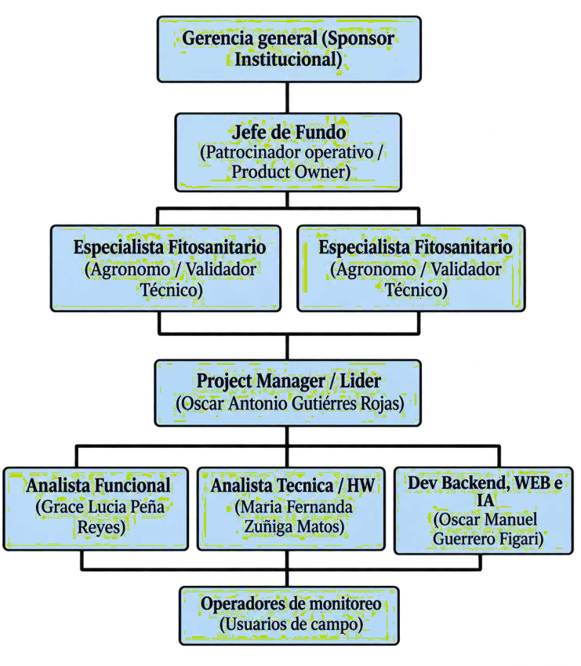

# Anexo 23 (AP-24): Organigrama del Proyecto

<table>
<tr>
<th colspan="6">CONTROL DE VERSIONES</th>
</tr>
<tr>
<td>Versión</td>
<td>Hecha por</td>
<td>Revisada por</td>
<td>Aprobada por</td>
<td>Fecha</td>
<td>Motivo</td>
</tr>
<tr>
<td>1.0</td>
<td>Grace Lucia Peña Reyes</td>
<td>Oscar Antonio Gutiérrez Rojas</td>
<td>Jefe de Fundo (Agrícola Riachuelo S.A.C.)</td>
<td>01/09/2026</td>
<td>Elaboración del Organigrama del Proyecto para definir la estructura de gobernanza y líneas de reporte</td>
</tr>
</table>

## ORGANIGRAMA DEL PROYECTO

| Nombre del Proyecto | Siglas del Proyecto |
|---|---|
| Sistema inteligente para el monitoreo y detección de plagas en cultivos de vid en Agrícola Riachuelo | SIMDPCVAR |

