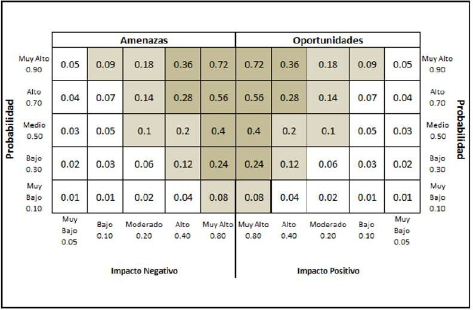

# Anexo 28 (AP-29): Plan de Gestión de Riesgos

<table>
<tr>
<th colspan="6">CONTROL DE VERSIONES</th>
</tr>
<tr>
<td>Versión</td>
<td>Hecha por</td>
<td>Revisada por</td>
<td>Aprobada por</td>
<td>Fecha</td>
<td>Motivo</td>
</tr>
<tr>
<td>1.0</td>
<td>Grace Lucia Peña Reyes</td>
<td>Oscar Antonio Gutiérrez Rojas</td>
<td>Jefe de Fundo (Agrícola Riachuelo S.A.C.)</td>
<td>01/09/2026</td>
<td>Elaboración inicial del Plan de Gestiónde los Riesgos para el proyectoSIMDPCVAR.</td>
</tr>
</table>

## PLAN DE GESTIÓN DE LOS RIESGOS

| Nombre del Proyecto | Siglas del Proyecto |
|---|---|
| Sistema inteligente para el monitoreo y detección de plagas en cultivos de vid en Agrícola Riachuelo | SIMDPCVAR |

**ESTRATEGIA DE RIESGOS: Describir el enfoque general para gestionar los riesgos en el PROYECTO.**

**El proyecto adoptará una estrategia de gestión proactiva e híbrida alineada al PMBOK y Scrum. El enfoque busca identificar, analizar, planificar respuestas y monitorear riesgos técnicos (hardware/software/IA), operativos (resistencia al cambio) y ambientales en campo. Las respuestas a amenazas se enfocarán en mitigar impactos mediante la arquitectura offline-first, la validación experta humana síncrona y la calibración ergonómica. Las oportunidades se orientarán a explotar y escalar la trazabilidad digital.**

<table>
<tr>
<th colspan="4">METODOLOGÍA DE GESTIÓN DE RIESGOS: Definir los enfoques específicos, las herramientas y las fuentes de información que se utilizarán para llevar a cabo la gestión de RIESGOS EN EL PROYECTO.</th>
</tr>
<tr>
<td>Proceso</td>
<td>Descripción</td>
<td>Herramientas</td>
<td>Fuentes de Información</td>
</tr>
<tr>
<td rowspan="3">Planificarla Gestión deRiesgos</td>
<td>Definir el enfoque, herramientas, roles y escalas para gestionar los riesgos del proyecto</td>
<td>Plantilla FGPR_350, Juicio de expertos, Reuniones de planificación.</td>
<td>Acta de Constitución, Plan de Dirección del Proyecto.</td>
</tr>
<tr>
<td></td>
<td></td>
<td></td>
</tr>
<tr>
<td></td>
<td></td>
<td></td>
</tr>
<tr>
<td>Identificar los Riesgos</td>
<td>Determinar qué riesgos (amenazas y oportunidades) pueden afectar al proyecto y documentar sus características.</td>
<td>Tormenta de ideas, Listas de chequeo, Diagrama causa-efecto, RBS</td>
<td>Lecciones aprendidas, mapa del fundo, requisitos funcionales</td>
</tr>
</table>

<table>
<tr>
<th rowspan="2"></th>
<th></th>
<th></th>
<th></th>
</tr>
<tr>
<th></th>
<th></th>
<th></th>
</tr>
<tr>
<td rowspan="3">Realizar el Análisis Cualitativo</td>
<td>Priorizar los riesgos evaluando su probabilidad de ocurrencia e impacto combinado en tiempo, costo y calidad.</td>
<td>Matriz de Probabilidad e Impacto ( 5 × 5 ), Categorización de riesgos.</td>
<td>Registro de riesgos preliminar, Juicio del equipo técnico/agrónomo.</td>
</tr>
<tr>
<td></td>
<td></td>
<td></td>
</tr>
<tr>
<td></td>
<td></td>
<td></td>
</tr>
<tr>
<td rowspan="3">Planificarla Respuesta a los Riesgos</td>
<td></td>
<td></td>
<td></td>
</tr>
<tr>
<td>Desarrollar opciones y acciones para mejorar las oportunidades y reducir las amenazas.</td>
<td>Estrategias de respuesta (Mitigar, Evitar, Aceptar, Explotar), Análisis costo- beneficio</td>
<td>Registro de riesgos cualitativo,Matriz RACI, EDT/WBS.</td>
</tr>
<tr>
<td></td>
<td></td>
<td></td>
</tr>
<tr>
<td rowspan="3">Monitorear los Riesgos</td>
<td>Dar seguimiento a los riesgos identificados, auditar respuestas y detectar nuevos riesgos en cada Sprint.</td>
<td>Bitácora de Impedimentos, Revisiones de Sprint, Auditorías de riesgos.</td>
<td>Informes de avance de Sprint, Burndown Chart, logsdelsistema</td>
</tr>
<tr>
<td></td>
<td></td>
<td></td>
</tr>
<tr>
<td></td>
<td></td>
<td></td>
</tr>
</table>

<table>
<tr>
<th colspan="4">ROLES Y RESPONSABILIDADES DE GESTIÓN DE RIESGOS: Definir las personas para cada proceso del plan de gestión de los riesgos, así como también explicar sus RESPONSABILIDADES.</th>
</tr>
<tr>
<td>Proceso</td>
<td>Roles</td>
<td>Personas</td>
<td>Responsabilidades</td>
</tr>
<tr>
<td rowspan="3">Identificación y Análisis de Riesgos</td>
<td>Project Manager / Equipo Técnico</td>
<td>Oscar Antonio Gutiérrez Rojas, Grace Peña, María Fernanda Zúñiga, Oscar Guerrero</td>
<td>Identificar riesgos técnicos, de hardware, software e IA,y evaluar su matrizprobabilidad-impacto.</td>
</tr>
<tr>
<td></td>
<td></td>
<td></td>
</tr>
<tr>
<td></td>
<td></td>
<td></td>
</tr>
<tr>
<td rowspan="3">Validación de Riesgos Operativos y de Negocio</td>
<td>Product Owner / Especialista Fitosanitario</td>
<td>Jefe de Fundo / Agrónomo</td>
<td>Evaluar la probabilidad e impacto de riesgos en campo (conectividad, usabilidad, falsos positivos).</td>
</tr>
<tr>
<td></td>
<td></td>
<td></td>
</tr>
<tr>
<td></td>
<td></td>
<td></td>
</tr>
</table>

<table>
<tr>
<th rowspan="3">Planificación de RespuestasyControl</th>
<th>Project Manager / Scrum Master</th>
<th>Oscar Antonio Gutiérrez Rojas (Project Manager) / Grace Lucia Peña Reyes (Scrum Master)</th>
<th>Asignar dueños a cada riesgo, monitorear la ejecución de mitigaciones y controlar las reservas.</th>
</tr>
<tr>
<th></th>
<th></th>
<th></th>
</tr>
<tr>
<th></th>
<th></th>
<th></th>
</tr>
<tr>
<td rowspan="3">Aprobación deUsode Contingencias</td>
<td>Sponsor / Jefe de Fundo</td>
<td>Gerencia General / Jefe de Fundo</td>
<td>Autorizar la liberación de la Reserva de Contingencia (S/ 595.00) ante la materialización de un riesgo.</td>
</tr>
<tr>
<td></td>
<td></td>
<td></td>
</tr>
<tr>
<td></td>
<td></td>
<td></td>
</tr>
</table>

<table>
<tr>
<th colspan="8">PRESUPUESTO DE GESTIÓN DE RIESGOS: Estimar sobre la base de los recursos ASIGNADOS, LOS FONDOS NECESARIOS PARA SU INCLUSIÓN EN LA LÍNEA BASE DE COSTOS.</th>
</tr>
<tr>
<td>Proceso</td>
<td colspan="2">Personas</td>
<td colspan="2">Materiales</td>
<td colspan="2">Equipos</td>
<td>Total</td>
</tr>
<tr>
<td rowspan="2">Reserva de Contingencia (Riesgos Conocidos / Mitigaciones de Hardware y Red)</td>
<td>S/ 0.00</td>
<td></td>
<td>S/ 250.00</td>
<td></td>
<td>S/ 345.00</td>
<td></td>
<td>S/ 595.00</td>
</tr>
<tr>
<td></td>
<td></td>
<td></td>
<td></td>
<td></td>
<td></td>
<td></td>
</tr>
<tr>
<td rowspan="2">Reserva de Gestión (Imprevistos Desconocidos / Cambios de Negocio)</td>
<td>S/ 0.00</td>
<td></td>
<td>S/ 100.00</td>
<td></td>
<td>S/ 200.00</td>
<td></td>
<td>S/ 300.00</td>
</tr>
<tr>
<td></td>
<td></td>
<td></td>
<td></td>
<td></td>
<td></td>
<td></td>
</tr>
<tr>
<td rowspan="2">TOTAL PRESUPUESTO DE RIESGOS</td>
<td>S/ 0.00</td>
<td></td>
<td>S/ 350.00</td>
<td></td>
<td>S/ 545.00</td>
<td></td>
<td>S/ 895.00</td>
</tr>
<tr>
<td></td>
<td></td>
<td></td>
<td></td>
<td></td>
<td></td>
<td></td>
</tr>
<tr>
<td colspan="7"></td>
<td></td>
</tr>
</table>

<table>
<tr>
<th colspan="4">PERIODICIDAD DE LA GESTIÓN DE RIESGOS: Definir cuándo y con qué frecuencia se llevarán a cabo los procesos de gestión de riesgos a lo largo del Ciclo de Vida del Proyecto.</th>
</tr>
<tr>
<td>Proceso</td>
<td>Momento de Ejecución</td>
<td>Entregable del EDT</td>
<td>Periodicidad de Ejecución</td>
</tr>
<tr>
<td>Planificar e Identificar Riesgos</td>
<td>Inicio del Proyecto (Sprint 0 / Sprint 1)</td>
<td>1.2 Planificación y gestión del proyecto</td>
<td>Inicial / Revisión al inicio de cada Sprint.</td>
</tr>
<tr>
<td>Análisis Cualitativo y Respuesta</td>
<td>Planificación de cada Sprint</td>
<td>1.2 / 6.14 Gestión de riesgos</td>
<td>Quincenal (durante el Sprint Planning).</td>
</tr>
<tr>
<td>Monitoreo y Bitácora de Impedimentos</td>
<td>Desarrollo de Sprints y Pruebas Piloto</td>
<td>1.3 / 5.1 Controle informe / Piloto</td>
<td>Semanal / En cada Sprint Retrospective.</td>
</tr>
</table>

<table>
<tr>
<th colspan="5">CATEGORÍAS DE RIESGO: Agrupar las causas potenciales de riesgo, mediante una estructura DE DESGLOSE DE RIESGOS (RBS).</th>
</tr>
<tr>
<td rowspan="5"></td>
<td>RBS NIVEL 0</td>
<td>RBS NIVEL 1</td>
<td>RBS NIVEL 2</td>
<td></td>
</tr>
<tr>
<td rowspan="4">0. Todas las Fuentes de Riesgo del Proyecto</td>
<td>1. Riesgo Técnico</td>
<td>1.1 Interfaces Técnicas / Conectividad: Limitada red de internet en sectores del fundo. 1.2 Tecnología e IA: Falsos positivos o baja precisión inicial del modelo YOLO. 1.3 Hardware y Prototipo: Descalibración o inestabilidad del soporte vestible durante marcha.</td>
<td></td>
</tr>
<tr>
<td>2. Riesgo de Gestión</td>
<td>2.1 Dirección de Proyectos: Desviación en el cronograma de los 6 Sprints. 2.2 Dotación de Recursos: Falta de disponibilidad de dispositivos móviles de prueba</td>
<td></td>
</tr>
<tr>
<td>3. Riesgo Comercial</td>
<td>3.1 Operaciones de Campo: Resistencia al cambio por operadores acostumbrados a Excel.</td>
<td></td>
</tr>
<tr>
<td>4. Riesgo Externo</td>
<td>4.1 Ambiental / Clima: Condiciones de luz solar extrema o polvo afectando la calidad de las tomas en campo.</td>
<td></td>
</tr>
</table>

<table>
<tr>
<th colspan="6">TOLERANCIAS DE LOS INTERESADOS</th>
</tr>
<tr>
<td rowspan="5"></td>
<td rowspan="2">Objetivos del Proyecto</td>
<td colspan="3">Nivel de Tolerancia</td>
<td></td>
</tr>
<tr>
<td>Alto</td>
<td>Medio</td>
<td>Bajo</td>
<td></td>
</tr>
<tr>
<td>Tiempo (Cronograma de 12 semanas)</td>
<td></td>
<td></td>
<td>X</td>
<td></td>
</tr>
<tr>
<td>Costo (Presupuesto S/ 6,845.00)</td>
<td></td>
<td>X</td>
<td></td>
<td></td>
</tr>
<tr>
<td>Calidad (Validación fitosanitaria y nitidez)</td>
<td></td>
<td></td>
<td>X</td>
<td></td>
</tr>
<tr>
<td colspan="6"></td>
</tr>
</table>

<table>
<tr>
<th colspan="5">ESCALA DE LA PROBABILIDAD E IMPACTO DE LOS RIESGOS</th>
</tr>
<tr>
<td>ESCALA</td>
<td>PROBABILIDAD</td>
<td colspan="3">Impacto en los Objetivos del Proyecto</td>
</tr>
<tr>
<td></td>
<td></td>
<td>Tiempo</td>
<td>Costo</td>
<td>Calidad</td>
</tr>
<tr>
<td>Muy Alto</td>
<td>&gt;70%</td>
<td>&gt;3 semanas</td>
<td>&gt;S/ 1,000</td>
<td>Falla crítica en sincronización/IA que invalida el piloto</td>
</tr>
<tr>
<td>Alto</td>
<td>51-70%</td>
<td>2 -3 semanas</td>
<td>S/ 500 − S/ 1,000</td>
<td>Retraso o degradación severa en módulos clave (App o Web).</td>
</tr>
<tr>
<td>Medio</td>
<td>31-50%</td>
<td>1-2 semanas</td>
<td>S/ 200 − S/ 500</td>
<td>Falsos positivos de IA manejables por validación humana.</td>
</tr>
<tr>
<td>Bajo</td>
<td>11-30%</td>
<td>3 – 6 días</td>
<td>S/ 50 − S/ 200</td>
<td>Incomodidad leve en el prototipo solucionable con ajustes.</td>
</tr>
<tr>
<td>Muy Bajo</td>
<td>1-10%</td>
<td>&lt; 3 días</td>
<td>&lt; S/ 50</td>
<td>Reajuste menor en la interfaz de la app.</td>
</tr>
<tr>
<td>Nulo</td>
<td>&lt;1%</td>
<td>No cambia</td>
<td>No cambia</td>
<td>Ningún cambio en la funcionalidad</td>
</tr>
</table>

**MATRIZ DE PROBABILIDAD E IMPACTO**

****

<table>
<tr>
<th colspan="5">FORMATOS DE LA GESTIÓN DE RIESGOS: Definir cómo se documentarán, analizarán y COMUNICARÁN LOS RESULTADOS DEL PROCESO DE GESTIÓN DE RIESGOS.</th>
</tr>
<tr>
<td>Formato</td>
<td>Contenido</td>
<td>Proceso en QUE SE GENERA</td>
<td>Responsable DE GENERARL O</td>
<td>Frecuencia o periodicida D</td>
</tr>
<tr>
<td>Registro de Riesgos (Matriz 5x5)</td>
<td>Lista de riesgos, causa raíz, probabilidad, impacto, puntaje y estrategia de respuesta.</td>
<td>Identificació n y Análisis Cualitativ o</td>
<td>Project Manager (Oscar Gutiérre z)</td>
<td>Actualización quincenal en Sprints.</td>
</tr>
<tr>
<td>Bitácora de Impediment os / Incidencias</td>
<td>Bloqueos técnicos activos, fallas de calibración y seguimiento de la mitigación.</td>
<td>Monitorear los Riesgos</td>
<td>Scrum Master</td>
<td>Monitoreo semanal.</td>
</tr>
<tr>
<td>Informede Estado deRiesgos</td>
<td>Resumen de riesgos materializado s, uso de reservas de contingencia y nuevos riesgos.</td>
<td>Monitorear los Riesgos</td>
<td>Project Manager</td>
<td>Quincenal/ Informe a la Jefatura de Fundo.</td>
</tr>
</table>

**SEGUIMIENTO: Definir cómo se registrarán y auditarán los procesos de gestión de riesgos.**

**El seguimiento de los riesgos se ejecutará mediante la revisión continua del Registro de Impedimentos durante las reuniones semanales y la Sprint Retrospective de cada**

**iteración. Si un riesgo identificado supera la puntuación de exposición (Riesgo Alto/Muy Alto en la matriz), el Project Manager convocará una reunión extraordinaria para activar la respuesta planificada y notificar al Jefe de Fundo. Adicionalmente, al cierre de cada fase del proyecto se auditará el estado del fondo de contingencia (S/ 595.00).**
