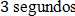
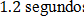
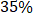

# Anexo 35 (AP-36): Registro de Incidentes

<table>
<tr>
<th colspan="6">CONTROL DE VERSIONES</th>
</tr>
<tr>
<td>Versión</td>
<td>Hecha por</td>
<td>Revisada por</td>
<td>Aprobada por</td>
<td>Fecha</td>
<td>Motivo</td>
</tr>
<tr>
<td>1.0</td>
<td>Grace Lucia Peña Reyes</td>
<td>Oscar Antonio Gutiérrez Rojas</td>
<td>Jefe de Fundo (Agrícola Riachuelo S.A.C.)</td>
<td>03/10/2026</td>
<td>Registro oficial de incidentes técnicos, mecánicos y de arquitectura del proyecto SIMDPCVAR.</td>
</tr>
</table>

## REGISTRO DE INCIDENTES

| Nombre del Proyecto | Siglas del Proyecto |
|---|---|
| Sistema inteligente para el monitoreo y detección de plagas en cultivos de vid en Agrícola Riachuelo | SIMDPCVAR |

| Tipo de Incide nte | Involucr ados y Fecha de Incident E | Descripc ión | Priori dad | Respons ables | Fecha de Soluc ión | Estad o | Solució n Final |
|---|---|---|---|---|---|---|---|
| Incidente Tecnológic o y de Arquitectur a de Software. | Oscar Manuel Guerrero Figari (Desarrollado r), Oscar Antonio Gutiérrez Rojas (PM), Asesor Académico / 18/09/2026. | Se detectaron tiempos de respuesta superiores a los 1.5 s en la devolución de indicios por parte del backend debido a la arquitectura inicial desacoplad a con Spring Boot, colas RabbitMQ y llamadas cruzadas a microservic ios externos.  | Alta | Oscar Manuel Guerrero Figari (Desarrolla dor Backend e IA). | 25/09/2 026. | Solucio nado | Se reformuló la arquitectur a a un backend central unificado en Django (Python). La app móvil y la web se conectan mediante la API REST de Django con JWT, consumien do Supabase para la base de datos PostgreSQ L, Cloudinar y para el almacenam iento de imágenes y un worker de IA de Django con YOLO (ONNX) que toma las tareas de la tabla ai_tasks, sin RabbitMQ ni callback s. La latencia bajó a menos de 1,2 s .  |
| Incidente Mecánic o y de Calidad de Captura | María Fernanda Zúñiga Matos (Hardware), Operadores de | Durante las caminatas de prueba en el viñedo, el balanceo natural del | Alta | María Fernanda Zúñiga Matos (Analista Técnica de Hardware) | 22/09/2 026. | Solucio nado | Se añadieron empaqueta duras de neopreno antivibraci ón a las |
| en Campo | Monitoreo / 15/09/2026. | cuerpo aflojaba las abrazaderas rígidas de la barra horizontal tipo T, generando una tasa del 35 % de fotos descartadas por desenfoque de movimient o.  |  |  |  |  | abrazadera s universales y contratuerc as con arandelas de presión en la barra tipo T. Adicional mente, se ajustó la app móvil en React Native para permitir la repetición exclusiva de la cámara que falló (SC-05) en lugar de cancelar toda la captura. |
| Incidente de Segurida d y Cumplim iento de Reglas de Arquitect ura. | Grace Lucia Peña Reyes (Analista Funcional), Oscar Manuel Guerrero (Desarrollad or) / 28/09/2026. | Se presentó una inconsisten cia donde la app móvil intentaba consultar datos de la base de datos consumien do directament e la SDK de Supabase, eludiendo la capa de negocio y la validación de JWT del backend central. | Media | Oscar Manuel Guerrero Figari. | 30/09/2 026 | Solucio nado | Se aplicó estrictame nte la regla de arquitectur a del proyecto: la app móvil y la web tienen prohibido acceder directamen te a Supabase; las fotos se suben a Cloudinary solo con un ticket firmado por Django . Todas las demás peticiones deben pasar obligatoria mente por la API v1 de Django, donde se validan los tokens JWT, los |
|  |  |  |  |  |  |  | roles del usuario y se registran las URLs seguras desde Cloudinary . |
| Incidente de Hardware y Operación Offline. | Grace Lucia Peña Reyes (Analista Funcional), Operadores de Campo / 01/10/2026. | En zonas del fundo con cobertura vegetal densa, la lectura de coordenadas GPS del móvil perdía precisión o se interrumpía momentánea mente, impidiendo asociar la ubicación exacta a las fotografías guardadas localmente en SQLite. | Media | Grace Lucia Peña Reyes / Oscar Manuel Guerrero. | 02/10/20 26. | Solucio nado | Se implementó la regla de negocio RN-03 en la app móvil React Native: si el GPS no responde, la foto se registra obligatoriam ente con el metadato de localización por marcador físico, número de hilera y sector de campo registrado al iniciar la sesión. Al sincronizar con el backend Django, el mapa en Leaflet proyecta el punto estimado basándose en la hilera correspondi ente sin perder la captura. |
