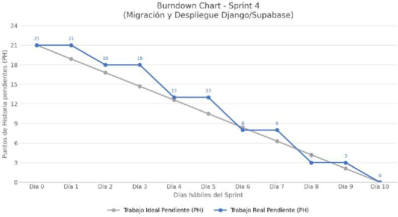

# Anexo 60 (AS-12): Burndown

<table>
<tr>
<th colspan="6">CONTROL DE VERSIONES</th>
</tr>
<tr>
<td>Versión</td>
<td>Hecho por</td>
<td>Revisado por</td>
<td>Aprobado por</td>
<td>Fecha</td>
<td>Motivo</td>
</tr>
<tr>
<td>2.0</td>
<td>Grace Peña / Equip o Scru m</td>
<td>Scrum Master</td>
<td>Product Owner</td>
<td>23/10/2 026</td>
<td>Aprobación del incremento funcional y consolidación de la documentación técnica para la entrega final.</td>
</tr>
</table>

**Código y Nombre del Proyecto**

**SIMDPCVAR – Sistema Inteligente para el Monitoreo y Detección de Plagas en Cultivos de Vid en Agrícola Riachuelo S.A.C.**

<table>
<tr>
<th colspan="3">Datos del Sprint</th>
</tr>
<tr>
<td>Capacidad comprometida</td>
<td>Duración</td>
<td>Periodo</td>
</tr>
<tr>
<td>21 Puntos de Historia (PH)</td>
<td>10 días hábiles (2 semanas)</td>
<td>12/10/2026 al 23/10/2026</td>
</tr>
</table>

***Definición***

El Burndown Chart es la herramienta gráfica que muestra el progreso del trabajo completado y los Puntos de Historia (PH) pendientes a lo largo de los días laborables de cada Sprint (duración de 2 semanas / 10 días hábiles por Sprint).

<table>
<tr>
<th colspan="2">Estructura del Burndown Chart</th>
</tr>
<tr>
<td>Eje horizontal (X)</td>
<td>Días hábiles del Sprint (Día 1 al Día 10).</td>
</tr>
<tr>
<td>Eje vertical (Y)</td>
<td>Puntos de Historia (PH) pendientes de completar.</td>
</tr>
<tr>
<td>Línea ideal</td>
<td>Proyección teórica de avance lineal hacia 0 PH.</td>
</tr>
<tr>
<td>Línea real</td>
<td>Trabajo real pendiente registrado al cierre de cada jornada.</td>
</tr>
</table>

<table>
<tr>
<th colspan="5">Registro Diario - Sprint 4</th>
</tr>
<tr>
<td>Día</td>
<td>Fecha</td>
<td>Ideal (PH)</td>
<td>REAL (PH)</td>
<td>Tareas / Hitos completados en el día</td>
</tr>
<tr>
<td>Día 0</td>
<td>Inicio</td>
<td>21.0</td>
<td>21.0</td>
<td>Asignación y refinamiento del Sprint Backlog.</td>
</tr>
<tr>
<td>Día 1</td>
<td>12/10/2026</td>
<td>18.9</td>
<td>21.0</td>
<td>Configuración inicial del entorno Django y repositorio central.</td>
</tr>
<tr>
<td>Día 2</td>
<td>13/10/2026</td>
<td>16.8</td>
<td>18.0</td>
<td>Creación de endpoints /api/v1 y autenticación JWT con SimpleJWT (Django).</td>
</tr>
<tr>
<td>Día 3</td>
<td>14/10/2026</td>
<td>14.7</td>
<td>18.0</td>
<td>Pruebas de conexión local entre Django y la base de datos cloud.</td>
</tr>
<tr>
<td>Día 4</td>
<td>15/10/2026</td>
<td>12.6</td>
<td>13.0</td>
<td>Completada la integración del backend REST en Django (5 PH completados).</td>
</tr>
<tr>
<td>Día 5</td>
<td>16/10/2026</td>
<td>10.5</td>
<td>13.0</td>
<td>Diseño de vistas en Django Templates con HTMX.</td>
</tr>
<tr>
<td>Día 6</td>
<td>19/10/2026</td>
<td>8.4</td>
<td>8.0</td>
<td>Finalizado el módulo web con mapas interactivos Leaflet (5 PH completados).</td>
</tr>
<tr>
<td>Día 7</td>
<td>20/10/2026</td>
<td>6.3</td>
<td>8.0</td>
<td>Configuración de subida directa a Cloudinary mediante tickets firmados.</td>
</tr>
<tr>
<td>Día 8</td>
<td>21/10/2026</td>
<td>4.2</td>
<td>3.0</td>
<td>Integración del Worker IA consumiendo la tabla ai_tasks (5 PH completados).</td>
</tr>
<tr>
<td>Día 9</td>
<td>22/10/2026</td>
<td>2.1</td>
<td>3.0</td>
<td>Ejecución de pruebas integradas backend-móvil-cloud.</td>
</tr>
<tr>
<td>Día 10</td>
<td>23/10/2026</td>
<td>0.0</td>
<td>0.0</td>
<td>Ajustes finales y cierre exitoso del incremento funcional (3 PH completados).</td>
</tr>
</table>

**Interpretación**

**Durante los primeros cinco días el avance real estuvo por encima de la línea ideal, debido a que las entregas se cerraron en bloques de 5 PH (integración del backend REST) y no de forma diaria. A partir del Día 6, con la finalización del módulo web con mapas Leaflet, el equipo alcanzó la línea ideal y la superó desde el Día 8 con la integración del Worker IA. El Sprint se cerró en el Día 10 con 0 PH pendientes, cumpliendo el 100 % de la capacidad comprometida (21 PH) y entregando el incremento funcional previsto.**
