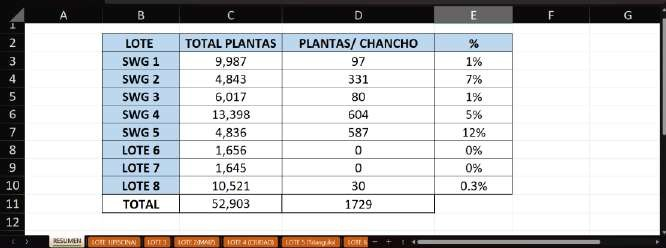
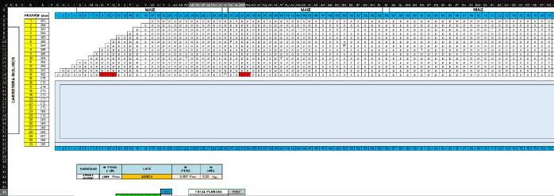
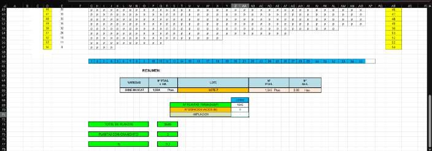
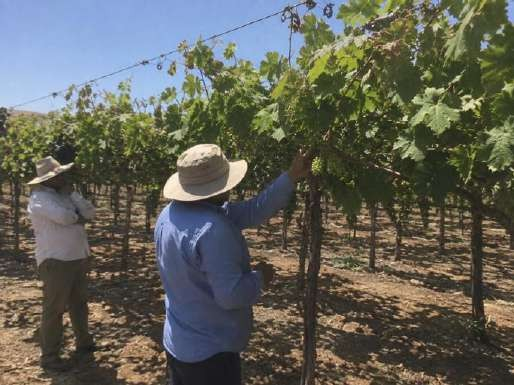

# CAPÍTULO I. PLANTEAMIENTO DE LA INVESTIGACIÓN

## 1.1. Descripción de la organización

Agrícola Riachuelo S.A.C. es una compañía peruana del sector agroexportador y agrícola que se encuentra en el distrito de La Tinguiña, en la provincia y región Ica. Sus instalaciones productivas están situadas a lo largo de la carretera hacia Los Molinos. Su actividad está enfocada principalmente en producir vid para conseguir uva fresca, que se destina a su gestión comercial y también al mercado internacional.

La misma organización también realiza actividades relacionadas con las diferentes etapas de la producción vitivinícola, comenzando en el cultivo y en la cosecha y terminando en la adecuación de la fruta para su posterior venta. Dado que su producción está orientada a la exportación, el valor de la uva es considerado como un elemento importante dentro de sus operaciones agrícolas.

Agrícola Riachuelo tiene una relación empresarial con Sun Fruits Exports S.A. que nace de la unión en 2008 de Agrícola Don Luis y Agrícola Riachuelo, pudiendo así disponer de las condiciones necesarias para la exportación, el empaque y el tratamiento de la producción de uva, lo cual le permitió el acceso a los mercados internacionales y también a los requerimientos comerciales de la producción de dicho tipo.

Por eso, Agrícola Riachuelo S.A.C. se hace evidente que una de sus actividades principales es la producción y agroexportación de uva fresca, en la cual se viene desempeñando y desarrollando en la región, el valle de Ica, destinada a sostener la producción al mercado nacional e internacional.

## 1.2. Contexto empresarial

Gracias a sus condiciones de producción y al empleo de sistemas de riego tecnificado, el departamento de Ica es uno de los principales espacios agroindustriales y agroexportadores del Perú \[1\]. En este contexto, la uva es el cultivo agrícola de mayor relevancia a nivel regional y contribuye con más del 33% del valor bruto de producción agrícola en Ica. Además, la región es el mayor productor del país, con alrededor del 53 % de la producción nacional de uvas \[1\].

Las compañías que se dedican al cultivo de la vid operan dentro de un ambiente productivo enfocado en el mercado interno y también en la agroexportación. En este

ámbito, entre las tareas que son imprescindibles para conservar condiciones apropiadas de manejo agrícola y producción se incluyen el control de la calidad del cultivo y el monitoreo de su condición fitosanitaria \[1\], \[2\].

El chanchito blanco (Planococcus ficus) es un tipo de plaga capaz de afectar a la vid mediante la succión de la savia y la producción de melaza, lo que a su vez genera la emisión de fumagina o negrilla \[2\]. Igualmente, se le ha estudiado a esta especie por la transmisión del virus de enrollamiento de la hoja de la vid (GLRaV-3), lo cual hace que sea objeto de mayor vigilancia en el seguimiento fitosanitario de los viñedos \[3\].

A la par, la viticultura ha estado incorporando instrumentos relacionados con la agricultura de precisión, el registro digital de imágenes y el análisis artificial para respaldar el seguimiento de plagas y enfermedades \[4\]. Estudios recientes también demuestran que se emplean modelos de detección de objetos e imágenes para automatizar en parte la supervisión de insectos en los viñedos \[5\]. Estas tecnologías son parte de un proceso de digitalización destinado a tener información más útil y ordenada para monitorear las condiciones del cultivo.

## 1.3. Situación problemática

En el momento actual, el seguimiento fitosanitario de la vitis en la unidad de investigación se realiza fundamentalmente con recorridos manuales por el campo. Mediante esta actividad, el personal controla las plantas a través de los diversos lotes e hileras, para posteriormente anotar el resultado en matrices de Excel. La investigación realizada de forma paralela al proyecto indica que este procedimiento puede necesitar entre 10 y 20 personas y puede gestionar un gran número de datos, que están distribuidos según la disposición de las plantas.

Los datos que se obtienen durante el trabajo de inspección se administran, fundamentalmente, mediante hojas de cálculo que dejan ver los lotes, las hileras y las posiciones de las plantas. Y si bien esto permite tener un registro mediante el cual se puede llevar un control del monitoreo realizado, el procedimiento se basa, en gran medida, en registrarlo de forma manual y directa del operador de registro. Este aspecto complica que haya un seguimiento estricto de cada hallazgo y que se relacione de inmediato el registro realizado con pruebas visuales y una posición exacta en el campo.

Esta situación adquiere mayor relevancia en el seguimiento del chanchito blanco (Planococcus ficus), debido a que esta plaga presenta un comportamiento que puede dificultar su observación, al localizarse en zonas protegidas de la planta y en racimos, por lo que su vigilancia requiere inspecciones constantes \[2\]. Asimismo, su importancia fitosanitaria aumenta por su participación en la transmisión del virus del enrollamiento de la hoja de la vid (GLRaV-3), cuya propagación en viñedos ha sido relacionada con la presencia de esta especie \[3\].

Por consiguiente, el proceso de monitoreo actual reúne una gran cantidad de datos adquiridos directamente en campo; no obstante, su registro y consulta están mayormente vinculados a hojas de cálculo y procedimientos manuales. Este escenario restringe la posibilidad de acceder de manera inmediata a información ordenada, trazable y con vínculos espaciales con los descubrimientos hechos durante las inspecciones; esta cuestión es importante para el seguimiento fitosanitario de áreas cultivadas que se extienden por varios lotes e hileras.

## 1.4. Identificación del problema

La baja eficiencia y trazabilidad del proceso de control fitosanitario en los cultivos de vid de la organización analizada, que se ubica en Ica, se establece como el problema clave tras llevar a cabo el análisis de la situación actual. En la actualidad dicho procedimiento se basa en la realización de recorridos manuales en el campo y en el anotado posterior de los datos en hojas de cálculo. Lo que impide tener a tiempo una información ordenada y que esté referida directamente a cada hallazgo en el desarrollo de las inspecciones.

El contenido se centra básicamente en el proceso de registro, codificación, seguimiento y localización de los hallazgos fitosanitarios que emergen de la inspección de las filas y las extensiones de la vid. Lo anterior resulta imprescindible para hacer un seguimiento a los fitófagos de plagas tipo chanchito blanco (Planococcus ficus) y, por lo demás, es muy importante poder tener una adecuada trazabilidad de las observaciones que se realizan en el terreno.

## 1.5. Causas del problema

La necesidad de inspección visual manual en las rutas de campo es uno de los factores que contribuyen al problema. La detección de plagas potenciales se lleva a cabo sobre todo a través de la observación directa de las plantas, así que el avance del monitoreo

depende de la intervención y del juicio de los empleados responsables de examinar los distintos lotes e hileras.

De igual forma, el juicio humano es necesario para identificar y registrar los hallazgos, dado que distintas personas pueden participar en las inspecciones de acuerdo a su experiencia, su atención y su capacidad de reconocer los síntomas que se encuentran en las plantas, lo que dificulta encontrar un criterio totalmente unificado a través de todo el proceso de monitoreo.

Otra causa que se puede inferir es el uso de hojas de cálculo y extensas matrices como principal modo de inscripción y organización de una fuente. Para la distribución a gran escala de los datos actualmente, se ha empleado un archivo en el que se distribuyen los datos en lotes, hileras y plantas y con el uso de letras y colores con los que se representan determinados estados. Este tipo de organización de los datos prevé sobre todo la interpretación de los datos, sin prever la inclusión directa de elementos como son las evidencias fotográficas, la localización y el seguimiento de cada hallazgo por separado.

Por último, la inspección visual se hace más complicada debido a las características del chanchito blanco (Planococcus ficus), ya que puede encontrarse en áreas resguardadas de la vid y tener un comportamiento que obstaculiza su observación durante las inspecciones \[2\]. Por lo tanto, el procedimiento actual necesita una cuidadosa revisión de las plantas y depende en gran medida de la habilidad del personal para observar.

## 1.6. Consecuencias del problema

El proceso actual produce, inicialmente, un alto esfuerzo operativo para llevar a cabo el monitoreo fitosanitario. La inspección de grandes superficies de cultivo implica recorrer múltiples lotes e hileras y puede suponer la implicación de entre 10 y 20 trabajadores/as. Esto conlleva un aumento en la cantidad de personas-hora necesarias para llevar a cabo una evaluación y demanda una mayor coordinación del personal durante las jornadas de inspección.

Una de las consecuencias es la dificultad para que haya una trazabilidad homogénea entre los hallazgos. Al utilizar registros manuales y hojas de cálculo de Excel, la información de una planta afectada no siempre queda ligada a una fotografía, a una hora, a un lugar, a un seguimiento posterior. Esto complica poder comparar las observaciones realizadas en

distintas fechas, el revisar el historial de una planta o el comprobar rápidamente si un hallazgo fue objeto de atención o si es necesario realizar una nueva inspección.

Además, la localización específica de una planta puede demandar un tiempo adicional. Los registros actuales permiten identificar hileras y lotes pero no siempre dan un punto de referencia lo suficientemente exacto para ir de inmediato al punto donde se vio una posible plaga. Por tanto, el personal puede requerir hacer nuevos recorridos para la búsqueda de la zona referida, con lo cual la confirmación/revisión/tratamiento del hallazgo podría retrasarse. La especificación del proyecto tiene en cuenta el tiempo de retorno a la planta como una de las métricas a cotejar con el proceso manual.

La dependencia de varios evaluadores y del registro posterior puede también generar variaciones en los datos recolectados, lo que complica la comparación entre lotes, fechas o jornadas de evaluación y la consolidación de resultados. Esto limita la posibilidad de conservar un historial fitosanitario ordenado y disminuye la disponibilidad de información uniforme para identificar las áreas que necesitan más atención.

Por último, Planococcus ficus puede tener relevancia fitosanitaria debido a que contribuye a la difusión del virus de enrollamiento de la hoja de la vid (GLRaV-3) \[3\]; por eso, un seguimiento deficiente o una detección tardía pueden ser decisivos. Por eso, los problemas para registrar, ubicar y hacer un seguimiento apropiado a los hallazgos pueden perjudicar la posibilidad de actuar de manera temprana en áreas que necesitan atención.

## 1.7. Evidencias del problema

El archivo de mapeo que se utiliza actualmente para extrapolar el control del chanchito blanco en las viñas constituye la principal justificación de la evidencia documental; se describe a través de hojas que se consideran los lotes, plantas y hileras y una hoja para la síntesis total, a través de dicha hoja se categoriza la información. En dicha síntesis se reportan 52 903 plantas analizadas de las cuales 1 729 tienen antecedentes de chanchito blanco, lo que supone alrededor del 3,27 % global.

*Figura 1. Resumen general del registro de plantas y presencia de chanchito blanco.*

*Fuente: archivo de mapeo proporcionado por la organización.*

El registro muestra también que no hay una distribución equitativa de la presencia reportada. La cantidad de plantas con chanchito blanco en primer lugar, el lote SWG 5, es de 587, lo que equivale al 12,14 % del total (4 836), mientras que para SWG 2 y SWG 4, los porcentajes se distribuyen en un 6,83 % (331) y un 4,51 % (604), respectivamente. Tal como evidencian estos datos, resulta relevante conocer el número total de descubrimientos registrados, la serie, el lote y la localización de los mismos.

Igualmente, las hojas del archivo contienen extensas matrices para visualizar cada planta de forma independiente, utilizando letras y formatos gráficos para comunicar distintos estados. En algunos ficheros las matrices contienen, incluso más de 400 columnas, lo que refleja la gran cantidad de información a la que hay que prestar atención y revisar manualmente durante el seguimiento fitosanitario.

*Figura 2. Matriz utilizada actualmente para el registro de plantas por lote e hilera.*

*Fuente: archivo de mapeo proporcionado por la organización.*

Se encontraron diferencias durante la revisión del archivo que necesitan ser validadas con la organización. Por ejemplo, en el Lote 7 se identificaron tres celdas destacadas en rojo, pero la hoja resumen no muestra ninguna planta con chanchito blanco. Asimismo,

en el Lote 2 se descubrieron 376 celdas con relleno rojo, en comparación con las 331 plantas mencionadas en el resumen. Como la empresa debe verificar el significado preciso de todos los colores, estos datos no pueden ser considerados errores de forma automática; no obstante, muestran las dificultades que se presentan para confirmar y consolidar información cuando una parte del registro depende de códigos visuales en matrices grandes.

*Figura 3. Ejemplo de codificación visual utilizada en el registro actual del*

**monitoreo.**

*Fuente: archivo de mapeo proporcionado por la organización.*

Otra evidencia corresponde al procedimiento realizado directamente en campo. Según el levantamiento preliminar del proceso, el monitoreo actual puede involucrar entre **10 y 20 personas**, quienes realizan recorridos por los lotes e hileras para inspeccionar las plantas y registrar los hallazgos encontrados. Esta actividad permite comprobar que una parte importante del proceso depende actualmente de la inspección presencial y del trabajo manual de los evaluadores.

*Figura 4. Personal realizando actividades de monitoreo fitosanitario en las hileras*

**de vid.**

*Fuente: fotografía propia, 2026.*

Finalmente, puede agregarse un conjunto de fotos, tomadas durante las inspecciones, que evidencien directamente la presencia del chanchito blanco en los cultivos estudiados. Dichas fotos constituyen un soporte gráfico para los registros de Excel, puesto que atestiguan que las observaciones registradas se corresponden a condiciones observadas en el campo y documentan a la plaga que se trata en la presente actividad de seguimiento.

## 1.8. Formulación del problema

### 1.8.1. Problema general

¿En qué medida la implementación de un sistema tecnológico de monitoreo fitosanitario mejora el desempeño del proceso de monitoreo fitosanitario en los cultivos de vid de Agrícola Riachuelo S.A.C., Ica, 2026?

### 1.8.2. Problemas específicos

- ¿En qué medida la implementación de un sistema tecnológico de monitoreo fitosanitario mejora la eficiencia operativa del proceso de monitoreo fitosanitario en los cultivos de vid de Agrícola Riachuelo S.A.C., Ica, 2026?

- ¿En qué medida la implementación de un sistema tecnológico de monitoreo fitosanitario mejora la efectividad del monitoreo, mediante el registro y la organización de los hallazgos obtenidos durante las inspecciones fitosanitarias de los cultivos de vid de Agrícola Riachuelo S.A.C., Ica, 2026?

- ¿En qué medida la implementación de un sistema tecnológico de monitoreo fitosanitario mejora la trazabilidad y seguimiento de los hallazgos fitosanitarios, considerando su localización desde su detección hasta su posterior revisión o atención en los cultivos de vid de Agrícola Riachuelo S.A.C., Ica, 2026?

## 1.9. Objetivos

### 1.9.1. Objetivo general

Determinar en qué medida la implementación de un sistema tecnológico de monitoreo fitosanitario mejora el desempeño del proceso de monitoreo fitosanitario en los cultivos de vid de Agrícola Riachuelo S.A.C., Ica, 2026.

### 1.9.2. Objetivos específicos

- Determinar en qué medida la implementación de un sistema tecnológico de monitoreo fitosanitario mejora la eficiencia operativa del proceso de monitoreo fitosanitario en los cultivos de vid de Agrícola Riachuelo S.A.C., Ica, 2026.

- Determinar en qué medida la implementación de un sistema tecnológico de monitoreo fitosanitario mejora la efectividad del monitoreo, mediante el registro y organización de los hallazgos obtenidos durante las inspecciones fitosanitarias de los cultivos de vid de Agrícola Riachuelo S.A.C., Ica, 2026.

- Determinar en qué medida la implementación de un sistema tecnológico de monitoreo fitosanitario mejora la trazabilidad y seguimiento de los hallazgos fitosanitarios, considerando su localización desde la detección hasta su posterior revisión o atención en los cultivos de vid de Agrícola Riachuelo S.A.C., Ica, 2026.

## 1.10. Hipótesis

### 1.10.1. Hipótesis general

La implementación de un sistema tecnológico de monitoreo fitosanitario mejora significativamente el desempeño del proceso de monitoreo fitosanitario en los cultivos de vid de Agrícola Riachuelo S.A.C., Ica, 2026.

### 1.10.2. Hipótesis específicas

- La implementación de un sistema tecnológico de monitoreo fitosanitario mejora significativamente la eficiencia operativa del proceso de monitoreo fitosanitario en los cultivos de vid de Agrícola Riachuelo S.A.C., Ica, 2026.

- La implementación de un sistema tecnológico de monitoreo fitosanitario mejora significativamente la efectividad del monitoreo de plagas en los cultivos de vid de Agrícola Riachuelo S.A.C., Ica, 2026.

- La implementación de un sistema tecnológico de monitoreo fitosanitario mejora significativamente la trazabilidad y seguimiento de los hallazgos fitosanitarios en los cultivos de vid de Agrícola Riachuelo S.A.C., Ica, 2026.

## 1.11. Justificación

El cultivo de uva se trata de una actividad que tiene un alto valor para el departamento de Ica, ya que implica una parte importante de la producción del país y tiene una fuerte orientación agroexportadora y agroindustrial \[1\]. En este sentido, el monitoreo

fitosanitario es una actividad fundamental para realizar un seguimiento de las condiciones del cultivo y llevar a cabo a tiempo acciones de manejo cuando hay plagas \[2\].

Entre las plagas asociadas a la vid, el chanchito blanco (*Planococcus ficus*) presenta especial importancia por los daños que puede ocasionar mediante su alimentación y por su capacidad de participar en la transmisión de enfermedades como el virus del enrollamiento de la hoja de la vid (GLRaV-3) \[2\], \[3\]. Por ello, el proyecto se justifica desde una perspectiva práctica por la necesidad de disponer de un proceso de monitoreo que facilite la organización de las inspecciones, el registro de los hallazgos, su ubicación dentro de los lotes e hileras y el seguimiento posterior de la información generada en campo.

Diversos estudios muestran que la captura digital de imágenes, la visión artificial y los modelos de detección de objetos se emplean para ayudar a identificar y monitorear enfermedades y plagas en viñedos desde el campo tecnológico \[4\], \[5\]. Estos antecedentes avalan el hecho de que es apropiado evaluar herramientas tecnológicas que faciliten la complementación de la inspección convencional y la organización digital de la evidencia reunida durante el monitoreo, conservando después la validación de los resultados dentro del proceso fitosanitario.

El proyecto utilizará un diseño preexperimental en lo que respecta a la metodología, con mediciones previas y posteriores a la intervención tecnológica, de acuerdo con el esquema pretest-intervención-postest. Para analizar las modificaciones que se producen después de la implementación de una solución tecnológica, este tipo de diseño se ha utilizado al comparar indicadores previos y posteriores a la aplicación \[6\]. En este proyecto, esta comparación permitirá evaluar los cambios observados en el desempeño del proceso de monitoreo fitosanitario a través de las dimensiones de eficiencia operativa, efectividad del monitoreo y trazabilidad y seguimiento.

Finalmente, el proyecto ofrece la posibilidad de integrar la captura y gestión de información, el procesamiento de imágenes, la inteligencia artificial y los sistemas de información en un contexto agrícola real desde el ámbito de la Ingeniería de Sistemas. Su desarrollo permitirá evaluar de manera objetiva los cambios asociados a la implementación de la intervención tecnológica en el proceso actual de monitoreo

fitosanitario, además de generar conocimiento y experiencias aplicables a futuras mejoras del sistema.

## 1.12. Alcances

El estudio será implementado en Agrícola Riachuelo S.A.C. en la ciudad de Ica, y estará orientado específicamente al proceso de monitoreo fitosanitario de cultivos de vid tomando como primer caso de seguimiento el chanchito blanco (Planococcus ficus). El seguimiento se iniciará sobre base de recorridos y zonas seleccionadas de los lotes e hileras de la organización durante el año 2026.

El alcance funcional comprende el desarrollo de un prototipo tecnológico orientado al monitoreo fitosanitario, capaz de capturar evidencia fotográfica durante los recorridos de campo, asociarla con información contextual y espacial, almacenar los datos localmente cuando exista conectividad limitada y sincronizarlos posteriormente para su procesamiento. La solución incorporará visión artificial para identificar posibles hallazgos fitosanitarios y una plataforma web con mapa y tablero de control para su consulta, revisión, gestión y seguimiento. La ubicación de los hallazgos se establecerá mediante coordenadas geográficas como referencia, complementadas con información del lote, hilera, zona, lado y marcadores de campo. Para la captura bilateral se utilizarán dos teléfonos móviles, mientras que un tercer dispositivo controlará la sesión de monitoreo.

El proyecto comparará el proceso habitual de monitoreo con el proceso apoyado por la intervención tecnológica mediante un diseño preexperimental de grupo único con mediciones de pretest y postest. La evaluación estará orientada a determinar los cambios observados en el desempeño del proceso de monitoreo fitosanitario, considerando las dimensiones de eficiencia operativa, efectividad del monitoreo y trazabilidad y seguimiento. Los resultados obtenidos corresponderán al contexto y a las condiciones del piloto realizado en Agrícola Riachuelo S.A.C., por lo que servirán como base para valorar posteriormente la posibilidad de ampliar la solución a otros lotes, plagas o contextos de aplicación.

## 1.13. Limitaciones

Los resultados y evaluaciones del presente estudio estarán delimitados al contexto de Agrícola Riachuelo S.A.C., Ica, durante el año 2026, considerando los lotes e hileras

seleccionados para la etapa de prueba. Por ello, el desempeño obtenido no podrá generalizarse automáticamente a otros viñedos o empresas agrícolas, ya que las condiciones de cultivo y del entorno pueden variar y afectar el comportamiento de las tecnologías de monitoreo y visión artificial \[4\].

En el campo fitosanitario, la evaluación se restringirá a los individuos o signos que puedan observarse en las imágenes obtenidas. La plaga puede encontrarse en áreas protegidas de la vid, como debajo de la corteza o dentro de los racimos, lo que hace difícil su detección directa \[2\]. Esto es cierto para el chanchito blanco (Planococcus ficus). Por lo tanto, el sistema no será capaz de detectar ejemplares que se mantengan escondidos o fuera del alcance visual de las cámaras.

La captura de imágenes es también dependiente de elementos como: la distancia de captura, las sombras, el movimiento, obstáculos parciales tales como hojas o racimos, la complejidad del fondo o las variaciones en la iluminación que además de afectar a la calidad de las imágenes adquiridas en campo, dificultan la identificación automática de los insectos y el funcionamiento de los modelos de detección \[5\], \[7\].

En relación con la ubicación, las coordenadas obtenidas a través de teléfonos servirán como referencia geográfica, aunque no serán suficientes por sí mismas para determinar con precisión una planta individual. Por eso, el proyecto añadirá a la ubicación información del lote, la hilera, la zona, el lado y los marcadores físicos. Además, la sincronización con los servicios en la nube y el procesamiento central de las imágenes necesitarán posteriormente una buena conexión a Internet, aunque las actividades de captura y almacenamiento podrán seguir cuando haya poca o ninguna señal.

El rendimiento de los modelos de inteligencia artificial estará condicionado por la cantidad, calidad y diversidad de las imágenes utilizadas para entrenamiento y validación \[5\]. También podrán producirse falsos positivos y falsos negativos ante objetos pequeños, similitudes visuales entre especies, diferentes condiciones del entorno o variaciones en las características de las plagas, aspectos que continúan representando retos para los modelos de detección agrícola \[8\], \[9\].

En última instancia, el proyecto consiste en crear y evaluar un prototipo tecnológico en su fase piloto. Por esta razón, no se sugiere reemplazar por completo al personal agronómico ni asumir que un hallazgo hecho por inteligencia artificial es igual a un

diagnóstico final. Se debe revisar y validar los hallazgos antes de decidir qué acciones fitosanitarias se deben tomar.
