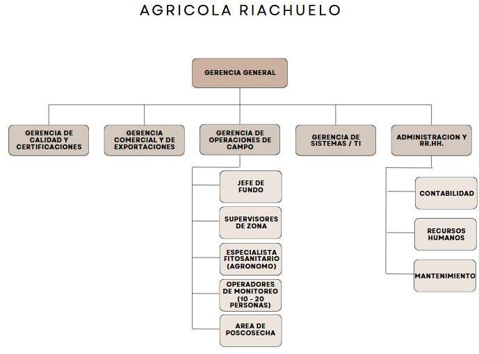
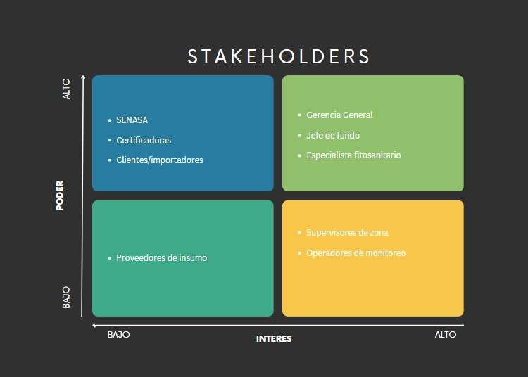
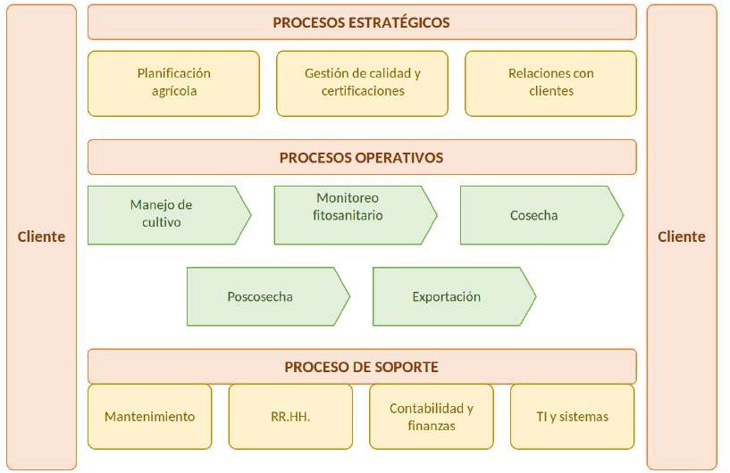
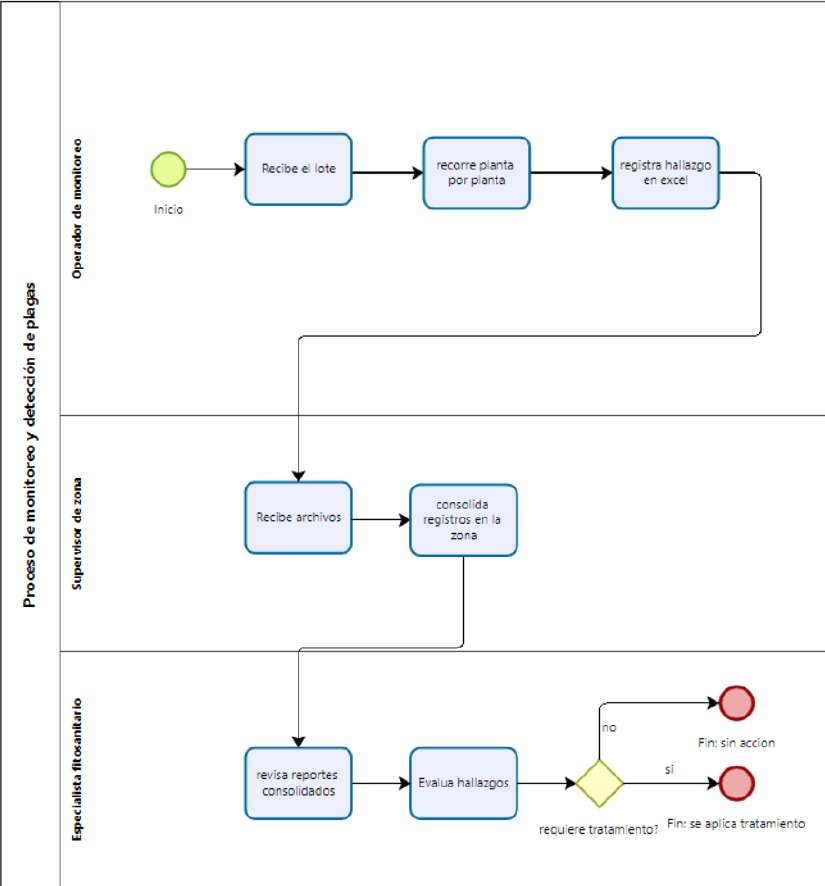
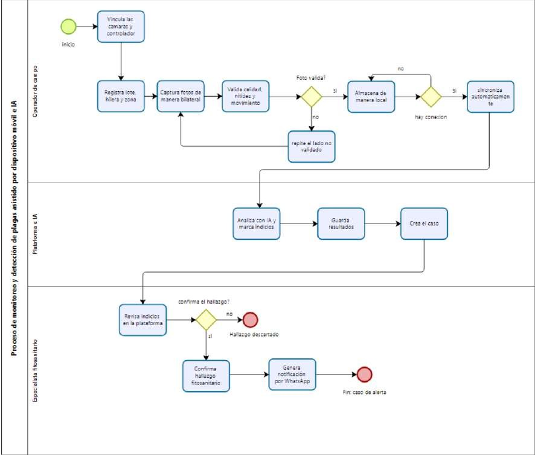

# CAPÍTULO IV. ANÁLISIS EMPRESARIAL

## 4.1. Organización

Agrícola Riachuelo es una empresa agrícola peruana que se dedica al cultivo y exportación de la uva de mesa, con operaciones de campo en la región de Ica. Maneja un fundo de gran escala el cual está orientado a mercados de exportación con estándares altos fitosanitarios y de trazabilidad.

## 4.2. Misión y visión

Su misión es producir y exportar uva de alta calidad, garantizando la sanidad del cultivo y la trazabilidad de los procesos por medio de prácticas agrícolas eficientes, además del responsable uso de tecnología.

Su visión es ser una destacada empresa agroexportadora en la región por la calidad de sus uvas y por la aplicación de la innovación tecnológica en el manejo fitosanitario de los cultivos.

## 4.3. Objetivos empresariales

Sus objetivos empresariales son:

- Cumplir con los estándares fitosanitarios que exigen los mercados de exportación

- Optimizar el uso de mano de obra en las labores de monitoreo de campo

- Reducir el riesgo de impacto de plagas mediante la detección temprana de indicios de Planococcus ficus

- Mejorar el tiempo de respuesta frente a hallazgos fitosanitarios

- Digitalizar y ver que la información sea trazable al generarse en el campo

## 4.4. Organigrama

*Figura 5. Organigrama de Agrícola Riachuelo S.A.C.*

*Fuente: Elaboración propia a partir de información proporcionada por Agrícola Riachuelo S.A.C.*

## 4.5. Stakeholders

*Figura 6. Matriz de poder e interés de los stakeholders de Agrícola Riachuelo S.A.C.*

*Fuente: Elaboración propia.*

- Gerente General

*Tabla 11. Análisis de stakeholders según rol, interés y poder (Gerente General)*

| FICHA DE STAKEHOLDERS | N.° 01 |
|---|---|
| IDENTIFICACIÓN | STK-01 · Interno · Sponsor del proyecto |
| NOMBRE | Dulio Gonzales Calderón / César Yañez |
| CARGO / PUESTO | Gerente de Producción / Gerente Administrativo |
| ÁREA | Gerencia General |
| DESCRIPCIÓN | Máxima autoridad de la empresa, a cargo de dos gerentes. Aprueba el presupuesto y las inversiones, incluida la del SIMDPCVAR. |
| ACTIVIDADES | Dirige a las gerencias de la empresa, aprueba presupuestos e inversiones y fija las metas de exportación y rentabilidad. |
| INTERÉS | Alto. Reducir los costos operativos del monitoreo y mejorar la rentabilidad gracias a la tecnología. |
| NECESIDADES | Conocer el retorno esperado, el costo y los avances del piloto para decidir la implementación a nivel institucional. |
| EXPECTATIVAS | Que el piloto demuestre ahorro de horas-persona y mejor cobertura frente al proceso en Excel, sin arriesgar las certificaciones de exportación. |
| INFLUENCIAS | Fuerte. Poder alto: decide si el proyecto se aprueba, se financia y se implementa a nivel institucional. |
| IMPACTO RECIBIDO | Menos horas-persona en el recorrido de más de 52 900 plantas y datos fitosanitarios centralizados para decidir. |
| IMPACTO GENERADO | Muy alto. Su aprobación del presupuesto y de la implementación define si la solución continúa después del piloto. |
| PARTICIPACIÓN | Sponsor, con mayor interés en el inicio y el cierre; postura de apoyo. Recibe informes de estado al término de cada fase crítica. |
| ESTRATEGIA | Gestionar de cerca (alto poder, alto interés). Informar periódicamente sobre el retorno esperado y los avances del piloto. |

*Fuente: Elaboración propia.*

- Jefe de fundo

*Tabla 12. Análisis de stakeholders según rol, interés y poder (jefe de fundo)*

| FICHA DE STAKEHOLDERS | N.° 02 |
|---|---|
| IDENTIFICACIÓN | STK-02 · Interno · Patrocinador operativo / gerente funcional |
| NOMBRE | Pedro Jesús Palacios Chanco |
| CARGO / PUESTO | Jefe de Fundo |
| ÁREA | Gerencia de Operaciones de Campo |
| DESCRIPCIÓN | Responsable de la operación del campo y de coordinar al personal de monitoreo. Firmó el acta de constitución como patrocinador operativo del piloto. |
| ACTIVIDADES | Planifica las labores diarias del viñedo, gestiona al personal operativo y coordina el tratamiento de los focos de plaga. |
| INTERÉS | Alto. Que el nuevo sistema mejore el trabajo de campo sin afectar la producción. |
| NECESIDADES | Ubicar con exactitud la planta con hallazgo, pues el GPS actual no distingue hileras cercanas, y enterarse a tiempo para actuar. |
| EXPECTATIVAS | Que el piloto no interrumpa las labores diarias y que los focos confirmados se ubiquen y traten más rápido. |
| INFLUENCIAS | Fuerte. Poder alto: define cómo se ejecutan las labores diarias y gestiona al personal operativo. |
| IMPACTO RECIBIDO | Recibe avisos por Telegram (SC-02) de cada hallazgo confirmado y consulta los casos en el mapa del viñedo de la plataforma web. |
| IMPACTO GENERADO | Muy alto. Organiza al personal y las rutas; sin su apoyo no se puede ejecutar el piloto en campo. |
| PARTICIPACIÓN | Patrocinador operativo y gerente funcional durante todo el proyecto; postura de apoyo. Participa en las revisiones de avance quincenales. |
| ESTRATEGIA | Gestionar de cerca. Involucrarlo en la planificación del piloto y en la capacitación de los operadores. |

*Fuente: Elaboración propia.*

- Especialista fitosanitario

*Tabla 13. Análisis de stakeholders según rol, interés y poder (Especialista fitosanitario)*

| FICHA DE STAKEHOLDERS | N.° 03 |
|---|---|
| IDENTIFICACIÓN | STK-03 · Interno · Validador técnico |
| NOMBRE | Max Daniel Gutiérrez Huamán |
| CARGO / PUESTO | Especialista fitosanitario (ingeniero agrónomo) |
| ÁREA | Gerencia de Operaciones de Campo |
| DESCRIPCIÓN | Agrónomo encargado de validar los hallazgos de plagas. Su confirmación es obligatoria para todo hallazgo. |
| ACTIVIDADES | Revisa los indicios de Planococcus ficus reportados, confirma o descarta cada caso e indica el tratamiento. |
| INTERÉS | Alto. Contar con evidencia fotográfica confiable que agilice y respalde su diagnóstico. |
| NECESIDADES | Fotos nítidas con lote, hilera, zona y lado para revisar un caso sin volver al campo, más el historial de observaciones. |
| EXPECTATIVAS | Que la IA señale indicios con precisión aceptable y que la decisión final sobre cada hallazgo siga siendo suya. |
| INFLUENCIAS | Fuerte. Poder alto: sin su validación ningún hallazgo de la IA queda validado en forma definitiva (los casos «Confirmado por IA» se avisan marcados como pendientes de su revisión, SC-03). |
| IMPACTO RECIBIDO | Valida en la plataforma web los casos que señala la IA, sin esperar a que se consolide el Excel. |
| IMPACTO GENERADO | Muy alto. Define los criterios de aceptación del modelo de IA y su validación controla los falsos positivos. |
| PARTICIPACIÓN | Validador técnico durante todo el proyecto; postura de apoyo. Aporta requisitos en entrevistas y valida en cada Sprint Review. |
| ESTRATEGIA | Gestionar de cerca. Validar junto a él los criterios de aceptación del modelo de IA en cada Sprint Review. |

*Fuente: Elaboración propia.*

- Supervisores de zona

*Tabla 14. Análisis de stakeholders según rol, interés y poder (Supervisores de zona)*

| FICHA DE STAKEHOLDERS | N.° 04 |
|---|---|
| IDENTIFICACIÓN | STK-04 · Interno · Usuarios / coordinadores |
| NOMBRE | Miguel Ángel Aparcana Ramos (representante de los supervisores) |
| CARGO / PUESTO | Supervisor de zona |
| ÁREA | Gerencia de Operaciones de Campo |
| DESCRIPCIÓN | Coordinan a los operadores de monitoreo dentro de su zona asignada del fundo. |
| ACTIVIDADES | Asignan rutas de recorrido, controlan el avance diario y dan seguimiento a los casos detectados en su zona. |
| INTERÉS | Alto. Que el sistema facilite la asignación de rutas y el seguimiento de casos detectados. |
| NECESIDADES | Ver el estado de cada caso de su zona y recibir avisos oportunos para organizar la atención de las plantas afectadas. |
| EXPECTATIVAS | Saber en todo momento qué casos de su zona están pendientes, validados o atendidos. |
| INFLUENCIAS | Baja. Poder bajo: no deciden la implementación, pero su labor depende directamente del sistema. |
| IMPACTO RECIBIDO | Reciben por Telegram (SC-02) los hallazgos confirmados de su zona y siguen cada caso en el panel de la plataforma. |
| IMPACTO GENERADO | Alto. Organizan a los operadores durante el piloto; una mala asignación de rutas reduce la cobertura del monitoreo. |
| PARTICIPACIÓN | Usuarios y coordinadores en el piloto en campo (Sprint 6, del 09/11 al 20/11/2026); postura de apoyo. |
| ESTRATEGIA | Mantener informados (bajo poder, alto interés). Explicarles el funcionamiento del panel de casos de la plataforma. |

*Fuente: Elaboración propia.*

- Operadores de monitoreo

*Tabla 15. Análisis de stakeholders según rol, interés y poder (Operadores de monitoreo)*

| FICHA DE STAKEHOLDERS | N.° 05 |
|---|---|
| IDENTIFICACIÓN | STK-05 · Interno · Usuarios directos del prototipo |
| NOMBRE | Rosa Elena Yataco Huamán (representante de los operadores) |
| CARGO / PUESTO | Operadora de monitoreo |
| ÁREA | Gerencia de Operaciones de Campo (equipo de 10 a 20 operadores) |
| DESCRIPCIÓN | Recorren el viñedo planta por planta y registran sus observaciones en un Excel compartido. |
| ACTIVIDADES | Inspeccionan a simple vista más de 52 900 plantas, anotan los indicios de plaga y digitan sus registros. |
| INTERÉS | Alto. Que el equipo sea cómodo, funcional y no aumente su carga de trabajo. |
| NECESIDADES | Un prototipo ligero y ergonómico, capacitación práctica previa y una app que funcione sin internet en sectores alejados. |
| EXPECTATIVAS | Hacer el recorrido con menos esfuerzo físico y menos errores de digitación que con el registro en Excel. |
| INFLUENCIAS | Baja. Poder bajo: no tienen poder de decisión, pero son los usuarios directos de la solución. |
| IMPACTO RECIBIDO | Pasan del registro manual a la captura con el soporte tipo T de tres celulares; si una foto sale mal, solo se repite la de la cámara que falló (SC-05). |
| IMPACTO GENERADO | Alto. Su adopción define la calidad de las fotos y el éxito del piloto; la resistencia al cambio es un riesgo identificado. |
| PARTICIPACIÓN | Usuarios directos en el piloto en campo; postura neutral. Aportan requisitos en entrevistas y prueban el prototipo. |
| ESTRATEGIA | Mantener informados. Brindar capacitación práctica previa al piloto y recoger su retroalimentación. |

*Fuente: Elaboración propia.*

- SENASA

*Tabla 16. Análisis de stakeholders según rol, interés y poder (SENASA)*

| FICHA DE STAKEHOLDERS | N.° 06 |
|---|---|
| IDENTIFICACIÓN | STK-06 · Externo · Regulador |
| NOMBRE | Ing. César Augusto Uchuya Pecho |
| CARGO / PUESTO | Inspector de sanidad vegetal |
| ÁREA | SENASA – Dirección Ejecutiva Ica |
| DESCRIPCIÓN | Entidad reguladora fitosanitaria del Estado peruano. Vigila que la producción cumpla la normativa para exportar. |
| ACTIVIDADES | Inspecciona predios y envíos, emite la certificación fitosanitaria de exportación y exige correctivos ante incumplimientos. |
| INTERÉS | Bajo sobre el proyecto. Que la empresa cumpla la normativa fitosanitaria vigente para la exportación. |
| NECESIDADES | Registros verificables de la presencia y el control de plagas en cada lote del fundo. |
| EXPECTATIVAS | Que el fundo detecte y controle a tiempo plagas como Planococcus ficus y lo demuestre con registros. |
| INFLUENCIAS | Fuerte. Poder alto: sanciona, exige correctivos o restringe la exportación si no se siguen las normas. |
| IMPACTO RECIBIDO | Podrá revisar hallazgos con foto, ubicación y estado de validación, en lugar de un Excel manual sin evidencia. |
| IMPACTO GENERADO | Alto. Sus exigencias de trazabilidad definen qué datos debe registrar y conservar la plataforma. |
| PARTICIPACIÓN | Regulador externo, con mayor interés en el cierre y la certificación; postura neutral. No participa en el piloto. |
| ESTRATEGIA | Mantener satisfecho (alto poder, bajo interés). Documentar la trazabilidad generada por la plataforma para futuras auditorías. |

*Fuente: Elaboración propia.*

- Certificadoras (GlobalG.A.P.)

*Tabla 17. Análisis de stakeholders según rol, interés y poder (Certificadoras)*

| FICHA DE STAKEHOLDERS | N.° 07 |
|---|---|
| IDENTIFICACIÓN | STK-07 · Externo · Auditor de estándares |
| NOMBRE | Ing. Patricia Milagros Hernández Quintanilla |
| CARGO / PUESTO | Auditora líder de buenas prácticas agrícolas |
| ÁREA | Organismo certificador GlobalG.A.P. |
| DESCRIPCIÓN | Organismos que certifican las buenas prácticas agrícolas exigidas por ciertos mercados de exportación. |
| ACTIVIDADES | Auditan la trazabilidad y el control de plagas del fundo y otorgan, renuevan o retiran la certificación. |
| INTERÉS | Bajo sobre el proyecto. Verificar trazabilidad y control de plagas conforme al estándar de certificación. |
| NECESIDADES | Evidencia ordenada y consultable de monitoreos, hallazgos y acciones correctivas por lote. |
| EXPECTATIVAS | Encontrar en la auditoría un historial completo y coherente, sin inconsistencias como las del Excel actual. |
| INFLUENCIAS | Fuerte. Poder alto: otorgan o retiran la certificación para exportar a ciertos mercados. |
| IMPACTO RECIBIDO | Dispondrán de un historial digital de casos validados que facilita verificar el control de plagas. |
| IMPACTO GENERADO | Alto. Los requisitos del estándar orientan qué registros e historial debe conservar el sistema. |
| PARTICIPACIÓN | Auditor externo, con mayor interés en el cierre y la certificación; postura neutral. No participa en el piloto. |
| ESTRATEGIA | Mantener satisfechos. Documentar la trazabilidad de la plataforma para futuras auditorías, junto con la Gerencia de Calidad y Certificaciones. |

*Fuente: Elaboración propia.*

- Clientes / importadores

*Tabla 18. Análisis de stakeholders según rol, interés y poder (Clientes/importadores)*

| FICHA DE STAKEHOLDERS | N.° 08 |
|---|---|
| IDENTIFICACIÓN | STK-08 · Externo · Cliente final indirecto |
| NOMBRE | Michael J. Turner (representante del importador) |
| CARGO / PUESTO | Gerente de Compras y Calidad |
| ÁREA | Compras y calidad de una empresa importadora de uva |
| DESCRIPCIÓN | Compradores internacionales de la uva que produce y exporta el fundo. |
| ACTIVIDADES | Negocian volúmenes, fijan requisitos de calidad e inspeccionan los lotes que reciben en destino. |
| INTERÉS | Bajo sobre el proyecto. Recibir producto de calidad, libre de plagas y con trazabilidad demostrable. |
| NECESIDADES | Garantía de fruta libre de plagas, respaldada por registros fitosanitarios verificables. |
| EXPECTATIVAS | Lotes sin rechazos por plagas en destino y registros que respalden su origen. |
| INFLUENCIAS | Fuerte. Poder alto: pueden cambiar de proveedor si la calidad no cumple sus exigencias. |
| IMPACTO RECIBIDO | Reciben fruta con menor riesgo de plaga y con mejor respaldo de trazabilidad. |
| IMPACTO GENERADO | Alto. No intervienen en el piloto, pero sus exigencias de calidad justifican la inversión en el sistema. |
| PARTICIPACIÓN | Cliente final indirecto, con mayor interés en el cierre; postura de apoyo. Sin involucramiento directo. |
| ESTRATEGIA | Mantener satisfechos. Comunicar los resultados del piloto como mejora en la calidad exportable, vía la Gerencia Comercial y de Exportaciones. |

*Fuente: Elaboración propia.*

- Proveedores de insumos

*Tabla 19. Análisis de stakeholders según rol, interés y poder (Proveedores de insumos)*

| FICHA DE STAKEHOLDERS | N.° 09 |
|---|---|
| IDENTIFICACIÓN | STK-09 · Externo · Proveedor externo al sistema |
| NOMBRE | Juan Carlos Magallanes Cartagena (representante de ventas) |
| CARGO / PUESTO | Ejecutivo de ventas agrícolas |
| ÁREA | Distribuidora de insumos agrícolas, proveedor habitual del fundo |
| DESCRIPCIÓN | Proveedores que venden fertilizantes, pesticidas y otros insumos agrícolas al fundo. |
| ACTIVIDADES | Atienden pedidos, coordinan entregas y asesoran comercialmente sobre sus productos. |
| INTERÉS | Bajo. Mantener su relación comercial habitual de venta de insumos. |
| NECESIDADES | Continuidad de los pedidos y de las condiciones comerciales actuales. |
| EXPECTATIVAS | Mantener su relación comercial habitual, sin verse afectados. |
| INFLUENCIAS | Baja. Poder bajo: su vínculo es ajeno al sistema de monitoreo. |
| IMPACTO RECIBIDO | Ninguno directo: no participan ni se ven afectados por el sistema. |
| IMPACTO GENERADO | Bajo. No intervienen en el desarrollo ni en el piloto. |
| PARTICIPACIÓN | Proveedor externo al sistema, sin fase de mayor interés; postura neutral. |
| ESTRATEGIA | Monitorear (bajo poder, bajo interés). No requieren estrategia específica; solo vigilar que no se vean afectados. |

*Fuente: Elaboración propia.*

## 4.6. Mapa de procesos

*Figura 7. Mapa de procesos de Agrícola Riachuelo S.A.C.*

*Fuente: Elaboración propia.*

## 4.7. Proceso crítico

Dentro del mapa de procesos de Agrícola Riachuelo, el proceso crítico identificado es el monitoreo y detección de plagas (Planococcus ficus), que forma parte de los procesos operativos de la empresa.

Se considera crítico porque:

- Es el proceso que asegura la sanidad del cultivo, condición indispensable para mantener las certificaciones de exportación (SENASA, GlobalG.A.P.).

- Actualmente depende de 10 a 20 personas que recorren manualmente el viñedo (más de 52 900 plantas) y registran sus observaciones en un archivo Excel de 12 hojas y más de 400 columnas, donde ya se han detectado inconsistencias entre las celdas marcadas y los totales del resumen.

- Cualquier falla en este proceso (detección tardía o registro incorrecto) impacta directamente en la producción exportable y en el cumplimiento fitosanitario de la empresa.

## 4.8. Modelo AS-IS

** 8. Modelo AS-IS del proceso de monitoreo y detección de plagas en Agrícola Riachuelo S.A.C.**

*Fuente: Elaboración propia.*

## 4.9. Análisis del AS-IS

En el modelo AS -IS se pueden identificar varios puntos que afectan la eficiencia del proceso de monitoreo y detección de plagas. En primer lugar, el proceso presenta una alta dependencia de mano de obra, ya que requiere entre 10 y 20 personas recorriendo simultáneamente el viñedo para cubrir las más de 52 900 plantas registradas, lo que representa un costo constante en horas-persona.

Asimismo, el registro de los hallazgos es propenso a errores humanos, pues depende completamente del criterio visual de cada operador y de su digitación manual en un archivo Excel. A ello se suma que la consolidación de la información resulta compleja y poco escalable, ya que el archivo maestro llega a tener 12 hojas y más de 400 columnas, diferenciando zonas mediante colores, letras y nombres similares; si bien este esquema facilita la lectura visual, dificulta considerablemente la automatización y verificación de los datos.

Otro aspecto crítico es que al no existir respaldo fotográfico ni de otro tipo sobre los hallazgos reportados, el especialista fitosanitario no cuenta con manera de comprobar un caso señalado días antes sin regresar físicamente al campo. A esto se añade la imprecisión en la ubicación de los hallazgos, puesto que el GPS utilizado no distingue con suficiente exactitud entre plantas de hileras cercanas, lo que retrasa o dificulta volver al punto exacto donde se detectó un indicio de plaga. Finalmente, la validación por parte del especialista ocurre en un momento posterior a la consolidación de los datos, es decir, no en el instante del hallazgo, lo que retrasa la aplicación oportuna del tratamiento correspondiente.

Estos hallazgos evidencian que, si bien el proceso actual cumple su función, su dependencia total de registros manuales lo convierte en un proceso lento y vulnerable a errores.

## 4.10. Problemas y oportunidades

*Tabla 20. Problemas identificados y oportunidades de mejora del proceso actual*

| PROBLEMA | OPORTUNIDADES |
|---|---|
| Registro manual propenso a error humano | Realizar capturas automáticas para registrar los datos de manera más precisa |
| No hay evidencia clara o trazable del trabajo | Imágenes con ubicación aproximada por lote o planta |
| El GPS impreciso entre hileras | Marcadores y secuencia de captura para ubicación georreferenciada y respaldada por marcadores físicos de tramo |
| La consolidación en Excel es lenta | Sincronización automática hacia una plataforma centralizada |
| No hay alertas que detecten a tiempo | Notificaciones automáticas para respuesta más rápida |

*Fuente: Elaboración propia.*

## 4.11. Propuesta de mejora

Con base en las oportunidades identificadas en el punto anterior, se propone un prototipo de soporte portátil/ergonómico que apoya el recorrido de monitoreo en campo, sin eliminar la validación final de un especialista fitosanitario. La propuesta busca automatizar la captura de evidencia y su ubicación aproximada, manteniendo el criterio humano como parte indispensable del proceso de decisión.

La solución consiste en un operador que porta un soporte tipo T con tres celulares: dos cámaras (Cámara 1 y Cámara 2) que fotografían a la vez el mismo punto de la misma cara de la hilera (doble evidencia) y un controlador que gestiona la sesión, los cambios de zona y las repeticiones necesarias; cada hilera se recorre por sus dos lados, con la pasada «lateral A» (ida) y la pasada «lateral B» (vuelta) (SC-04). Cada cámara verifica automáticamente la nitidez, la exposición y la ausencia de movimiento en la toma; en caso de que una fotografía no cumpla estos criterios, únicamente se repite la captura de la cámara que falló, con un máximo de 2 intentos (en el último la foto se acepta y se marca para revisión técnica) (SC-05), sin necesidad de reiniciar todo el recorrido. Dado que el trabajo de campo no siempre cuenta con conexión a internet estable, las imágenes se almacenan localmente en el dispositivo y se sincronizan de forma automática cuando la señal se recupera.

Cada fotografía capturada queda asociada a un conjunto de datos que permite su ubicación aproximada dentro del viñedo: lote, hilera, zona, lado, marcador, secuencia y coordenadas GPS. Una vez sincronizada la información, un modelo de inteligencia artificial analiza las imágenes y señala posibles indicios visibles de plaga; sin embargo, es el especialista fitosanitario quien finalmente confirma o descarta cada hallazgo, preservando así su rol de validación dentro del proceso. Los casos confirmados, junto con la evidencia fotográfica y su ubicación, se centralizan en una plataforma web que permite visualizar el mapa del viñedo, los casos detectados y el estado de revisión de los hallazgos e historial de observaciones, mientras que las alertas de mayor relevancia se envían mediante Telegram (SC-02) para asegurar una respuesta oportuna.

Es importante precisar que esta propuesta no tiene como finalidad detectar plagas ocultas ni reemplazar por completo la labor del especialista fitosanitario, sino reducir las horas-persona invertidas en el recorrido manual, conservar evidencia trazable de cada hallazgo, mejorar la cobertura del monitoreo y facilitar la localización y el tratamiento oportuno de las plantas sospechosas.

## 4.12. Modelo TO-BE

*Figura 9. Modelo TO-BE del proceso de monitoreo y detección de plagas en Agrícola Riachuelo S.A.C.*

*Fuente: Elaboración propia.*

## 4.13. Comparación AS-IS / TO-BE

Una vez descritos ambos modelos, se compara el proceso actual de monitoreo fitosanitario con la propuesta planteada, con el fin de evidenciar los cambios concretos que introduce la solución tecnológica en cada etapa del proceso.

En el modelo AS-IS, el monitoreo depende completamente de la observación visual y el registro manual de entre 10 y 20 operadores, cuya información se consolida en un archivo Excel de gran tamaño, sin evidencia fotográfica ni ubicación precisa de los hallazgos y la validación del especialista es luego de la consolidación, lo que retrasa la respuesta ante una posible plaga. En contraste, el modelo TO-BE automatiza la captura de evidencia mediante un dispositivo móvil que valida la calidad de cada fotografía al instante, la asocia a una ubicación aproximada dentro del viñedo y la sincroniza automáticamente hacia una plataforma, donde un modelo de inteligencia artificial identifica posibles indicios antes de que el especialista realice su validación. Asimismo, mientras que en el proceso actual no existen alertas de ningún tipo, el modelo propuesto notifica de forma

inmediata y automática, vía Telegram (SC-02), al jefe de fundo y al supervisor de zona cuando el especialista confirma un hallazgo en la plataforma o cuando la IA lo marca como «Confirmado por IA» (en ese caso el aviso indica que falta la revisión del especialista, SC-03), priorizando así la atención oportuna sin generar notificaciones innecesarias.
