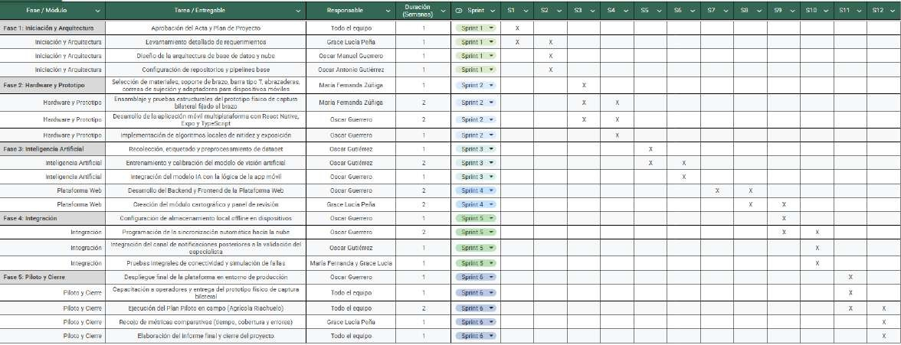
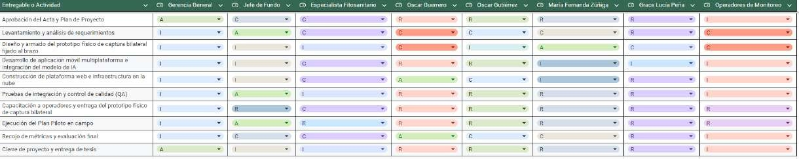

# CAPÍTULO VI. PLANIFICACIÓN DEL PROYECTO

La planificación del proyecto establece la guía directiva para la correcta ejecución, monitoreo, control y cierre del sistema inteligente de monitoreo y detección de posibles indicios de plagas en los cultivos de uva de mesa de Agrícola Riachuelo. Para ello, se adopta un enfoque híbrido: por un lado, la gestión predictiva permite controlar alcance, cronograma, costos, riesgos, calidad y adquisiciones; por otro lado, el marco ágil Scrum organiza el desarrollo incremental de la aplicación móvil, la plataforma web, la integración del modelo de visión artificial y la validación del prototipo físico de captura bilateral en campo.

La planificación toma como base la arquitectura vigente del proyecto: una aplicación móvil desarrollada con React Native, Expo y TypeScript; una plataforma central en Python y Django; base de datos PostgreSQL gestionada en Supabase; almacenamiento de imágenes en Cloudinary; cola de análisis mediante la tabla ai_tasks; y revisión obligatoria del especialista fitosanitario antes de generar avisos oficiales, salvo la alerta temprana de los casos «Confirmado por IA», que sale marcada «falta la revisión del especialista» (SC-03).

## 6.1. Plan para la Dirección del Proyecto

El plan para la dirección del proyecto integra los planes subsidiarios de alcance, cronograma, costos, calidad, recursos, comunicaciones, riesgos, adquisiciones, cambios y configuración. Asimismo, define los criterios de seguimiento, los umbrales de desempeño permitidos y los mecanismos formales de aprobación ante cualquier desviación detectada durante la ejecución del piloto en campo.

Este plan también establece que las decisiones oficiales del proyecto deben mantenerse documentadas y trazables, especialmente aquellas relacionadas con cambios tecnológicos, funcionamiento offline, arquitectura de despliegue, seguridad, validación humana de los hallazgos y uso de servicios externos. De esta forma, se evita que el documento combine tecnologías descartadas con componentes vigentes del aplicativo.

## 6.2. Gestión del alcance

El alcance del proyecto comprende de forma detallada los siguientes elementos:

- **Prototipo vestible de captura bilateral:** Diseño, adquisición de materiales y ensamblaje de un soporte ergonómico fijado al brazo del operador. El prototipo considera un poste vertical ajustable unido al brazo y una barra horizontal tipo T en la parte superior, donde se ubican dos dispositivos móviles a la misma altura que fotografían el mismo punto de la misma cara de la hilera (doble evidencia); cada hilera se recorre por sus dos lados en las pasadas «lateral A» (ida) y «lateral B» (vuelta) (SC-04). Además, se considera un tercer dispositivo móvil con función de controlador principal de la sesión.

- **Aplicación móvil de captura:** Desarrollo de una aplicación móvil multiplataforma con React Native, Expo y TypeScript. La app permitirá gestionar sesiones de recorrido, vincular los dos celulares cámara (Cámara 1 y Cámara 2), registrar capturas, validar condiciones básicas de calidad como nitidez y exposición, almacenar datos localmente en SQLite y archivos privados, proteger credenciales con SecureStore y sincronizar posteriormente con la plataforma Django cuando exista conectividad.

- **Modelo de inteligencia artificial:** Entrenamiento e integración de un modelo YOLO de visión artificial para sugerir posibles indicios visuales de chanchito en racimos y hojas. La IA no emite diagnósticos definitivos ni activa tratamientos por sí sola; únicamente prioriza evidencia y genera indicios que deben ser revisados por el especialista fitosanitario.

- **Plataforma Django centralizada:** Construcción de una plataforma en Python y Django que integra API REST para la app móvil, web de revisión para especialistas, paneles de supervisión, gestión de usuarios, catálogos, sesiones, capturas, casos y reportes. La web se implementa con plantillas Django, HTMX y Leaflet/OpenStreetMap dentro del mismo repositorio de plataforma.

- **Infraestructura, almacenamiento y notificaciones:** Uso de PostgreSQL gestionado en Supabase como base de datos central, Cloudinary para el almacenamiento seguro de fotografías, tabla ai_tasks como cola de análisis y Telegram Bot API para avisos oficiales (SC-02). Las notificaciones se generan cuando el especialista confirma un caso desde la plataforma web y, como alerta temprana, cuando la IA marca un caso como «Confirmado por IA», con el aviso señalado «falta la revisión del especialista» (SC-03).

## 6.3. Gestión de requisitos

La gestión de requisitos se deriva directamente de las deficiencias detectadas en el modelo AS-IS: exceso de personal en campo, dependencia de hojas de Excel extensas, inconsistencias de datos, baja trazabilidad de evidencias y ausencia de un flujo digital que conecte captura, análisis, revisión y decisión fitosanitaria.

- **Requisitos funcionales:** Captura fotográfica georreferenciada por lote, hilera, zona, lado y marcador; control de sesiones de recorrido; validación local de calidad de imagen; almacenamiento offline de capturas y metadatos; sincronización idempotente con la API de Django; subida de fotos a Cloudinary mediante ticket firmado; generación de tareas ai_tasks para análisis; revisión de evidencias en la web; confirmación, descarte o solicitud de nueva evidencia por parte del especialista; y envío de avisos solo para casos confirmados.

- **Requisitos no funcionales:** Operación offline-first en campo; seguridad en credenciales, tokens y secretos; transmisión cifrada mediante HTTPS; disponibilidad de la plataforma web; trazabilidad completa entre sesión, captura, análisis de IA, revisión humana y notificación; ergonomía del

prototipo físico; consistencia de datos en Supabase; y tiempos de respuesta adecuados para bandeja de casos, mapas y reportes.

## 6.4. EDT/WBS

El trabajo total del proyecto se descompone jerárquicamente en cinco paquetes principales de entregables:

**1. Gestión del Proyecto**

## 1.1. Elaboración y aprobación del acta de constitución

## 1.2. Planificación y gestión de recursos

## 1.3. Control, seguimiento y gestión de informes de avance

**2. Hardware y Prototipo Físico de Captura Bilateral**

2.1. Selección y compra de materiales para el soporte de brazo, barra horizontal tipo T, poste vertical ajustable, abrazaderas de fijación, correas de sujeción y adaptadores universales para dispositivos móviles.

## 2.2. Ensamblaje y pruebas estructurales del prototipo de captura bilateral fijado al brazo del operador.

## 2.3. Calibración de la altura, distancia, ángulos de enfoque y estabilidad de los dispositivos móviles durante el recorrido en campo.

**3. Desarrollo de Software y Modelos de Inteligencia Artificial**

## 3.1. Desarrollo de la app móvil con captura offline y validación de calidad

## 3.2. Recolección, etiquetado y entrenamiento del modelo YOLO

## 3.3. Desarrollo de la plataforma Django con API REST, web HTMX, mapa y gestión de casos

## 3.4. Integración de Cloudinary, ai_tasks, worker de IA y notificaciones posteriores a la revisión humana.

**4. Infraestructura y Despliegue**

## 4.1. Configuración de Supabase, Cloudinary, variables de entorno y entornos de prueba

## 4.2. Despliegue de la plataforma Django y del worker de IA

## 4.3. Pruebas integrales de conectividad, sincronización, análisis y revisión de casos.

**5. Pruebas Piloto y Cierre**

## 5.1. Ejecución del piloto en Agrícola Riachuelo

## 5.2. Recolección de métricas comparativas de tiempo, cobertura, errores y costos

## 5.3. Elaboración del informe final de resultados y cierre del proyecto.

## 6.5. Diccionario EDT

- **Paquete 2.2 (Ensamblaje del prototipo físico de captura bilateral):** Comprende la integración de un soporte de brazo con poste vertical ajustable y barra horizontal tipo T para ubicar dos dispositivos móviles a la misma altura. El prototipo debe permitir colocación y retiro sencillo, mantener estabilidad durante la caminata, reducir la fatiga del operador y conservar una distancia razonablemente constante respecto al follaje.

- **Paquete 3.2 (Modelo de Inteligencia Artificial):** Comprende la preparación del dataset, etiquetado de evidencia, entrenamiento, evaluación y ajuste de un modelo YOLO para sugerir indicios visuales de plaga. Sus resultados se registran como evidencias preliminares y siempre quedan sujetos a revisión humana.

- **Paquete 3.3 (Plataforma Django):** Incluye la API REST utilizada por la app móvil, la web de revisión con plantillas Django, HTMX y Leaflet, la gestión de usuarios y roles, la consulta de mapas, la bandeja de casos y los reportes necesarios para medir el piloto.

- **Paquete 3.4 (Integración de análisis y notificaciones):** Incluye la carga de fotos hacia Cloudinary con tickets firmados, la creación de tareas en ai_tasks, la ejecución del worker de IA y el envío de avisos por Telegram (SC-02) cuando exista una confirmación registrada por el especialista fitosanitario o un caso «Confirmado por IA», cuyo aviso sale marcado «falta la revisión del especialista» (SC-03).

## 6.6. Gestión del cronograma

El cronograma se rige bajo una metodología iterativa dividida en ciclos de dos semanas, denominados sprints. La duración global estimada del proyecto es de tres meses,

equivalente a doce semanas de trabajo distribuidas en seis sprints. La secuencia inicia con análisis y arquitectura, continúa con el prototipo físico y la app móvil, integra la plataforma Django, el modelo de IA y la sincronización, y finaliza con pruebas piloto en condiciones reales de campo.

## 6.7. Gantt

El diagrama de Gantt organiza las actividades del proyecto de acuerdo con fases, responsables, duración estimada y sprints de ejecución. Su objetivo es mostrar la secuencia temporal del trabajo y evitar dependencias mal ubicadas; por ejemplo, la sincronización móvil debe validarse antes de la revisión web completa, y el envío de avisos por Telegram (SC-02) debe probarse después de confirmar el flujo de decisión del especialista.

Link del diagrama de Gantt:

**[<u>https://docs.google.com/spreadsheets/d/1EYzL02fnB9kWrHMtlV_zPlwnIAQi2YS</u> <u>DLd94IuIQPtE/edit?usp=sharing</u>](https://docs.google.com/spreadsheets/d/1EYzL02fnB9kWrHMtlV_zPlwnIAQi2YSDLd94IuIQPtE/edit?usp=sharing)**

## 6.8. Gestión de costos

La gestión de costos comprende la estimación de los recursos financieros necesarios para cubrir dispositivos móviles, materiales del prototipo físico de captura bilateral, servicios administrados de nube, almacenamiento de imágenes, base de datos, despliegue de la plataforma y valorización de horas de ingeniería de software, análisis de datos y supervisión agronómica.

En esta versión se consideran como componentes principales de infraestructura Supabase para la base de datos PostgreSQL, Cloudinary para evidencias fotográficas, un entorno de despliegue para Django y el worker de IA, y la integración con Telegram Bot API (SC-02) para avisos operativos posteriores a la confirmación.

## 6.9. Presupuesto

El presupuesto consolidado refleja la inversión requerida para desarrollar y validar el prototipo, contemplando equipos tecnológicos, componentes físicos, licencias o planes base de servicios, costos operativos del piloto en el fundo y un fondo de contingencia para imprevistos técnicos. El presupuesto debe diferenciar claramente los costos de construcción inicial, operación piloto y posible escalamiento posterior.

## 6.10. Gestión de calidad

La calidad se gestiona considerando criterios técnicos, operativos y fitosanitarios. Para el software, se controlan errores críticos de sincronización, trazabilidad de registros, consistencia entre app móvil, API, base de datos y web, protección de datos y disponibilidad de la plataforma. Para la aplicación móvil, se revisa la estabilidad del almacenamiento local, la validación de calidad de imagen, el comportamiento offline y los reintentos de sincronización.

Para el modelo de inteligencia artificial, se evalúan precisión, falsos positivos, falsos negativos, nivel de confianza y concordancia frente a la decisión del especialista. La calidad agronómica no se mide por la decisión automática de la IA, sino por su capacidad de apoyar la revisión humana con evidencia ordenada, ubicable y verificable.

## 6.11. Gestión de recursos

Se definen las responsabilidades y perfiles requeridos para el proyecto: jefe de fundo como patrocinador operativo, especialista fitosanitario como validador técnico de plagas, estudiantes de ingeniería de sistemas como responsables del desarrollo móvil, plataforma Django, base de datos, IA e infraestructura, y operadores de monitoreo como usuarios clave para las pruebas de campo.

## 6.12. Matriz RAM/RACI

Link de Matriz RAM/RACI:

[<u>https://docs.google.com/spreadsheets/d/1744IT8uGCd3ZreAn5s4d6kbDYNsEGSlSLQq</u> <u>kotJwQbg/edit?gid=1262987032#gid=1262987032</u>](https://docs.google.com/spreadsheets/d/1744IT8uGCd3ZreAn5s4d6kbDYNsEGSlSLQqkotJwQbg/edit?gid=1262987032&gid=1262987032)

- **R (Responsible / Responsable):** Persona o equipo que ejecuta directamente la actividad. En tareas técnicas suele corresponder al equipo de desarrollo; en pruebas de campo puede corresponder al operador o equipo del piloto.

- **A (Accountable / Aprobador):** Único responsable de aprobar el entregable y asumir la decisión final. Debe existir solo un aprobador por actividad para evitar ambigüedad.

- **C (Consulted / Consultado):** Persona experta que entrega información o retroalimentación. En este proyecto destacan el especialista fitosanitario, jefe de fundo y usuarios operativos.

- **I (Informed / Informado):** Persona que recibe avances o resultados, pero no interviene directamente en la ejecución de la actividad.

## 6.13. Gestión de comunicaciones

La gestión de comunicaciones establece reuniones semanales de sincronización con el equipo técnico, revisiones quincenales con la jefatura de fundo y reportes al cierre de cada fase crítica. Además, se documentarán decisiones relevantes sobre arquitectura, alcance, prototipo físico, validación de IA, seguridad y resultados de las pruebas piloto, de manera que todos los interesados trabajen con la misma versión del proyecto.

## 6.14. Gestión de riesgos

**Riesgo 1: Limitada o nula conectividad a Internet en sectores alejados del fundo.**

**Mitigación:** Implementar una arquitectura offline-first en la app móvil, almacenando fotografías, metadatos y estado de sesión localmente hasta detectar una conexión estable para sincronizar con la API de Django.

**Riesgo 2: Resistencia al cambio por parte de los operadores habituados al registro manual en papel o Excel.**

**Mitigación:** Diseñar un prototipo físico ergonómico, capacitar a los operadores antes del piloto y mantener una interfaz móvil sencilla, orientada a recorridos, lados de hilera y alertas claras de calidad.

**Riesgo 3: Falsos positivos o baja precisión inicial del modelo de visión artificial.**

**Mitigación:** Mantener la validación humana obligatoria. La IA solo sugiere indicios; el especialista confirma, descarta o solicita nueva evidencia antes de cualquier aviso operativo; solo los casos «Confirmado por IA» generan una alerta temprana, marcada «falta la revisión del especialista», que el especialista ratifica o descarta (SC-03).

**Riesgo 4: Duplicidad o pérdida de datos durante la sincronización.**

Mitigación: Usar identificadores únicos de captura, sincronización idempotente, registro de estados locales y confirmación transaccional en Django antes de considerar una captura como sincronizada.

**Riesgo 5: Exposición de credenciales o servicios externos.**

Mitigación: Mantener las claves de Supabase y Cloudinary y el token del bot de Telegram (SC-02) únicamente como variables de entorno del servidor; la app no debe incluir secretos ni acceder directamente a Supabase o a la API administrativa de Cloudinary.

## 6.15. Gestión de interesados

Consiste en monitorear y gestionar las expectativas de los stakeholders identificados, tales como gerencia, jefatura de fundo, especialista fitosanitario, operadores de monitoreo, equipo técnico del proyecto y, cuando corresponda, entidades externas vinculadas al control fitosanitario. Esta gestión busca asegurar que sus necesidades e intereses sean considerados durante el desarrollo, validación y cierre del proyecto.

## 6.16. Gestión de cambios

Cualquier solicitud de modificación en el alcance, diseño del prototipo físico, requerimientos del sistema o flujo de validación deberá registrarse mediante un formato de solicitud de cambio. Dicha solicitud será evaluada por el equipo del proyecto considerando su impacto en tiempo, costo, alcance, calidad, seguridad, trazabilidad y operación en campo antes de ser aprobada por los responsables correspondientes. Las solicitudes y su revisión por el Comité de Control de Cambios se registran en el Anexo 37 (Solicitud de Cambio), que reúne las solicitudes SC-01 a SC-09.

## 6.17. Gestión de configuración

Se implementará control de versiones mediante repositorios centralizados en la nube. La configuración vigente considera dos repositorios principales: riachuelo-mobile para la aplicación móvil desarrollada con React Native, Expo y TypeScript; y riachuelo-platform para la plataforma Django, que integra API REST, web de revisión, administración, worker de IA y servicios de notificación.

También se controlarán las versiones de datasets, configuraciones de entrenamiento, pesos del modelo, variables por entorno, migraciones de base de datos, documentación técnica y decisiones de arquitectura. Esto permite mantener trazabilidad entre código, datos, modelo de IA, despliegue y resultados del piloto.

## 6.18. Gestión de adquisiciones, cuando corresponda

Detalla el proceso de compra o préstamo temporal de los componentes necesarios para el prototipo físico: soporte de brazo, poste vertical ajustable, barra horizontal tipo T, abrazaderas, correas de sujeción, adaptadores universales para dispositivos móviles, tornillería y dispositivos de prueba. Asimismo, contempla los servicios de nube requeridos para base de datos, almacenamiento de imágenes, despliegue de la plataforma, análisis de IA y mensajería oficial.
