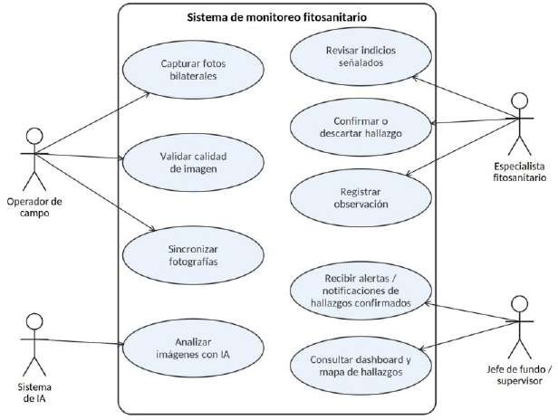
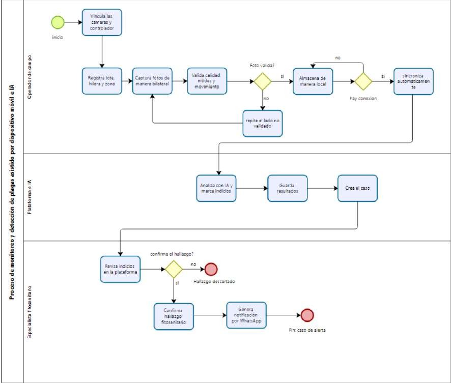
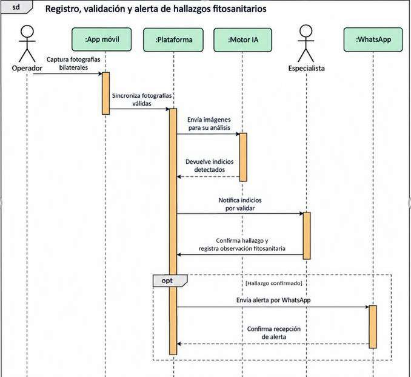
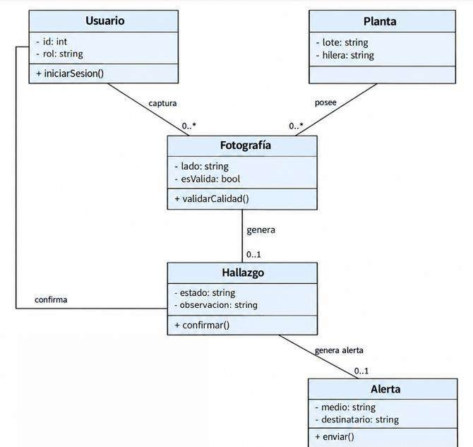
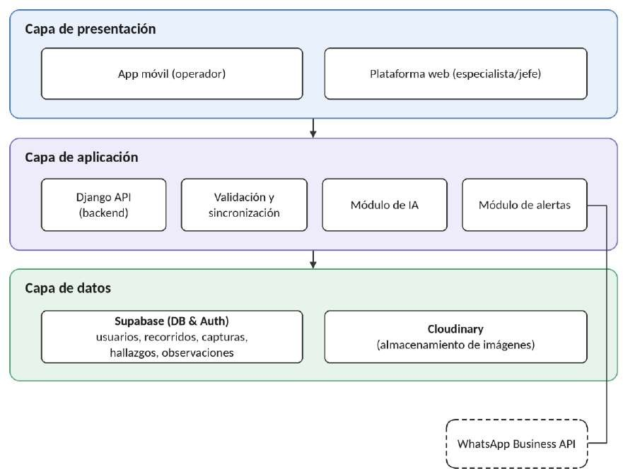
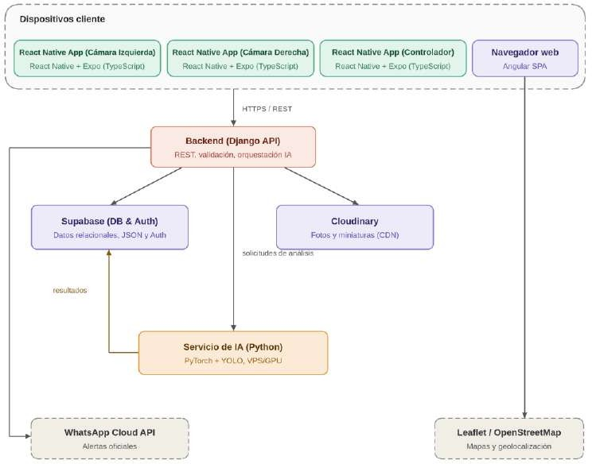
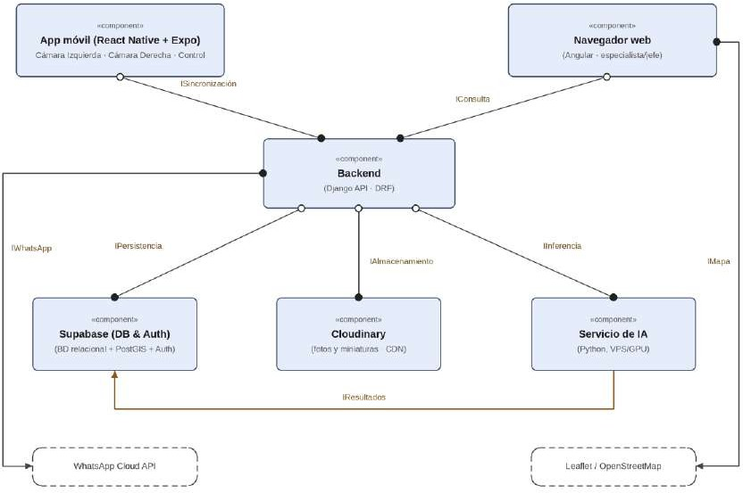
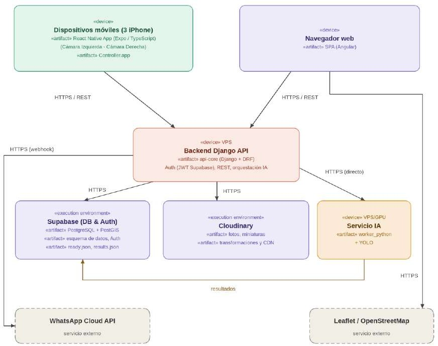

# CAPÍTULO VIII. ANÁLISIS Y DISEÑO DEL SISTEMA

## 8.1. Requerimientos funcionales

*Tabla 27. Requerimientos funcionales*

| Código | Descripción del requerimiento |
|---|---|
| RF01 | El sistema debe permitir capturar fotos bilaterales de cada planta por medio de dispositivos móviles |
| RF02 | El sistema debe validar automáticamente la calidad de cada foto (nitidez, exposición y movimiento) |
| RF03 | El sistema debe permitir repetir la captura del lado de la planta cuya foto no fuese valida |
| RF04 | El sistema debe almacenar localmente las fotos cuando no haya conexión a internet |
| RF05 | El sistema debe sincronizar automáticamente las fotografías hacia la plataforma cuando la conexión se restablezca |
| RF06 | El sistema debe asociar cada foto a los datos de lote, hilera, zona, lado, marcador, secuencia y coordenada GPS |
| RF07 | El sistema debe analizar las imágenes sincronizadas mediante un modelo de IA y señalar posibles indicios de plaga |
| RF08 | El sistema debe permitir al especialista fitosanitario visualizar los indicios en la plataforma |
| RF09 | El sistema debe permitir al especialista confirmar o descartar los hallazgos |
| RF10 | El sistema debe enviar una notificación automática vía Telegram al jefe de fundo y supervisor de zona inmediatamente después de que el especialista confirme un hallazgo fitosanitario. |
| RF11 | El sistema debe exigir la vinculación exitosa de los tres dispositivos (controlador, cámara A, cámara B) antes de habilitar el inicio del recorrido |

*Fuente: Elaboración propia.*

## 8.2. Requerimientos no funcionales

*Tabla 28. Requerimientos no funcionales*

| Código | Descripción del requerimiento |
|---|---|
| RNF01 | El sistema debe operar por medio de servicios en la nube, sin necesidad de infraestructura de servidores físicos locales en el fundo (servicios desplegados en la nube) |
| RNF02 | La validación de calidad debe realizarse en un tiempo máximo de 2 segundos por fotografía |
| RNF03 | La aplicación móvil debe tener una interfaz intuitiva que permita iniciar un recorrido en menos de 3 pasos para el personal de campo |
| RNF04 | El sistema debe soportar la consulta web y almacenamiento de datos de 50,000+ plantas manteniendo un tiempo de respuesta de la API menor a 1.5 segundos |
| RNF05 | El acceso a la plataforma debe ser protegido por autenticación y control de roles según el usuario |
| RNF06 | La aplicación debe operar en el modo sin conexión durante lacaptura, sincronizándose de manera automática al tener señal |
| RNF07 | Las imágenes y metadatos almacenados localmente deben custodiarse dentro del almacenamiento privado y seguro de la aplicación móvil (expo-secure-store o react-native-keychain) hasta completar su sincronización. |

*Fuente: Elaboración propia.*

## 8.3. Reglas de negocio

*Tabla 29. Reglas de negocio*

| Código | Regla de negocio | Descripción |
|---|---|---|
| RN-01 | Validación del especialista | El sistema no dejara que el estado del hallazgo cambie a "confirmado" ni registrar alguna observación fitosanitaria si la acción de viene del usuario autenticado con el rol de "Especialista fitosanitario" |
| RN-02 | Bloqueo de acciones sobreun hallazgo no confirmado | Ningún hallazgo podrá pasarse al estado " observación fitosanitaria registrada" ni dar ninguna notificación si su estado en el sistema esta como "pendiente" o "descartado" |
| RN-03 | Metadatos obligatorios por fotografía | El sistema rechazará el registro de cualquier fotografía que no contenga los campos obligatorios de lote, hilera, zona, lado, marcador y secuencia. Las coordenadas GPS se asociarán automáticamente cuando exista una lectura válida; en caso de indisponibilidad temporal del GPS, la foto se registrará con la localización por marcador y sector de campo, evitando la pérdida de la captura. |
| RN-04 | Repetición por calidad de imagen | Si el análisis de nitidez, exposición o movimiento de una foto no superala configuración establecida, el sistema marcara solo el lado afectado como "pendiente de recaptura" |
| RN-05 | Persistencia local sin conexión | El sistema deberá almacenar en el dispositivo las fotos que se tomaron sin conexión a internet, y no podrá eliminarla del almacenamiento local hasta confirmar su sincronización a la plataforma. |
| RN-06 | Carácter no vinculante del análisis de IA | El resultado del modelo de IA se registrará como "indicio sugerido" y no podrá derivar en observación fitosanitaria ni alerta sin la confirmación del especialista fitosanitario. |

*Fuente: Elaboración propia.*

## 8.4. Diagrama de casos de uso

> **Figura transcrita (image13.jpeg):** Representa los nueve casos de uso CU1 a CU9 del capítulo 8 y qué actor participa en cada uno. [Transcripción completa](../06-figuras/informe-principal/img13-diagrama-de-casos-de-uso-8-4.md)

## 8.5. Especificación de casos de uso

CU1: Capturar fotos bilaterales

- Actor: Operador de campo

- Descripción: El operador recorre el viñedo con el soporte tipo T que porta los tres celulares (controlador, Cámara 1 y Cámara 2). Al llegar a cada planta, activa la captura desde el controlador y las dos cámaras fotografían el mismo punto de la misma cara de la hilera (doble evidencia); cada hilera se recorre por sus dos lados con las pasadas «lateral A» (ida) y «lateral B» (vuelta) (SC-04). Cada fotografía queda asociada a los datos de lote, hilera, zona, lado, marcador, secuencia y coordenadas GPS.

CU2: Validar calidad de imagen

- Actor: Operador de campo (validación automática del dispositivo)

- Descripción: Cada cámara evalúa automáticamente la nitidez, la exposición y la presencia de movimiento en la fotografía capturada. Si la imagen no cumple los criterios establecidos, el sistema pide repetir solo la foto de la cámara que falló (máximo 2 intentos; en el último la foto se acepta y se marca para revisión técnica), sin reiniciar todo el recorrido (SC-05).

CU3: Sincronizar fotografías

- Actor: Operador de campo (proceso automático del dispositivo)

- Descripción: Las fotografías validadas se almacenan localmente en el dispositivo mientras no exista conexión a internet. En cuanto la señal se restablece, el sistema

sincroniza automáticamente las imágenes hacia la plataforma en la nube, sin requerir intervención manual del operador.

CU4: Analizar imágenes con IA

- Actor: Sistema de IA

- Descripción: Una vez que las imágenes llegan a la plataforma, un modelo de inteligencia artificial las procesa y señala los posibles indicios visuales de plaga detectados en cada fotografía, dejándolos disponibles para su revisión por parte del especialista fitosanitario. Según la regla de triage, la foto sin indicios queda «Descartada por la IA» (sin caso; se puede rescatar a mano), la dudosa abre un caso «Pendiente de revisión» y la de evidencia fuerte queda «Confirmado por IA», con aviso marcado «falta la revisión del especialista» (SC-03).

CU5: Revisar indicios señalados

- Actor: Especialista fitosanitario

- Descripción: El especialista ingresa a la plataforma web y revisa los indicios marcados por la inteligencia artificial, junto con la evidencia fotográfica y la ubicación aproximada de cada hallazgo dentro del viñedo.

CU6: Confirmar o descartar hallazgo

- Actor: Especialista fitosanitario

- Descripción: Con base en la evidencia revisada, el especialista determina si el indicio corresponde efectivamente a una plaga. Si lo confirma, el caso avanza al registro de observación fitosanitaria y envío de notificación; si lo descarta, el proceso concluye sin generar ninguna acción adicional. También puede marcar el caso como «Posible plaga» o «Evidencia insuficiente» y corregir una decisión indicando el motivo.

CU7: Registrar observación

- Actor: Especialista fitosanitario

- Descripción: Para todo hallazgo confirmado, el especialista registra en la plataforma la decisión fitosanitaria que corresponde aplicar sobre la planta afectada.

CU8: Recibir alertas / notificaciones de hallazgos confirmados

- Actor: jefe de fundo / Supervisor de zona

- Descripción: El sistema emite automáticamente una notificación vía Telegram (SC-02) a la jefatura de fundo y al supervisor de zona inmediatamente después de que el especialista fitosanitario confirme formalmente un hallazgo en la plataforma web. Además, cuando la IA encuentra evidencia visual fuerte («Confirmado por IA») se envía una alerta temprana marcada «falta la revisión del especialista» (SC-03; ver 14.7.4).

El mensaje incluye la foto, la ubicación operativa del hallazgo (lote, hilera, lado, segmento y marcador), el botón «Ver caso» (enlace de acceso controlado para consultar la evidencia fotográfica y la observación registrada) y el botón «Cómo llegar».

CU9: Consultar dashboard y mapa de hallazgos

- Actor: jefe de fundo / Supervisor / Especialista fitosanitario

- Descripción: Permite a la jefatura de fundo y a los supervisores consultar el avance global de los recorridos de monitoreo en campo, visualizar la ubicación georreferenciada de los hallazgos en el viñedo mediante el mapa interactivo (Leaflet sobre teselas satelitales Esri y OpenStreetMap), y revisar el estado de las revisiones realizadas y las notificaciones emitidas.

## 8.6. Diagrama de actividades

> **Figura transcrita (image10.jpeg):** Proceso propuesto con el sistema: captura con tres celulares, control de calidad en el celular, guardado sin internet, sincronización, análisis de IA y decisión del especialista con aviso automático. Es la misma imagen que se usa como diagrama de actividades… [Transcripción completa](../06-figuras/informe-principal/img10-figura-9-modelo-to-be-del-proceso-de-monitoreo-y-deteccion-d.md)

## 8.7. Diagrama de secuencia

> **Figura transcrita (image14.jpeg):** Orden de los mensajes desde la captura hasta el aviso. La alerta solo se envía si el hallazgo queda confirmado. [Transcripción completa](../06-figuras/informe-principal/img14-diagrama-de-secuencia-registro-validacion-y-alerta-de-hallaz.md)

## 8.8. Diagrama de clases

> **Figura transcrita (image15.jpeg):** Modelo conceptual simplificado del dominio: una foto pertenece a una planta, puede generar un hallazgo, que el especialista confirma y que puede generar una alerta. [Transcripción completa](../06-figuras/informe-principal/img15-diagrama-de-clases-8-8.md)

## 8.9. Arquitectura lógica

> **Figura transcrita (image16.jpeg):** Tres capas: lo que ven los usuarios, la lógica del backend Django (incluye IA y alertas) y los datos (base de datos y fotos). [Transcripción completa](../06-figuras/informe-principal/img16-arquitectura-logica-en-capas-8-9.md)

## 8.10. Arquitectura física

> **Figura transcrita (image17.jpeg):** Dónde corre cada pieza y cómo se comunican: los celulares y el navegador hablan con el backend Django por HTTPS; el backend usa la base de datos, el almacenamiento de fotos, el servicio de IA y el canal de alertas. [Transcripción completa](../06-figuras/informe-principal/img17-arquitectura-fisica-8-10.md)

## 8.11. Arquitectura tecnológica

*Tabla 30. Arquitectura tecnológica*

<table>
<tr>
<th>Capa/componente</th>
<th>Tecnología</th>
<th>Justificación</th>
</tr>
<tr>
<td>Campo / hardware</td>
<td>Tres celulares Android (controlador, Cámara 1 y Cámara 2), soporte tipo T, soportes para celular, abrazaderas, power banks, correas de seguridad.</td>
<td>Mantener las cámaras en posición estable y cargar los celulares</td>
</tr>
<tr>
<td rowspan="14">Aplicación móvil</td>
<td>React Native + Expo</td>
<td>Vincular los tres equipos</td>
</tr>
<tr>
<td>(TypeScript), con expo-</td>
<td>(Cámara 1, Cámara 2</td>
</tr>
<tr>
<td>camera (captura de fotos),</td>
<td>y controlador),</td>
</tr>
<tr>
<td>expo-sensors (movimiento</td>
<td>dirigir la sesión, capturar,</td>
</tr>
<tr>
<td>y orientación), expo-sqlite</td>
<td>validar calidad, repetir,</td>
</tr>
<tr>
<td>(base de datos local),</td>
<td>almacenar y sincronizar.</td>
</tr>
<tr>
<td>expo-file-system (archivos</td>
<td>Funciona offline-first.</td>
</tr>
<tr>
<td>locales) y expo-secure-</td>
<td></td>
</tr>
<tr>
<td>store (almacenamiento</td>
<td></td>
</tr>
<tr>
<td>seguro de credenciales);</td>
<td></td>
</tr>
<tr>
<td>comunicación local entre</td>
<td></td>
</tr>
<tr>
<td>dispositivos mediante</td>
<td></td>
</tr>
<tr>
<td>Wi-Fi local (WebSocket +</td>
<td></td>
</tr>
<tr>
<td>HTTP), sin internet; celulares Android (SC-07).</td>
<td></td>
</tr>
<tr>
<td rowspan="12">Backend / API</td>
<td>Django + Django REST</td>
<td>Autenticar, coordinar</td>
</tr>
<tr>
<td>Framework (Python), con</td>
<td>cargas, registrar eventos y</td>
</tr>
<tr>
<td>autenticación y JWT</td>
<td>exponer la API REST.</td>
</tr>
<tr>
<td>propios (SimpleJWT),</td>
<td>Reduce la complejidad de</td>
</tr>
<tr>
<td>sin Supabase Auth (SC-07).</td>
<td>la arquitectura al eliminar</td>
</tr>
<tr>
<td></td>
<td>el broker de mensajes y los</td>
</tr>
<tr>
<td></td>
<td>servicios intermedios. La IA</td>
</tr>
<tr>
<td></td>
<td>se ejecuta en un worker de</td>
</tr>
<tr>
<td></td>
<td>Django que toma las tareas</td>
</tr>
<tr>
<td></td>
<td>de la tabla ai_tasks (cola</td>
</tr>
<tr>
<td></td>
<td>en la propia base de datos,</td>
</tr>
<tr>
<td></td>
<td>sin RabbitMQ) (SC-07). Unifica el</td>
</tr>
</table>

<table>
<tr>
<th></th>
<th></th>
<th>backend y el servicio de inteligencia artificial en el ecosistema Python, lo que permite compartir librerías, lenguaje y equipo de desarrollo.</th>
</tr>
<tr>
<td>Almacenamiento de</td>
<td rowspan="20">Cloudinary.</td>
<td>Fotografías originales y</td>
</tr>
<tr>
<td>archivos</td>
<td>miniaturas. Reduce la</td>
</tr>
<tr>
<td></td>
<td>complejidad al generar</td>
</tr>
<tr>
<td></td>
<td>miniaturas y</td>
</tr>
<tr>
<td></td>
<td>transformaciones de</td>
</tr>
<tr>
<td></td>
<td>imagen mediante URL, sin</td>
</tr>
<tr>
<td></td>
<td>desarrollar procesos</td>
</tr>
<tr>
<td></td>
<td>propios. Se integra</td>
</tr>
<tr>
<td></td>
<td>directamente con Django</td>
</tr>
<tr>
<td></td>
<td>mediante su SDK para</td>
</tr>
<tr>
<td></td>
<td>Python y entrega las</td>
</tr>
<tr>
<td></td>
<td>imágenes a través de</td>
</tr>
<tr>
<td></td>
<td>CDN, lo que disminuye la</td>
</tr>
<tr>
<td></td>
<td>latencia de carga en el</td>
</tr>
<tr>
<td></td>
<td>dashboard web. La</td>
</tr>
<tr>
<td></td>
<td>sincronización es</td>
</tr>
<tr>
<td></td>
<td>gestionada por el backend</td>
</tr>
<tr>
<td></td>
<td>Django (la app sube cada foto directo a Cloudinary con un ticket firmado; las fotos son privadas y se ven con URLs firmadas), y los resultados en</td>
</tr>
<tr>
<td></td>
<td>formato JSON se</td>
</tr>
<tr>
<td></td>
<td>almacenan en Supabase.</td>
</tr>
<tr>
<td>Base de datos y</td>
<td>Supabase (PostgreSQL</td>
<td>Usuarios, recorridos,</td>
</tr>
<tr>
<td>autenticación</td>
<td>gestionado, sin PostGIS</td>
<td>capturas, hallazgos,</td>
</tr>
<tr>
<td></td>
<td>ni Supabase Auth) (SC-07).</td>
<td>observaciones, coordenadas</td>
</tr>
<tr>
<td></td>
<td></td>
<td>(lotes, hileras,</td>
</tr>
<tr>
<td></td>
<td></td>
<td>marcadores), resultados de</td>
</tr>
<tr>
<td></td>
<td></td>
<td>IA y auditoría. Al ser un</td>
</tr>
<tr>
<td></td>
<td></td>
<td>servicio gestionado que</td>
</tr>
</table>

|  |  | ofrece PostgreSQL administrado, reduce la complejidad operativa: no requiere administrar el servidor ni el contenedor de la base de datos (los respaldos semanales con pg_dump se describen en SLA-09). La autenticación la resuelve Django con SimpleJWT, sin Supabase Auth (SC-07). Mantiene PostgreSQL, por lo que se conserva el modelo de datos relacional (las coordenadas se guardan como latitud y longitud, sin PostGIS) (SC-07), y se integra de forma sencilla con Django. |
|---|---|---|
| Inteligencia artificial | Python: worker de Django (comando worker_ia) con el modelo YOLO26n (Ultralytics) exportado a ONNX y ejecutado con ONNX Runtime en CPU, contenedorizado en Docker. | Worker que toma las tareas de la tabla ai_tasks, descarga cada foto de Cloudinary con URL firmada, detecta indicios de Planococcus ficus (chanchito blanco) y de melaza/fumagina, y guarda los resultados directamente en la base de datos, sin FastAPI ni callbacks (SC-07). |
| Web y dashboard | Django Templates + HTMX (sin Angular ni frameworks de JavaScript), con mapas Leaflet sobre teselas satelitales Esri y OpenStreetMap (SC-01). | Gestionar usuarios, mapas, evidencia, casos, observaciones y reportes. Confirmar o descartar indicios sugeridos por la IA. |
| Notificaciones | Telegram Bot API, invocada desde el backend Django (reemplaza a WhatsApp Cloud API, SC-02). | Enviar alertas oficiales agrupadas y registrar su entrega |

*Fuente: Elaboración propia.*

## 8.12. Diagrama de componentes

> **Figura transcrita (image18.jpeg):** Muestra los componentes y las interfaces que los unen (sincronización, consulta, persistencia, almacenamiento, inferencia, mapa y mensajería). [Transcripción completa](../06-figuras/informe-principal/img18-diagrama-de-componentes-8-12.md)

## 8.13. Diagrama de despliegue

> **Figura transcrita (image19.jpeg):** Dónde se instala cada artefacto en el diseño inicial. [Transcripción completa](../06-figuras/informe-principal/img19-diagrama-de-despliegue-8-13.md)
