# CAPÍTULO IX. DISEÑO UX/UI

Nota de alcance. Los wireframes, mockups y capturas de este capítulo (Fig. 9.3 a 9.21) corresponden al prototipo de diseño inicial. Los módulos «Tratamientos», «Reportes en PDF» y «Simulador», y el perfil «Aplicador», no forman parte del sistema implementado (la decisión y ejecución del tratamiento está fuera del alcance, ver 14.1.3; los reportes se descargan en CSV). El sistema implementado usa los roles Administrador, Especialista fitosanitario, Supervisor y Operador de campo, avisos por Telegram (SC-02) y la app con la función «Ubicar plaga» (SC-09); sus pantallas reales se documentan en los manuales de usuario de la plataforma web y de la app móvil.

## 9.1. Usuarios

*Tabla 31. Usuarios*

| Perfil | Rol en el sistema | Objetivos principale s | Frustraciones con el proceso actual | Dispositivo |
|---|---|---|---|---|
| (Operador de Campo) | Recorre el viñedo y captura fotografías bilaterales de cada planta con la app Riachuelo Monitoreo. | Completar el recorrido rápido, sin repetir capturas innecesaria s y sin perder evidencia por falta de conexión. | Elregistro manual en Excel era lento y propenso a errores; sin evidencia fotográfica de respaldo. | Celular Android (soporte tipo T) |
| (Especialista Fitosanitaria ) | Revisa en la web los indicios señalados por la IAy confirma o descarta cada hallazgo. | Validar hallazgos con evidencia clara y ubicación exacta, sin tener que volver físicamente al campo. | No podía comprobar un hallazgo reportado días antes; ubicación imprecisa entre hileras. | Laptop/navegado r web |
| (Encargado de Fundo) | Supervisaeldashboard, el mapa operativo y | Tener visibilidad global del estado | Se enteraba de una plaga días después de | Laptop y Telegram |
|  | los reportes; recibe alertas críticas por Telegram (SC-02). | fitosanitari o del fundo y reaccionar rápido ante casos urgentes. | detectada, cuando ya había avanzado. |  |
| (Aplicador) | Recibe el tratamiento asignado en la web y registra su aplicación en campo. | Saber con precisión qué planta tratar (lote, hilera, marcador) y con qué producto. | Instrucciones verbales o en papel, con riesgo de tratar la planta equivocad a. | Notificación Telegram + web |

*Fuente: Elaboración propia.*

## 9.2. Flujo de usuario

**Flujo del Operador de Campo (app Riachuelo Monitoreo)**

El operador recorre el viñedo capturando evidencia fotográfica de cada planta. El flujo contempla dos puntos de decisión críticos: la validación automática de calidad de cada fotografía y la disponibilidad de conexión a internet, que determina si la sincronización ocurre de inmediato o queda pendiente en el dispositivo.

> **Figura transcrita (image20.png):** Recorrido del operador en la app: elegir función, abrir sesión, capturar, repetir si la foto es mala, guardar sin internet, sincronizar y cerrar. [Transcripción completa](../06-figuras/informe-principal/img20-flujo-de-usuario-del-operador-de-campo-9-2.md)

**Flujo del Especialista Fitosanitario / Encargado de Fundo**

Desde el Dashboard, el especialista revisa los indicios detectados por la IA y decide si confirma o descarta cada hallazgo. Todo hallazgo confirmado deriva en el registro de la observación fitosanitaria y dispara automáticamente una alerta por Telegram al jefe de fundo y al supervisor de zona (SC-02); además, los casos «Confirmado por IA» generan una alerta temprana marcada «falta la revisión del especialista» (SC-03). El Dashboard también da acceso directo al Mapa Operativo y a los Reportes.

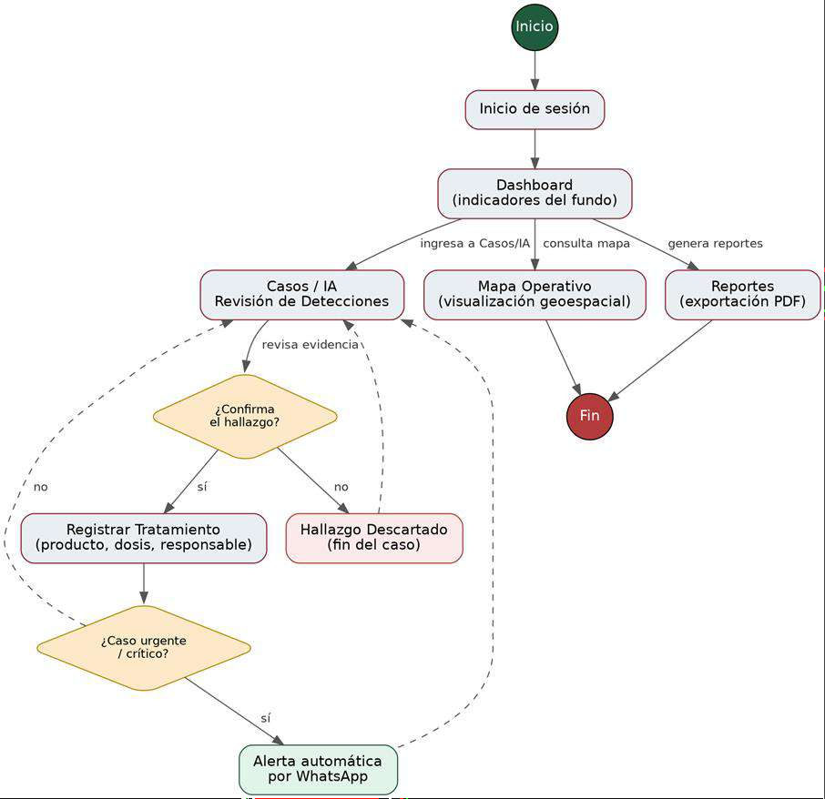

> **Figura transcrita (image21.png):** Recorrido del especialista en la web: ver indicadores, revisar casos de la IA, confirmar o descartar y consultar mapa y reportes. [Transcripción completa](../06-figuras/informe-principal/img21-flujo-de-usuario-del-especialista-fitosanitario-encargado-de.md)

## 9.3. Arquitectura de información

La arquitectura de información se organiza en dos mapas de navegación independientes, uno por producto, conectados por la sincronización de datos en la nube.

App móvil (operador de campo)

- Selección de rol → Controlador / Cámara 1 / Cámara 2

- Sesiones (lista de recorridos: activo, sincronizado, cerrado)

- Recorrido Activo → Captura con dos cámaras sobre la misma cara (pasadas lateral A / lateral B) (SC-04)

- Cambiar Zona (lote, hilera, zona, marcador)

- Sin Conexión (modo offline)

- Sincronización (cola de carga)

- Cerrar Recorrido → Sesión Cerrada

- Navegación inferior: Sesiones \| Mapa \| Casos \| Configuración

Plataforma web (especialista, jefe de fundo, administración) PLATAFORMA

- Dashboard – indicadores generales del fundo

- Sesiones – detalle de recorridos de captura por lote/hilera

- Casos / IA – revisión y validación de detecciones

- Mapa – visualización cartográfica de hallazgos

- Tratamientos – registro y seguimiento de aplicaciones

- Reportes – generación de documentos PDF ADMINISTRACIÓN

- Dispositivos – gestión de cámaras y controladores vinculados

- Usuarios – gestión de roles y accesos

- Alertas Telegram – configuración de eventos y destinatarios

- Configuración – parámetros generales del sistema SIMULADOR MÓVIL

- Controlador – simula la vinculación y el flujo del operador

- Cámara – simula la activación de la Cámara 1 y la Cámara 2

## 9.4. Wireframes

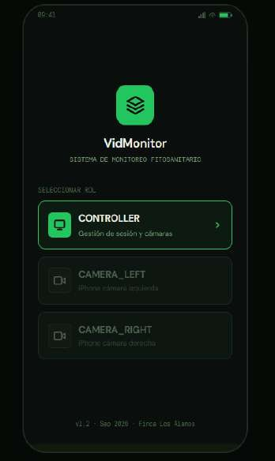

> **Figura transcrita (image22.jpeg):** Primera pantalla del prototipo: el celular elige si será el controlador o una de las dos cámaras. En el documento comparte espacio con la Fig. 9.4 «Listado de sesiones de captura» (imagen no extraída por separado). [Transcripción completa](../06-figuras/informe-principal/img22-fig-9-3-wireframe-seleccion-de-rol-app-prototipo-inicial.md)

*Fig. 9.3 – Selección de rol Fig. 9.4 – Listado de sesiones de captura*

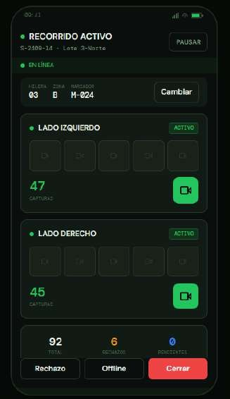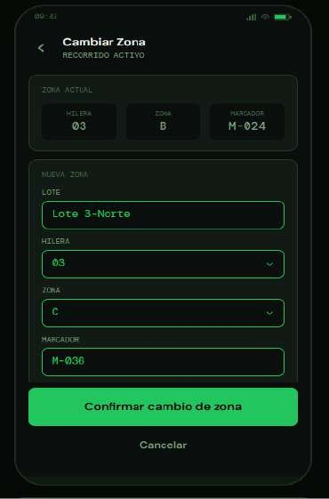

> **Figura transcrita (image24.jpeg):** Pantalla principal durante la captura: muestra la ubicación actual (hilera, zona, marcador), cuántas fotos lleva cada cámara, los rechazos por calidad y las fotos pendientes de enviar. [Transcripción completa](../06-figuras/informe-principal/img24-fig-9-5-wireframe-recorrido-activo-app-prototipo-inicial.md)
> **Figura transcrita (image25.jpeg):** Permite al operador avisar que pasó a otra zona o marcador sin cerrar el recorrido, para que las fotos siguientes queden con la ubicación correcta. [Transcripción completa](../06-figuras/informe-principal/img25-fig-9-6-wireframe-cambiar-zona-lote-hilera-marcador-app-prot.md)

*Fig. 9.5 – Recorrido activo Fig. 9.6 – Cambiar zona (lote, hilera, marcador)*

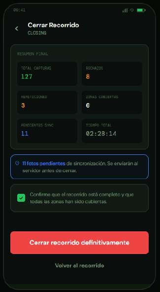

> **Figura transcrita (image26.jpeg):** Resumen y confirmación antes de cerrar un recorrido. En el documento comparte espacio con la Fig. 9.8 «Modo sin conexión» (imagen no extraída por separado). [Transcripción completa](../06-figuras/informe-principal/img26-fig-9-7-wireframe-cierre-del-recorrido-app-prototipo-inicial.md)

*Fig.9.7–Cierre Fig. 9.8 – Modo sin conexión*

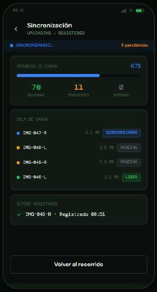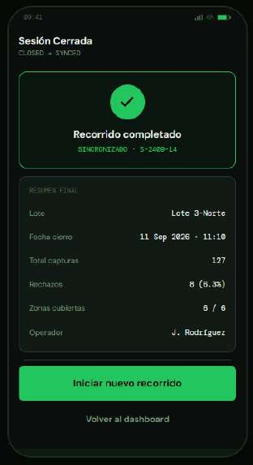

> **Figura transcrita (image28.jpeg):** Muestra el avance del envío de fotos al servidor y el estado de cada archivo en la cola. [Transcripción completa](../06-figuras/informe-principal/img28-fig-9-9-wireframe-sincronizacion-app-prototipo-inicial.md)
> **Figura transcrita (image29.jpeg):** Confirmación final de que el recorrido quedó cerrado y enviado al servidor. Los datos son de ejemplo. [Transcripción completa](../06-figuras/informe-principal/img29-fig-9-10-wireframe-sesion-cerrada-y-sincronizada-app-prototi.md)

*Fig. 9.9 – Sincronización Fig. 9.10 – Sesión cerrada y sincronizada*

## 9.5. Mockups

> **Figura transcrita (image30.jpeg):** Panel de indicadores del fundo para el especialista y la jefatura: volumen y calidad de capturas, detecciones de la IA, casos por estado y evolución diaria. Datos ficticios. [Transcripción completa](../06-figuras/informe-principal/img30-fig-9-11-mockup-dashboard-fitosanitario-indicadores-clave-de.md)

*Fig. 9.11 – Dashboard Fitosanitario: indicadores clave del fundo*

> **Figura transcrita (image31.jpeg):** Lista de salidas de campo sincronizadas y el detalle de una: quién la hizo, cuánto duró, cuántas fotos se aceptaron y cuántas detecciones generó. Datos ficticios. [Transcripción completa](../06-figuras/informe-principal/img31-fig-9-12-mockup-sesiones-de-captura-listado-y-detalle-por-lo.md)

*Fig. 9.12 – Sesiones de captura: listado y detalle por lote/hilera*

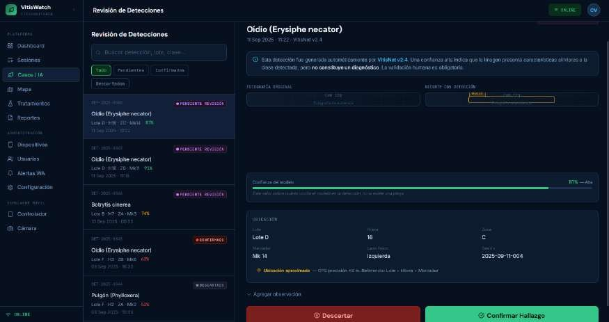

> **Figura transcrita (image32.jpeg):** Pantalla clave del especialista: revisa la foto y la caja que marcó la IA con su confianza y ubicación, y decide confirmar o descartar. Refleja la regla de que la IA no diagnostica. [Transcripción completa](../06-figuras/informe-principal/img32-fig-9-13-mockup-revision-de-detecciones-validacion-de-hallaz.md)

*Fig. 9.13 – Revisión de Detecciones: validación de hallazgos de IA*

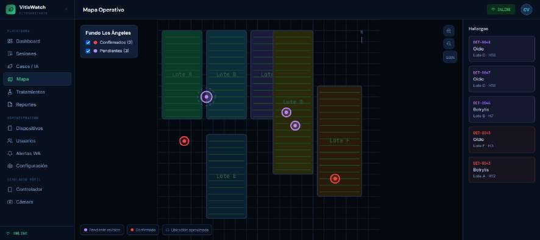

> **Figura transcrita (image33.jpeg):** Ubica los hallazgos sobre un esquema de los lotes, con colores por estado, para ver dónde se concentran. [Transcripción completa](../06-figuras/informe-principal/img33-fig-9-14-mockup-mapa-operativo-distribucion-geoespacial-de-h.md)

*Fig. 9.14 – Mapa Operativo: distribución geoespacial de hallazgos por lote*

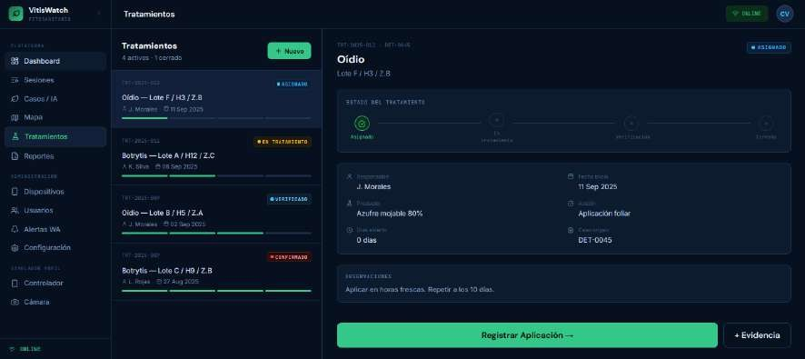

> **Figura transcrita (image34.jpeg):** Seguimiento de la aplicación de tratamientos después de confirmar un hallazgo. [Transcripción completa](../06-figuras/informe-principal/img34-fig-9-15-mockup-tratamientos-seguimiento-del-estado-de-aplic.md)

*Fig. 9.15 – Tratamientos: seguimiento del estado de aplicación*

> **Figura transcrita (image35.jpeg):** Catálogo de reportes descargables que se planteó en el diseño inicial. [Transcripción completa](../06-figuras/informe-principal/img35-fig-9-16-mockup-reportes-generacion-de-documentos-pdf-del-si.md)

*Fig. 9.16 – Reportes: generación de documentos PDF del sistema*

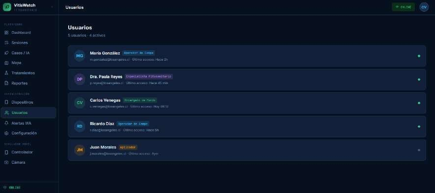

> **Figura transcrita (image36.jpeg):** Lista de cuentas con su rol y actividad. Personas y datos ficticios. [Transcripción completa](../06-figuras/informe-principal/img36-fig-9-17-mockup-usuarios-gestion-de-roles-y-accesos-web-prot.md)

*Fig. 9.17 – Usuarios: gestión de roles y accesos*

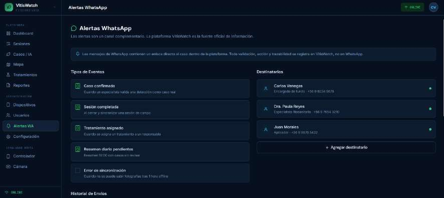

> **Figura transcrita (image37.jpeg):** Configuración de qué eventos generan avisos y a quién le llegan. El pie del documento la titula «Alertas Telegram», pero la imagen conserva el texto original de WhatsApp. [Transcripción completa](../06-figuras/informe-principal/img37-fig-9-18-mockup-alertas-configuracion-de-eventos-y-destinata.md)

*Fig. 9.18 – Alertas Telegram: configuración de eventos y destinatarios*

## 9.6. Prototipo interactivo

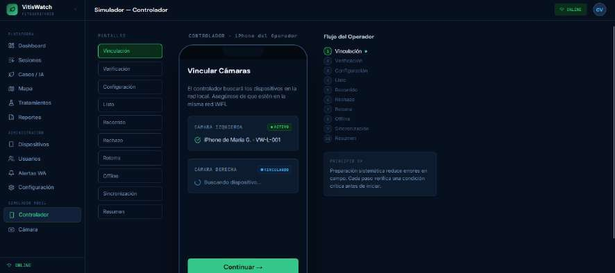

> **Figura transcrita (image38.jpeg):** Prototipo navegable que simula las pantallas del celular controlador, empezando por vincular las dos cámaras en la red Wi-Fi local. [Transcripción completa](../06-figuras/informe-principal/img38-fig-9-19-prototipo-simulador-controlador-flujo-de-vinculacio.md)

*Fig. 9.19 – Simulador – Controlador: flujo de vinculación de cámaras del operador*

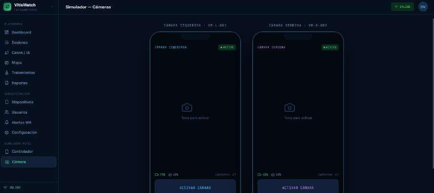

> **Figura transcrita (image39.jpeg):** Simulación de los dos celulares cámara con su estado, batería, espacio y número de capturas. [Transcripción completa](../06-figuras/informe-principal/img39-fig-9-20-prototipo-simulador-camaras-activacion-de-la-camara.md)

*Fig. 9.20 – Simulador – Cámaras: activación de la Cámara 1 y la Cámara 2*

> **Figura transcrita (image40.jpeg):** Muestra cómo se vería la plataforma sin conexión: los hallazgos siguen visibles y se avisa cuántas fotos faltan sincronizar. [Transcripción completa](../06-figuras/informe-principal/img40-fig-9-21-prototipo-simulador-mapa-operativo-en-modo-offline.md)

*Fig. 9.21 – Simulador – Mapa operativo en modo offline, con hallazgos pendientes de sincronización*

## 9.7. Componentes

*Tabla 32. Componentes*

| Componente | Descripción | Dónde se usa |
|---|---|---|
| Badge de estado | Etiqueta de color según estado: verde (activo/sincronizado/confirmado), ámbar (pendiente/en curso), rojo (cerrado/descartado), morado (rol especialista). | Sesiones, Revisión de Detecciones, Usuarios |
| Tarjeta de sesión / caso | Contenedor con título, metadatos (lote, hilera, fecha) y contadores numéricos destacados (capturas, rechazos, detecciones). | Sesiones, Casos/IA, Tratamientos |
| Indicador de conexión | Punto de color y etiqueta “EN LÍNEA” / “OFFLINE” visible de forma persistente en laparte superior o inferior de la pantalla. | App móvil yplataformaweb (banner superior) |
| Barra de progreso | Barra lineal que comunicaavance (sincronización, calidad de captura, confianza del modelo de IA, progreso del tratamiento). | Sincronización, Revisión deDetecciones,Sesiones |
| Grilla de miniaturas | Conjunto de celdas numeradas que representan cada captura de un lado de la planta, con estado activo/vacío. | Recorrido Activo (App móvil) |
| Botón primario / secundario/destructivo | Botón sólido verde para la acción principal, contorno para acciones secundarias y rojo sólido para acciones irreversibles (cerrar, descartar). | Todas las pantallas |
| Navegación inferior (móvil) | Barra fija con 4 accesos directos (Sesiones, Mapa, Casos, Config) con ícono y etiqueta. | App móvil (Riachuelo Monitoreo) |
| Barra lateral (web) | Menú fijo agrupado por secciones (Plataforma / Administración / Simulador) con ícono, etiqueta y resaltado del ítem activo. | Plataforma web (monitoreo.agricolariachuelo.org) |
| Mapa con marcadores | Lienzo cuadriculado con polígonos de lote coloreados y marcadores circulares por estado (confirmado, pendiente, ubicación aproximada). | Mapa Operativo, Simulador |
| Avatar de usuario | Círculo con iniciales del usuario y color asignado por rol, acompañado de nombre, roly último acceso. | Usuarios, Alertas Telegram, cabecera superior |
| Formulario de zona | Campos de texto y desplegables para lote, hilera, zona y marcador, con botón de confirmación destacado. | Cambiar Zona (App móvil) |

*Fuente: Elaboración propia.*

## 9.8. Diseño responsive

Los dos productos tienen estrategias de adaptabilidad distintas, de acuerdo con su contexto de uso:

- App móvil:

  - Diseñada exclusivamente para orientación vertical (portrait) y para el tamaño de pantalla de un celular Android, ya que el dispositivo va montado de forma fija en el soporte tipo T (SC-04, SC-07).

  - No requiere breakpoints adicionales: al ser una app de un único propósito operativo (captura en campo), se prioriza la legibilidad bajo luz solar directa mediante alto contraste y objetivos táctiles grandes, pensados para operarse con guantes o en movimiento.

  - Los elementos críticos (botón de cerrar recorrido, indicador de conexión, contador de capturas) se mantienen siempre visibles sin necesidad de scroll.

- Plataforma web

  - Escritorio (≥ 1280 px): diseño de referencia mostrado en los mockups, con barra lateral fija expandida, paneles de detalle en dos columnas y gráficos completos en el Dashboard.

  - Tablet (768–1279 px): la barra lateral se colapsa a solo íconos y los paneles de dos columnas (por ejemplo, Sesiones o Revisión de Detecciones) pasan a apilarse verticalmente.

  - Escritorio angosto / móvil (\< 768 px): uso previsto como consulta ocasional (por ejemplo, el jefe de fundo revisando el Dashboard desde su teléfono); las tarjetas de KPIs y los gráficos se reorganizan en una sola columna y las tablas pasan a un formato de tarjetas apiladas.

  - El módulo “Simulador móvil” se diseñó a un ancho fijo mayor (equivalente a dos teléfonos en paralelo) porque su propósito es mostrar simultáneamente ambas cámaras del operador durante las pruebas de escritorio.
