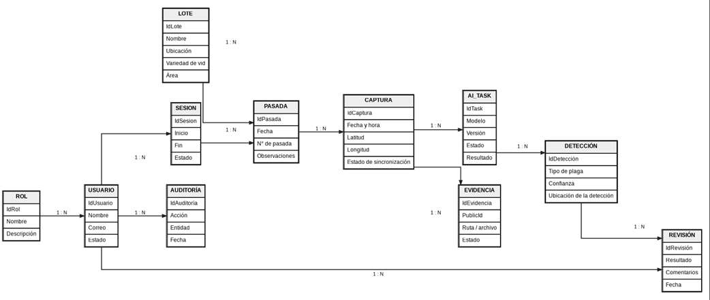
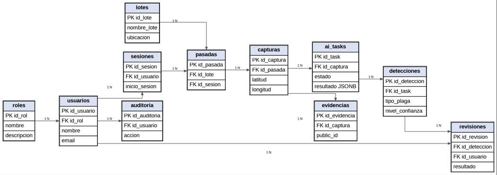
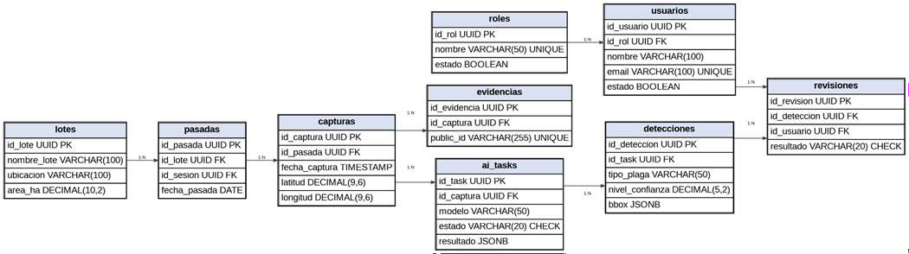
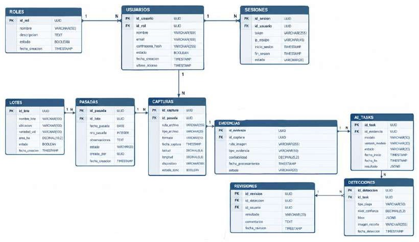

# CAPÍTULO X. BASE DE DATOS

Nota de alcance. Las Tablas 33 a 36, los diagramas de las secciones 10.1 a 10.4 y los scripts de la sección 10.9 describen el diseño lógico inicial de la base de datos (once tablas con nombres en español). La base implementada en Supabase PostgreSQL la crean las migraciones de Django y tiene unas 30 tablas con nombres en inglés, que son las que usan los capítulos XI a XIV; se resumen en la Tabla 37, al final de este capítulo. Las decisiones del especialista son cuatro (Confirmado, Posible plaga, Descartado y Evidencia insuficiente) y quedan en human_reviews; las reglas de estados, rangos de coordenadas y auditoría de solo inserción se aplican en la propia base, y solo Django se conecta a ella (RLS activo sin políticas). La diferencia se justifica en las solicitudes SC-03 y SC-07 (Anexo 37).

## 10.1. Modelo conceptual

> **Figura transcrita (image41.png):** Entidades principales y cómo se relacionan: un usuario hace sesiones; cada pasada pertenece a un lote y una sesión; cada captura genera evidencias y tareas de IA; cada tarea produce detecciones que el especialista revisa. [Transcripción completa](../06-figuras/informe-principal/img41-modelo-conceptual-de-datos-10-1.md)

## 10.2. Modelo lógico

> **Figura transcrita (image42.png):** Pasa el modelo conceptual a tablas con claves primarias (PK) y foráneas (FK). [Transcripción completa](../06-figuras/informe-principal/img42-modelo-logico-de-datos-10-2.md)

## 10.3. Modelo físico

> **Figura transcrita (image43.png):** Define los tipos de datos para PostgreSQL: identificadores UUID, coordenadas con 6 decimales, resultados de la IA en JSONB y restricciones CHECK de estado. [Transcripción completa](../06-figuras/informe-principal/img43-modelo-fisico-de-datos-10-3.md)

## 10.4. Diagrama entidad-relación

> **Figura transcrita (image44.jpeg):** Versión más completa del diseño de datos, con fechas de auditoría, versión del modelo de IA, cajas (bbox) y recortes de cada detección. Lectura de la imagen ampliada; algunos tipos pueden variar levemente. [Transcripción completa](../06-figuras/informe-principal/img44-diagrama-entidad-relacion-10-4.md)

## 10.5. Tablas

*Tabla 33. Tablas*

<table style="width:100%;">
<colgroup>
<col style="width: 26%" />
<col style="width: 30%" />
<col style="width: 26%" />
<col style="width: 17%" />
</colgroup>
<thead>
<tr class="header">
<th>
<strong>Tabla</strong>

</th>
<th>
<strong>Finalidad</strong>

</th>
<th>
<strong>PK</strong>

</th>
<th>
<strong>FK</strong>

<strong>principales</strong>

</th>
</tr>
</thead>
<tbody>
<tr class="odd">
<td>
<strong>roles</strong>

</td>
<td>
<strong>Catálogo de perfiles</strong>

</td>
<td>
<strong>id_rol</strong>

</td>
<td>
<strong>—</strong>

</td>
</tr>
<tr class="even">
<td>
<strong>usuarios</strong>

</td>
<td>
<strong>Usuarios del sistema</strong>

</td>
<td>
<strong>id_usuario</strong>

</td>
<td>
<strong>id_rol</strong>

</td>
</tr>
<tr class="odd">
<td>
<strong>sesiones</strong>

</td>
<td>
<strong>Sesiones de</strong>

<strong>autenticación/monitoreo</strong>

</td>
<td>
<strong>id_sesion</strong>

</td>
<td>
<strong>id_usuario</strong>

</td>
</tr>
</tbody>
</table>

<table style="width:100%;">
<colgroup>
<col style="width: 26%" />
<col style="width: 30%" />
<col style="width: 26%" />
<col style="width: 17%" />
</colgroup>
<thead>
<tr class="header">
<th>
<strong>lotes</strong>

</th>
<th>
<strong>Lotes o ubicaciones del fundo</strong>

</th>
<th>
<strong>id_lote</strong>

</th>
<th>
<strong>—</strong>

</th>
</tr>
</thead>
<tbody>
<tr class="odd">
<td>
<strong>pasadas</strong>

</td>
<td>
<strong>Recorridos/segmentos de monitoreo</strong>

</td>
<td>
<strong>id_pasada</strong>

</td>
<td>
<strong>id_lote, id_sesion</strong>

</td>
</tr>
<tr class="even">
<td>
<strong>capturas</strong>

</td>
<td>
<strong>Registro de fotografías y contexto</strong>

</td>
<td>
<strong>id_captura</strong>

</td>
<td>
<strong>id_pasada</strong>

</td>
</tr>
<tr class="odd">
<td>
<strong>evidencias</strong>

</td>
<td>
<strong>Referencia y metadatos de archivos</strong>

</td>
<td>
<strong>id_evidencia</strong>

</td>
<td>
<strong>id_captura</strong>

</td>
</tr>
<tr class="even">
<td>
<strong>ai_tasks</strong>

</td>
<td>
<strong>Tareas de</strong>

<strong>procesamiento IA</strong>

</td>
<td>
<strong>id_task</strong>

</td>
<td>
<strong>id_captura</strong>

</td>
</tr>
<tr class="odd">
<td>
<strong>detecciones</strong>

</td>
<td>
<strong>Resultados de visión artificial</strong>

</td>
<td>
<strong>id_deteccion</strong>

</td>
<td>
<strong>id_task</strong>

</td>
</tr>
<tr class="even">
<td>
<strong>revisiones</strong>

</td>
<td>
<strong>Validación del especialista</strong>

</td>
<td>
<strong>id_revision</strong>

</td>
<td>
<strong>id_deteccion, id_usuario</strong>

</td>
</tr>
<tr class="odd">
<td>
<strong>auditoria</strong>

</td>
<td>
<strong>Registro de acciones</strong>

</td>
<td>
<strong>id_auditoria</strong>

</td>
<td>
<strong>id_usuario</strong>

</td>
</tr>
</tbody>
</table>

*Fuente: Elaboración propia.*

## 10.6. Relaciones

*Tabla 34. Relaciones*

| Origen | Cardinalidad | Destino | Regla funcional |
|---|---|---|---|
| ROLES | 1:N | USUARIOS | Un rolpuede asignarse a variosusuarios. |
| USUARIOS | 1:N | SESIONES | Un usuariopuede generar múltiplessesiones. |
| USUARIOS | 1:N | REVISIONES | Un especialista puede revisar |
|  |  |  | múltiples detecciones. |
| USUARIOS | 1:N | AUDITORIA | Un usuariopuede generar múltipleseventos de auditoría. |
| LOTES | 1:N | PASADAS | Un lote puede tener múltiples pasadas. |
| SESIONES | 1:N | PASADAS | Una sesión agrupa múltiples pasadas. |
| PASADAS | 1:N | CAPTURAS | Una pasada contiene múltiples capturas. |
| CAPTURAS | 1:N | EVIDENCIAS | Una captura puede asociar evidencia almacenada. |
| CAPTURAS | 1:N | AI_TASKS | Una captura puede generar tareas de análisis/reintento. |
| AI_TASKS | 1:N | DETECCIONES | Una tareapuede devolver múltiplesdetecciones. |
| DETECCIONES | 1:N | REVISIONES | Una detección puede tener registros de revisión. |

*Fuente: Elaboración propia.*

## 10.7. Restricciones

*Tabla 35. Restricciones*

| Tipo | Restricción | Aplicación |
|---|---|---|
| PK | Identificador único UUID | Todas las entidades principales. |
| FK | Integridad referencial | No se permite una captura sin pasada, evidencia sin captura o revisión sin detección. |
| UNIQUE | captureId / public_id | Evitar duplicidad de capturas o archivos. |
| NOT NULL | Campos esenciales | IDs, relaciones obligatorias y estados mínimos. |
| CHECK | Estados controlados | Estados de sincronización, ai_tasks y revisiones. |
| DECIMAL | Coordenadas y confianza | Latitud/longitud y nivel de confianza con precisión definida. |
| JSONB | Resultados variables | bbox y payload/resultados de inferencia. |
| AUDITORÍA | Usuario + acción + entidad + fecha | Trazabilidad de operaciones críticas. |
| SEGURIDAD | Acceso únicamente por Django | El navegador no accede directamente a Supabase. |
| TRANSACCIÓN | Captura + ai_tasks | Evitar registros incompletos durante la sincronización. |

*Fuente: Elaboración propia.*

## 10.8. Diccionario de datos

*Tabla 36. Diccionario de datos*

| Tabla | Campo | Tipo | Clave / restricción | Descripción |
|---|---|---|---|---|
| roles | id_rol | UUID | PK | Identificador del rol. |
| roles | nombre | VARCHAR(50) | NOT NULL | Nombre del perfil. |
| roles | descripcion | TEXT | — | Descripción del rol. |
| roles | estado | BOOLEAN | — | Estado del rol. |
| usuarios | id_usuario | UUID | PK | Identificador del usuario. |
| usuarios | id_rol | UUID | FK | Rol asignado. |
| usuarios | nombre | VARCHAR(100) | NOT NULL | Nombre del usuario. |
| usuarios | email | VARCHAR(100) | UNIQUE | Credencial de acceso. |
| usuarios | contrasena_hash | VARCHAR(255) | NOT NULL | Hash de contraseña. |
| usuarios | estado | BOOLEAN | — | Estado de la cuenta. |
| sesiones | id_sesion | UUID | PK | Identificador de sesión. |
| sesiones | id_usuario | UUID | FK | Usuario de la sesión. |
| sesiones | token | VARCHAR(255) | — | Token de sesión/API. |
| sesiones | ip_equipo | VARCHAR(45) | — | Dirección IP. |
| sesiones | inicio_sesion | TIMESTAMP | — | Inicio de sesión. |
| sesiones | fin_sesion | TIMESTAMP | — | Fin de sesión. |
| lotes | id_lote | UUID | PK | Identificador del lote. |
| lotes | nombre_lote | VARCHAR(100) | NOT NULL | Nombre del lote. |
| lotes | ubicacion | VARCHAR(100) | — | Ubicación. |
| lotes | variedad_vid | VARCHAR(100) | — | Variedad de vid. |
| lotes | area_ha | DECIMAL(10,2) | — | Área en hectáreas. |
| pasadas | id_pasada | UUID | PK | Identificador de pasada. |
| pasadas | id_lote | UUID | FK | Lote recorrido. |
| pasadas | id_sesion | UUID | FK | Sesión asociada. |
| pasadas | fecha_pasada | DATE | NOT NULL | Fecha del recorrido. |
| pasadas | nro_pasada | INTEGER | — | Número de pasada. |
| pasadas | observaciones | TEXT | — | Observaciones de campo. |
| capturas | id_captura | UUID | PK | Identificador de captura. |
| capturas | id_pasada | UUID | FK | Pasada asociada. |
| capturas | ruta_archivo | VARCHAR(255) | — | Referencia de archivo. |
| capturas | tipo_archivo | VARCHAR(20) | — | Tipo de evidencia. |
| capturas | formato | VARCHAR(10) | — | Formato de imagen. |
| capturas | fecha_captura | TIMESTAMP | NOT NULL | Fecha y hora. |
| capturas | latitud | DECIMAL(9,6) | — | Latitud GPS. |
| capturas | longitud | DECIMAL(9,6) | — | Longitud GPS. |
| capturas | dispositivo | VARCHAR(100) | — | Dispositivo utilizado. |
| capturas | estado_sync | BOOLEAN | — | Estado de sincronización. |
| evidencias | id_evidencia | UUID | PK | Identificador de evidencia. |
| evidencias | id_captura | UUID | FK | Captura relacionada. |
| evidencias | public_id | VARCHAR(255) | UNIQUE | Identificador del archivo en Cloudinary. |
| evidencias | ruta_imagen | VARCHAR(255) | — | URL/referencia de imagen. |
| evidencias | tipo_evidencia | VARCHAR(50) | — | Tipo de evidencia. |
| evidencias | confiabilidad | DECIMAL(5,2) | — | Indicador de confiabilidad. |
| ai_tasks | id_task | UUID | PK | Identificador de tarea. |
| ai_tasks | id_captura | UUID | FK | Captura procesada. |
| ai_tasks | modelo | VARCHAR(50) | — | Modelo IA utilizado. |
| ai_tasks | version_modelo | VARCHAR(20) | — | Versión del modelo. |
| ai_tasks | estado | VARCHAR(20) | CHECK | Pendiente, procesando, completada o error. |
| ai_tasks | resultado | JSONB | — | Resultado del procesamiento. |
| detecciones | id_deteccion | UUID | PK | Identificador de detección. |
| detecciones | id_task | UUID | FK | Tarea que generó la detección. |
| detecciones | tipo_plaga | VARCHAR(50) | — | Clase detectada. |
| detecciones | nivel_confianza | DECIMAL(5,2) | — | Confianza de la detección. |
| detecciones | bbox | JSONB | — | Coordenadas de la caja. |
| revisiones | id_revision | UUID | PK | Identificador de revisión. |
| revisiones | id_deteccion | UUID | FK | Detección revisada. |
| revisiones | id_usuario | UUID | FK | Especialista que revisa. |
| revisiones | resultado | VARCHAR(20) | CHECK | Confirmada o descartada. |
| revisiones | comentarios | TEXT | — | Observaciones del especialista. |
| revisiones | fecha_revision | TIMESTAMP | — | Fecha de revisión. |
| auditoria | id_auditoria | UUID | PK | Identificador de auditoría. |
| auditoria | id_usuario | UUID | FK | Usuario que ejecutó la acción. |
| auditoria | accion | TEXT | NOT NULL | Acción realizada. |
| auditoria | entidad | VARCHAR(50) | — | Entidad afectada. |
| auditoria | fecha | TIMESTAMP | NOT NULL | Fecha del evento. |

*Fuente: Elaboración propia.*

## 10.9. Scripts

**Extensión y tabla de roles**

**CREATE EXTENSION IF NOT EXISTS pgcrypto; CREATE TABLE IF NOT EXISTS roles ( id_rol UUID PRIMARY KEY DEFAULT gen_random_uuid(), nombre VARCHAR(50) NOT NULL UNIQUE, descripcion TEXT, estado BOOLEAN NOT NULL DEFAULT TRUE, fecha_creacion TIMESTAMP NOT NULL DEFAULT CURRENT_TIMESTAMP );**

**Usuarios y sesiones**

**CREATE TABLE IF NOT EXISTS usuarios ( id_usuario UUID PRIMARY KEY DEFAULT gen_random_uuid(), id_rol UUID NOT NULL REFERENCES roles(id_rol), nombre VARCHAR(100) NOT NULL, email VARCHAR(100) NOT NULL UNIQUE, contrasena_hash VARCHAR(255) NOT NULL, estado BOOLEAN NOT NULL DEFAULT TRUE, fecha_creacion TIMESTAMP NOT NULL DEFAULT CURRENT_TIMESTAMP, ultimo_acceso TIMESTAMP ); CREATE TABLE IF NOT EXISTS sesiones ( id_sesion UUID PRIMARY KEY DEFAULT gen_random_uuid(), id_usuario UUID NOT NULL REFERENCES usuarios(id_usuario), token VARCHAR(255), ip_equipo VARCHAR(45), inicio_sesion TIMESTAMP NOT NULL DEFAULT CURRENT_TIMESTAMP, fin_sesion TIMESTAMP, estado VARCHAR(20) NOT NULL DEFAULT 'ACTIVA' );**

**Lotes, pasadas y capturas**

**CREATE TABLE IF NOT EXISTS lotes ( id_lote UUID PRIMARY KEY DEFAULT gen_random_uuid(), nombre_lote VARCHAR(100) NOT NULL, ubicacion VARCHAR(100), variedad_vid VARCHAR(100), area_ha DECIMAL(10,2), estado BOOLEAN NOT NULL DEFAULT TRUE, fecha_creacion TIMESTAMP NOT NULL DEFAULT CURRENT_TIMESTAMP ); CREATE TABLE IF NOT EXISTS pasadas ( id_pasada UUID PRIMARY KEY DEFAULT gen_random_uuid(),**

**id_lote UUID NOT NULL REFERENCES lotes(id_lote), id_sesion UUID REFERENCES sesiones(id_sesion), fecha_pasada DATE NOT NULL, nro_pasada INTEGER, observaciones TEXT, estado VARCHAR(20) NOT NULL DEFAULT 'ABIERTA', creado_por UUID REFERENCES usuarios(id_usuario), fecha_creacion TIMESTAMP NOT NULL DEFAULT CURRENT_TIMESTAMP ); CREATE TABLE IF NOT EXISTS capturas ( id_captura UUID PRIMARY KEY DEFAULT gen_random_uuid(), id_pasada UUID NOT NULL REFERENCES pasadas(id_pasada), ruta_archivo VARCHAR(255), tipo_archivo VARCHAR(20), formato VARCHAR(10), fecha_captura TIMESTAMP NOT NULL DEFAULT CURRENT_TIMESTAMP, latitud DECIMAL(9,6), longitud DECIMAL(9,6), dispositivo VARCHAR(100), estado_sync BOOLEAN NOT NULL DEFAULT FALSE );**

**Evidencias y tareas IA**

**CREATE TABLE IF NOT EXISTS evidencias ( id_evidencia UUID PRIMARY KEY DEFAULT gen_random_uuid(), id_captura UUID NOT NULL REFERENCES capturas(id_captura), public_id VARCHAR(255) NOT NULL UNIQUE, ruta_imagen VARCHAR(255), tipo_evidencia VARCHAR(50), confiabilidad DECIMAL(5,2), fecha_procesamiento TIMESTAMP, estado VARCHAR(20) NOT NULL DEFAULT 'PENDIENTE' ); CREATE TABLE IF NOT EXISTS ai_tasks ( id_task UUID PRIMARY KEY DEFAULT gen_random_uuid(), id_captura UUID NOT NULL REFERENCES capturas(id_captura), modelo VARCHAR(50) NOT NULL, version_modelo VARCHAR(20), estado VARCHAR(20) NOT NULL DEFAULT 'PENDIENTE', fecha_inicio TIMESTAMP, fecha_fin TIMESTAMP, resultado JSONB, CONSTRAINT ck_ai_tasks_estado**

**CHECK (estado IN ('PENDIENTE','PROCESANDO','COMPLETADA','ERROR')) );**

**Detecciones y revisiones**

**CREATE TABLE IF NOT EXISTS detecciones ( id_deteccion UUID PRIMARY KEY DEFAULT gen_random_uuid(), id_task UUID NOT NULL REFERENCES ai_tasks(id_task), tipo_plaga VARCHAR(50) NOT NULL, nivel_confianza DECIMAL(5,2), bbox JSONB, imagen_recorte VARCHAR(255), fecha_deteccion TIMESTAMP NOT NULL DEFAULT CURRENT_TIMESTAMP ); CREATE TABLE IF NOT EXISTS revisiones ( id_revision UUID PRIMARY KEY DEFAULT gen_random_uuid(), id_deteccion UUID NOT NULL REFERENCES detecciones(id_deteccion), id_usuario UUID NOT NULL REFERENCES usuarios(id_usuario), resultado VARCHAR(20) NOT NULL, comentarios TEXT, fecha_revision TIMESTAMP NOT NULL DEFAULT CURRENT_TIMESTAMP, CONSTRAINT ck_revisiones_resultado CHECK (resultado IN ('CONFIRMADA','DESCARTADA')) );**

**Auditoría**

**CREATE TABLE IF NOT EXISTS auditoria ( id_auditoria UUID PRIMARY KEY DEFAULT gen_random_uuid(), id_usuario UUID REFERENCES usuarios(id_usuario), accion TEXT NOT NULL, entidad VARCHAR(50), fecha TIMESTAMP NOT NULL DEFAULT CURRENT_TIMESTAMP );**

**Índices básicos**

**CREATE INDEX IF NOT EXISTS idx_usuarios_rol ON usuarios(id_rol); CREATE INDEX IF NOT EXISTS idx_sesiones_usuario ON sesiones(id_usuario); CREATE INDEX IF NOT EXISTS idx_pasadas_lote ON pasadas(id_lote);**

**CREATE INDEX IF NOT EXISTS idx_capturas_pasada ON capturas(id_pasada); CREATE INDEX IF NOT EXISTS idx_capturas_fecha ON capturas(fecha_captura); CREATE INDEX IF NOT EXISTS idx_ai_tasks_estado ON ai_tasks(estado); CREATE INDEX IF NOT EXISTS idx_detecciones_task ON detecciones(id_task); CREATE INDEX IF NOT EXISTS idx_revisiones_deteccion ON revisiones(id_deteccion); CREATE INDEX IF NOT EXISTS idx_auditoria_usuario_fecha ON auditoria(id_usuario, fecha);**

**Consulta de trazabilidad**

**SELECT c.id_captura, c.fecha_captura, e.public_id, t.estado AS estado_ia,d.tipo_plaga, d.nivel_confianza, r.resultado AS decision_especialista, r.fecha_revision FROM capturas c LEFT JOIN evidencias e ON e.id_captura = c.id_captura LEFT JOIN ai_tasks t ON t.id_captura = c.id_captura LEFT JOIN detecciones d ON d.id_task = t.id_task LEFT JOIN revisiones r ON r.id_deteccion = d.id_deteccion ORDER BY c.fecha_captura DESC;**

*Tabla 37. Base de datos implementada en Supabase PostgreSQL*

| Grupo | Tablas | Qué guardan |
|---|---|---|
| Cuentas | users, user_roles, devices | Usuarios, roles y celulares registrados (con revocación). |
| Campo (catálogo) | field_lots, field_rows, field_segments, markers, points_of_interest | Lotes, hileras (largo y plantas), 10 segmentos por hilera, marcadores y puntos del mapa. |
| Monitoreo | monitoring_sessions, session_devices, monitoring_passes, marker_changes, capture_sequences, incidents | Sesiones, celulares vinculados, pasadas (lateral A y B), cambios de marcador, secuencias con GPS e incidencias. |
| Evidencias | captures, quality_results, deleted_captures, deleted_sessions | Fotos (identificador de Cloudinary), resultado de calidad, papelera y borrados. |
| IA | model_configs, ai_tasks, detections | Modelo activo y umbrales, cola de análisis y cajas detectadas. |
| Revisión | review_cases, human_reviews | Casos y decisiones del especialista (con corrección motivada). |
| Avisos | notification_recipients, notifications | Destinatarios de Telegram por lote y cada envío. |
| Auditoría | audit_events | Quién hizo qué y cuándo (solo inserción). |

*Fuente: Elaboración propia.*
