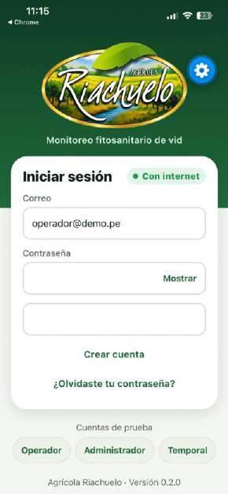
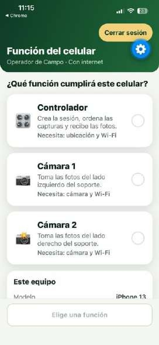
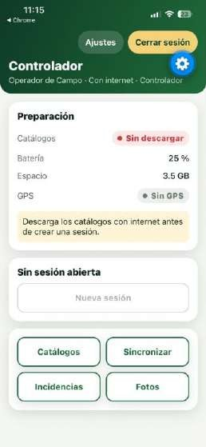
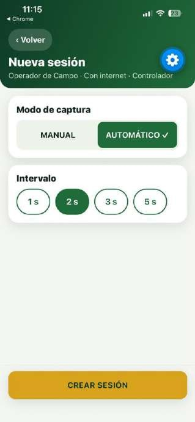
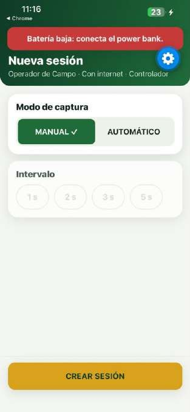

# CAPÍTULO XIII. DESPLIEGUE

## 13.1. Estrategia

La estrategia de despliegue adopta un enfoque incremental y modular alineado a la arquitectura unificada en Python, permitiendo disponer de versiones operativas del sistema al término de cada Sprint. Se estructuran dos frentes principales desplegados de manera coordinada:

- Aplicación Móvil (Offline-First): Desarrollada en React Native con Expo (TypeScript), instalada en los tres celulares Android montados sobre el soporte ergonómico en T (dos cámaras sobre la misma cara de la hilera) (SC-04, SC-07).

- Plataforma Web y Backend Centralizado: Plataforma web unificada en Django (Python) con Django Templates para la interfaz gráfica (Leaflet/OSM) y Django REST Framework para la exposición de la API REST v1. Esta plataforma centraliza la autenticación, el control de acceso y la gestión fitosanitaria.

## 13.2. Infraestructura

La infraestructura integra componentes de campo, servicios BaaS y procesamiento en la nube:

- Dispositivos de Campo: Celulares Android (Controlador, Cámara 1 y Cámara 2) operando en modo offline-first con persistencia local en expo-sqlite y expo-file-system.

- Backend Central (Django REST Framework): API REST desplegada en un VPS Hostinger (Ubuntu 24.04) con Docker Compose y Traefik (HTTPS con Let's Encrypt), encargada de la lógica de negocio, emisión y validación de tokens JWT (SimpleJWT) y roles (RBAC).

- Base de Datos (Supabase): Instancia en la nube de PostgreSQL (sin PostGIS, SC-07) administrada bajo la plataforma Supabase (BaaS). Garantiza la integridad de usuarios, recorridos, capturas, hallazgos y coordenadas.

- Almacenamiento CDN (Cloudinary): Red de distribución de contenidos para la carga, optimización y custodia de las evidencias fotográficas capturadas en campo.

- Worker de IA (Django + YOLO26n/ONNX): comando worker_ia de Django en su propio contenedor del VPS, que ejecuta el modelo con ONNX Runtime en CPU (sin FastAPI, SC-07) y consume las tareas registradas en la tabla ai_tasks de Supabase para inferir indicios de Planococcus ficus.

## 13.3. Cloud

La estrategia de servicios en la nube optimiza el presupuesto del piloto en Agrícola Riachuelo S.A.C.:

- Supabase Cloud (PostgreSQL, sin PostGIS): Operando bajo la capa administrada para garantizar alta disponibilidad sin administrar un servidor de base de datos propio (SC-07).

- Cloudinary CDN: Gestión de imágenes bajo esquema Pay-As-You-Go, reduciendo la latencia de transferencia hacia la plataforma web.

- VPS Hostinger (web y worker de IA): los contenedores web y worker corren de forma continua en un VPS Hostinger (Ubuntu 24.04); el worker ejecuta en CPU las inferencias del modelo YOLO26n exportado a ONNX.

- Telegram Bot API: Integración directa desde el backend en Django para la emisión de alertas automáticas tras la validación del especialista fitosanitario (Ing. Max Gutiérrez) o como alerta temprana «Confirmado por IA» (SC-02, SC-03).

## 13.4. Contenedores

Para garantizar la portabilidad y homogeneidad en los entornos de desarrollo y pruebas, se utiliza una estrategia de contenerización con Docker:

- Contenedor web: Empaqueta la aplicación Django con gunicorn y WhiteNoise, exponiendo la API REST y la plataforma web detrás de Traefik (HTTPS con Let's Encrypt).

- Contenedor worker: Ejecuta el comando worker_ia de Django con ONNX Runtime y el modelo YOLO26n exportado a ONNX para la ejecución de visión por computadora (sin FastAPI, SC-07).

- Configuración docker-compose.yml: Unifica las variables de entorno, claves de API, secretos de Supabase/Cloudinary y mapeo de puertos entre servicios.

## 13.5. Deployment V1

El Deployment V1 corresponde a la versión preliminar de prueba desplegada en entornos de desarrollo para validar la conectividad integrada inicial en condiciones controladas (la línea base del pretest se mide sobre el proceso habitual, sin el sistema, según 3.15):

- Infraestructura y Backend Inicial: Despliegue preliminar en contenedores Docker sobre VPS de prueba, verificando endpoints REST, autenticación JWT y persistencia en PostgreSQL tradicional (reemplazado por Supabase con la SC-01).

- Cliente Móvil: Compilación en modo desarrollo de Expo / React Native instalada en los tres dispositivos móviles del soporte de captura en T. Se probaron la captura bilateral, la validación local de nitidez e iluminación y la persistencia local en expo-sqlite.

- Integración IA e Imágenes Preliminar: Configuración de pruebas en Amazon S3 y encolamiento asíncrono con RabbitMQ hacia un microservicio en Python para las primeras inferencias del modelo YOLO. Esta pila (Amazon S3 y RabbitMQ) se retiró con la SC-01 (22/09/2026).

- Plataforma Web Inicial: Pruebas locales en Angular para validar el flujo de inicio de sesión y la visualización de tableros preliminares. Angular se reemplazó por Django Templates + HTMX (SC-01).

## 13.6. Deployment final

El despliegue final del sistema SIMDPCVAR establece la puesta en producción de una arquitectura unificada, lineal y sin acoplamientos complejos, basada en el ecosistema Django + Supabase + Cloudinary. Esta estructura elimina los cuellos de botella de la pila inicial (Spring Boot, RabbitMQ y Angular), garantizando tiempos de respuesta de la API REST menores a 1,5 s (RNF04) y un mantenimiento simplificado para Agrícola Riachuelo S.A.C.

### 13.6.1. Definición del Entorno de Producción Proyectado

- Repositorio 1: Aplicación Móvil (React Native + Expo + TypeScript): Cliente nativo distribuido a los operadores de campo. Implementa una arquitectura offline-first respaldada por SQLite, FileSystem y SecureStore para almacenar capturas locales y datos de sesión sin depender de conectividad continua.

- Repositorio 2: Plataforma Django (Backend Central + Web de Revisión): Centraliza en una sola base tecnológica en Python el procesamiento backend y la interfaz web:

  - Proceso Web (Django + DRF): Expone la API REST versionada (/api/v1) con tokens JWT, gestiona permisos por roles, aplica reglas de negocio y firma los tickets temporales para la subida a Cloudinary. Servido mediante Django Templates y mapas interactivos con Leaflet/OSM.

  - Worker IA (Proceso Asíncrono en Python): Servicio en segundo plano que carga en memoria el modelo YOLO26n exportado a ONNX (ONNX Runtime, CPU), consume las tareas encoladas en la tabla ai_tasks de Supabase utilizando la cláusula FOR UPDATE SKIP LOCKED y registra los indicios detectados (cajas delimitadoras y % de confianza).

### 13.6.2. Servicios Cloud Integrados y Flujo de Datos

- Supabase Cloud (PostgreSQL, sin PostGIS): Base de datos relacional administrada de acceso exclusivo para la plataforma Django. Almacena usuarios, roles, catálogos, pasadas de monitoreo, la cola de tareas ai_tasks e historial inmutable de revisiones.

- Cloudinary CDN: Repositorio de almacenamiento seguro para las fotos de evidencia. Recibe la carga directa desde la app móvil utilizando tickets firmados por Django (≤ 1 h de validez) sin recargar el ancho de banda ni la memoria del servidor central.

- Telegram Bot API: Servicio externo de mensajería configurado para enviar avisos de alerta tras la confirmación manual del Especialista Fitosanitario (Ing. Max Gutiérrez) en el panel web y, como alerta temprana marcada «falta la revisión del especialista», en los casos «Confirmado por IA» (SC-02, SC-03).

### 13.6.3. Protocolo y Pasos para el Despliegue de Producción

1\. Puesta a Punto de BD e Infraestructura Cloud:

a\. Aprovisionamiento del proyecto en Supabase Cloud y ejecución de las migraciones relacionales desde Django (python manage.py migrate).

b\. Configuración de la cuenta corporativa de Cloudinary para la emisión de firmas seguras y entrega de imágenes optimizadas mediante CDN.

2\. Publicación del Servidor Central (Django + Worker IA):

a\. Despliegue del Repositorio 2 en el VPS Hostinger (Ubuntu 24.04) con Docker Compose: contenedor web (gunicorn + Django + WhiteNoise) detrás de Traefik con HTTPS de Let's Encrypt, en el dominio monitoreo.agricolariachuelo.org.

b\. Inicialización del proceso Worker IA en segundo plano para el monitoreo continuo de la tabla ai_tasks.

3\. Compilación y Entrega del Cliente Móvil:

a\. Generación de la compilación ejecutable .apk (React Native / Expo) apuntando a los endpoints de producción con cifrado HTTPS/JWT.

b\. Instalación del aplicativo en los tres dispositivos móviles fijados al soporte tipo T de los operadores de campo.

**Verificación de Reglas de Arquitectura y Sanidad**

- Seguridad y Acceso Restringido: Ni la app móvil ni el navegador web acceden directamente a las credenciales o tablas de Supabase; todo requerimiento fluye centralizado por la API REST en Django protegida con JWT.

- Cero Bloqueo en Sincronización: La sincronización de fotos desde la app móvil no espera a que el modelo YOLO termine de analizar para completar la subida. La carga de la evidencia a Cloudinary y el registro en la base de

datos es inmediato, delegando el procesamiento de IA de forma totalmente asíncrona.

## 13.7. Evidencias

 

