# Manual de usuario · App móvil

<!-- página 1 -->

M O N I TO R E O F I TO S A N I TA R I O D E L A V I D

## Manual de usuario:

## app móvil

La jornada en el campo con los tres celulares: preparar, vincular las cámaras, capturar, repetir, cerrar, sincronizar y ubicar plagas.

Controlador

Cámara 1 y 2

Ubicar plaga

Sin internet

Agrícola Riachuelo S.A.C. · Sistema de monitoreo fitosanitario de la vid Curso Integrador II

Noviembre 2026

Web v1.6 · App 0.6.1

<!-- página 2 -->

1

Conoce la app

3

2

Antes de salir al campo

5

3

Instalar e ingresar

6

4

Elegir la función del celular

8

5

Controlador: panel y catálogos

10

6

Nueva sesión y vincular las cámaras

12

7

Prueba corta

14

8

Nueva pasada

16

9

Pasada activa: capturar

17

10

Si una foto sale mal: repetir

18

11

Cambiar marcador y pausar

20

12

Terminar la pasada y seguir

22

13

Cerrar la sesión de monitoreo

24

14

Sincronizar

25

15

Incidencias, fotos guardadas y ajustes

27

16

Funciones de cámara

29

17

Ubicar plaga

31

18

Sin internet: qué funciona

33

19

Problemas frecuentes

34

20

Resumen de la jornada

35

### Contenido

<!-- página 3 -->

EN POCAS PALABRAS

Una sola app para los tres celulares del equipo de campo. Uno es el controlador (ordena, guarda y sincroniza) y dos son cámaras (toman las fotos). Todo funciona sin internet en el campo; los datos se envían al volver a tener señal.

Controlador

Crea la sesión, vincula las cámaras con un QR, ordena cada captura, guarda todo y sincroniza.

Cámara 1 y Cámara 2

Van en el soporte. Toman la foto cuando el controlador lo ordena, revisan su calidad y la envían por Wi-Fi.

Ubicar plaga

Muestra en un mapa o lista dónde hay plagas confirmadas y guía a pie con Google Maps.

1

### Quién usa la app

Rol

Qué hace en la app

Operador de campo

Hace el monitoreo: controlador o cámara. Sincroniza. Usa «Ubicar plaga».

Administrador

Lo mismo que el operador.

Especialista fitosanitario

Solo «Ubicar plaga» (no monitorea ni sincroniza).

Supervisor

No usa la app (usa la web).

2

### Cómo se ve el equipo en el campo

HILERA DE VID · el lado que se fotografía (lateral A o B)

soporte (barra en T)

Cám. 1

Cám. 2

lado izquierdo

lado derecho

Controlador

en la mano del operador

Wi-Fi local

router o hotspot

(sin internet)

Las dos cámaras van en la barra y fotografían el mismo lado de la hilera al mismo tiempo. El controlador las une por Wi-Fi local. Cada hilera se recorre dos veces: lado A de ida y lado B de vuelta.

## Conoce la app

CAPÍTULO 1

app 0.6.1

<!-- página 4 -->

### 3 Las palabras que verás

Palabra

Significado

Sesión

Una salida al campo con los 3 celulares vinculados.

Pasada

Recorrer un lado (lateral A o B) de una hilera.

Secuencia

Una orden de capturar: una foto por cámara en el mismo lugar.

Segmento y marcador

Cada hilera tiene 10 tramos (segmentos); los postes del inicio de cada tramo son los marcadores.

Sincronizar

Enviar las sesiones y fotos al servidor cuando hay internet.

4 Cuentas de prueba para evaluar

Cuenta de prueba · app móvil

USUARIO

**testeador2@gmail.com**

CONTRASEÑA

**[omitido]**

Rol activo:

Operador de campo

· controlador, cámaras, sincronizar y «Ubicar plaga».

operador de campo

Úsala en los tres celulares Inicia sesión con esta cuenta en el controlador y en las dos cámaras (la primera vez, con internet). Luego elige la función de cada celular (capítulo 4).

i

¿Y la cuenta de la web? testeador@gmail.com / [omitido] tiene los roles Administrador, Especialista fitosanitario y Supervisor. En la app entra como administrador: puede monitorear, sincronizar y usar «Ubicar plaga».

i

Cuentas compartidas No cambies su contraseña. Si pides una cuenta nueva con «Crear cuenta», el formulario no pide rol: el administrador la aprueba en la web y queda como operador de campo. Para copiar el usuario o la contraseña, selecciona el texto del recuadro.

!

<!-- página 5 -->

EN POCAS PALABRAS

Revisa esta lista la noche anterior y antes de empezar. Evita la mayoría de los problemas del día.

En la oficina (con internet)

En el campo

El router no debe aislar a los celulares Algunos routers no dejan que los equipos se vean entre sí. Si las cámaras no se vinculan, prueba con el hotspot de otro celular.

## Antes de salir al campo

CAPÍTULO 2

lista

Los 3 celulares tienen la misma versión de la app (Ajustes → App). Cada persona inició sesión al menos una vez con internet en su celular. En el controlador: Catálogos → Actualizar. Sesiones anteriores ya sincronizadas. Baterías cargadas y power bank en la mochila.

Router o hotspot encendido; los 3 celulares en la misma red Wi-Fi. Cámara 1 a la izquierda y Cámara 2 a la derecha del soporte, bien ajustadas. Ubicación (GPS) encendida en el controlador. Pantalla del controlador siempre encendida y con la app abierta durante la pasada. Más de 3 GB libres en cada celular.

<!-- página 6 -->

EN POCAS PALABRAS

La app se instala con un archivo APK que entrega el responsable técnico. Después inicias sesión con tu correo y contraseña. Los tres celulares deben tener la misma versión.

1

Tu correo

2

Tu contraseña

3

Ver lo escrito

4

Ingresar

5

Indica si hay internet

6

Pedir una cuenta

7

Pedir una contraseña nueva

Ingreso.

¿No tienes cuenta? Pulsa «Crear cuenta». Queda pendiente hasta que el administrador la apruebe en la web. «¿Olvidaste tu contraseña?» envía un pedido al administrador.

## Instalar e ingresar

CAPÍTULO 3

todos

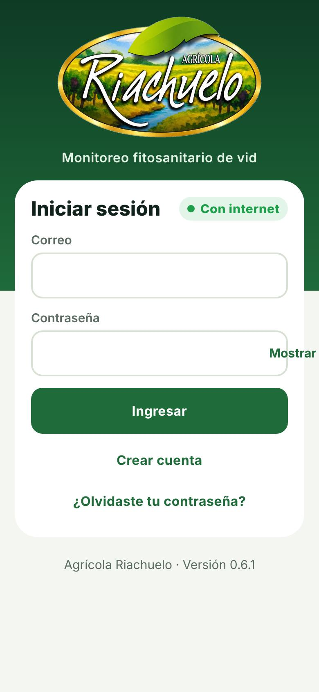

> **Captura transcrita:** Pantalla de entrada de la app 0.6.1. [Transcripción completa](../06-figuras/manual-app/01-inicio-de-sesion-de-la-app.md)

1

2

3

4

5

6

7

Instala el APK

Abre el archivo en el celular y permite «instalar apps desconocidas» si te lo pide.

1

Escribe tu correo y contraseña

La etiqueta verde indica si hay internet.

2

Pulsa «Ingresar»

La primera vez en cada celular necesitas internet. Después puedes entrar sin internet hasta 7 días.

3

Si tu contraseña es temporal

La app te pide cambiarla antes de seguir.

4

Cuenta de prueba Usuario testeador2@gmail.com · contraseña [omitido] (operador de campo). Las cuentas pedidas con «Crear cuenta» no eligen rol: al aprobarlas quedan como operador de campo.

i

<!-- página 7 -->

Crear cuenta (queda pendiente de aprobación).

Pedir una contraseña nueva.

Sin internet Si fallas 5 veces la contraseña sin internet, el ingreso se bloquea 15 minutos. En celulares de gama baja el ingreso sin internet puede tardar unos segundos.

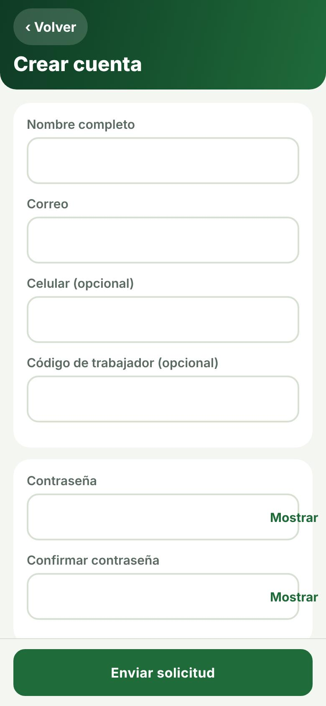

> **Captura transcrita:** Formulario de solicitud de cuenta que llena el propio operador de campo desde la app. [Transcripción completa](../06-figuras/manual-app/02-crear-cuenta-registro-del-operador.md)

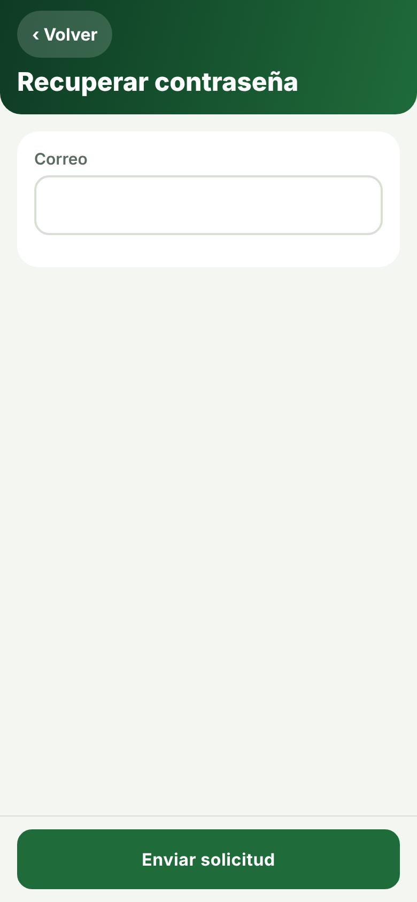

> **Captura transcrita:** Pantalla para pedir una contraseña nueva: solo pide el correo y envía la solicitud al administrador. [Transcripción completa](../06-figuras/manual-app/03-recuperar-contrasena.md)

<!-- página 8 -->

EN POCAS PALABRAS

Después de cada ingreso eliges qué hará este celular hoy: Controlador, Cámara 1 o Cámara 2. La función es del celular, no de la persona.

1

El que manda y guarda

2

Lado izquierdo del soporte

3

Lado derecho del soporte

4

Ir a una plaga

5

Salir de tu cuenta

Elige una función.

1

Confirmar la función

Confirma con «Usar como…».

## Elegir la función del celular

CAPÍTULO 4

operador

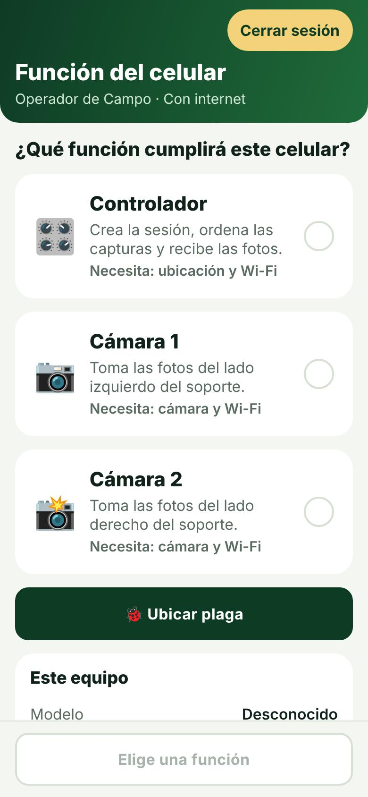

> **Captura transcrita:** Después de ingresar, la app pregunta qué papel cumplirá el equipo en la sesión: Controlador, Cámara 1 o Cámara 2. [Transcripción completa](../06-figuras/manual-app/04-funcion-del-celular-sin-elegir.md)

1

2

3

4

5

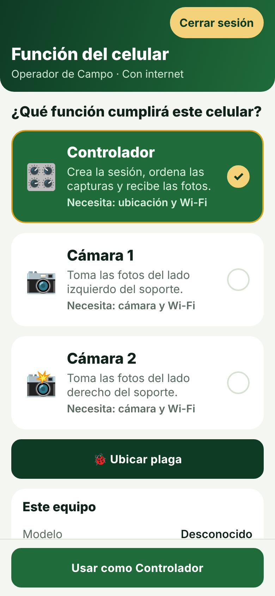

> **Captura transcrita:** La misma pantalla con «Controlador» marcado (tarjeta en verde con check). [Transcripción completa](../06-figuras/manual-app/05-funcion-del-celular-controlador-elegido.md)

1

Toca la tarjeta de la función

Cada una dice qué necesita: ubicación o cámara, y Wi-Fi.

1

Pulsa «Usar como …»

Si falta un permiso (ubicación o cámara), la app lo pide.

2

<!-- página 9 -->

Para cambiar después

Ajustes → «Cambiar función». Si el controlador tiene datos sin sincronizar, la app lo avisa.

3

<!-- página 10 -->

EN POCAS PALABRAS

El panel muestra si el celular está listo (catálogos, batería, espacio y GPS) y da acceso a todo. Lo primero es descargar los catálogos: los lotes, hileras, segmentos y marcadores del fundo.

1

Faltan los catálogos

2

Aviso: qué falta

3

Descargar catálogos

Sin catálogos: la app avisa qué falta.

1

Lo que bajó

2

Regla de 10 segmentos

Catálogos descargados.

## Controlador: panel y catálogos

CAPÍTULO 5

controlador

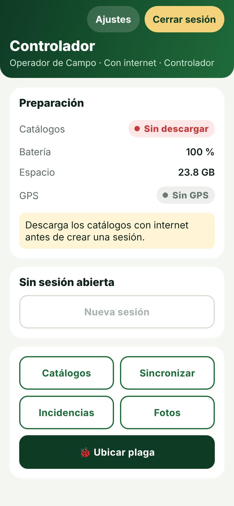

> **Captura transcrita:** Panel principal del controlador antes de descargar los catálogos. [Transcripción completa](../06-figuras/manual-app/06-panel-del-controlador-sin-catalogos.md)

1

2

3

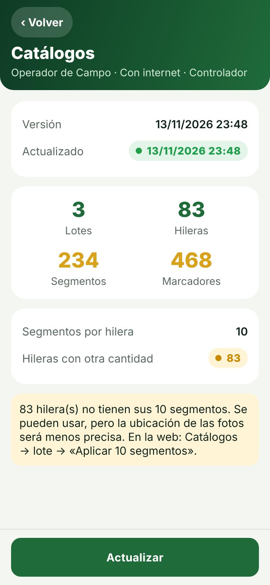

> **Captura transcrita:** Pantalla «Catálogos» con la versión descargada y el resumen de lo que trae: lotes, hileras, segmentos y marcadores. [Transcripción completa](../06-figuras/manual-app/07-catalogos-descargados.md)

1

2

Abre «Catálogos»

Desde el panel.

1

Pulsa «Actualizar» (con internet)

Baja los datos del fundo.

2

<!-- página 11 -->

1

Estado del celular

2

Señal GPS

3

Empezar a trabajar

4

Enviar al servidor

5

Registrar problemas

6

Fotos guardadas

7

Ajustes

Panel listo para trabajar.

Avisos del panel

Batería bajo 15 %: solo avisa «conecta el power bank». Espacio: aviso bajo 3 GB; no deja empezar bajo 2 GB; pausa bajo 1 GB. GPS: si la precisión es peor que 15 m, lo indica; las fotos igual se guardan.

Vuelve al panel

La fila «Catálogos» muestra la fecha de la última descarga.

3

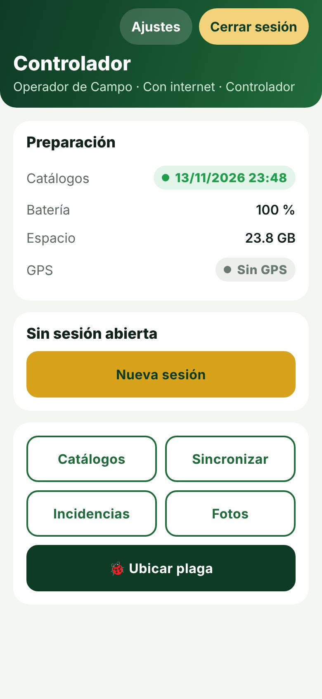

> **Captura transcrita:** Panel del controlador con los catálogos al día (fecha en verde). [Transcripción completa](../06-figuras/manual-app/08-panel-del-controlador-listo.md)

1

2

3

4

5

6

7

<!-- página 12 -->

EN POCAS PALABRAS

Una sesión es la salida del día. Al crearla, el controlador muestra un QR; cada cámara lo escanea y queda vinculada por el Wi-Fi local, sin internet.

1

Manual: tú tocas CAPTURAR

2

Automático: cada 1 a 5 s

3

Intervalo

4

Crear la sesión

Modo de captura e intervalo.

## Nueva sesión y vincular las cámaras

CAPÍTULO 6

controlador + cámaras

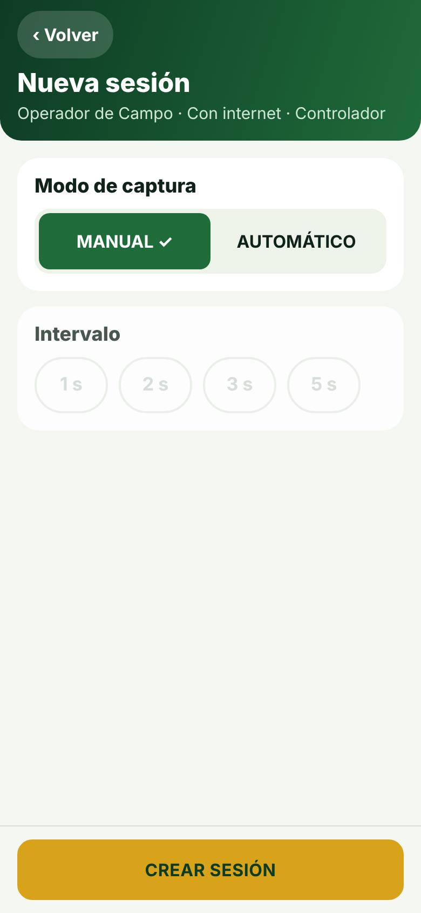

> **Captura transcrita:** Al crear la sesión se elige el modo de captura. [Transcripción completa](../06-figuras/manual-app/09-nueva-sesion-modo-de-captura.md)

1

2

3

4

Pulsa «Nueva sesión»

En el panel del controlador.

1

Elige el modo

Manual: tú tocas CAPTURAR. Automático: captura sola cada 1, 2, 3 o 5 segundos, solo con el celular quieto.

2

Pulsa «CREAR SESIÓN»

Aparece el QR para vincular.

3

<!-- página 13 -->

1

QR para las cámaras

2

Dirección del controlador

3

Nuevo QR

4

Cámara 1 vinculada

5

Seguir

Controlador: QR y estado de cada cámara.

1

Apunta al QR

2

Probar la cámara

Cámara: apunta al QR del controlador.

Si una cámara no conecta

Revisa que los 3 estén en la misma red Wi-Fi. «Regenerar QR» y vuelve a escanear. Si la red no detecta la IP, usa «IP manual».

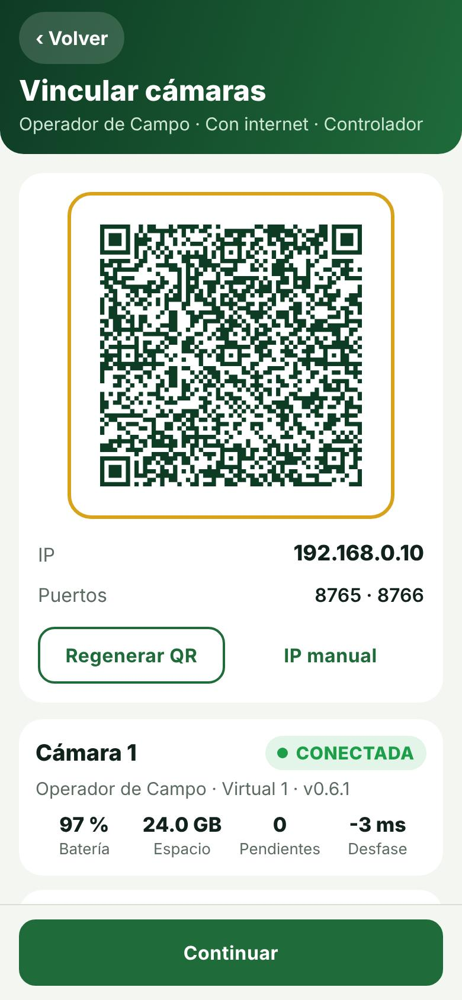

> **Captura transcrita:** El controlador muestra un código QR con su IP y puertos para que las dos cámaras se vinculen por Wi-Fi local. [Transcripción completa](../06-figuras/manual-app/10-vincular-camaras-qr-del-controlador.md)

1

2

3

4

5

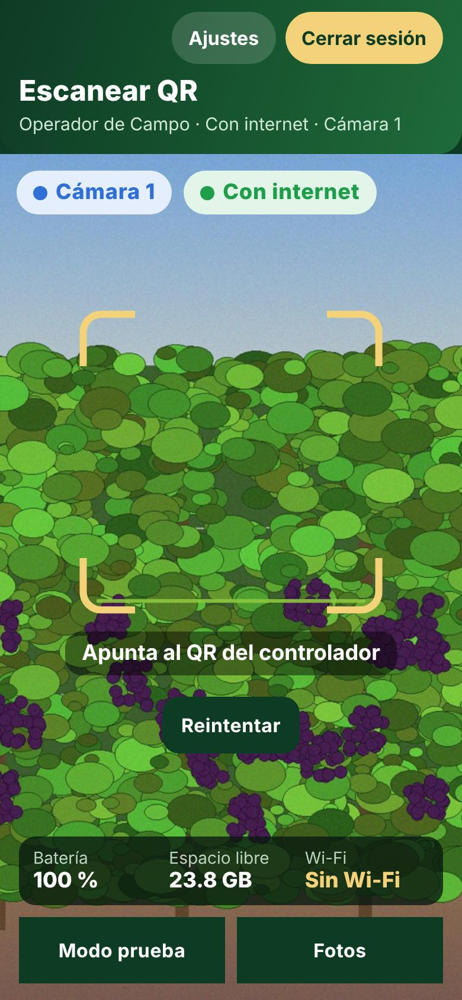

> **Captura transcrita:** Vista del celular que hará de Cámara 1: la cámara apunta al QR del controlador (en la imagen se ve un viñedo simulado). [Transcripción completa](../06-figuras/manual-app/11-escanear-qr-desde-la-camara.md)

1

2

En cada cámara

Ingresa, elige «Cámara 1» o «Cámara 2» y apunta al QR del controlador.

1

Espera «CONECTADA»

En el controlador, la tarjeta de cada cámara pasa a CONECTADA con su batería y espacio.

2

Pulsa «Continuar»

Solo se puede seguir con las dos cámaras conectadas.

3

<!-- página 14 -->

EN POCAS PALABRAS

Antes de empezar, cada cámara toma una foto, la evalúa y la envía. Así se comprueba que todo funciona. Aprueba si las dos fotos llegan en menos de 20 segundos.

1

Probar las 2 cámaras

Antes de la prueba.

1

Cada cámara aprobada

2

Diferencia entre cámaras

3

Resultado

4

Seguir

Prueba aprobada.

Resultado

Qué hacer

Aprobada

Pulsa «Continuar».

Reprobada por tiempo o conexión

Acerca los celulares al router, revisa el Wi-Fi y pulsa «Repetir».

## Prueba corta

CAPÍTULO 7

controlador

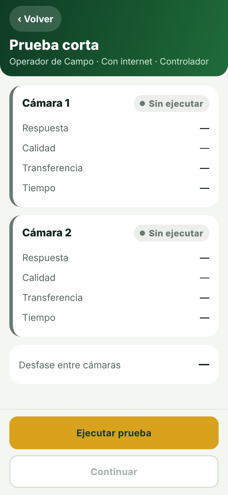

> **Captura transcrita:** Prueba de conexión y calidad con las dos cámaras antes de salir al campo. [Transcripción completa](../06-figuras/manual-app/12-prueba-corta-antes-de-ejecutar.md)

1

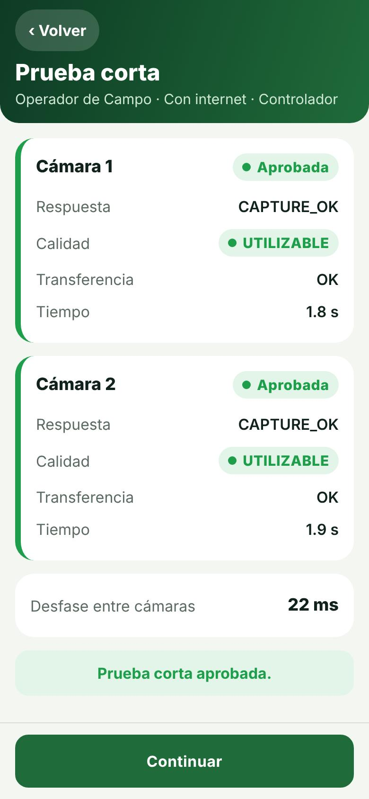

> **Captura transcrita:** Resultado de la prueba: las dos cámaras respondieron CAPTURE_OK, la foto salió UTILIZABLE, la transferencia fue correcta y tardó menos de 2 s. [Transcripción completa](../06-figuras/manual-app/13-prueba-corta-aprobada.md)

1

2

3

4

<!-- página 15 -->

Resultado

Qué hacer

Error de cámara

Cierra otras apps de cámara en ese celular y repite.

Foto de mala calidad

La comunicación está bien; revisa el lente y la luz.

<!-- página 16 -->

EN POCAS PALABRAS

Una pasada es recorrer un lado de una hilera. Eliges lote, hilera y lado; la app propone el segmento y el marcador de inicio y te dice en qué sentido caminar.

1

Lote

2

Hilera

3

Lado (A ida, B vuelta)

4

Sentido y punto de inicio

5

Segmento propuesto

6

Empezar

Nueva pasada con el recorrido propuesto.

Aviso de segmentos Si una hilera no tiene sus 10 segmentos, la app lo avisa: se puede trabajar, pero la ubicación será menos precisa.

## Nueva pasada

CAPÍTULO 8

controlador

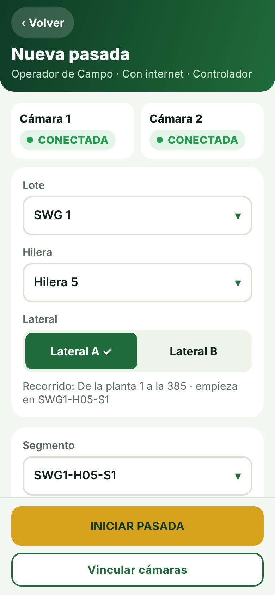

> **Captura transcrita:** Configuración de una pasada: con las dos cámaras conectadas se elige lote, hilera, lateral y segmento inicial. [Transcripción completa](../06-figuras/manual-app/14-nueva-pasada-lateral-a.md)

1

2

3

4

5

6

Elige el lote

Toca «Elegir» y luego el lote.

1

Elige la hilera

La lista muestra cuántas plantas tiene cada una.

2

Elige el lado

Lateral A: de ida (planta 1 → última). Lateral B: de vuelta.

3

Revisa el recorrido

La app propone segmento y marcador del extremo donde empiezas.

4

Pulsa «INICIAR PASADA»

Se abre la pasada activa.

5

<!-- página 17 -->

EN POCAS PALABRAS

La pantalla principal del día. Arriba ves dónde estás; en el medio, el estado de las cámaras; abajo, el botón grande CAPTURAR.

1

Dónde estás

2

Marcador y segmento

3

GPS y su precisión

4

Secuencias

5

Estado de cada cámara

6

Tomar fotos

7

Pausar

8

Al cruzar un poste

9

Al final de la hilera

Pasada activa.

Contador

Significa

Completas

Las dos fotos llegaron bien.

Parciales

Solo una cámara respondió.

Incompletas

Ninguna foto válida.

Mantén la app en pantalla Si el controlador pasa a segundo plano o se apaga la pantalla, Android pausa la app y las cámaras se desconectan. Una cámara desconectada pausa la pasada.

## Pasada activa: capturar

CAPÍTULO 9

controlador

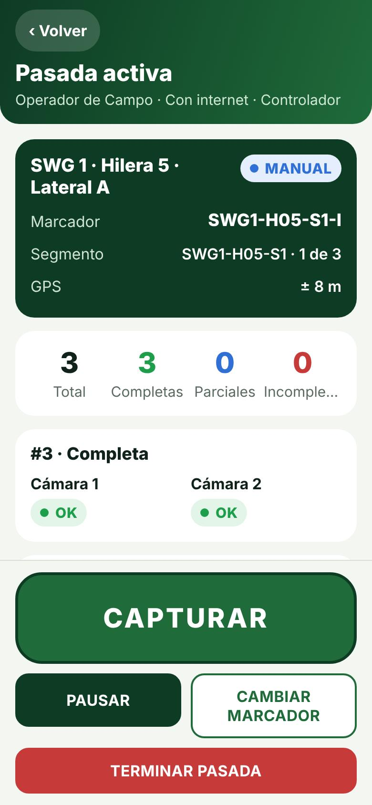

> **Captura transcrita:** Pantalla de trabajo durante la pasada. [Transcripción completa](../06-figuras/manual-app/15-pasada-activa-capturar.md)

1

2

3

4

5

6

7

8

9

Colócate en el punto

Con el soporte frente a las plantas.

1

Toca «CAPTURAR»

Las dos cámaras toman su foto a la vez. Cada orden es una secuencia con el GPS del controlador.

2

Mira el resultado

«#N · Completa» con Cámara 1 y 2 en OK. Avanza y repite.

3

En modo automático

La captura sale sola cada intervalo, solo con el celular quieto.

4

<!-- página 18 -->

EN POCAS PALABRAS

Si una cámara saca una foto movida u oscura, la app obliga a repetirla antes de seguir, como máximo 2 veces. En el último intento la foto se acepta igual y la evalúa la IA.

1

Qué cámara falló y el intento

2

Repetir (botón dorado)

3

Foto rechazada por calidad

El botón grande cambia a «REPETIR CÁMARA X · INTENTO a DE 2» (dorado).

1

La secuencia quedó completa

Repetida: la secuencia vuelve a estar completa.

## Si una foto sale mal: repetir

CAPÍTULO 10

controlador · v0.6.1

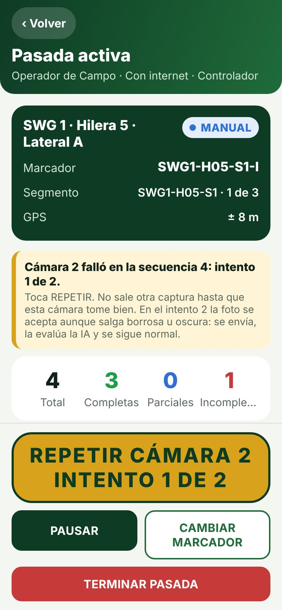

> **Captura transcrita:** Cuando una cámara entrega una foto mala, la app bloquea nuevas capturas y pide repetir. [Transcripción completa](../06-figuras/manual-app/16-repetir-camara-intento-1-de-2.md)

1

2

3

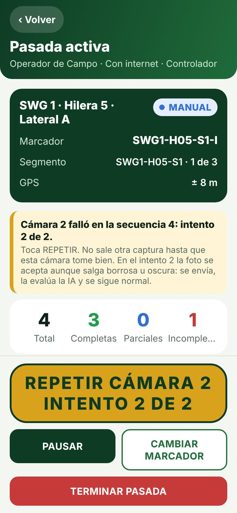

> **Captura transcrita:** Segundo y último intento. [Transcripción completa](../06-figuras/manual-app/17-repetir-camara-intento-2-de-2.md)

1

Lee el aviso

Dice qué cámara falló y en qué secuencia.

1

Toca el botón dorado «REPETIR»

Solo repite esa cámara (o las dos si fallaron ambas).

2

<!-- página 19 -->

En automático La repetición sale sola antes de la siguiente captura.

Último intento

Si vuelve a fallar, en el intento 2 la foto se acepta aunque salga borrosa u oscura, se envía y la IA la evalúa.

3

Sigue normal

El aviso desaparece y vuelve el botón CAPTURAR.

4

<!-- página 20 -->

EN POCAS PALABRAS

Cada vez que cruzas un poste (marcador), avisa a la app con CAMBIAR MARCADOR: el siguiente segmento ya viene elegido. Si necesitas parar, usa PAUSAR.

1

Ya elegido

2

Otros marcadores

3

Confirmar

Cambiar marcador: el siguiente segmento ya está elegido.

1

Seguir capturando

Pasada en pausa.

## Cambiar marcador y pausar

CAPÍTULO 11

controlador

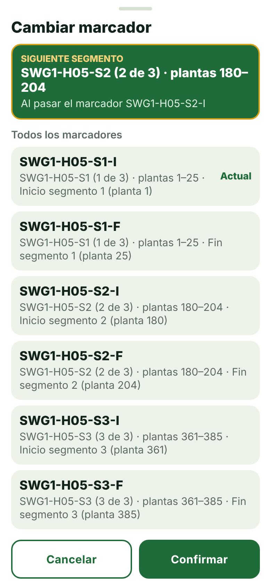

> **Captura transcrita:** Hoja inferior que se abre con «CAMBIAR MARCADOR». [Transcripción completa](../06-figuras/manual-app/18-cambiar-marcador.md)

1

2

3

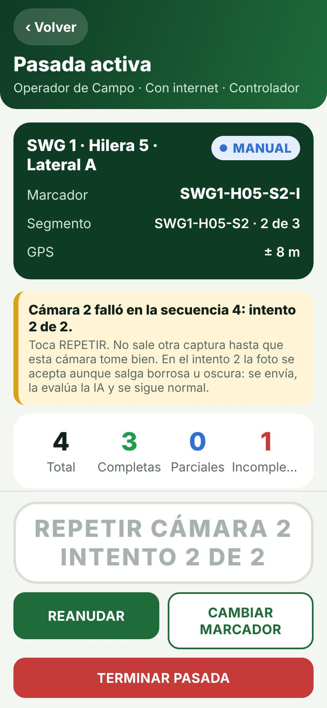

> **Captura transcrita:** Pasada pausada en el marcador SWG1-H05-S2-I (segmento 2 de 3). [Transcripción completa](../06-figuras/manual-app/19-pasada-en-pausa.md)

1

Al cruzar un poste

Toca «CAMBIAR MARCADOR».

1

Confirma

Arriba está «Siguiente segmento» seleccionado: basta «Confirmar».

2

<!-- página 21 -->

Para pausar

«PAUSAR»; para seguir, «REANUDAR».

3

<!-- página 22 -->

EN POCAS PALABRAS

Al llegar al final de la hilera, termina la pasada. Luego eliges qué sigue: el otro lado (lateral B), otra hilera o cerrar la sesión.

1

Resumen de la pasada

2

Completa o incompleta

3

Cerrar

Resumen de la pasada y estado final.

1

El otro lado (vuelta)

2

Otra hilera

3

Terminar el día

Qué hacer después.

## Terminar la pasada y seguir

CAPÍTULO 12

controlador

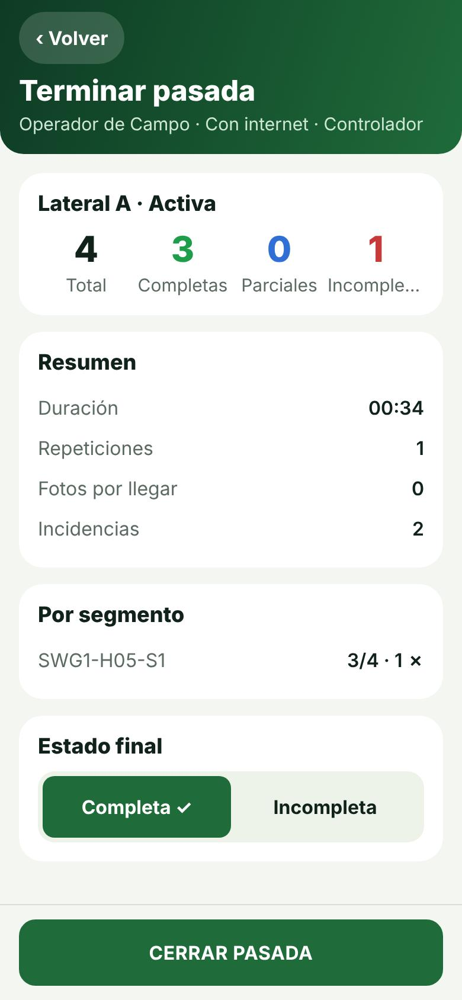

> **Captura transcrita:** Resumen antes de cerrar la pasada: contadores, duración, repeticiones, fotos por llegar, incidencias y avance por segmento. [Transcripción completa](../06-figuras/manual-app/20-terminar-pasada-resumen.md)

1

2

3

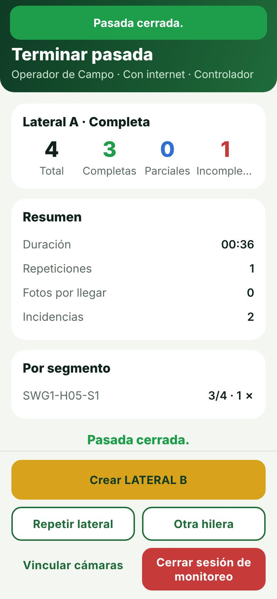

> **Captura transcrita:** Confirmación de pasada cerrada. [Transcripción completa](../06-figuras/manual-app/21-pasada-cerrada-que-sigue.md)

1

2

3

Toca «TERMINAR PASADA»

Revisa el resumen.

1

Estado final

«Completa» o «Incompleta» (con motivo obligatorio).

2

«Cerrar pasada»

Y elige: Crear LATERAL B, Repetir lateral, Otra hilera, Vincular cámaras o Cerrar sesión de monitoreo.

3

<!-- página 23 -->

1

Lado B

2

De vuelta: de la última planta a la 1

Lateral B: el recorrido es de vuelta.

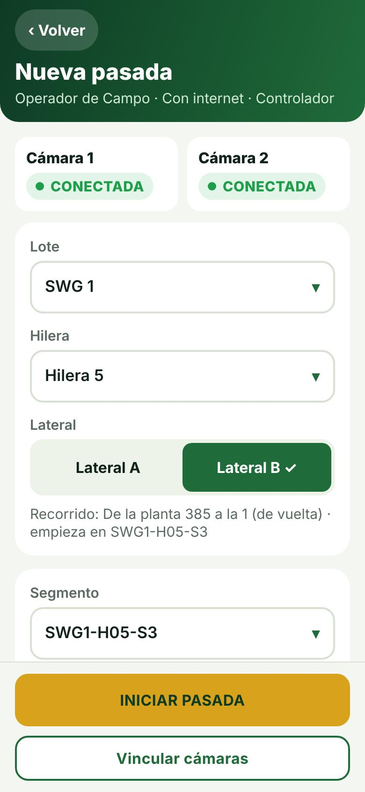

> **Captura transcrita:** Pasada del Lateral B de la misma hilera. [Transcripción completa](../06-figuras/manual-app/22-nueva-pasada-lateral-b-de-vuelta.md)

1

2

<!-- página 24 -->

EN POCAS PALABRAS

Al terminar el día, cierra la sesión en el controlador. La app avisa si faltan fotos por llegar de alguna cámara. Después cada celular vuelve a elegir función.

1

Pasadas de la sesión

2

Cerrar

Resumen y «Cerrar sesión».

1

Aviso: falta sincronizar

La app recuerda que falta sincronizar.

Fotos que faltan llegar Si una cámara aún tiene fotos pendientes, la app ofrece «Esperar» o «Cerrar igual». «Cerrar igual» registra una incidencia.

## Cerrar la sesión de monitoreo

CAPÍTULO 13

controlador

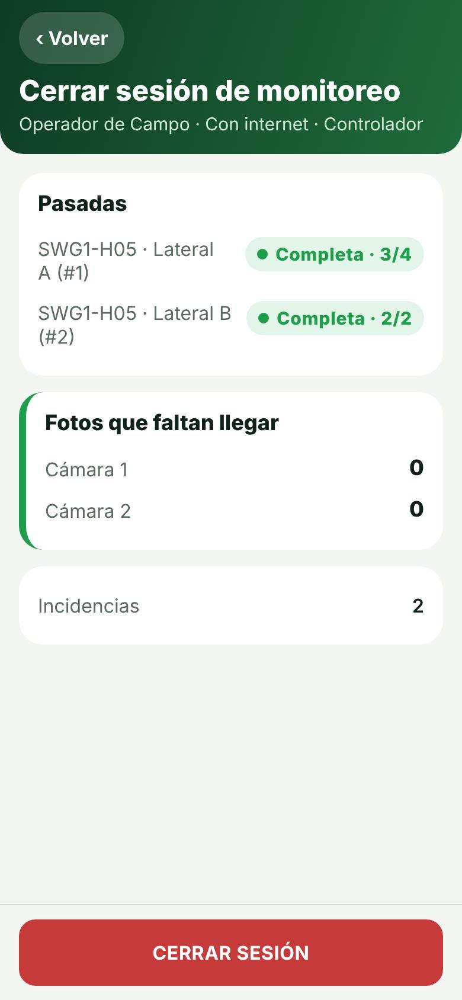

> **Captura transcrita:** Resumen final de la sesión: las pasadas hechas con su estado, las fotos de cada cámara que faltan llegar al controlador y el número de incidencias. [Transcripción completa](../06-figuras/manual-app/23-cerrar-sesion-de-monitoreo.md)

1

2

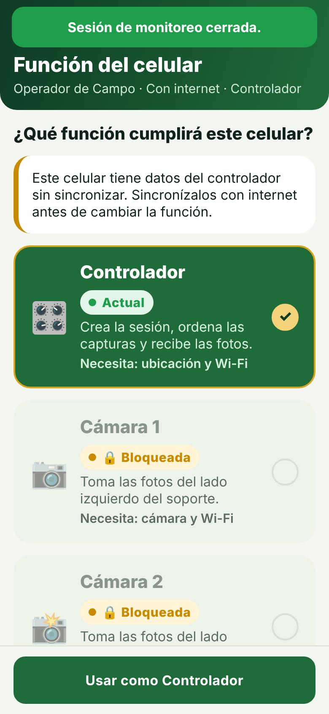

> **Captura transcrita:** Tras cerrar la sesión vuelve a «Función del celular». [Transcripción completa](../06-figuras/manual-app/24-sesion-cerrada-con-datos-sin-sincronizar.md)

1

<!-- página 25 -->

EN POCAS PALABRAS

Con internet, el controlador envía todo al servidor: primero los datos y después las fotos. Si se corta, retoma donde quedó; nada se duplica.

1

Total, enviados, pendientes y errores

2

Enviar todo

Antes: lo que falta enviar (en la captura, servidor de demostración).

1

Progreso del envío

2

Ya enviados

3

Detener (retoma después)

Durante el envío: progreso, enviados y «Detener».

## Sincronizar

CAPÍTULO 14

controlador

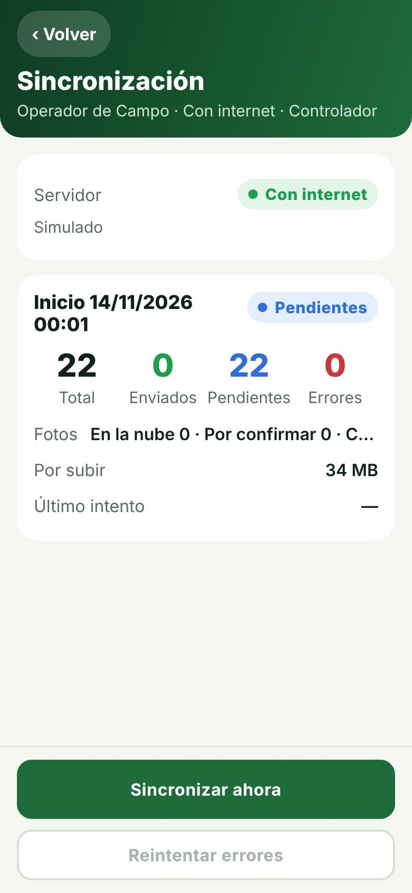

> **Captura transcrita:** Pantalla de sincronización con el servidor (aquí simulado). [Transcripción completa](../06-figuras/manual-app/25-sincronizacion-pendiente.md)

1

2

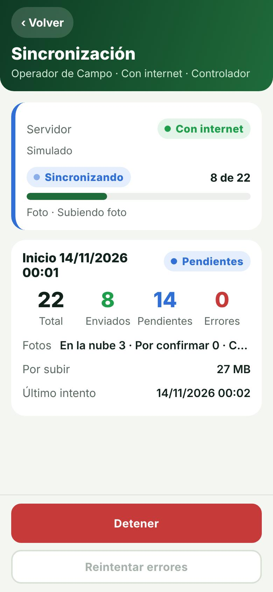

> **Captura transcrita:** Subida en progreso: barra «Sincronizando 8 de 22», 8 enviados y 14 pendientes, 27 MB por subir. [Transcripción completa](../06-figuras/manual-app/26-sincronizacion-en-curso.md)

1

2

3

Conéctate a internet

De preferencia Wi-Fi. Con datos móviles la app avisa el tamaño.

1

Panel → «Sincronizar» → «Sincronizar ahora»

Verás el progreso por tipo: sesión, pasadas, secuencias, fotos e incidencias.

2

Espera a que termine

Con errores, usa «Reintentar errores».

3

<!-- página 26 -->

Después de sincronizar Las fotos aparecen en la web en la sesión correspondiente y la IA las analiza en segundos. Las cámaras borran su copia solo cuando el controlador ya la sincronizó.

Automática

Con Wi-Fi, la app sincroniza sola si no hay una sesión abierta.

4

<!-- página 27 -->

EN POCAS PALABRAS

Herramientas del día a día: registrar un problema, ver las fotos del celular y revisar la configuración.

1

### Registrar una incidencia

1

Tipo

2

Severidad

3

Detalle

4

Guardar

Panel → Incidencias → «Agregar incidencia»: tipo, severidad y detalle.

1

Incidencia registrada

2

Agregar otra

La incidencia queda en la lista de la sesión.

Cuándo se puede «Agregar incidencia» se activa solo con una sesión abierta. La app también registra sola algunas incidencias (por ejemplo, una foto rechazada por calidad). Todas llegan a la web al sincronizar, en la página de la sesión.

## Incidencias, fotos guardadas y ajustes

CAPÍTULO 15

todos

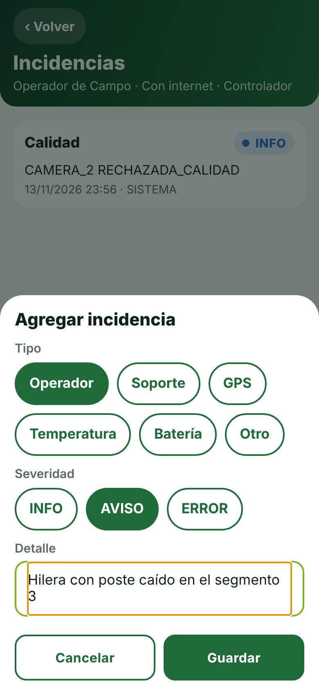

> **Captura transcrita:** Formulario para registrar una incidencia de campo. [Transcripción completa](../06-figuras/manual-app/27-agregar-incidencia.md)

1

2

3

4

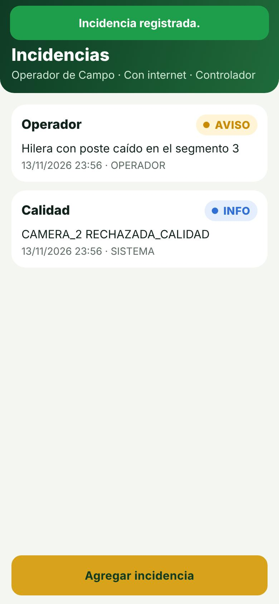

> **Captura transcrita:** Lista de incidencias de la sesión: la que acaba de registrar el operador (AVISO) y la generada por el sistema (INFO). [Transcripción completa](../06-figuras/manual-app/28-incidencias-registradas.md)

1

2

<!-- página 28 -->

2

### Fotos guardadas y ajustes

1

Fotos de sesiones

Fotos guardadas en el celular.

1

Tu cuenta

2

Servidor

3

Cambiar función

4

Exportar diagnóstico

Ajustes.

En Ajustes

Para qué

Cambiar función

Pasar de controlador a cámara o al revés.

Exportar diagnóstico

Genera un archivo para soporte (sin contraseñas). Pídelo cuando algo falle.

Cambiar contraseña · Cerrar sesión

Tu cuenta en este celular.

Sonidos y vibración

Ayudas de la interfaz.

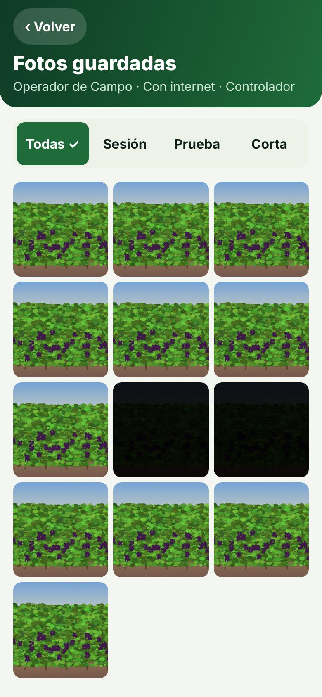

> **Captura transcrita:** Galería de fotos guardadas en el celular, con filtros Todas, Sesión, Prueba y Corta. [Transcripción completa](../06-figuras/manual-app/29-fotos-guardadas.md)

1

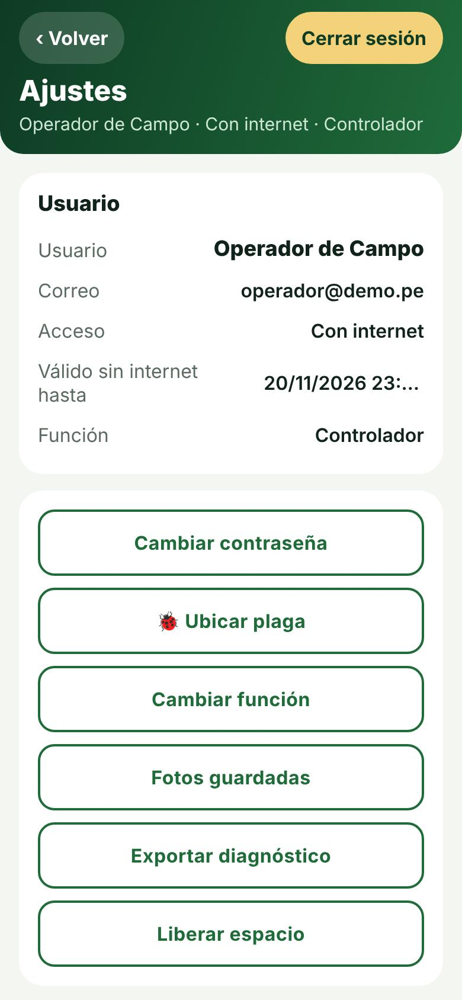

> **Captura transcrita:** Pantalla de ajustes con los datos del usuario y la vigencia del acceso sin internet, más las acciones de mantenimiento del equipo. [Transcripción completa](../06-figuras/manual-app/30-ajustes.md)

1

2

3

4

<!-- página 29 -->

EN POCAS PALABRAS

Los celulares cámara casi no se tocan durante la pasada: el controlador ordena todo. Su pantalla muestra la vista de la cámara y una franja de estado grande.

1

Tomar foto de prueba

Modo prueba: «Tomar foto de prueba».

1

Resultado de calidad

2

Métricas y tiempo

Resultado: Utilizable, con sus métricas y el tiempo.

## Funciones de cámara

CAPÍTULO 16

Cámara 1 · Cámara 2

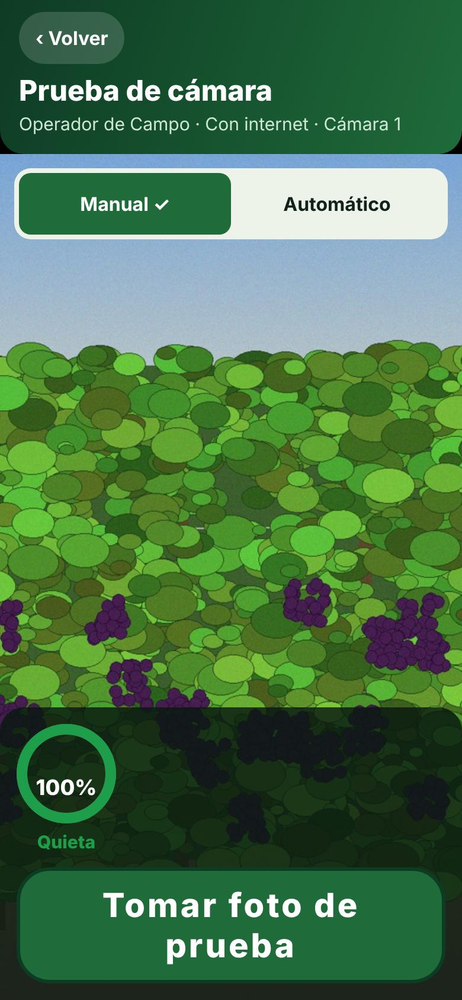

> **Captura transcrita:** Modo prueba de una cámara (Cámara 1). [Transcripción completa](../06-figuras/manual-app/31-prueba-de-camara-antes-de-tomar-la-foto.md)

1

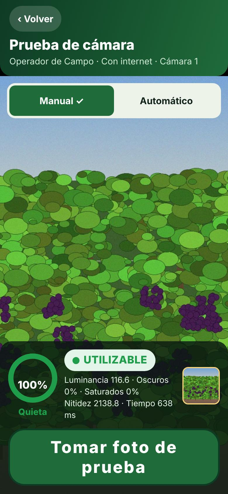

> **Captura transcrita:** Resultado de la foto de prueba: la validación local la marca UTILIZABLE y muestra las métricas que usa (luminancia, oscuros, saturados, nitidez y tiempo), con la miniatura de la foto. [Transcripción completa](../06-figuras/manual-app/32-prueba-de-camara-con-resultado.md)

1

2

Escanear QR

Apunta al QR del controlador; queda vinculada como Cámara 1 o 2.

1

Durante la pasada

No toques nada: la franja muestra conexión, pendientes y la última captura.

2

<!-- página 30 -->

Calidad Cada foto se revisa en la misma cámara en menos de 2 segundos: exposición (muy oscura o quemada) y nitidez (movida). Resultados: Utilizable, Repetir exposición, Repetir nitidez o Pendiente de revisión técnica.

Modo prueba

Toma fotos de prueba y ve su resultado de calidad (no crean datos de la sesión).

3

Sin conexión

Si se pierde el controlador: «Reescanear QR» o «Abandonar sesión».

4

<!-- página 31 -->

EN POCAS PALABRAS

Muestra en un mapa o en una lista los casos de plaga de los últimos 30 días, con la distancia y dirección desde tu posición, y el botón «Cómo llegar (Google Maps)» para ir a pie.

1

Solo «Ubicar plaga»

Ubicar plaga (especialista).

1

Distancia y dirección desde ti

Vista de lista.

## Ubicar plaga

CAPÍTULO 17

operador · especialista

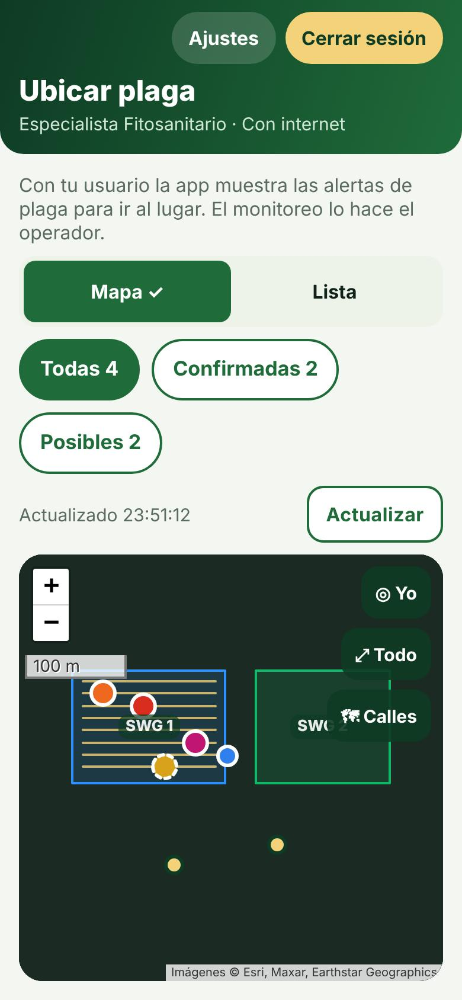

> **Captura transcrita:** Vista «Ubicar plaga» con usuario de especialista. [Transcripción completa](../06-figuras/manual-app/33-ubicar-plaga-mapa-especialista.md)

1

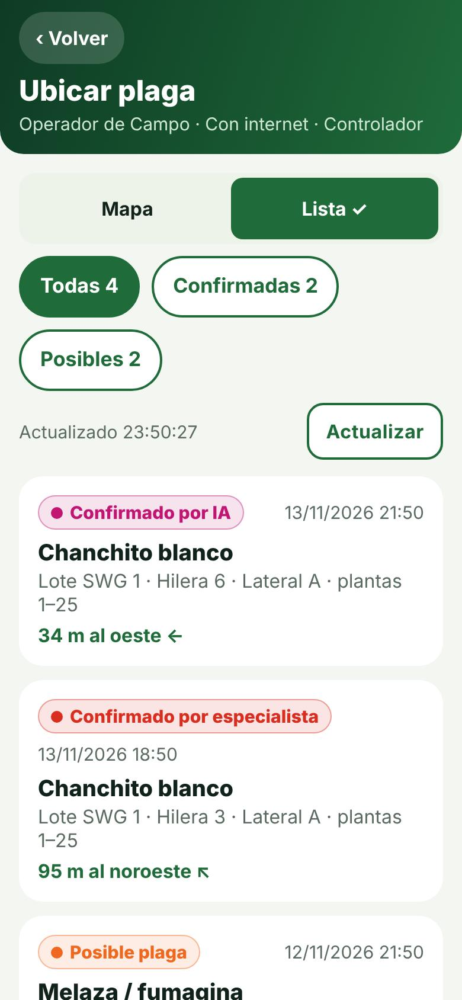

> **Captura transcrita:** La misma información en modo lista. [Transcripción completa](../06-figuras/manual-app/34-ubicar-plaga-lista.md)

1

Abre «Ubicar plaga»

Desde el panel o la pantalla de función. El especialista entra directo.

1

Elige Mapa o Lista

Filtra: Todas, Confirmadas o Posibles.

2

Toca una alerta

Ves el lugar: lote, hilera, lado, plantas y marcador.

3

<!-- página 32 -->

1

Distancia y dirección desde ti

2

Lote, hilera, lado y plantas

3

Navegar a pie

Detalle de una alerta.

Qué se muestra Confirmados por el especialista o por la IA, posibles plagas y casos en revisión. Los descartados no aparecen.

«Cómo llegar (Google Maps)»

Abre la navegación a pie hasta el punto.

4

«Actualizar»

Con internet se actualiza sola cada 2 minutos; sin internet usa la última copia.

5

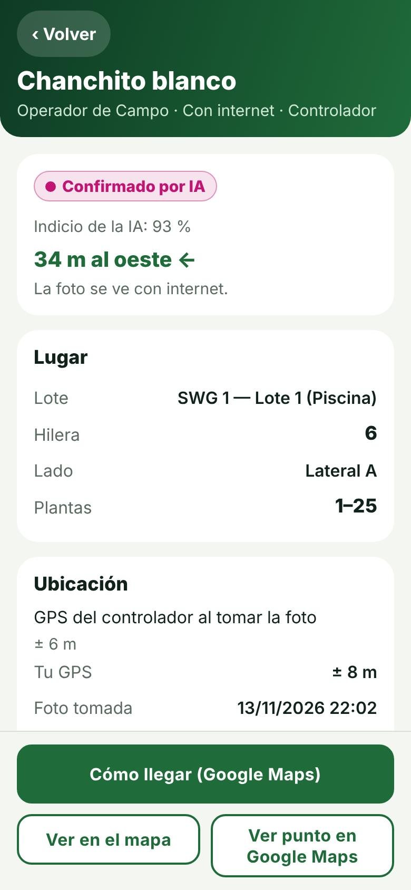

> **Captura transcrita:** Detalle de la alerta de chanchito blanco confirmada por la IA (93 %). [Transcripción completa](../06-figuras/manual-app/35-detalle-de-una-alerta.md)

1

2

3

<!-- página 33 -->

EN POCAS PALABRAS

La app está hecha para el campo: casi todo funciona sin internet.

Funciona sin internet

Necesita internet

Ingresar (si ya entraste antes con internet, hasta 7 días)

El primer ingreso en cada celular

Vincular, prueba corta, pasadas y capturas

Actualizar catálogos

Repetir fotos, marcadores, incidencias

Sincronizar

Ver las fotos guardadas

Ver fotos en «Ubicar plaga»

«Ubicar plaga» con la última copia y la distancia

Navegar con Google Maps (salvo mapa sin conexión descargado)

## Sin internet: qué funciona

CAPÍTULO 18

todos

<!-- página 34 -->

EN POCAS PALABRAS

Si algo falla y no se resuelve, exporta el diagnóstico (Ajustes → Exportar diagnóstico) y compártelo con el responsable técnico.

Síntoma

Qué hacer

Las cámaras no se vinculan

Misma red Wi-Fi; router que no aísle clientes; «Regenerar QR»; «IP manual».

Cámara «sin conexión» seguido

Pantalla del controlador encendida y app en primer plano; acerca el router.

Prueba corta reprobada

Mira el motivo en pantalla; acerca los celulares; repite.

El botón dorado no desaparece

Toca «REPETIR»; en el intento 2 la foto se acepta y se sigue.

«Sin GPS»

Activa la ubicación; sal a cielo abierto; las fotos se guardan igual, ubicadas por segmento.

«Catálogos sin descargar»

Con internet: Catálogos → Actualizar.

La sincronización no avanza

Revisa internet; «Reintentar errores»; exporta el diagnóstico.

No puedo cambiar de función

El controlador tiene datos sin sincronizar: sincroniza primero.

Ingreso sin internet bloqueado

Espera 15 minutos o ingresa con internet.

Batería baja

Conecta el power bank; la app no se detiene.

## Problemas frecuentes

CAPÍTULO 19

todos

<!-- página 35 -->

EN POCAS PALABRAS

La jornada completa en una página.

## Resumen de la jornada

CAPÍTULO 20

imprimible

Preparar

Misma versión, catálogos actualizados, baterías y power bank, misma red Wi-Fi.

1

Ingresar y elegir función

Controlador en la mano; Cámara 1 izquierda y Cámara 2 derecha en el soporte.

2

Nueva sesión → QR

Las cámaras escanean; esperar CONECTADA.

3

Prueba corta

Debe aprobar en menos de 20 s.

4

Nueva pasada

Lote, hilera, lado; seguir el recorrido propuesto.

5

Capturar

CAPTURAR en cada punto; repetir si aparece el botón dorado (máx. 2).

6

Cambiar marcador

Al cruzar cada poste.

7

Terminar pasada

Al final de la hilera; seguir con el lateral B u otra hilera.

8

Cerrar la sesión

Al terminar el día.

9

Sincronizar

Con internet. Luego la IA analiza y el especialista decide en la web.

10

Ubicar plaga

Para ir al lugar de las plagas confirmadas.

11

