# Manual de usuario · Plataforma web

<!-- página 1 -->

M O N I TO R E O F I TO S A N I TA R I O D E L A V I D

## Manual de usuario:

## plataforma web

Cómo usar cada pantalla de la web, paso a paso y por rol: revisar casos, decidir, ubicar en el mapa, avisos por Telegram y administración.

Administrador

Especialista

Supervisor

Con capturas reales

Agrícola Riachuelo S.A.C. · Sistema de monitoreo fitosanitario de la vid Curso Integrador II

Noviembre 2026

Web v1.6 · App 0.6.1

<!-- página 2 -->

1

Conoce la plataforma

3

2

Ingresar, cambiar la contraseña y salir

5

3

La pantalla y la ayuda de cada página

7

4

Panel del fundo

9

5

Bandeja de casos

11

6

Revisar y decidir un caso

13

7

Descartadas por la IA

17

8

Mapa y plano de hileras

18

9

Sesiones y fotos

20

10

Reportes

23

11

Avisos por Telegram

24

12

Estado de la IA

26

13

Usuarios y celulares

28

14

Destinatarios de avisos

31

15

Catálogos del fundo

34

16

Papelera y limpieza de fotos

36

17

Auditoría

39

18

Ayuda, manuales y uso en el celular

41

19

Problemas frecuentes

43

### Contenido

<!-- página 3 -->

EN POCAS PALABRAS

La plataforma web es la oficina del sistema de monitoreo: aquí llegan las fotos que toman los celulares en el campo, la IA sugiere dónde podría haber plaga, el especialista decide y el equipo recibe avisos por Telegram.

1

### ¿Qué puedes hacer aquí?

Revisar casos

Ver cada foto con las marcas de la IA, su lugar exacto y decidir si es plaga.

Ubicar en el mapa

Ver los casos sobre el mapa del fundo y en el plano de hileras.

Seguir el trabajo

Sesiones de campo, fotos, reportes en Excel (CSV) y avisos enviados.

Administrar

Cuentas, celulares, catálogos del fundo, destinatarios de avisos y papelera.

Rendir cuentas

La auditoría registra quién hizo qué y cuándo, sin poder borrarse.

Pedir ayuda

Cada pantalla trae sus pasos en «Cómo se usa esta página».

2

### Quién usa la web y qué ve

Función

Administrador

Especialista

Supervisor

Panel, casos, mapa, plano, sesiones, reportes y avisos

✓

✓

✓

Decidir y corregir casos; abrir un caso a mano

✓

Estado de la IA

✓

✓

Reintentar un análisis de la IA

✓

Catálogos del fundo y dibujar en el mapa

✓

✓

Usuarios, celulares, destinatarios de avisos, auditoría

✓

Papelera y limpieza de fotos

✓

Ayuda y manuales

✓

✓

✓

Una persona puede tener varios roles Por ejemplo, Administrador y Especialista. Así ve el menú de administración y además puede decidir casos. El operador de campo usa solo la app móvil.

### 3 Los colores indican el estado de revisión

En toda la web los colores dicen en qué etapa de revisión está un caso, nunca qué tan grave es. Siempre van acompañados de texto.

## Conoce la plataforma

CAPÍTULO 1

inicio

<!-- página 4 -->

Estado

Qué significa

¿Avisa por Telegram?

Pendiente de revisión

La IA vio un posible indicio; falta la decisión del especialista.

No

Confirmado por IA

La IA lo confirmó sola (2 o más cajas muy seguras, o 3 o más medianas).

Sí

Confirmado por especialista

El especialista confirmó la plaga o el daño.

Sí

Posible plaga

No es seguro: alguien debe ir a mirar. Se ve en «Ubicar plaga» de la app.

No

Descartado

No era plaga (reflejo, tallo, hoja seca…).

No

Evidencia insuficiente

La foto no permite decidir: hay que volver a fotografiar.

No

### 4 Antes de empezar

Usa un navegador actualizado (Chrome, Edge o Firefox) en computadora o celular. Dirección: https://monitoreo.agricolariachuelo.org. Tu cuenta la crea o aprueba el administrador. La primera vez entras con una contraseña temporal y la cambias. Las capturas de este manual usan datos de demostración: nombres y fotos son de ejemplo.

5 Cuentas de prueba para evaluar

Cuenta de prueba · plataforma web

DIRECCIÓN

**https://monitoreo.agricolariachuelo.org**

USUARIO

**testeador@gmail.com**

CONTRASEÑA

**[omitido]**

Roles activos:

Administrador

Especialista fitosanitario

Supervisor

los 3 roles de la web activos

Un solo perfil con las funciones de los tres tipos de usuario La cuenta testeador@gmail.com tiene activos a la vez los roles Administrador, Especialista fitosanitario y Supervisor. Los permisos se suman, así que con ella puedes usar todas las funciones de esos tres tipos de usuario: decidir y corregir casos (especialista); panel, mapa, plano, sesiones, reportes, avisos y catálogos (supervisor); y usuarios, celulares, destinatarios, papelera, limpieza y auditoría (administrador). En la tabla de la sección 2 tienes marcadas las tres columnas. Por ser administrador también puede entrar a la app móvil.

i

Es una cuenta compartida

No cambies su contraseña ni la bloquees: la usan todos los evaluadores. Para probar un rol suelto, el bloqueo por intentos o la contraseña temporal, crea una cuenta nueva en «Usuarios → Nueva cuenta» (capítulo 13). La app móvil tiene su propia cuenta de prueba: testeador2@gmail.com / [omitido] (operador de campo; ver el manual de la app). Para copiar el usuario o la contraseña, selecciona el texto del recuadro.

!

<!-- página 5 -->

EN POCAS PALABRAS

Entras con tu correo y tu contraseña. Si es la primera vez, la web te pedirá cambiar la contraseña temporal antes de seguir.

1

Escribe tu correo

2

Escribe tu contraseña

3

Muestra lo que escribiste

4

Pulsa «Ingresar»

Pantalla de ingreso.

## Ingresar, cambiar la contraseña y salir

CAPÍTULO 2

acceso

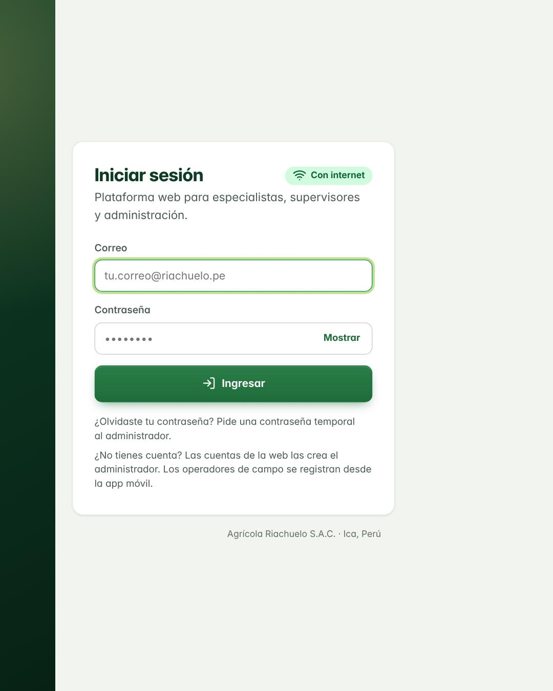

> **Captura transcrita:** Pantalla de ingreso de la plataforma web: una tarjeta blanca sobre fondo claro con franja verde a la izquierda. [Transcripción completa](../06-figuras/manual-web/01-inicio-de-sesion-de-la-web.md)

1

2

3

4

Escribe tu correo y tu contraseña

Usa «Mostrar» para revisar lo que escribiste.

1

Pulsa «Ingresar»

Llegas al Panel. Si tu contraseña es temporal, primero pasas a «Cambiar contraseña».

2

<!-- página 6 -->

1

Mensaje: no dice si el correo existe

Si te equivocas, el mensaje no dice si el correo existe (por seguridad).

Mensajes que puedes ver

Mensaje

Qué hacer

Correo o contraseña incorrectos.

Revisa mayúsculas y el correo. Pide una contraseña temporal si la olvidaste.

Demasiados intentos fallidos…

Tras 5 intentos fallidos se bloquea 15 minutos. Espera y vuelve a intentar.

Tu cuenta está pendiente de aprobación…

El administrador debe aprobarla en Usuarios.

Tu cuenta está bloqueada…

Habla con el administrador.

Tu cuenta no tiene acceso a la plataforma web…

Es una cuenta de campo: usa la app móvil.

1

### Cambiar la contraseña

1

Actual o temporal

2

Nueva

3

Confirmación

4

Guardar

Botón de la llave (arriba a la derecha) → Cambiar contraseña.

Pasos

Si algo no funciona

¿Olvidaste la actual? Pide al administrador una contraseña temporal.

2

### Salir

Pulsa el botón dorado Salir (arriba a la derecha). La sesión también se cierra sola al cerrar el navegador o tras una jornada (8 horas).

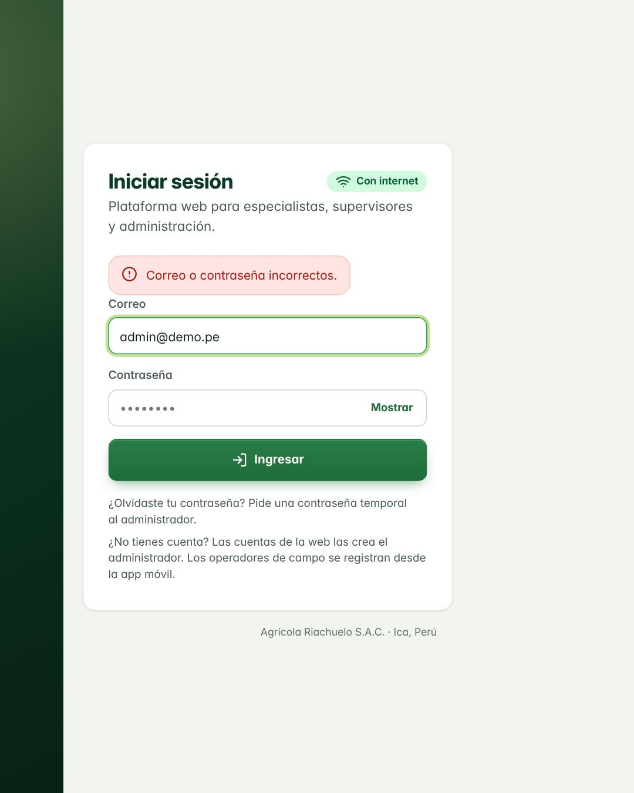

> **Captura transcrita:** El mismo formulario después de un intento fallido: aparece el aviso rojo «Correo o contraseña incorrectos.» sin indicar cuál de los dos falló. [Transcripción completa](../06-figuras/manual-web/02-inicio-de-sesion-con-error.md)

1

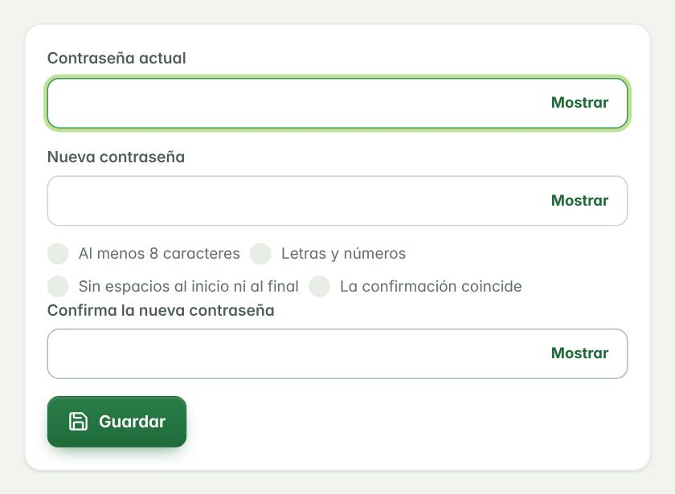

> **Captura transcrita:** Formulario para cambiar la contraseña (obligatorio en el primer ingreso con contraseña temporal). [Transcripción completa](../06-figuras/manual-web/03-cambiar-contrasena.md)

1

2

3

4

Escribe la contraseña actual (o la temporal que te dio el administrador).

1

Escribe la nueva dos veces: 8 o más caracteres, con letras y números.

2

<!-- página 7 -->

EN POCAS PALABRAS

Todas las páginas comparten la misma estructura: el menú a la izquierda, la cabecera arriba y el contenido. Arriba de cada página hay un recuadro plegable «Cómo se usa esta página» con los pasos exactos.

1

Menú: cambia según tu rol

2

Dónde estás

3

Se actualiza sola

4

Actividad reciente

5

Sonidos

6

Cambiar contraseña

7

Salir

8

Cómo se usa esta página

Partes de la pantalla (administrador).

Parte

Para qué sirve

Menú lateral

Cambia según tu rol. En el celular se abre con el botón de menú.

Dónde estás

La ruta de la página actual.

En vivo

La web se actualiza sola; el punto late mientras hay conexión.

Campana

Actividad reciente: fotos que llegan, casos nuevos y decisiones.

Sonidos

Activa o silencia los sonidos de la interfaz.

Llave

Cambiar tu contraseña.

Salir

Cerrar tu sesión.

## La pantalla y la ayuda de cada página

CAPÍTULO 3

orientación

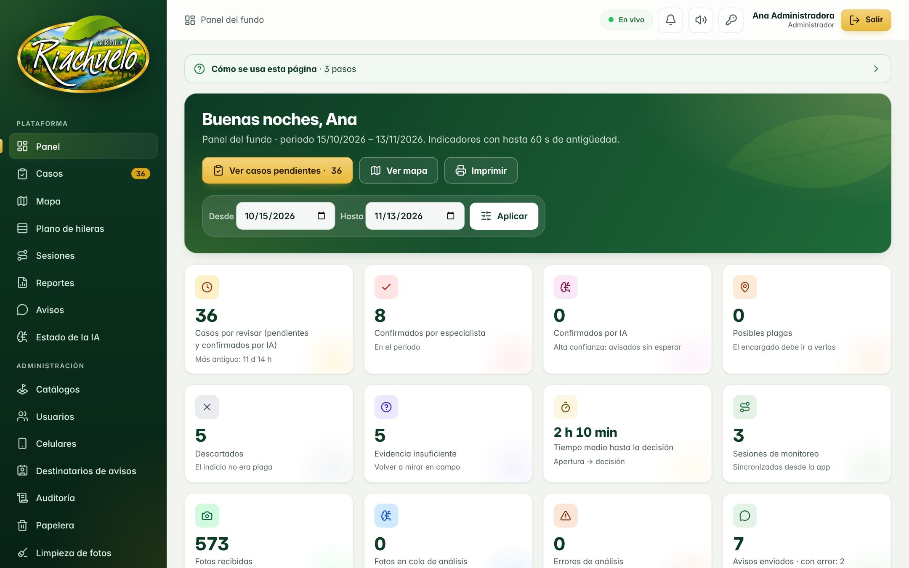

> **Captura transcrita:** Vista completa de la web con el menú lateral verde (logo, sección PLATAFORMA y sección ADMINISTRACIÓN), la barra superior con el estado «En vivo», notificaciones, sonido, contraseña, el usuario y «Salir», y el Panel del fundo con el saludo, el filtro de periodo y las tarjetas de indicadores. [Transcripción completa](../06-figuras/manual-web/04-panel-del-fundo-vista-completa-con-menu.md)

1

2

3

4

5

6

7

8

<!-- página 8 -->

1

### «Cómo se usa esta página»

1

Toca para abrir o cerrar

2

Pasos exactos

3

Qué hacer si algo falla

Al tocarlo se abre con los pasos y qué hacer si algo falla.

Ayuda completa En el menú, Ayuda y manuales reúne este manual, el de la app móvil, la documentación del sistema y todas las guías rápidas (capítulo 18).

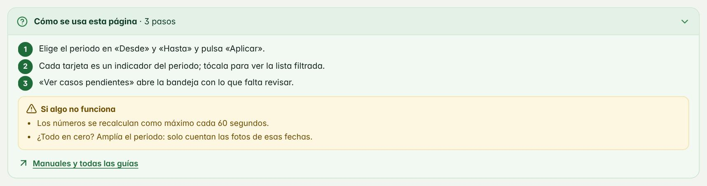

> **Captura transcrita:** La guía plegable del Panel desplegada: tres pasos numerados, un recuadro amarillo «Si algo no funciona» y el enlace a los manuales. [Transcripción completa](../06-figuras/manual-web/05-guia-como-se-usa-esta-pagina-abierta-panel.md)

1

2

3

<!-- página 9 -->

EN POCAS PALABRAS

Resumen del periodo elegido: cuántos casos faltan revisar, cuántos se confirmaron, fotos recibidas, avisos enviados y más. Cada tarjeta lleva a la lista filtrada.

1

Periodo: Desde, Hasta y «Aplicar»

2

Ir a la bandeja

3

Indicadores: toca una tarjeta

Panel con sus indicadores.

Pasos

## Panel del fundo

CAPÍTULO 4

todos

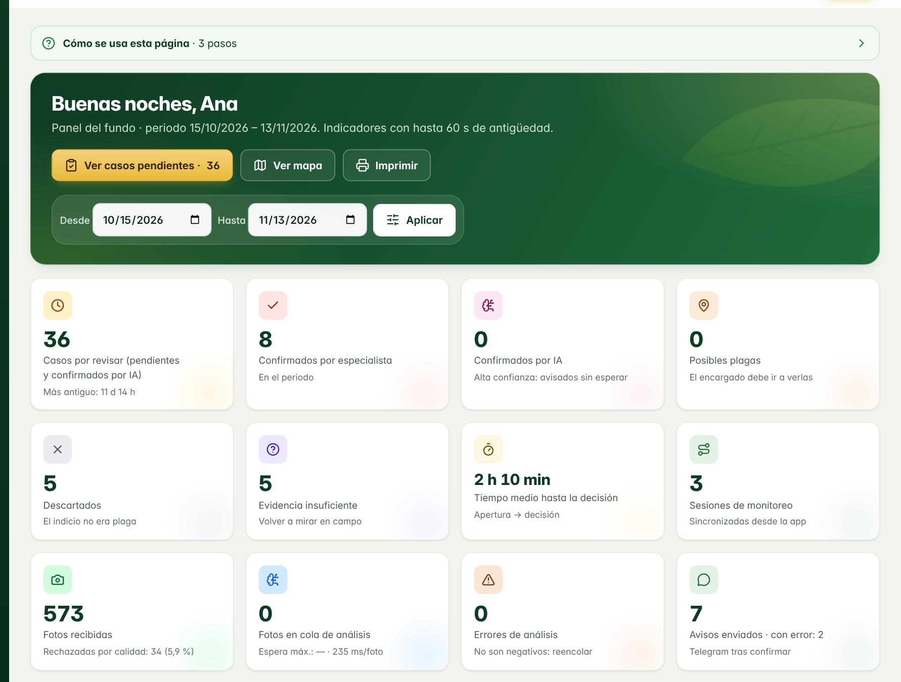

> **Captura transcrita:** Detalle del Panel: encabezado verde con saludo, accesos y filtro de periodo, y doce tarjetas de indicadores con una línea de contexto debajo de cada número (por ejemplo, el caso más antiguo, el porcentaje rechazado por calidad o los avisos con error). [Transcripción completa](../06-figuras/manual-web/06-panel-del-fundo-indicadores.md)

1

2

3

Elige el periodo en «Desde» y «Hasta» y pulsa «Aplicar».

1

Cada tarjeta es un indicador del periodo; tócala para ver la lista filtrada.

2

«Ver casos pendientes» abre la bandeja con lo que falta revisar.

3

<!-- página 10 -->

Si algo no funciona

Los números se recalculan como máximo cada 60 segundos. ¿Todo en cero? Amplía el periodo: solo cuentan las fotos de esas fechas.

Indicador

Qué cuenta

Casos por revisar

Pendientes y confirmados por IA que el especialista aún no decide (y el más antiguo).

Confirmados por especialista / por IA

Casos confirmados en el periodo.

Posibles plagas · Descartados · Evidencia insuficiente

Decisiones del especialista en el periodo.

Tiempo medio hasta la decisión

Desde que se abre un caso hasta que se decide.

Sesiones de monitoreo · Fotos recibidas

Trabajo de campo sincronizado y fotos que llegaron.

Fotos en cola · Errores de análisis

Estado de la IA.

Avisos enviados

Mensajes de Telegram enviados (y con error).

<!-- página 11 -->

EN POCAS PALABRAS

La lista de trabajo del especialista. Por defecto muestra lo que falta revisar, los más antiguos primero, y se actualiza sola cada 15 segundos.

1

Pestañas

2

Filtros (se aplican solos)

3

Descargar CSV

4

Un caso: clic para abrirlo

5

Estado de revisión

6

Papelera (solo administrador)

Bandeja de casos (vista del administrador).

Pasos

## Bandeja de casos

CAPÍTULO 5

todos

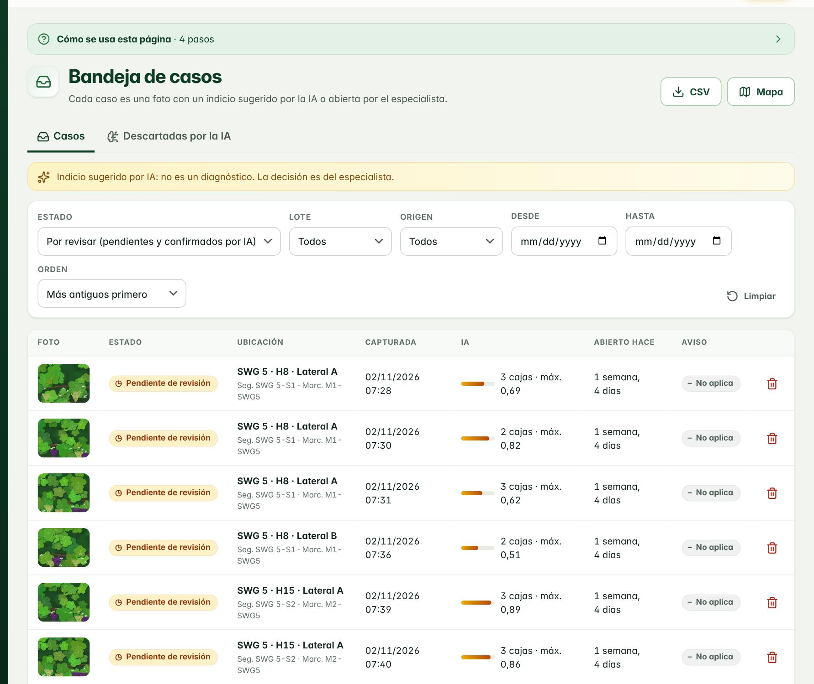

> **Captura transcrita:** Bandeja del especialista con las pestañas «Casos» y «Descartadas por la IA», el aviso fijo de que la IA solo sugiere, los filtros (estado, lote, origen, fechas, orden) y la tabla de casos con miniatura, estado, ubicación, fecha de captura, cajas de la IA con su confianza máxima, antigüedad, aviso y botón de papelera. [Transcripción completa](../06-figuras/manual-web/07-bandeja-de-casos.md)

1

2

3

4

5

6

Por defecto ves los casos «Por revisar», los más antiguos primero.

1

Filtra por estado, lote, origen o fechas: la lista cambia sola.

2

Abre un caso con un clic en su fila.

3

<!-- página 12 -->

Si algo no funciona

¿No aparece un caso? Pulsa «Limpiar» para quitar los filtros. La lista se actualiza sola cada 15 segundos; no hace falta recargar.

Columna

Qué muestra

Foto

Miniatura de la foto.

Estado

Estado de revisión (color + texto).

Ubicación

Lote, hilera, lateral, segmento y marcador.

Capturada

Fecha y hora de la foto.

IA

Cuántas cajas dibujó la IA y su confianza más alta.

Abierto hace · Aviso

Tiempo esperando decisión y estado del aviso de Telegram.

Exportar El botón CSV descarga la lista con los filtros aplicados (se abre en Excel). El botón Mapa muestra los mismos casos en el mapa.

La pestaña «Descartadas por la IA» muestra las fotos que la IA dejó sin caso.

4

<!-- página 13 -->

EN POCAS PALABRAS

En la página del caso se ve la foto con las cajas de la IA, el lugar exacto y la foto de la otra cámara del mismo lugar. Solo el especialista fitosanitario decide; los demás roles ven el caso en modo consulta.

1

Revisa la foto

2

Elige la decisión

3

Observación

4

Guardar

5

Guardar y pasar al siguiente

Caso abierto por el especialista: foto, ubicación y panel de decisión.

## Revisar y decidir un caso

CAPÍTULO 6

especialista

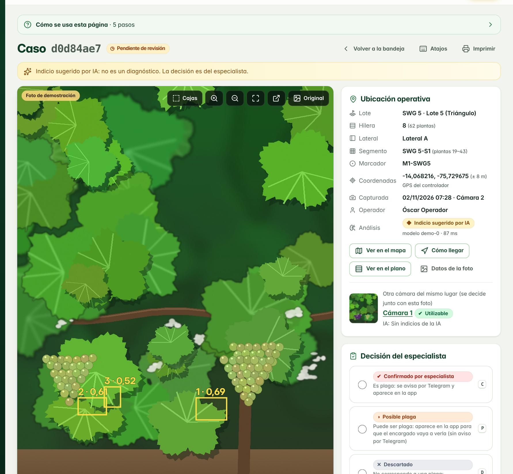

> **Captura transcrita:** Ficha de un caso pendiente. [Transcripción completa](../06-figuras/manual-web/08-revisar-un-caso.md)

1

2

345

<!-- página 14 -->

1

### Decidir paso a paso

1

Elige una decisión

2

Observación

3

Guardar

Panel de decisión.

Estado

Qué significa

¿Avisa por Telegram?

Pendiente de revisión

La IA vio un posible indicio; falta la decisión del especialista.

No

Confirmado por IA

La IA lo confirmó sola (2 o más cajas muy seguras, o 3 o más medianas).

Sí

Confirmado por especialista

El especialista confirmó la plaga o el daño.

Sí

Revisa la foto

Acerca con + / − o la rueda del ratón. «Cajas» muestra u oculta las marcas de la IA. «Original» carga la foto en resolución completa (tarda un poco más).

1

Revisa el lugar

Lote, hilera, lateral, segmento, marcador, coordenadas y la otra cámara del mismo lugar.

2

Elige la decisión

Confirmado por especialista · Posible plaga · Descartado · Evidencia insuficiente.

3

Escribe una observación

Qué se ve en la foto (sin tratamientos ni dosis). Si alguna caja de la IA estaba mal, márcala en «Cajas incorrectas».

4

Guarda

«Guardar decisión», o «Guardar y siguiente» para pasar al próximo caso de la bandeja.

5

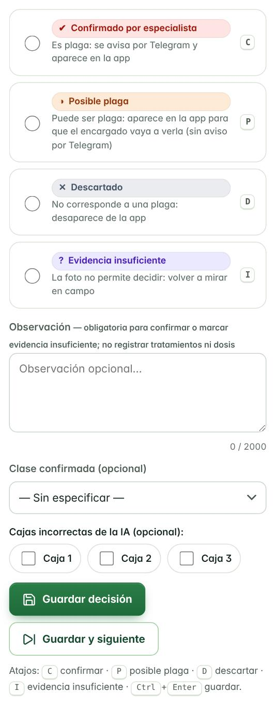

> **Captura transcrita:** Bloque de decisión ampliado: cuatro opciones con su efecto y su tecla de atajo, la observación, la clase confirmada opcional, la marca de cajas incorrectas de la IA y los botones para guardar. [Transcripción completa](../06-figuras/manual-web/09-decision-del-especialista-detalle.md)

1

2

3

<!-- página 15 -->

Estado

Qué significa

¿Avisa por Telegram?

Posible plaga

No es seguro: alguien debe ir a mirar. Se ve en «Ubicar plaga» de la app.

No

Descartado

No era plaga (reflejo, tallo, hoja seca…).

No

Evidencia insuficiente

La foto no permite decidir: hay que volver a fotografiar.

No

2

### Corregir una decisión

Si te equivocaste, en el mismo caso abre «Corregir la decisión», elige la nueva decisión y escribe el motivo (obligatorio). La decisión anterior queda en el Historial y en la auditoría. Si la corrección quita una confirmación, se anulan los avisos que aún no salieron.

### 3 Atajos de teclado

C confirmar · D descartar · P posible plaga · I evidencia insuficiente · Ctrl + Enter guardar · B

cajas · + − zoom · 0 ajustar · F pantalla completa · ? ayuda

<!-- página 16 -->

### 4 Lo que ven los demás roles

1

La foto y las cajas de la IA

2

Mostrar u ocultar cajas

3

Resolución completa

4

Ubicación operativa

5

Decisión (solo el especialista)

6

Mandar a la papelera

El administrador ve el caso, puede mandar la foto a la papelera, pero no decide.

Si algo no funciona

¿No ves los botones de decisión? Solo el rol Especialista fitosanitario decide. «Este caso ya fue decidido»: otra persona decidió antes; se muestra la decisión vigente. Solo «Confirmado» genera avisos por Telegram.

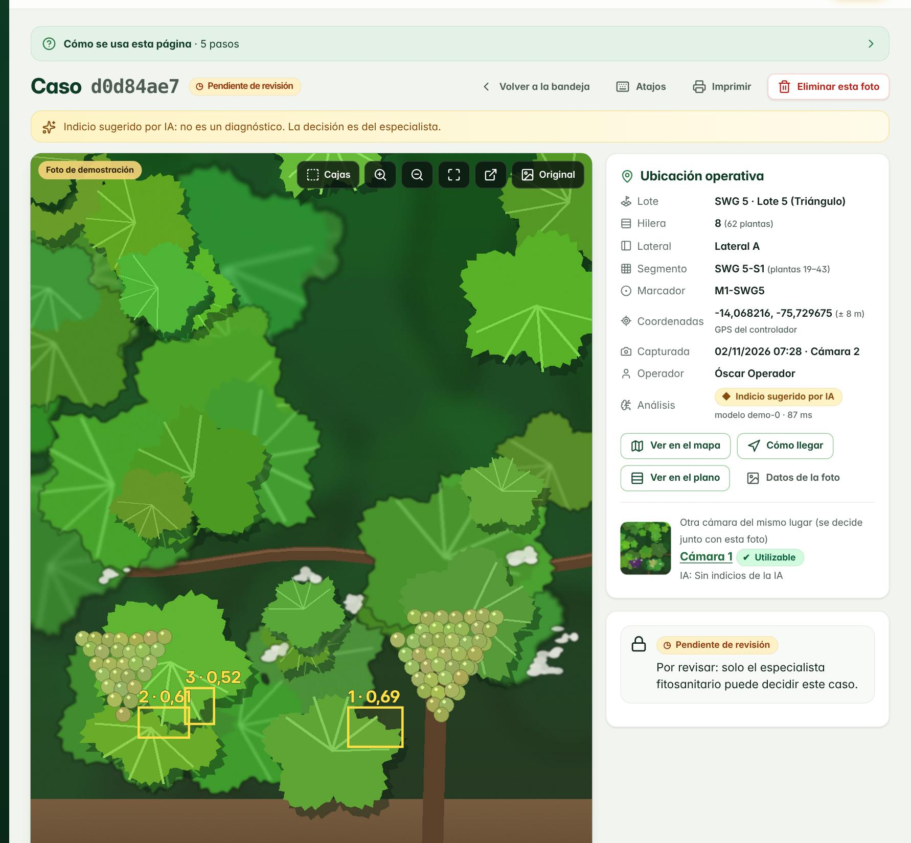

> **Captura transcrita:** La misma ficha de caso, pero el bloque de decisión está bloqueado (candado): solo el especialista fitosanitario puede decidir. [Transcripción completa](../06-figuras/manual-web/10-caso-visto-por-un-usuario-sin-permiso-para-decidir.md)

1

2

3

4

5

6

<!-- página 17 -->

EN POCAS PALABRAS

Fotos que la IA analizó y no le parecieron plaga: no tienen caso ni aviso. Conviene revisarlas de vez en cuando para rescatar lo que la IA no vio.

1

Filtros

2

Ver la foto

Casos → pestaña «Descartadas por la IA».

Pasos

Si algo no funciona

Una foto rescatada sale de esta lista y aparece en la bandeja.

Rescatar una foto Abre la foto con «Ver foto». Si hay plaga, el especialista pulsa «Abrir caso para revisión»: la foto pasa a la bandeja como caso manual y sale de esta lista.

## Descartadas por la IA

CAPÍTULO 7

todos

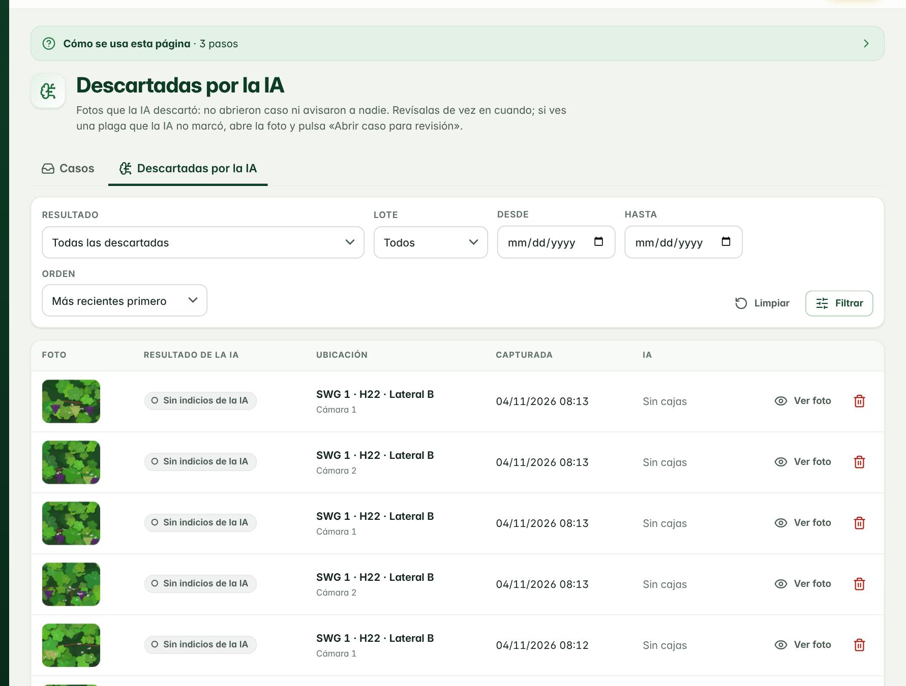

> **Captura transcrita:** Pestaña con las fotos que la IA descartó (no abrieron caso ni generaron aviso). [Transcripción completa](../06-figuras/manual-web/11-descartadas-por-la-ia.md)

1

2

Son fotos que la IA analizó y no le parecieron plaga: no tienen caso ni aviso.

1

Revísalas de vez en cuando con «Ver foto».

2

Si ves una plaga, el especialista abre la foto y la manda a revisión con un caso manual.

3

<!-- página 18 -->

EN POCAS PALABRAS

Dos formas de ver dónde están los casos: el mapa satelital del fundo y el plano de hileras, que dibuja cada hilera con sus segmentos.

1

Filtros

2

Colores = estado

3

Herramientas

4

Mapa: toca un punto

Mapa del fundo. En esta captura de demostración no cargó la imagen satelital (sin internet); en el sistema real se ve el fundo desde el satélite.

Pasos

## Mapa y plano de hileras

CAPÍTULO 8

todos

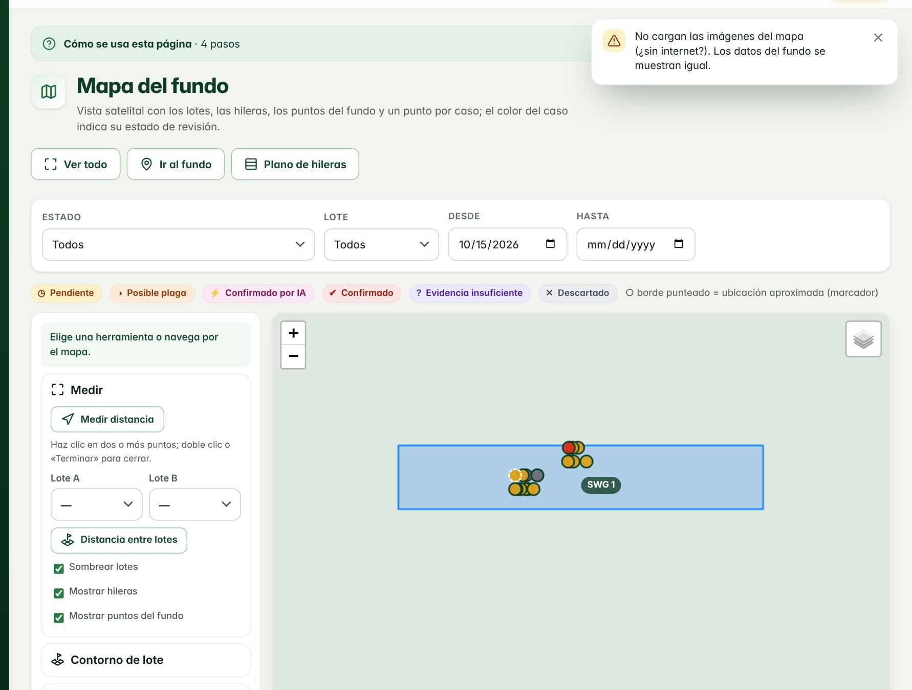

> **Captura transcrita:** Mapa satelital del fundo. [Transcripción completa](../06-figuras/manual-web/12-mapa-del-fundo.md)

1

2

3

4

Cada punto es un caso; su color indica el estado de revisión.

1

Filtra por estado, lote y fechas; toca un punto para abrir el caso.

2

«Medir» y «Distancia entre lotes» calculan distancias sobre el mapa.

3

Administrador y supervisor pueden dibujar contornos de lote, inicio y fin de hileras y puntos del fundo.

4

<!-- página 19 -->

Si algo no funciona

Si no carga la imagen satelital, revisa tu conexión: los datos se muestran igual. Un borde punteado indica ubicación aproximada (por marcador, sin GPS).

1

### Plano de hileras

1

Elige el lote y «Aplicar»

2

Una hilera

3

Segmento con casos (abre la bandeja)

Plano de un lote: cada barra es una hilera y los recuadros son segmentos con casos.

Pasos

Si algo no funciona

«n / m hileras cubiertas» cuenta solo las hileras recorridas por los dos lados (A y B).

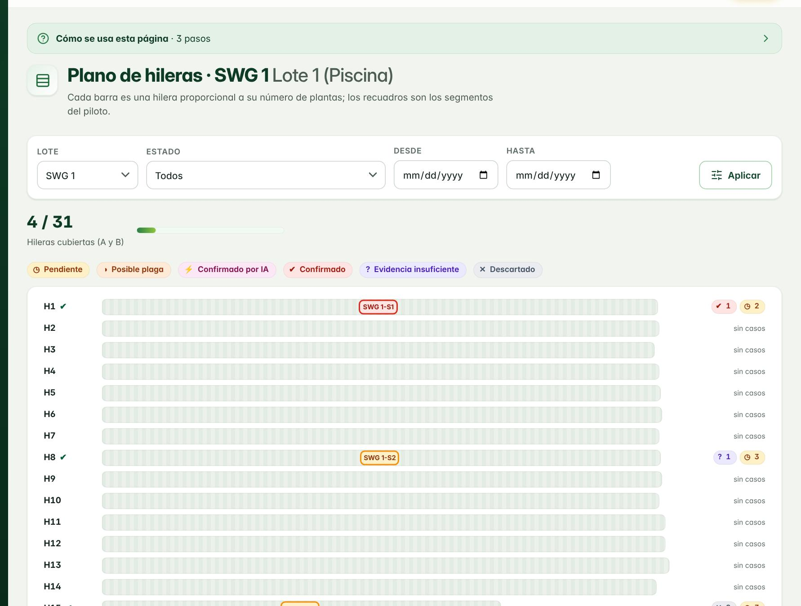

> **Captura transcrita:** Plano esquemático de un lote: cada hilera es una barra proporcional a su número de plantas y los recuadros son los segmentos con casos, coloreados por estado. [Transcripción completa](../06-figuras/manual-web/13-plano-de-hileras.md)

1

2

3

Elige el lote y pulsa «Aplicar».

1

Cada barra es una hilera; su largo es proporcional a sus plantas.

2

Los recuadros marcan los segmentos con casos; toca uno para ver los casos de ese lote en la bandeja.

3

<!-- página 20 -->

EN POCAS PALABRAS

Cada sesión es una salida al campo que el celular controlador ya sincronizó. Desde ella se llega a cada foto con sus datos y su análisis.

1

Una salida al campo

Lista de sesiones.

## Sesiones y fotos

CAPÍTULO 9

todos

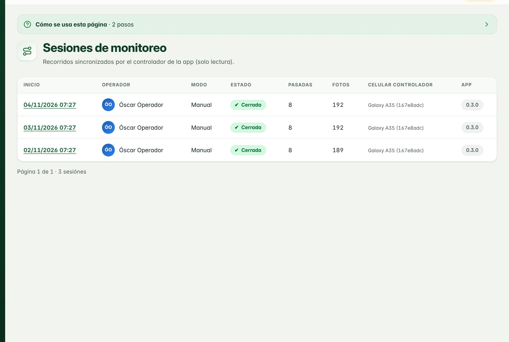

> **Captura transcrita:** Lista de sesiones sincronizadas desde el controlador de la app (solo lectura), con operador, modo, estado, número de pasadas y fotos, celular controlador y versión de la app. [Transcripción completa](../06-figuras/manual-web/14-sesiones-de-monitoreo.md)

1

<!-- página 21 -->

1

Resumen de la salida

2

Cámaras vinculadas

3

Pasadas (lado A y B)

4

Borrar la sesión (admin)

Detalle de una sesión.

Pasos

Si algo no funciona

Para quitar solo algunas fotos usa la papelera desde cada foto: se puede deshacer.

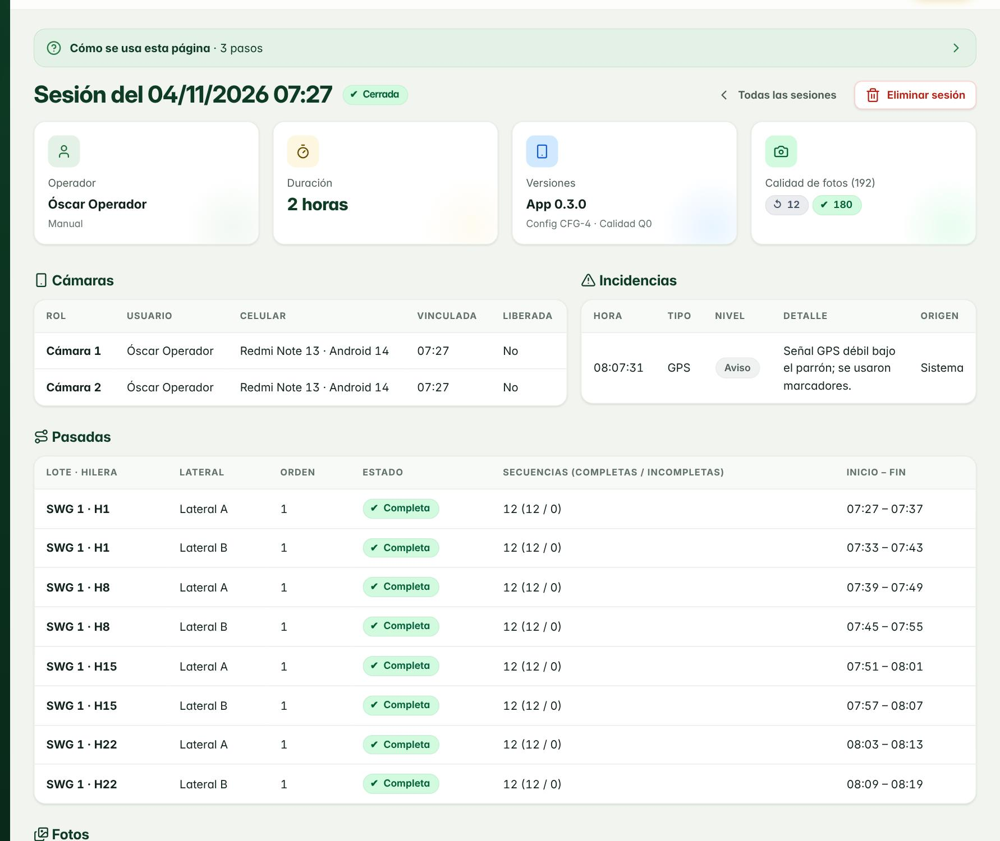

> **Captura transcrita:** Detalle de la sesión del 04/11/2026: tarjetas de operador, duración, versiones y calidad de fotos; tablas de cámaras vinculadas, incidencias y pasadas (lote-hilera, lateral, orden, estado, secuencias e intervalo horario). [Transcripción completa](../06-figuras/manual-web/15-detalle-de-una-sesion.md)

1

2

3

4

Arriba: operador, duración, versión de la app y calidad de las fotos.

1

Abajo: cámaras vinculadas, pasadas (lado y estado), incidencias y galería de fotos.

2

El administrador puede «Eliminar sesión»: borra para siempre y pide escribir ELIMINAR.

3

<!-- página 22 -->

1

### Página de una foto

1

Datos de la foto

2

Lo que vio la IA

3

Papelera (admin)

Datos de la foto, calidad, ubicación y lo que vio la IA.

Pasos

Si algo no funciona

Una foto en la papelera no se analiza ni se puede decidir hasta restaurarla.

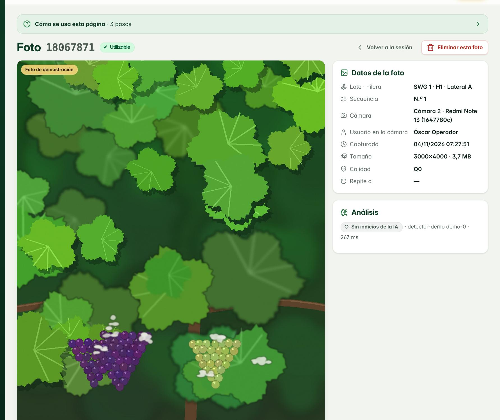

> **Captura transcrita:** Ficha de una foto individual: imagen a la izquierda y, a la derecha, los datos de captura (lote, hilera, lateral, secuencia, cámara, usuario, hora, tamaño, calidad) y el resultado del análisis de la IA. [Transcripción completa](../06-figuras/manual-web/16-detalle-de-una-foto.md)

1

2

3

Muestra la foto, su calidad, su ubicación y el análisis de la IA.

1

Si la IA no abrió caso y ves una plaga, el especialista puede abrir un caso manual desde aquí.

2

El administrador puede quitarla: va a la papelera, donde se puede restaurar durante 30 días.

3

<!-- página 23 -->

EN POCAS PALABRAS

Descarga los casos y decisiones en un archivo CSV que se abre en Excel, con los filtros que elijas. Sirve para el análisis antes y después del sistema.

1

Filtros

2

Descargar CSV

Reportes y exportaciones.

Pasos

Si algo no funciona

Cada exportación queda registrada en la auditoría.

## Reportes

CAPÍTULO 10

todos

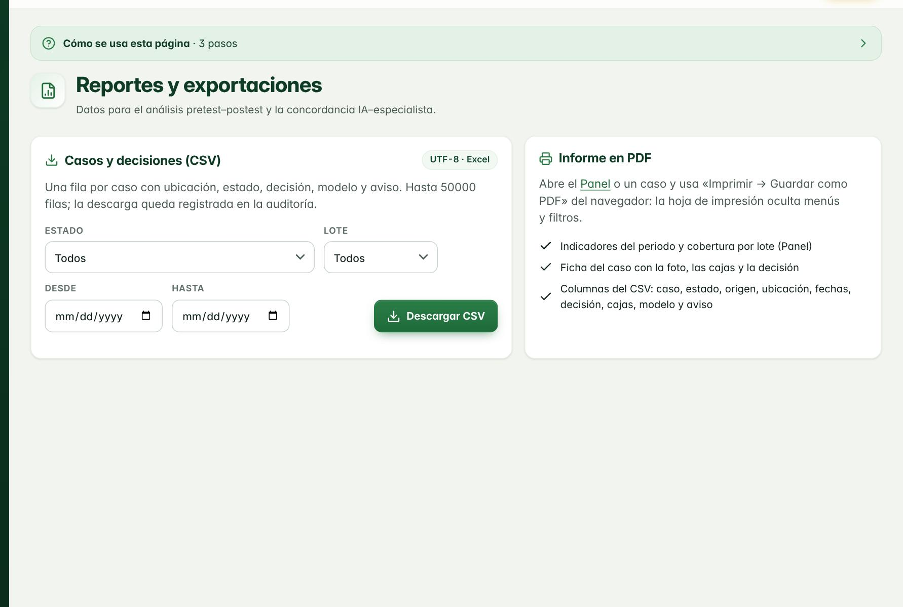

> **Captura transcrita:** Pantalla de reportes: descarga del CSV de casos y decisiones con filtros y explicación de cómo obtener el informe en PDF imprimiendo desde el navegador. [Transcripción completa](../06-figuras/manual-web/17-reportes-y-exportaciones.md)

1

2

Elige lote, estado y fechas.

1

«Descargar CSV» baja los casos y decisiones; ábrelo en Excel.

2

Para un informe en PDF: abre el Panel o un caso y usa Imprimir → Guardar como PDF del navegador.

3

<!-- página 24 -->

EN POCAS PALABRAS

Cuando un caso queda confirmado (por el especialista o por la IA), el sistema envía un mensaje de Telegram a los destinatarios del lote con la foto, el lugar y los botones «Ver caso» y «Cómo llegar». En esta página se ve cada envío.

Caso confirmado

especialista o IA

›

Un aviso por destinatario

de ese lote

›

El sistema lo envía

y reintenta si falla

›

Llega al chat

persona o grupo

1

Filtrar por estado

2

Un envío a un destinatario

3

El error, si hubo

Página Avisos: estado, intentos y error de cada envío.

## Avisos por Telegram

CAPÍTULO 11

todos

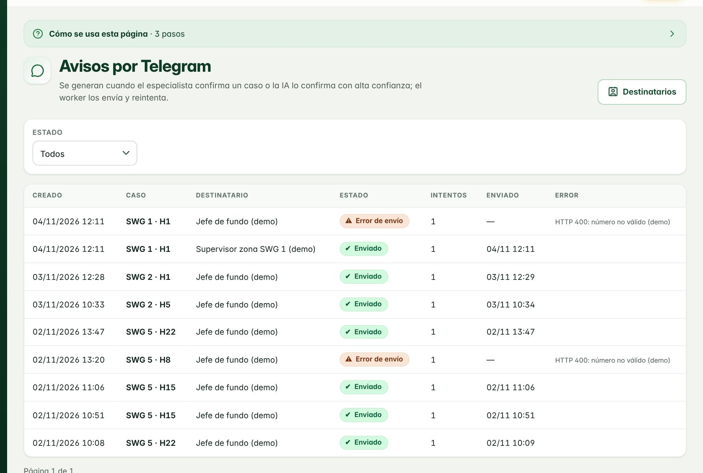

> **Captura transcrita:** Registro de avisos generados: fecha, caso, destinatario, estado (Enviado o Error de envío), intentos, hora de envío y error. [Transcripción completa](../06-figuras/manual-web/18-avisos-por-telegram.md)

1

2

3

<!-- página 25 -->

Pasos

Si algo no funciona

«chat not found»: el número de chat está mal o la persona no pulsó «Iniciar» en el bot. «bot was blocked» o «kicked»: la persona bloqueó el bot o lo sacaron del grupo. Corrige en Destinatarios y usa «Enviar prueba» antes de esperar el próximo caso.

Caso confirmado por el especialista Lote SWG 5 · hilera 8 · Lateral A Segmento SWG 5-S1 · marcador M1 Foto del 02/11/2026 07:28 IA: 3 caja(s) · máx. 0,69

Aviso automático de la plataforma Riachuelo.

Ver caso

Cómo llegar

Dibujo del mensaje en Telegram

Estado del aviso

Significado

Pendiente de envío

En cola; sale en segundos.

Enviado

Telegram lo entregó.

Error de envío

Telegram lo rechazó (lee la columna Error y corrige el destinatario).

No aplica

Se anuló (por ejemplo, el caso se corrigió antes de enviarse).

Para registrar quién recibe los avisos, mira el capítulo 14 (Destinatarios de avisos).

Cada fila es un envío a un destinatario: caso, destinatario, estado, intentos y error.

1

Se crean solos al confirmar un caso; el sistema los envía y reintenta si Telegram falla.

2

Filtra por estado para ver solo los errores.

3

foto con las cajas de la IA

<!-- página 26 -->

EN POCAS PALABRAS

Muestra el modelo de IA activo y cuántas fotos hay en cada etapa del análisis. La IA sugiere indicios; nunca diagnostica.

1

Modelo activo

2

Reintentar un análisis

Estado del análisis con IA.

Pasos

Si algo no funciona

«Sin modelo activo»: lo configura el responsable técnico; las fotos esperan en la cola. La IA sugiere indicios, nunca diagnostica: la decisión es del especialista.

Lo que ve la IA en la foto

Resultado

Ninguna caja ≥ 0,40, o menos de 2 cajas ≥ 0,40

Descartada por la IA (sin caso)

## Estado de la IA

CAPÍTULO 12

administrador · especialista

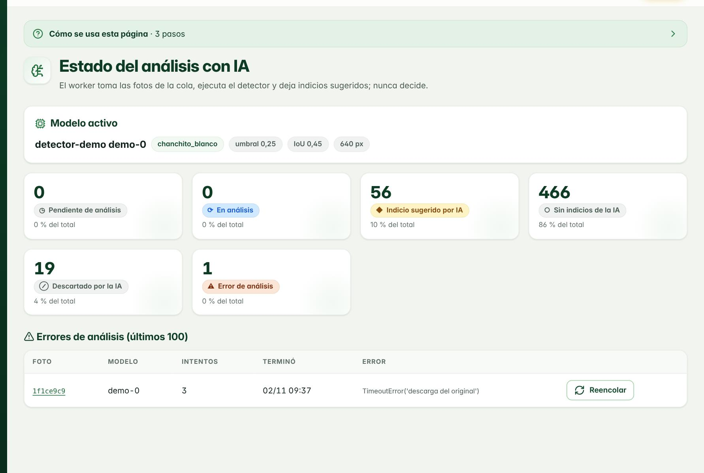

> **Captura transcrita:** Estado del worker de IA: el modelo activo con sus parámetros, contadores por resultado de análisis y la tabla de errores recientes con el botón «Reencolar». [Transcripción completa](../06-figuras/manual-web/19-estado-del-analisis-con-ia.md)

1

2

Arriba: el modelo activo y sus parámetros.

1

Tarjetas: cuántas fotos hay en cada estado del análisis.

2

Errores de análisis: el administrador pulsa «Reencolar» para volver a intentarlo.

3

<!-- página 27 -->

Lo que ve la IA en la foto

Resultado

2 o más cajas con confianza ≥ 0,70

Confirmado por IA + aviso

3 o más cajas con confianza ≥ 0,50

Confirmado por IA + aviso

Cualquier otro caso

Pendiente de revisión (decide el especialista)

Las dos cámaras deciden juntas Las dos fotos de un mismo lugar forman un solo caso, anclado en la foto con más confianza. Si las dos salen bajas, el lugar se descarta.

<!-- página 28 -->

EN POCAS PALABRAS

El administrador crea las cuentas de la web, aprueba las que piden los operadores desde la app, asigna roles, entrega contraseñas temporales y bloquea accesos.

1

Aprobar o rechazar

2

Crear una cuenta

3

Todas las cuentas

4

Cambiar roles

5

Contraseña temporal

6

Bloquear

Usuarios: solicitudes, nueva cuenta y todas las cuentas.

Pasos

## Usuarios y celulares

CAPÍTULO 13

administrador

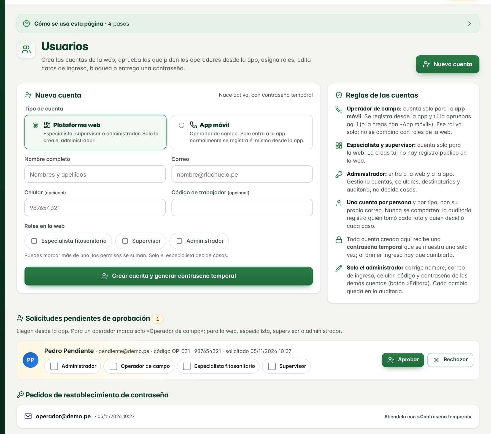

> **Captura transcrita:** Administración de cuentas: formulario para crear una cuenta web o de app con roles, panel con las reglas de las cuentas, solicitudes pendientes que llegan desde la app (aprobar o rechazar asignando rol) y pedidos de restablecimiento de contraseña. [Transcripción completa](../06-figuras/manual-web/20-usuarios.md)

1

2

3

4

5

6

1

«Nueva cuenta»: nombre, correo, tipo y roles → «Crear cuenta y generar contraseña temporal».

2

sde la app móvil. Al aprobarlas quedan como «Operador de campo» (solo app); no se elige rol.

✓ Operador de campo · app móvil

<!-- página 29 -->

Si algo no funciona

«El correo ya está registrado»: busca a la persona en «Todas las cuentas». No puede entrar a la web: revisa que la cuenta esté Activa y tenga un rol de la web. Una persona puede tener varios roles (por ejemplo Administrador y Especialista).

Crear una cuenta

Contraseñas Las contraseñas temporales no se pueden volver a ver. Si se pierde, genera otra con «Contraseña temporal». Asignar una contraseña también cierra la sesión de esa persona en la app.

1

### Celulares

1

Revocar (no se deshace)

Celulares que iniciaron sesión en la app.

La contraseña temporal se muestra una sola vez: anótala y entrégala en persona.

3

4

Nueva cuenta

Nombre, correo de ingreso y, si quieres, celular y código de empleado.

1

Tipo y roles

Cuenta de la web (administrador, especialista o supervisor) o de la app (operador).

2

Crear cuenta y generar contraseña temporal

La contraseña aparece una sola vez: anótala y entrégala en persona. La persona deberá cambiarla al entrar.

3

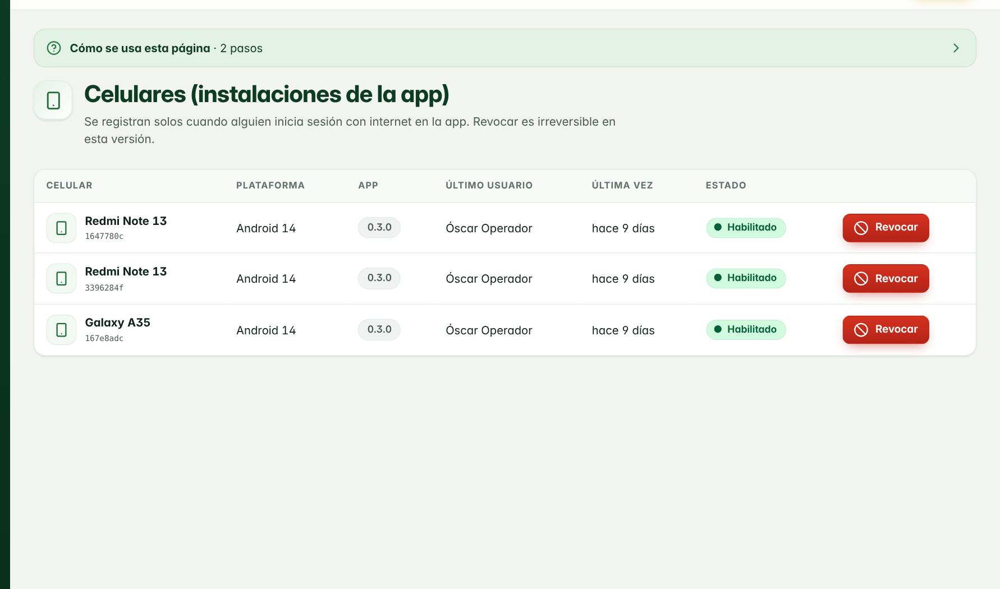

> **Captura transcrita:** Lista de celulares donde se instaló e inició sesión la app: modelo e identificador corto, plataforma, versión, último usuario, última vez y estado, con el botón rojo «Revocar» (irreversible para esa versión). [Transcripción completa](../06-figuras/manual-web/21-celulares-instalaciones-de-la-app.md)

1

<!-- página 30 -->

Pasos

Si algo no funciona

Revocar no se puede deshacer en esta versión: úsalo si el celular se perdió o lo robaron.

Cada celular aparece solo cuando alguien inicia sesión en la app con internet.

1

«Revocar» bloquea ese celular: ya no podrá sincronizar ni iniciar sesión.

2

<!-- página 31 -->

EN POCAS PALABRAS

Aquí se registra a quién le llegan los avisos de Telegram. Cada destinatario necesita su número de chat (no es el número de celular), haber aceptado recibir avisos y estar activo. La web guía cada paso y avisa si algo falta.

1

Pasos para agregar

2

«Buscar chats»

3

Formulario

4

«Enviar prueba»

5

Un destinatario

Destinatarios: lista, pasos, «Buscar chats» y formulario.

1

### Agregar una persona o un grupo

## Destinatarios de avisos

CAPÍTULO 14

administrador

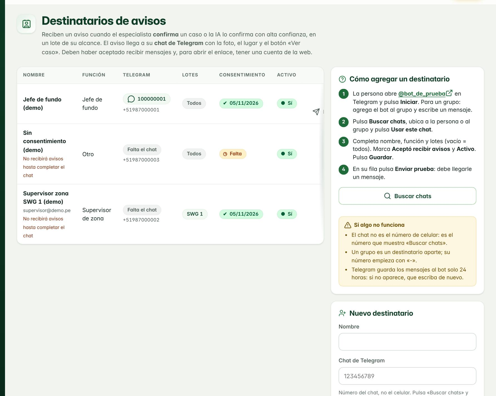

> **Captura transcrita:** Lista de personas o grupos de Telegram que reciben los avisos: función, chat, lotes, consentimiento y estado. [Transcripción completa](../06-figuras/manual-web/22-destinatarios-de-avisos.md)

1

2

3

4

5

La persona abre el bot

En Telegram busca el bot de la plataforma (el enlace está en la página) y pulsa Iniciar. Para un grupo: agrega el bot al grupo y escribe cualquier mensaje.

1

Buscar chats

Pulsa Buscar chats. Aparecen las personas y grupos que escribieron al bot en las últimas 24 horas.

2

<!-- página 32 -->

1

Una persona

2

Un grupo (número con «-»)

3

«Usar este chat»

Resultado de «Buscar chats» (ejemplo).

1

Chat copiado

2

Función

3

Lotes (vacío = todos)

4

Consentimiento

5

Activo

6

Guardar

Formulario con el chat ya copiado.

Usar este chat

Pulsa Usar este chat junto a la persona o grupo: el número se copia al formulario.

3

Completa y guarda

Nombre, función, lotes (vacío = todos), marca Aceptó recibir avisos y Activo. Pulsa Guardar.

4

Envía una prueba

En su fila pulsa Enviar prueba: debe llegarle un mensaje en Telegram.

5

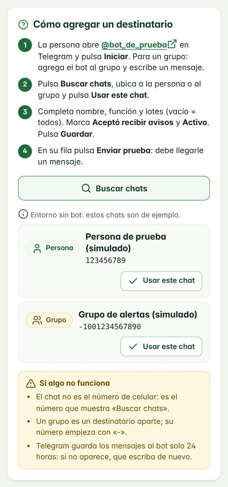

> **Captura transcrita:** Panel lateral ampliado: los cuatro pasos para dar de alta a alguien en Telegram y el resultado de «Buscar chats». [Transcripción completa](../06-figuras/manual-web/23-como-agregar-un-destinatario-y-buscar-chats.md)

1

2

3

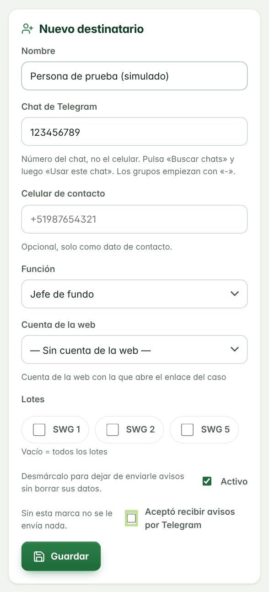

> **Captura transcrita:** Formulario de alta llenado con el chat simulado. [Transcripción completa](../06-figuras/manual-web/24-nuevo-destinatario-formulario.md)

1

2

3

4

5

6

<!-- página 33 -->

2

### Ayudas que muestra la web

Si pasa esto…

La web te dice…

Escribes un número de celular en el chat

«Eso parece un número de celular. El chat de Telegram es otro número…»

Escribes un @usuario o letras

«Es un número (por ejemplo 123456789, o -100… para un grupo)…»

Guardas sin marcar el consentimiento

«Guardado, pero no recibirá avisos hasta que marques…»

Nadie puede recibir avisos

Franja roja arriba: «Nadie recibirá avisos todavía…»

La prueba falla

El motivo y qué hacer: chat no encontrado, bot bloqueado, bot fuera del grupo…

Nadie escribió al bot

«Nadie le escribió al bot en las últimas 24 horas…»

Grupos Un grupo de Telegram es un destinatario más, con su propio número (empieza con «-»). Si los avisos te llegan a ti pero no al grupo, falta registrar el grupo.

<!-- página 34 -->

EN POCAS PALABRAS

Los catálogos son los lotes, hileras, segmentos y marcadores que usa la app para ubicar cada foto. Cada hilera se divide en 10 segmentos iguales que comparten sus dos lados.

1

Abrir un lote

2

Nuevo lote

Catálogos: lotes y «Nuevo lote».

Pasos

## Catálogos del fundo

CAPÍTULO 15

administrador · supervisor

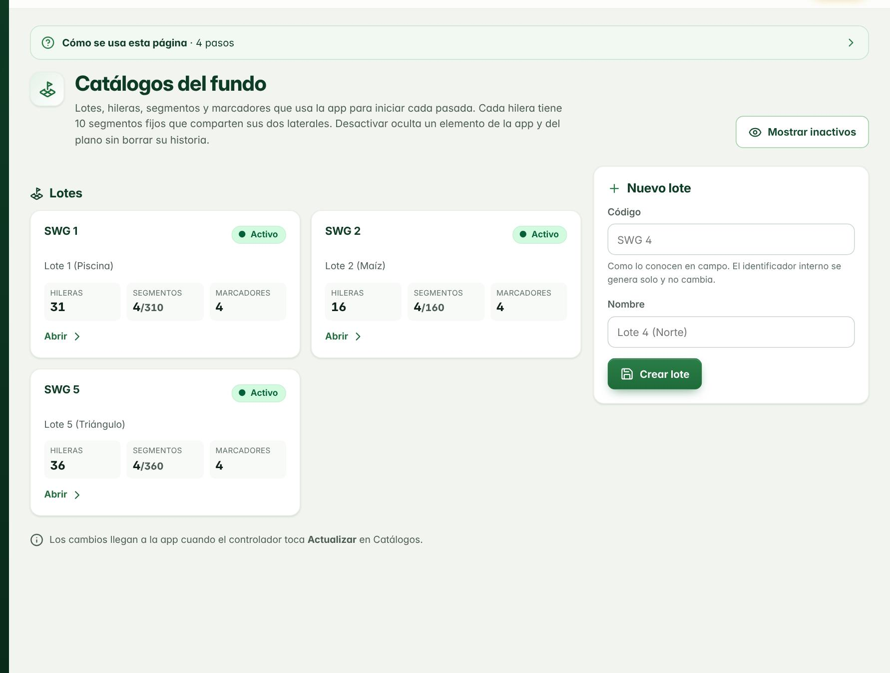

> **Captura transcrita:** Lista de lotes del fundo con su conteo de hileras, segmentos y marcadores, y el formulario para crear un lote nuevo. [Transcripción completa](../06-figuras/manual-web/25-catalogos-del-fundo-lotes.md)

1

2

«Nuevo lote»: código y nombre → «Crear lote».

1

Abre el lote y usa «Agregar hileras» (desde–hasta y largo o plantas): se crean los segmentos y marcadores.

2

«Desactivar» oculta un lote, hilera o segmento sin borrarlo; «Reactivar» lo devuelve.

3

Los celulares reciben los cambios en la app con Catálogos → Actualizar.

4

<!-- página 35 -->

Si algo no funciona

Una hilera marcada «fuera del estándar» se corrige con «Aplicar 10 segmentos» en su lote. Nada se borra: la historia de las fotos sigue apuntando a sus catálogos.

1

Agregar hileras en bloque

2

Aplicar segmentos estándar

3

Abrir una hilera

Dentro de un lote: agregar hileras, aplicar segmentos y abrir cada hilera.

Nada se borra «Desactivar» oculta un elemento para la app sin borrar su historia. Los celulares reciben los cambios cuando el controlador pulsa Catálogos → Actualizar.

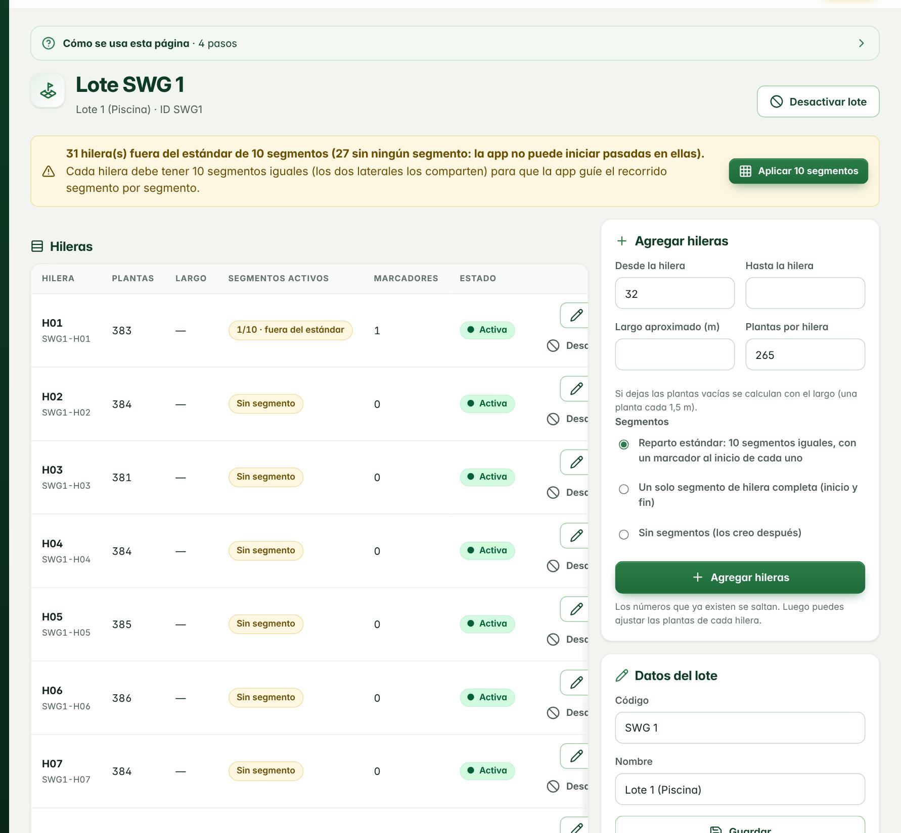

> **Captura transcrita:** Ficha del lote SWG 1: aviso amarillo de hileras fuera del estándar de 10 segmentos con el botón «Aplicar 10 segmentos», tabla de hileras (plantas, largo, segmentos, marcadores, estado, editar/desactivar) y formularios para agregar hileras y editar los datos del lote. [Transcripción completa](../06-figuras/manual-web/26-detalle-de-un-lote-hileras.md)

1

2

3

<!-- página 36 -->

EN POCAS PALABRAS

Dos formas de quitar fotos, solo para el administrador: la papelera (una foto a la vez, se puede deshacer durante 30 días) y la limpieza (en bloque, no se puede deshacer).

1

### Papelera

El botón Eliminar esta foto está en la foto, en el caso, sobre cada miniatura de la sesión, en cada fila de la bandeja y en «Descartadas por la IA». La foto desaparece de todas las listas, del mapa y de la app, y la IA no la analiza.

1

Restaurar

2

Borrar una

3

Vaciar (escribe ELIMINAR)

Papelera: restaurar o borrar para siempre.

## Papelera y limpieza de fotos

CAPÍTULO 16

administrador

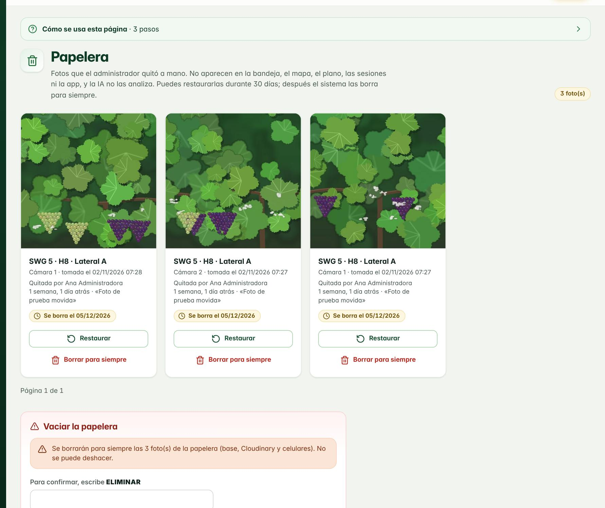

> **Captura transcrita:** Fotos quitadas a mano por el administrador. [Transcripción completa](../06-figuras/manual-web/27-papelera.md)

1

2

3

<!-- página 37 -->

Pasos

Si algo no funciona

Si nadie hace nada, cada foto se borra sola a los 30 días.

2

### Limpieza de fotos

1

Calcular cuántas

Limpieza: calcula cuántas fotos sin indicios se borrarían.

Pasos

Aquí llegan las fotos que el administrador quitó desde la foto, el caso, la sesión o la bandeja.

1

«Restaurar» la devuelve con su caso e historial.

2

«Borrar para siempre» elimina una; «Vaciar la papelera» pide escribir ELIMINAR.

3

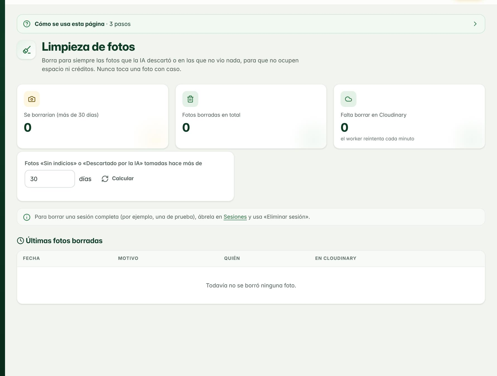

> **Captura transcrita:** Herramienta para borrar fotos sin valor (sin indicios o descartadas por la IA) pasado cierto número de días, para ahorrar espacio. [Transcripción completa](../06-figuras/manual-web/28-limpieza-de-fotos.md)

1

Elige la antigüedad y pulsa «Calcular» para ver cuántas fotos se borrarían.

1

Solo cuenta fotos «Sin indicios» o «Descartado por la IA»; nunca una foto con caso.

2

Escribe ELIMINAR y confirma.

3

<!-- página 38 -->

Si algo no funciona

No se puede deshacer. Para quitar una foto suelta usa la papelera. Las fotos sirven para entrenar la IA: limpia solo si hace falta espacio.

Papelera

Limpieza

Qué borra

Una foto que eliges

Fotos sin indicios o descartadas de más de N días

¿Se deshace?

Sí, 30 días

No

Confirmación

Escribir ELIMINAR solo para vaciar

Escribir ELIMINAR

<!-- página 39 -->

EN POCAS PALABRAS

El registro de todo lo importante: quién hizo qué, cuándo, sobre qué registro y qué cambió. Nadie puede editarlo ni borrarlo. Sirve para rendir cuentas, investigar un problema y demostrar la trazabilidad de cada hallazgo.

1

Para qué sirve y cómo leerla

2

Filtrar por tipo

3

Buscar por acción o ID

4

Qué significa

5

Toda la historia de ese registro

Auditoría con su explicación, filtros por tipo y el significado de cada acción.

## Auditoría

CAPÍTULO 17

administrador

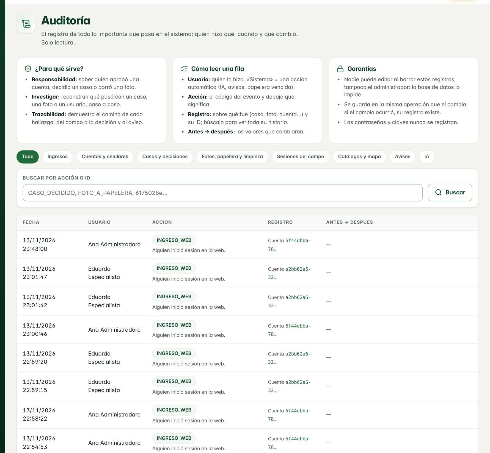

> **Captura transcrita:** Registro de solo lectura de las acciones importantes del sistema. [Transcripción completa](../06-figuras/manual-web/29-auditoria.md)

1

2 3

4

5

<!-- página 40 -->

Pasos

Si algo no funciona

Nadie puede editar ni borrar estos registros, tampoco el administrador.

Ejemplos de uso

Quiero saber…

Haz esto

Quién decidió un caso y cuándo

Copia el ID del caso (arriba en la página del caso) y búscalo.

Quién borró fotos

Categoría «Fotos, papelera y limpieza».

Quién cambió los roles de alguien

Categoría «Cuentas y celulares».

Qué pasó con un registro

Toca su ID en cualquier fila: se filtra toda su historia.

Elige una categoría o busca por acción o por ID.

1

Cada fila dice quién hizo qué, cuándo, sobre qué registro y qué cambió.

2

«Sistema» significa una acción automática (análisis de la IA, avisos, papelera vencida).

3

<!-- página 41 -->

EN POCAS PALABRAS

La página Ayuda y manuales reúne los PDF y todas las guías. La web también se usa desde el celular: las tablas se convierten en tarjetas.

1

Manuales en PDF

2

Para quienes prueban

3

Guías de cada pantalla

Ayuda y manuales.

## Ayuda, manuales y uso en el celular

CAPÍTULO 18

todos

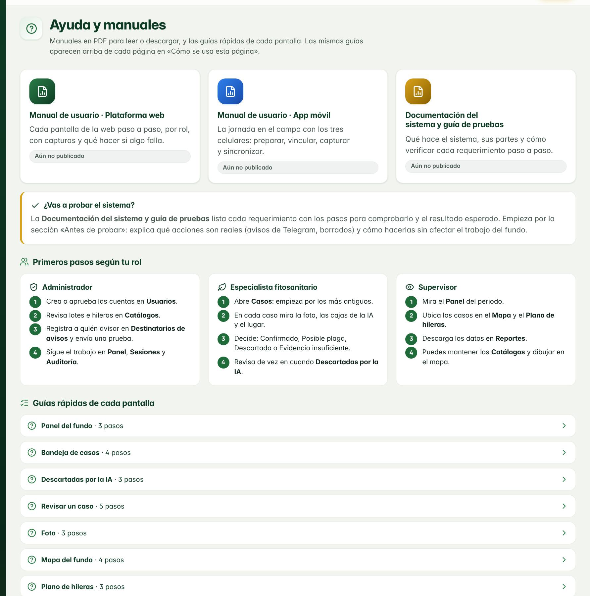

> **Captura transcrita:** Pantalla de ayuda con los tres documentos (manual web, manual de la app y documentación del sistema y guía de pruebas, aún sin publicar en la captura), un aviso para quien vaya a probar el sistema, los primeros pasos por rol y la lista de guías rápidas de cada pantalla. [Transcripción completa](../06-figuras/manual-web/30-ayuda-y-manuales.md)

1

2

3

<!-- página 42 -->

1

### Desde el celular

Bandeja en el celular.

Caso en el celular (abierto desde el aviso de Telegram).

Al tocar «Ver caso» en un aviso de Telegram, la web pide iniciar sesión y luego abre directamente ese caso.

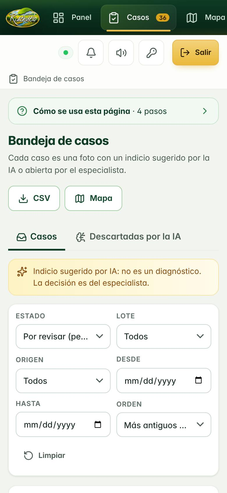

> **Captura transcrita:** La bandeja vista en un navegador de celular: el menú pasa a una barra horizontal superior con logo, Panel, Casos (36) y Mapa; los filtros se acomodan en dos columnas. [Transcripción completa](../06-figuras/manual-web/31-bandeja-de-casos-en-celular.md)

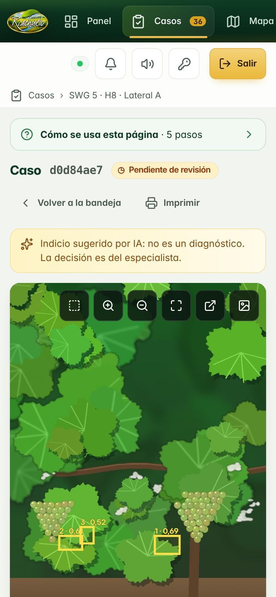

> **Captura transcrita:** La ficha del caso en celular: miga de pan «Casos › SWG 5 · H8 · Lateral A», el estado, el aviso de la IA y la foto a todo el ancho con sus herramientas y las cajas numeradas. [Transcripción completa](../06-figuras/manual-web/32-revisar-un-caso-en-celular.md)

<!-- página 43 -->

EN POCAS PALABRAS

Qué hacer cuando algo no sale como esperas. Si el problema sigue, anota la hora, la página y lo que hiciste, y avisa al administrador.

Síntoma

Causa probable

Qué hacer

No puedo entrar

Contraseña mala, cuenta bloqueada o pendiente

Lee el mensaje; pide al administrador una contraseña temporal.

«Demasiados intentos»

5 intentos fallidos

Espera 15 minutos.

No veo un menú

Tu rol no lo incluye

Pide al administrador que revise tus roles.

No veo los botones de decisión

No tienes el rol Especialista

Pide el rol al administrador.

«Este caso ya fue decidido»

Otra persona decidió antes

Revisa la decisión vigente; usa «Corregir» si hace falta.

Un caso no aparece

Filtros activos

Pulsa «Limpiar» en la bandeja.

Fotos sin imagen

Conexión o la foto está en la papelera

Recarga; revisa la Papelera.

El mapa se ve gris

Sin conexión a las imágenes satelitales

Revisa tu internet; los datos se ven igual.

No llega el aviso de Telegram

Destinatario sin chat, sin consentimiento o de otro lote

Revisa Destinatarios y usa «Enviar prueba».

Llega a mí pero no al grupo

El grupo no está registrado

Agrega el grupo como destinatario (capítulo 14).

«Sin modelo activo» en la IA

Configuración técnica pendiente

Avisa al responsable técnico.

Una sesión no aparece

El controlador no sincronizó

Sincroniza desde la app con internet.

## Problemas frecuentes

CAPÍTULO 19

todos

