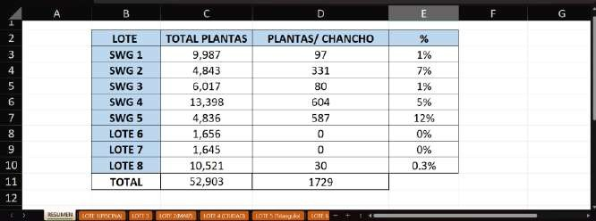

# Figura 1. Resumen general del registro de plantas y presencia de chanchito blanco

| Campo | Valor |
|---|---|
| Archivo de imagen | `01-documentacion-principal/media/image2.jpeg` |
| Tipo | Captura de hoja de cálculo (Excel, pestaña «RESUMEN») |
| Aparece en | [`capitulo-01-planteamiento-de-la-investigacion.md`](../../01-documentacion-principal/capitulo-01-planteamiento-de-la-investigacion.md) — 1.7. Evidencias del problema |
| Fuente | Informe principal (versión revisada, noviembre 2026) |

## Qué muestra

Es la evidencia principal del problema (AS-IS): el registro manual en Excel del fundo. Muestra 52,903 plantas en 8 lotes y 1,729 plantas con chanchito blanco (≈3,3 %). El lote con mayor incidencia es SWG 5 (12 %) y SWG 2 (7 %). Estos números justifican el alcance del piloto (52,900+ plantas, RNF04) y la elección de los lotes SWG1, SWG2 y SWG5.

## Transcripción

| LOTE | TOTAL PLANTAS | PLANTAS/ CHANCHO | % |
|---|---:|---:|---:|
| SWG 1 | 9,987 | 97 | 1% |
| SWG 2 | 4,843 | 331 | 7% |
| SWG 3 | 6,017 | 80 | 1% |
| SWG 4 | 13,398 | 604 | 5% |
| SWG 5 | 4,836 | 587 | 12% |
| LOTE 6 | 1,656 | 0 | 0% |
| LOTE 7 | 1,645 | 0 | 0% |
| LOTE 8 | 10,521 | 30 | 0.3% |
| **TOTAL** | **52,903** | **1729** | |

Pestañas visibles del libro: RESUMEN, LOTE 1 (PISCINA), LOTE 2, LOTE 3 (MAÍZ), LOTE 4 (CIUDAD), LOTE 5 (Triángulo), LOTE 6…
