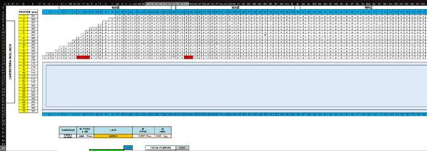

# Figura 2. Matriz utilizada actualmente para el registro de plantas por lote e hilera

| Campo | Valor |
|---|---|
| Archivo de imagen | `01-documentacion-principal/media/image3.jpeg` |
| Tipo | Captura de hoja de cálculo (Excel, una pestaña de lote) |
| Aparece en | [`capitulo-01-planteamiento-de-la-investigacion.md`](../../01-documentacion-principal/capitulo-01-planteamiento-de-la-investigacion.md) — 1.7. Evidencias del problema |
| Fuente | Informe principal (versión revisada, noviembre 2026) |

## Qué muestra

Muestra cómo el fundo registra hoy cada planta: un plano del lote dibujado en Excel, hilera por hilera, donde se marca a mano la planta con plaga. El texto de las celdas es muy pequeño en la imagen original; lo importante es el método: registro manual, sin foto ni GPS, difícil de consolidar.

## Transcripción

- Columna izquierda en amarillo: «HILERA» (números 1 a 30) y la cantidad de plantas por hilera (≈170–390).
- Rótulo vertical a la izquierda: «CARRETERA MOLINOS» (lado del lote que da a la carretera a Los Molinos).
- Encabezado superior: «MAÍZ» (lado del lote vecino a un campo de maíz), sobre una fila celeste con la numeración de posiciones (1, 2, 3…).
- Cuadrícula triangular: cada celda es una planta y lleva una letra («p» = planta). Algunas celdas en rojo marcan plantas con chanchito.
- Abajo, tabla resumen: VARIEDAD · Nº PTAS. x HA. · LOTE · Nº PTAS. · Nº HAS. (variedad y lote ilegibles por la resolución; el lote va resaltado en naranja).
