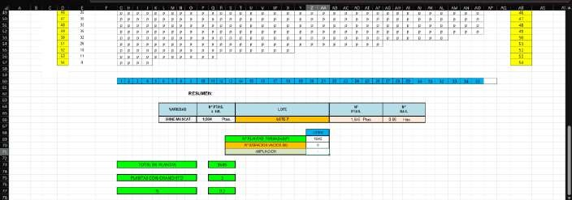

# Figura 3. Ejemplo de codificación visual utilizada en el registro actual del fundo

| Campo | Valor |
|---|---|
| Archivo de imagen | `01-documentacion-principal/media/image4.jpeg` |
| Tipo | Captura de hoja de cálculo (Excel, parte inferior de la pestaña LOTE 7) |
| Aparece en | [`capitulo-01-planteamiento-de-la-investigacion.md`](../../01-documentacion-principal/capitulo-01-planteamiento-de-la-investigacion.md) — 1.7. Evidencias del problema |
| Fuente | Informe principal (versión revisada, noviembre 2026) |

## Qué muestra

Ejemplo de la codificación por colores y letras que usa el registro manual (P = planta, E = espacio vacío) y de los totales que se calculan por lote. Coincide con la fila «LOTE 7» de la Figura 1 (1,645 plantas, 0 con chanchito). Algunas cifras son de lectura aproximada por la baja resolución de la imagen.

## Transcripción

- Filas finales del plano del lote (hileras 46 a 56) con celdas «p» por planta y la numeración de posiciones en una franja celeste.
- «RESUMEN:» tabla con VARIEDAD «SWEET MUSCAT» (lectura aproximada) · Nº PTAS. x HA. ≈ 1,604 Ptas. · LOTE «LOTE 7» (naranja) · Nº PTAS. 1,645 Ptas. · Nº HAS. ≈ 0.95 Has.
- Cuadro: «Nº PLANTAS TERMINADAS (P)» = 1645 · «Nº ESPACIOS VACÍOS (E)» = 0 · «AMPLIACIÓN» = (vacío).
- Cuadros verdes: «TOTAL DE PLANTAS» = 1645 · «PLANTAS CON CHANCHITO» = 0 · «%» = 0.
