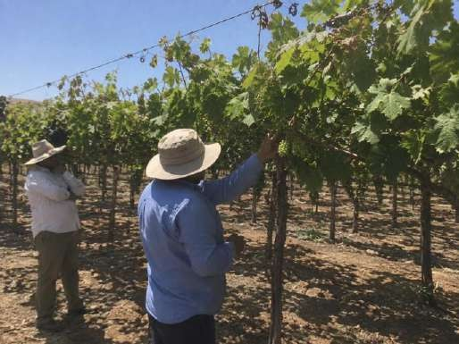

# Figura 4. Personal realizando actividades de monitoreo fitosanitario en las hileras

| Campo | Valor |
|---|---|
| Archivo de imagen | `01-documentacion-principal/media/image5.jpeg` |
| Tipo | Fotografía de campo |
| Aparece en | [`capitulo-01-planteamiento-de-la-investigacion.md`](../../01-documentacion-principal/capitulo-01-planteamiento-de-la-investigacion.md) — 1.7. Evidencias del problema |
| Fuente | Informe principal (versión revisada, noviembre 2026) |

## Qué muestra

Fotografía en el viñedo: un trabajador con sombrero y polo celeste revisa a mano las hojas y racimos de una planta de vid conducida en espaldera, entre hileras con follaje denso. Ilustra el monitoreo manual actual (AS-IS) que el sistema busca apoyar.

## Transcripción

Sin texto.
