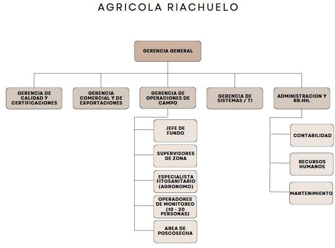

# Figura 5. Organigrama de Agrícola Riachuelo S.A.C.



| Campo | Valor |
|---|---|
| Archivo de imagen | `01-documentacion-principal/media/image6.jpeg` |
| Tipo | Organigrama |
| Aparece en | [`capitulo-04-analisis-empresarial.md`](../../01-documentacion-principal/capitulo-04-analisis-empresarial.md) — 4.4. Organigrama |
| Fuente | Informe principal (versión revisada, noviembre 2026) |

## Qué muestra

Estructura de la empresa cliente. Los usuarios del sistema están en la Gerencia de Operaciones de Campo: jefe de fundo (recibe avisos), supervisores de zona, especialista fitosanitario (decide los casos) y operadores de monitoreo (capturan con la app).

## Transcripción

```text
AGRICOLA RIACHUELO
└── GERENCIA GENERAL
    ├── GERENCIA DE CALIDAD Y CERTIFICACIONES
    ├── GERENCIA COMERCIAL Y DE EXPORTACIONES
    ├── GERENCIA DE OPERACIONES DE CAMPO
    │   ├── JEFE DE FUNDO
    │   ├── SUPERVISORES DE ZONA
    │   ├── ESPECIALISTA FITOSANITARIO (AGRÓNOMO)
    │   ├── OPERADORES DE MONITOREO (10 - 20 PERSONAS)
    │   └── ÁREA DE POSCOSECHA
    ├── GERENCIA DE SISTEMAS / TI
    └── ADMINISTRACIÓN Y RR.HH.
        ├── CONTABILIDAD
        ├── RECURSOS HUMANOS
        └── MANTENIMIENTO
```
