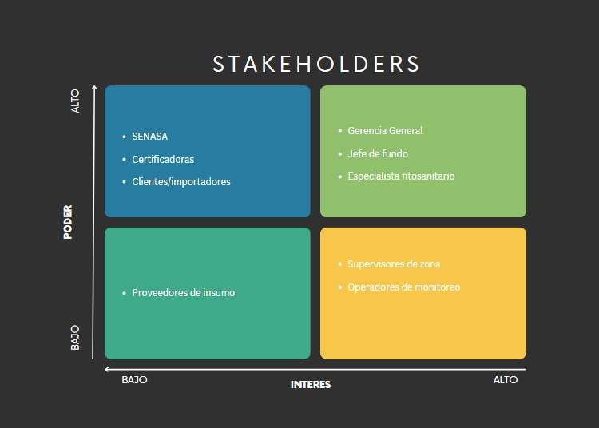

# Figura 6. Matriz de poder e interés de los stakeholders de Agrícola Riachuelo S.A.C.

| Campo | Valor |
|---|---|
| Archivo de imagen | `01-documentacion-principal/media/image7.jpeg` |
| Tipo | Matriz 2x2 (poder vs. interés) |
| Aparece en | [`capitulo-04-analisis-empresarial.md`](../../01-documentacion-principal/capitulo-04-analisis-empresarial.md) — 4.5. Stakeholders |
| Fuente | Informe principal (versión revisada, noviembre 2026) |

## Qué muestra

Clasifica a los interesados: gestionar de cerca a Gerencia General, jefe de fundo y especialista (poder e interés altos); mantener satisfechos a SENASA, certificadoras y clientes; mantener informados a supervisores y operadores; monitorear a los proveedores.

## Transcripción

Título: STAKEHOLDERS. Eje vertical: PODER (bajo → alto). Eje horizontal: INTERÉS (bajo → alto).

| | Interés bajo | Interés alto |
|---|---|---|
| **Poder alto** | SENASA · Certificadoras · Clientes/importadores | Gerencia General · Jefe de fundo · Especialista fitosanitario |
| **Poder bajo** | Proveedores de insumo | Supervisores de zona · Operadores de monitoreo |
