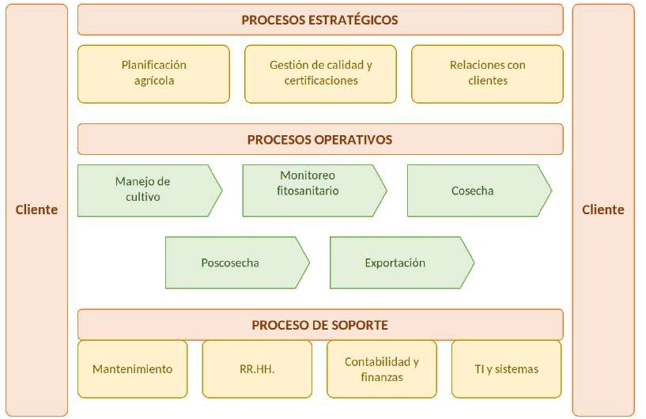

# Figura 7. Mapa de procesos de Agrícola Riachuelo S.A.C.

| Campo | Valor |
|---|---|
| Archivo de imagen | `01-documentacion-principal/media/image8.jpeg` |
| Tipo | Mapa de procesos |
| Aparece en | [`capitulo-04-analisis-empresarial.md`](../../01-documentacion-principal/capitulo-04-analisis-empresarial.md) — 4.6. Mapa de procesos |
| Fuente | Informe principal (versión revisada, noviembre 2026) |

## Qué muestra

Ubica el proceso que mejora el proyecto: «Monitoreo fitosanitario» es un proceso operativo, entre el manejo del cultivo y la cosecha; TI y sistemas lo soporta.

## Transcripción

- A ambos lados: «Cliente» (entrada y salida).
- **PROCESOS ESTRATÉGICOS:** Planificación agrícola · Gestión de calidad y certificaciones · Relaciones con clientes.
- **PROCESOS OPERATIVOS** (flechas en secuencia): Manejo de cultivo → Monitoreo fitosanitario → Cosecha → Poscosecha → Exportación.
- **PROCESO DE SOPORTE:** Mantenimiento · RR.HH. · Contabilidad y finanzas · TI y sistemas.
