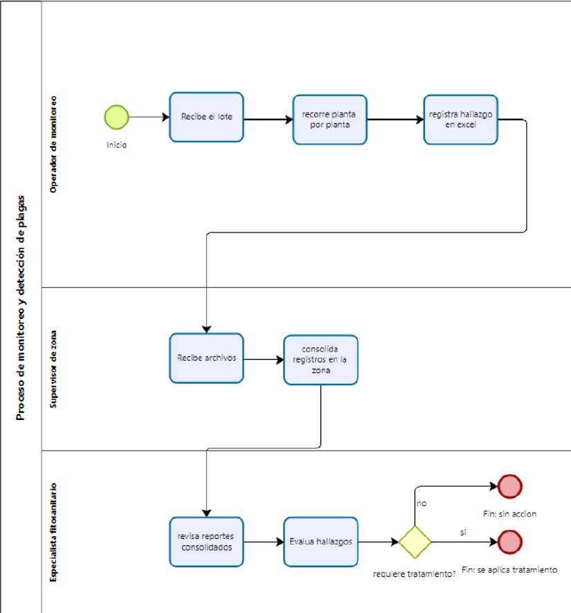

# Figura 8. Modelo AS-IS del proceso de monitoreo y detección de plagas

| Campo | Valor |
|---|---|
| Archivo de imagen | `01-documentacion-principal/media/image9.jpeg` |
| Tipo | Diagrama BPMN con carriles |
| Aparece en | [`capitulo-04-analisis-empresarial.md`](../../01-documentacion-principal/capitulo-04-analisis-empresarial.md) — 4.8. Modelo AS-IS |
| Fuente | Informe principal (versión revisada, noviembre 2026) |

## Qué muestra

Proceso actual, totalmente manual y secuencial: el hallazgo viaja en archivos Excel del operador al supervisor y al especialista, sin foto ni ubicación precisa, y el especialista decide tarde, sobre reportes ya consolidados. Es la base para medir el pretest (O₁).

## Transcripción

Pool: «Proceso de monitoreo y detección de plagas». Tres carriles:

1. **Operador de monitoreo:** (Inicio) → «Recibe el lote» → «recorre planta por planta» → «registra hallazgo en excel» → pasa al supervisor.
2. **Supervisor de zona:** «Recibe archivos» → «consolida registros en la zona» → pasa al especialista.
3. **Especialista fitosanitario:** «revisa reportes consolidados» → «Evalúa hallazgos» → decisión «¿requiere tratamiento?»
   - no → (Fin: sin acción)
   - sí → (Fin: se aplica tratamiento)
