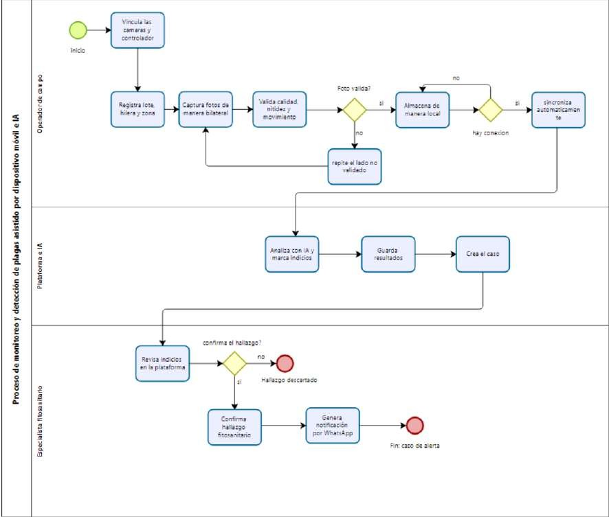

# Figura 9. Modelo TO-BE del proceso de monitoreo y detección de plagas asistido por dispositivo móvil e IA (también usada como diagrama de actividades, 8.6)

| Campo | Valor |
|---|---|
| Archivo de imagen | `01-documentacion-principal/media/image10.jpeg` |
| Tipo | Diagrama BPMN con carriles |
| Aparece en | [`capitulo-04-analisis-empresarial.md`](../../01-documentacion-principal/capitulo-04-analisis-empresarial.md) — 4.12. Modelo TO-BE [`capitulo-08-analisis-y-diseno-del-sistema.md`](../../01-documentacion-principal/capitulo-08-analisis-y-diseno-del-sistema.md) — 8.6. Diagrama de actividades |
| Fuente | Informe principal (versión revisada, noviembre 2026) |

## Qué muestra

Proceso propuesto con el sistema: captura con tres celulares, control de calidad en el celular, guardado sin internet, sincronización, análisis de IA y decisión del especialista con aviso automático. Es la misma imagen que se usa como diagrama de actividades en 8.6.

## Transcripción

Pool: «Proceso de monitoreo y detección de plagas asistido por dispositivo móvil e IA». Tres carriles:

1. **Operador de campo:** (inicio) → «Vincula las cámaras y controlador» → «Registra lote, hilera y zona» → «Captura fotos de manera bilateral» → «Valida calidad, nitidez y movimiento» → ¿Foto válida?
   - no → «repite el lado no validado» → vuelve a capturar
   - sí → «Almacena de manera local» → ¿hay conexión? (no → espera y vuelve a comprobar; sí → «sincroniza automáticamente»)
2. **Plataforma e IA:** «Analiza con IA y marca indicios» → «Guarda resultados» → «Crea el caso».
3. **Especialista fitosanitario:** «Revisa indicios en la plataforma» → ¿confirma el hallazgo?
   - no → (Hallazgo descartado)
   - sí → «Confirma hallazgo fitosanitario» → «Genera notificación por WhatsApp» → (Fin: caso de alerta)

## Vigencia frente al sistema actual

> Diagrama del diseño inicial. Cambios posteriores: el aviso sale por **Telegram**, no por WhatsApp (SC-02); la «captura bilateral» se hace con dos cámaras sobre el mismo lado y dos pasadas, lateral A y B (SC-04); la repetición tiene un límite de 2 intentos por cámara (SC-05); la IA también puede marcar «Confirmado por IA» y existe el estado «Posible plaga» (SC-03).
