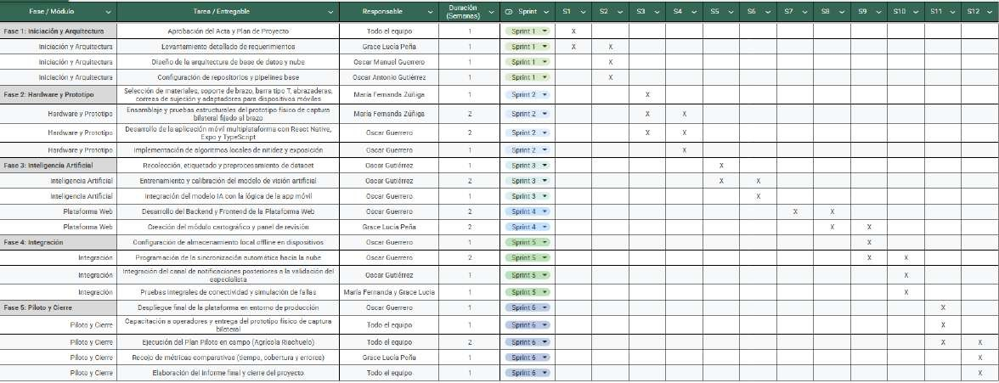

# Diagrama de Gantt del proyecto (6.7)

| Campo | Valor |
|---|---|
| Archivo de imagen | `01-documentacion-principal/media/image11.jpeg` |
| Tipo | Tabla de cronograma (hoja de cálculo con semanas S1–S12) |
| Aparece en | [`capitulo-06-planificacion-del-proyecto.md`](../../01-documentacion-principal/capitulo-06-planificacion-del-proyecto.md) — 6.7. Gantt |
| Fuente | Informe principal (versión revisada, noviembre 2026) |

## Qué muestra

Cronograma de 12 semanas en 6 sprints de 2 semanas (01/09/2026 a 20/11/2026): iniciación, prototipo físico y app, IA, plataforma web, integración (offline, sincronización, avisos) y piloto con cierre. Las marcas por semana son de lectura visual de la imagen.

## Transcripción

| Fase / Módulo | Tarea / Entregable | Responsable | Duración (semanas) | Sprint | Semanas marcadas |
|---|---|---|---:|---|---|
| Fase 1: Iniciación y Arquitectura | Aprobación del Acta y Plan de Proyecto | Todo el equipo | 1 | Sprint 1 | S1 |
| Iniciación y Arquitectura | Levantamiento detallado de requerimientos | Grace Lucía Peña | 1 | Sprint 1 | S1, S2 |
| Iniciación y Arquitectura | Diseño de la arquitectura de base de datos y nube | Oscar Manuel Guerrero | 1 | Sprint 1 | S2 |
| Iniciación y Arquitectura | Configuración de repositorios y pipelines base | Oscar Antonio Gutiérrez | 1 | Sprint 1 | S2 |
| Fase 2: Hardware y Prototipo | Selección de materiales, soporte de brazo, barra tipo T, abrazaderas, correas de sujeción y adaptadores para dispositivos móviles | María Fernanda Zúñiga | 1 | Sprint 2 | S3 |
| Hardware y Prototipo | Ensamblaje y pruebas estructurales del prototipo físico de captura bilateral fijado al brazo | María Fernanda Zúñiga | 2 | Sprint 2 | S3, S4 |
| Hardware y Prototipo | Desarrollo de la aplicación móvil multiplataforma con React Native, Expo y TypeScript | Oscar Guerrero | 2 | Sprint 2 | S3, S4 |
| Hardware y Prototipo | Implementación de algoritmos locales de nitidez y exposición | Oscar Guerrero | 1 | Sprint 2 | S4 |
| Fase 3: Inteligencia Artificial | Recolección, etiquetado y preprocesamiento de dataset | Oscar Gutiérrez | 1 | Sprint 3 | S5 |
| Inteligencia Artificial | Entrenamiento y calibración del modelo de visión artificial | Oscar Gutiérrez | 2 | Sprint 3 | S5, S6 |
| Inteligencia Artificial | Integración del modelo IA con la lógica de la app móvil | Oscar Guerrero | 1 | Sprint 3 | S6 |
| Plataforma Web | Desarrollo del Backend y Frontend de la Plataforma Web | Oscar Guerrero | 2 | Sprint 4 | S7, S8 |
| Plataforma Web | Creación del módulo cartográfico y panel de revisión | Grace Lucía Peña | 2 | Sprint 4 | S8, S9 |
| Fase 4: Integración | Configuración de almacenamiento local offline en dispositivos | Oscar Guerrero | 1 | Sprint 5 | S9 |
| Integración | Programación de la sincronización automática hacia la nube | Oscar Guerrero | 2 | Sprint 5 | S9, S10 |
| Integración | Integración del canal de notificaciones posteriores a la validación del especialista | Oscar Gutiérrez | 1 | Sprint 5 | S10 |
| Integración | Pruebas integrales de conectividad y simulación de fallas | María Fernanda y Grace Lucía | 1 | Sprint 5 | S10 |
| Fase 5: Piloto y Cierre | Despliegue final de la plataforma en entorno de producción | Oscar Guerrero | 1 | Sprint 6 | S11 |
| Piloto y Cierre | Capacitación a operadores y entrega del prototipo físico de captura bilateral | Todo el equipo | 1 | Sprint 6 | S11 |
| Piloto y Cierre | Ejecución del Plan Piloto en campo (Agrícola Riachuelo) | Todo el equipo | 2 | Sprint 6 | S11, S12 |
| Piloto y Cierre | Recojo de métricas comparativas (tiempo, cobertura y errores) | Grace Lucía Peña | 1 | Sprint 6 | S12 |
| Piloto y Cierre | Elaboración del informe final y cierre del proyecto | Todo el equipo | 1 | Sprint 6 | S12 |
