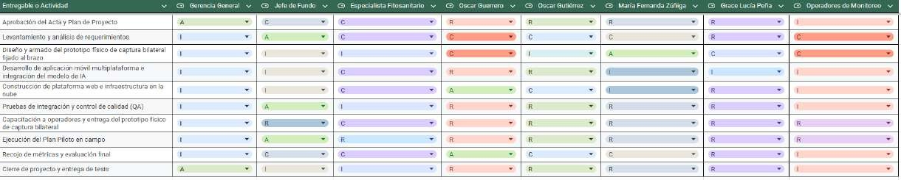

# Matriz RAM/RACI del proyecto (6.12)

| Campo | Valor |
|---|---|
| Archivo de imagen | `01-documentacion-principal/media/image12.jpeg` |
| Tipo | Matriz de responsabilidades (hoja de cálculo) |
| Aparece en | [`capitulo-06-planificacion-del-proyecto.md`](../../01-documentacion-principal/capitulo-06-planificacion-del-proyecto.md) — 6.12. Matriz RAM/RACI |
| Fuente | Informe principal (versión revisada, noviembre 2026) |

## Qué muestra

Asigna quién hace, aprueba, es consultado o informado en cada entregable. La Gerencia General aprueba el inicio y el cierre; el Jefe de Fundo aprueba requerimientos, pruebas y piloto. Lectura visual de la imagen (cada celda es un desplegable de color).

## Transcripción

R = Responsable · A = Aprueba (Accountable) · C = Consultado · I = Informado

| Entregable o actividad | Gerencia General | Jefe de Fundo | Especialista Fitosanitario | Oscar Guerrero | Oscar Gutiérrez | María Fernanda Zúñiga | Grace Lucía Peña | Operadores de Monitoreo |
|---|---|---|---|---|---|---|---|---|
| Aprobación del Acta y Plan de Proyecto | A | C | C | R | R | R | R | I |
| Levantamiento y análisis de requerimientos | I | A | C | C | C | C | R | C |
| Diseño y armado del prototipo físico de captura bilateral fijado al brazo | I | I | I | C | I | A | C | C |
| Desarrollo de aplicación móvil multiplataforma e integración del modelo de IA | I | I | C | R | R | I | I | I |
| Construcción de plataforma web e infraestructura en la nube | I | I | C | A | C | I | R | I |
| Pruebas de integración y control de calidad (QA) | I | A | I | R | R | R | R | I |
| Capacitación a operadores y entrega del prototipo físico de captura bilateral | I | R | C | R | R | R | R | R |
| Ejecución del Plan Piloto en campo | I | A | R | R | R | R | R | R |
| Recojo de métricas y evaluación final | I | C | C | A | R | C | R | I |
| Cierre de proyecto y entrega de tesis | A | I | I | R | R | R | R | I |
