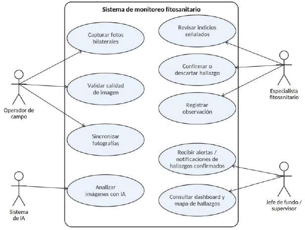

# Diagrama de casos de uso (8.4)

| Campo | Valor |
|---|---|
| Archivo de imagen | `01-documentacion-principal/media/image13.jpeg` |
| Tipo | Diagrama UML de casos de uso |
| Aparece en | [`capitulo-08-analisis-y-diseno-del-sistema.md`](../../01-documentacion-principal/capitulo-08-analisis-y-diseno-del-sistema.md) — 8.4. Diagrama de casos de uso |
| Fuente | Informe principal (versión revisada, noviembre 2026) |

## Qué muestra

Representa los nueve casos de uso CU1 a CU9 del capítulo 8 y qué actor participa en cada uno.

## Transcripción

Sistema: «Sistema de monitoreo fitosanitario».

| Actor | Casos de uso |
|---|---|
| Operador de campo | Capturar fotos bilaterales · Validar calidad de imagen · Sincronizar fotografías |
| Sistema de IA | Analizar imágenes con IA |
| Especialista fitosanitario | Revisar indicios señalados · Confirmar o descartar hallazgo · Registrar observación |
| Jefe de fundo / supervisor | Recibir alertas / notificaciones de hallazgos confirmados · Consultar dashboard y mapa de hallazgos |
