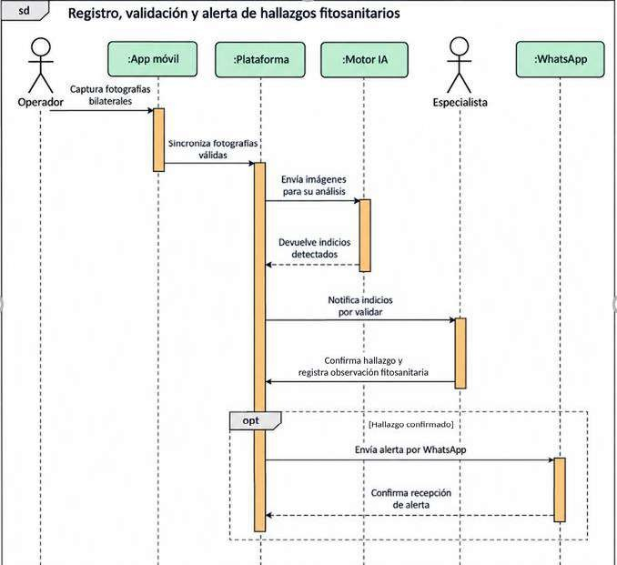

# Diagrama de secuencia «Registro, validación y alerta de hallazgos fitosanitarios» (8.7)

| Campo | Valor |
|---|---|
| Archivo de imagen | `01-documentacion-principal/media/image14.jpeg` |
| Tipo | Diagrama UML de secuencia |
| Aparece en | [`capitulo-08-analisis-y-diseno-del-sistema.md`](../../01-documentacion-principal/capitulo-08-analisis-y-diseno-del-sistema.md) — 8.7. Diagrama de secuencia |
| Fuente | Informe principal (versión revisada, noviembre 2026) |

## Qué muestra

Orden de los mensajes desde la captura hasta el aviso. La alerta solo se envía si el hallazgo queda confirmado.

## Transcripción

Participantes: Operador · :App móvil · :Plataforma · :Motor IA · Especialista · :WhatsApp

1. Operador → App móvil: «Captura fotografías bilaterales».
2. App móvil → Plataforma: «Sincroniza fotografías válidas».
3. Plataforma → Motor IA: «Envía imágenes para su análisis».
4. Motor IA ⇢ Plataforma (respuesta): «Devuelve indicios detectados».
5. Plataforma → Especialista: «Notifica indicios por validar».
6. Especialista → Plataforma: «Confirma hallazgo y registra observación fitosanitaria».
7. Fragmento **opt [Hallazgo confirmado]**: Plataforma → WhatsApp: «Envía alerta por WhatsApp»; WhatsApp ⇢ Plataforma: «Confirma recepción de alerta».

## Vigencia frente al sistema actual

> El canal de avisos real es **Telegram Bot API** (SC-02), no WhatsApp. El «Motor IA» es el worker de IA dentro del servidor (cola ai_tasks), no un servicio aparte.
