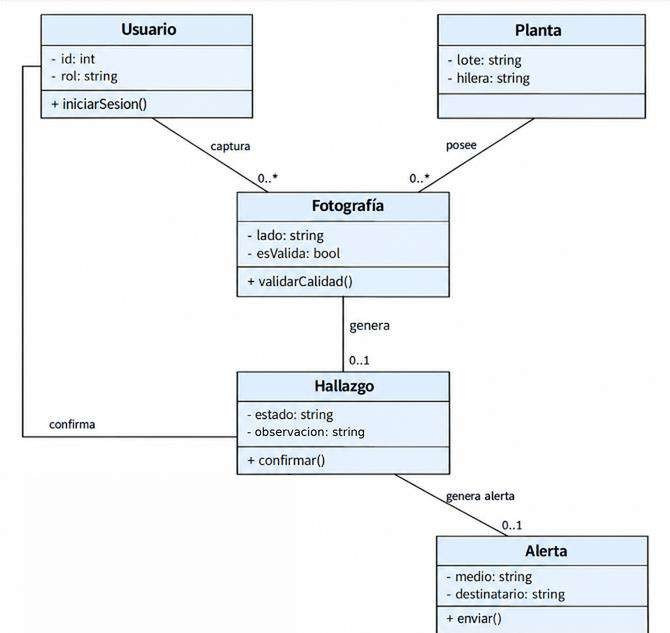

# Diagrama de clases (8.8)

| Campo | Valor |
|---|---|
| Archivo de imagen | `01-documentacion-principal/media/image15.jpeg` |
| Tipo | Diagrama UML de clases |
| Aparece en | [`capitulo-08-analisis-y-diseno-del-sistema.md`](../../01-documentacion-principal/capitulo-08-analisis-y-diseno-del-sistema.md) — 8.8. Diagrama de clases |
| Fuente | Informe principal (versión revisada, noviembre 2026) |

## Qué muestra

Modelo conceptual simplificado del dominio: una foto pertenece a una planta, puede generar un hallazgo, que el especialista confirma y que puede generar una alerta.

## Transcripción

| Clase | Atributos | Métodos |
|---|---|---|
| Usuario | id: int · rol: string | iniciarSesion() |
| Planta | lote: string · hilera: string | — |
| Fotografía | lado: string · esValida: bool | validarCalidad() |
| Hallazgo | estado: string · observacion: string | confirmar() |
| Alerta | medio: string · destinatario: string | enviar() |

Relaciones: Usuario «captura» 0..* Fotografía · Planta «posee» 0..* Fotografía · Fotografía «genera» 0..1 Hallazgo · Usuario «confirma» Hallazgo · Hallazgo «genera alerta» 0..1 Alerta.

## Vigencia frente al sistema actual

> Modelo inicial. El sistema real tiene más entidades (sesión, pasada, secuencia, captura, tarea de IA, detección, caso de revisión, decisión, aviso, auditoría); ver capítulo 10 y `05-repositorios-de-codigo/plataforma-web/docs/ARQUITECTURA_DATOS.md`.
