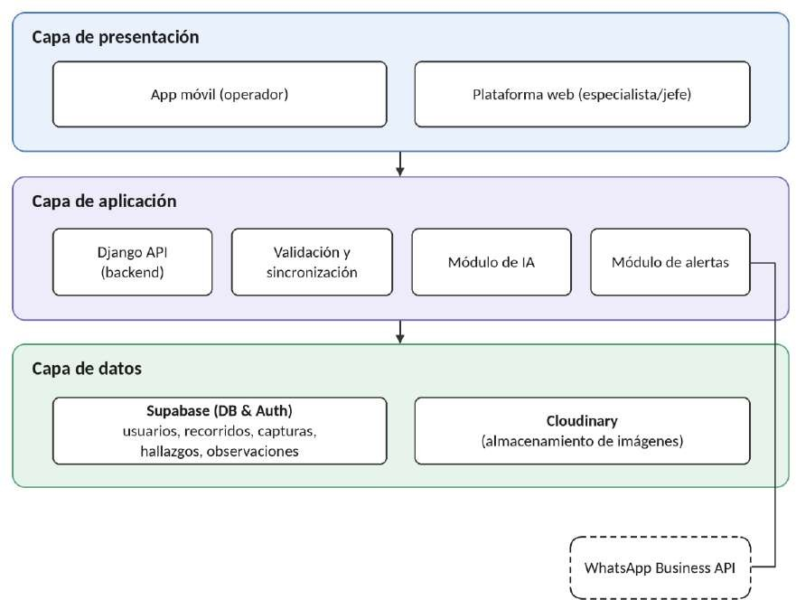

# Arquitectura lógica en capas (8.9)

| Campo | Valor |
|---|---|
| Archivo de imagen | `01-documentacion-principal/media/image16.jpeg` |
| Tipo | Diagrama de arquitectura por capas |
| Aparece en | [`capitulo-08-analisis-y-diseno-del-sistema.md`](../../01-documentacion-principal/capitulo-08-analisis-y-diseno-del-sistema.md) — 8.9. Arquitectura lógica |
| Fuente | Informe principal (versión revisada, noviembre 2026) |

## Qué muestra

Tres capas: lo que ven los usuarios, la lógica del backend Django (incluye IA y alertas) y los datos (base de datos y fotos).

## Transcripción

- **Capa de presentación:** App móvil (operador) · Plataforma web (especialista/jefe).
- **Capa de aplicación:** Django API (backend) · Validación y sincronización · Módulo de IA · Módulo de alertas.
- **Capa de datos:** Supabase (DB & Auth): usuarios, recorridos, capturas, hallazgos, observaciones · Cloudinary (almacenamiento de imágenes).
- Externo (recuadro punteado), conectado al Módulo de alertas: WhatsApp Business API.

## Vigencia frente al sistema actual

> Diagrama del diseño inicial, anterior a las solicitudes de cambio. En el sistema implementado: la web usa **plantillas Django + HTMX** (no Angular SPA); Supabase se usa **solo como PostgreSQL** (sin Supabase Auth ni PostGIS: el login es de Django con JWT); la IA es un **worker dentro del mismo backend** (ONNX Runtime, cola ai_tasks), no un servicio Python/GPU aparte; los avisos van por **Telegram Bot API** (no WhatsApp); los celulares son **3 Android** (no iPhone); las cámaras se llaman Cámara 1 y Cámara 2 y miran el mismo lado (no izquierda/derecha). Ver SC-01, SC-02, SC-04 y SC-07 y `00-contexto/03-arquitectura-y-tecnologias.md`.
