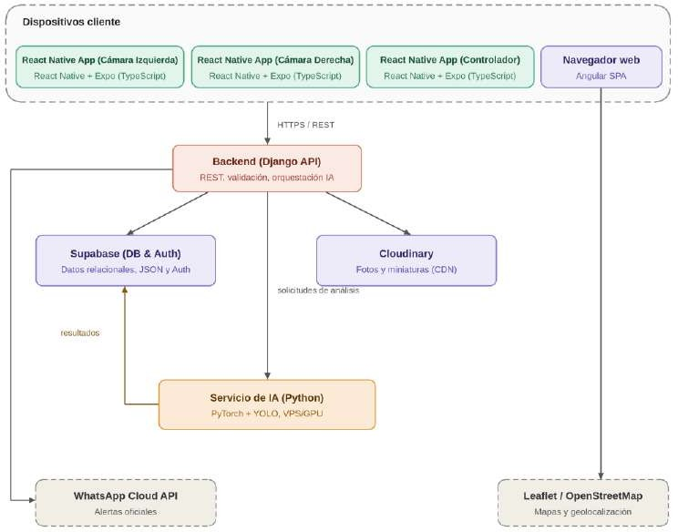

# Arquitectura física (8.10)

| Campo | Valor |
|---|---|
| Archivo de imagen | `01-documentacion-principal/media/image17.jpeg` |
| Tipo | Diagrama de arquitectura física |
| Aparece en | [`capitulo-08-analisis-y-diseno-del-sistema.md`](../../01-documentacion-principal/capitulo-08-analisis-y-diseno-del-sistema.md) — 8.10. Arquitectura física |
| Fuente | Informe principal (versión revisada, noviembre 2026) |

## Qué muestra

Dónde corre cada pieza y cómo se comunican: los celulares y el navegador hablan con el backend Django por HTTPS; el backend usa la base de datos, el almacenamiento de fotos, el servicio de IA y el canal de alertas.

## Transcripción

- **Dispositivos cliente:** React Native App (Cámara Izquierda) · React Native App (Cámara Derecha) · React Native App (Controlador) — React Native + Expo (TypeScript) · Navegador web (Angular SPA).
- Apps → «HTTPS / REST» → **Backend (Django API)**: REST, validación, orquestación IA.
- Backend → **Supabase (DB & Auth)**: datos relacionales, JSON y Auth.
- Backend → **Cloudinary**: fotos y miniaturas (CDN).
- Backend → «solicitudes de análisis» → **Servicio de IA (Python)**: PyTorch + YOLO, VPS/GPU → «resultados» → Supabase.
- Backend → **WhatsApp Cloud API** (alertas oficiales).
- Navegador web → **Leaflet / OpenStreetMap** (mapas y geolocalización).

## Vigencia frente al sistema actual

> Diagrama del diseño inicial, anterior a las solicitudes de cambio. En el sistema implementado: la web usa **plantillas Django + HTMX** (no Angular SPA); Supabase se usa **solo como PostgreSQL** (sin Supabase Auth ni PostGIS: el login es de Django con JWT); la IA es un **worker dentro del mismo backend** (ONNX Runtime, cola ai_tasks), no un servicio Python/GPU aparte; los avisos van por **Telegram Bot API** (no WhatsApp); los celulares son **3 Android** (no iPhone); las cámaras se llaman Cámara 1 y Cámara 2 y miran el mismo lado (no izquierda/derecha). Ver SC-01, SC-02, SC-04 y SC-07 y `00-contexto/03-arquitectura-y-tecnologias.md`.
