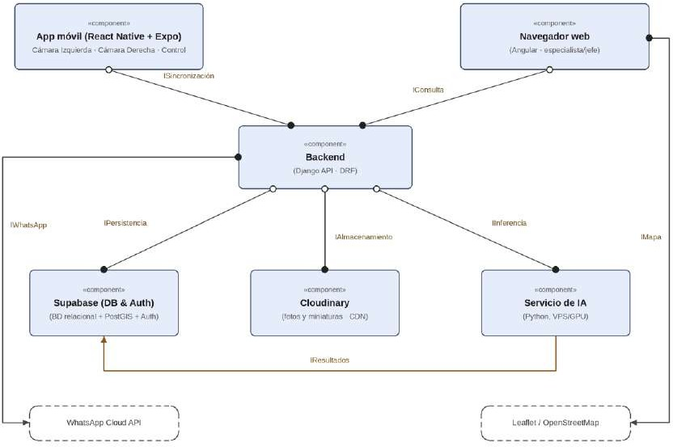

# Diagrama de componentes (8.12)

| Campo | Valor |
|---|---|
| Archivo de imagen | `01-documentacion-principal/media/image18.jpeg` |
| Tipo | Diagrama UML de componentes |
| Aparece en | [`capitulo-08-analisis-y-diseno-del-sistema.md`](../../01-documentacion-principal/capitulo-08-analisis-y-diseno-del-sistema.md) — 8.12. Diagrama de componentes |
| Fuente | Informe principal (versión revisada, noviembre 2026) |

## Qué muestra

Muestra los componentes y las interfaces que los unen (sincronización, consulta, persistencia, almacenamiento, inferencia, mapa y mensajería).

## Transcripción

Componentes e interfaces:
- «component» App móvil (React Native + Expo): Cámara Izquierda · Cámara Derecha · Control → interfaz **ISincronización** → Backend.
- «component» Navegador web (Angular · especialista/jefe) → **IConsulta** → Backend; → **IMapa** → Leaflet / OpenStreetMap.
- «component» **Backend** (Django API · DRF) → **IPersistencia** → Supabase (DB & Auth): BD relacional + PostGIS + Auth; → **IAlmacenamiento** → Cloudinary (fotos y miniaturas · CDN); → **IInferencia** → Servicio de IA (Python, VPS/GPU); → **IWhatsApp** → WhatsApp Cloud API.
- Servicio de IA → **IResultados** → Supabase.

## Vigencia frente al sistema actual

> Diagrama del diseño inicial, anterior a las solicitudes de cambio. En el sistema implementado: la web usa **plantillas Django + HTMX** (no Angular SPA); Supabase se usa **solo como PostgreSQL** (sin Supabase Auth ni PostGIS: el login es de Django con JWT); la IA es un **worker dentro del mismo backend** (ONNX Runtime, cola ai_tasks), no un servicio Python/GPU aparte; los avisos van por **Telegram Bot API** (no WhatsApp); los celulares son **3 Android** (no iPhone); las cámaras se llaman Cámara 1 y Cámara 2 y miran el mismo lado (no izquierda/derecha). Ver SC-01, SC-02, SC-04 y SC-07 y `00-contexto/03-arquitectura-y-tecnologias.md`.
