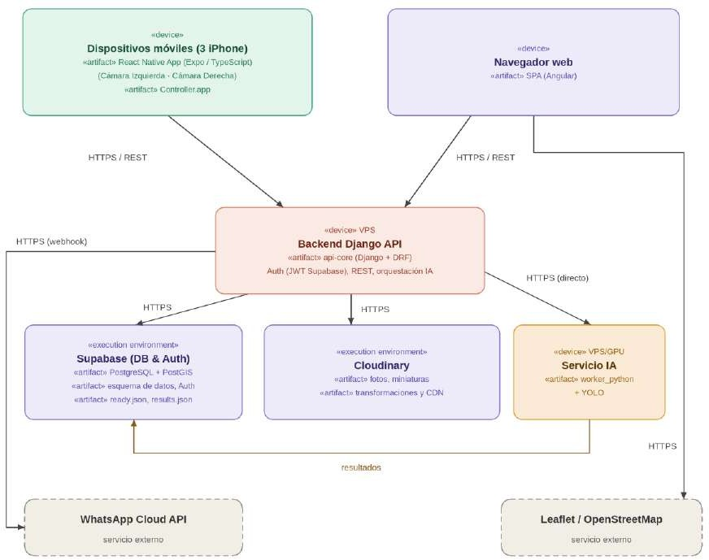

# Diagrama de despliegue (8.13)

| Campo | Valor |
|---|---|
| Archivo de imagen | `01-documentacion-principal/media/image19.jpeg` |
| Tipo | Diagrama UML de despliegue |
| Aparece en | [`capitulo-08-analisis-y-diseno-del-sistema.md`](../../01-documentacion-principal/capitulo-08-analisis-y-diseno-del-sistema.md) — 8.13. Diagrama de despliegue |
| Fuente | Informe principal (versión revisada, noviembre 2026) |

## Qué muestra

Dónde se instala cada artefacto en el diseño inicial.

## Transcripción

- «device» **Dispositivos móviles (3 iPhone)**: «artifact» React Native App (Expo / TypeScript) (Cámara Izquierda · Cámara Derecha) · «artifact» Controller.app → HTTPS / REST → backend.
- «device» **Navegador web**: «artifact» SPA (Angular) → HTTPS / REST → backend; → HTTPS → Leaflet / OpenStreetMap (servicio externo).
- «device» VPS — **Backend Django API**: «artifact» api-core (Django + DRF) · Auth (JWT Supabase), REST, orquestación IA.
  - → HTTPS → «execution environment» **Supabase (DB & Auth)**: «artifact» PostgreSQL + PostGIS · esquema de datos, Auth · ready.json, results.json.
  - → HTTPS → «execution environment» **Cloudinary**: «artifact» fotos, miniaturas · transformaciones y CDN.
  - → HTTPS (directo) → «device» VPS/GPU **Servicio IA**: «artifact» worker_python + YOLO → «resultados» → Supabase.
  - → HTTPS (webhook) → **WhatsApp Cloud API** (servicio externo).

## Vigencia frente al sistema actual

> Diagrama del diseño inicial, anterior a las solicitudes de cambio. En el sistema implementado: la web usa **plantillas Django + HTMX** (no Angular SPA); Supabase se usa **solo como PostgreSQL** (sin Supabase Auth ni PostGIS: el login es de Django con JWT); la IA es un **worker dentro del mismo backend** (ONNX Runtime, cola ai_tasks), no un servicio Python/GPU aparte; los avisos van por **Telegram Bot API** (no WhatsApp); los celulares son **3 Android** (no iPhone); las cámaras se llaman Cámara 1 y Cámara 2 y miran el mismo lado (no izquierda/derecha). Ver SC-01, SC-02, SC-04 y SC-07 y `00-contexto/03-arquitectura-y-tecnologias.md`. En producción todo el backend y el worker corren en un VPS de Hostinger con Docker y Traefik (capítulo 13).
