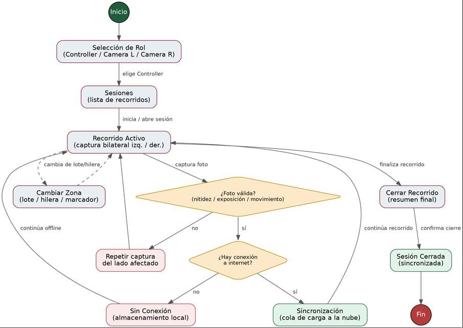

# Flujo de usuario del operador de campo (9.2)

| Campo | Valor |
|---|---|
| Archivo de imagen | `01-documentacion-principal/media/image20.png` |
| Tipo | Diagrama de flujo de usuario |
| Aparece en | [`capitulo-09-diseno-ux-ui.md`](../../01-documentacion-principal/capitulo-09-diseno-ux-ui.md) — 9.2. Flujo de usuario |
| Fuente | Informe principal (versión revisada, noviembre 2026) |

## Qué muestra

Recorrido del operador en la app: elegir función, abrir sesión, capturar, repetir si la foto es mala, guardar sin internet, sincronizar y cerrar.

## Transcripción

(Inicio) → **Selección de Rol** (Controller / Camera L / Camera R) —«elige Controller»→ **Sesiones** (lista de recorridos) —«inicia / abre sesión»→ **Recorrido Activo** (captura bilateral izq. / der.)

Desde Recorrido Activo:
- «cambia de lote/hilera» ⇄ **Cambiar Zona** (lote / hilera / marcador) — vuelve al recorrido.
- «captura foto» → **¿Foto válida?** (nitidez / exposición / movimiento)
  - no → **Repetir captura del lado afectado** → vuelve al recorrido.
  - sí → **¿Hay conexión a internet?**
    - no → **Sin Conexión** (almacenamiento local) —«continúa offline»→ recorrido.
    - sí → **Sincronización** (cola de carga a la nube) —«continúa recorrido»→ recorrido.
- «finaliza recorrido» → **Cerrar Recorrido** (resumen final) —«confirma cierre»→ **Sesión Cerrada** (sincronizada) → (Fin).

## Vigencia frente al sistema actual

> Corresponde al **prototipo de diseño inicial** del capítulo 9 (ver la «Nota de alcance» del capítulo). El sistema implementado difiere: no existen los módulos «Tratamientos», «Reportes en PDF» ni «Simulador» ni el perfil «Aplicador»; los reportes se descargan en CSV; los avisos van por Telegram (SC-02); la función del celular se elige como Controlador, Cámara 1 o Cámara 2; la web tiene tema claro y otra navegación. Las pantallas reales están en `03-manuales/`. Además, en la app real la sincronización automática ocurre con Wi-Fi y **sin** sesión de monitoreo abierta, no durante el recorrido.
