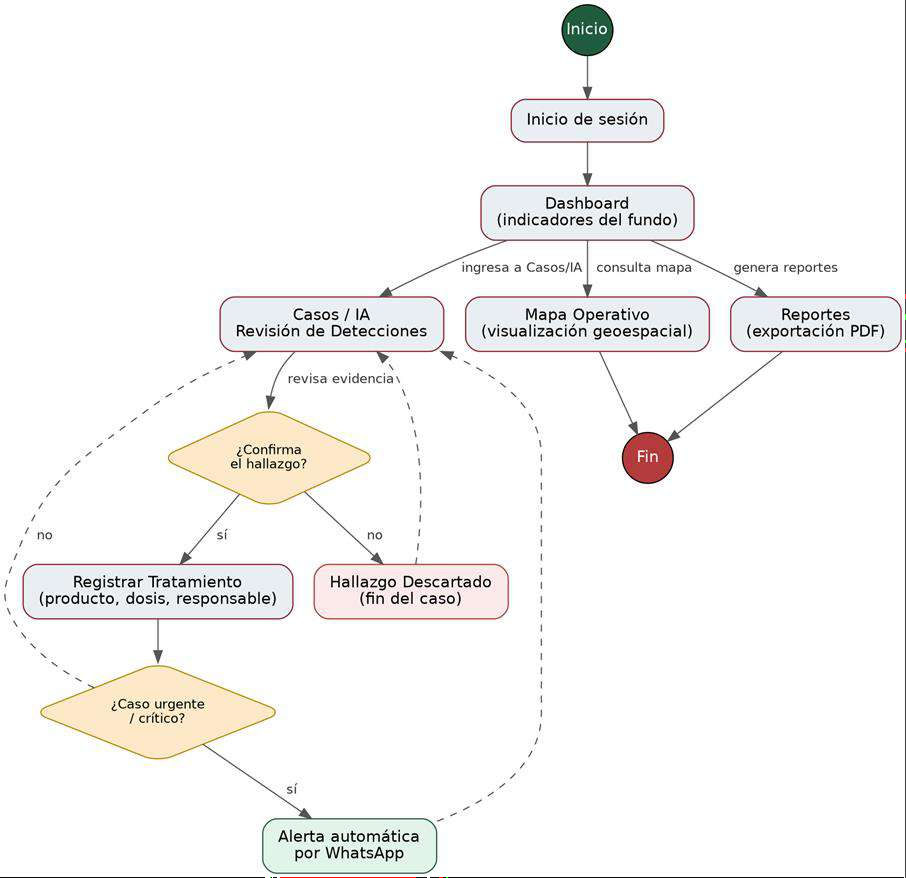

# Flujo de usuario del especialista fitosanitario / encargado de fundo (9.2)

| Campo | Valor |
|---|---|
| Archivo de imagen | `01-documentacion-principal/media/image21.png` |
| Tipo | Diagrama de flujo de usuario |
| Aparece en | [`capitulo-09-diseno-ux-ui.md`](../../01-documentacion-principal/capitulo-09-diseno-ux-ui.md) — 9.2. Flujo de usuario |
| Fuente | Informe principal (versión revisada, noviembre 2026) |

## Qué muestra

Recorrido del especialista en la web: ver indicadores, revisar casos de la IA, confirmar o descartar y consultar mapa y reportes.

## Transcripción

(Inicio) → **Inicio de sesión** → **Dashboard** (indicadores del fundo)
- «ingresa a Casos/IA» → **Casos / IA — Revisión de Detecciones** —«revisa evidencia»→ **¿Confirma el hallazgo?**
  - no → **Hallazgo Descartado** (fin del caso) ⇢ vuelve a Casos.
  - sí → **Registrar Tratamiento** (producto, dosis, responsable) → **¿Caso urgente / crítico?**
    - no ⇢ vuelve a Casos.
    - sí → **Alerta automática por WhatsApp** ⇢ vuelve a Casos.
- «consulta mapa» → **Mapa Operativo** (visualización geoespacial) → (Fin).
- «genera reportes» → **Reportes** (exportación PDF) → (Fin).

## Vigencia frente al sistema actual

> Corresponde al **prototipo de diseño inicial** del capítulo 9 (ver la «Nota de alcance» del capítulo). El sistema implementado difiere: no existen los módulos «Tratamientos», «Reportes en PDF» ni «Simulador» ni el perfil «Aplicador»; los reportes se descargan en CSV; los avisos van por Telegram (SC-02); la función del celular se elige como Controlador, Cámara 1 o Cámara 2; la web tiene tema claro y otra navegación. Las pantallas reales están en `03-manuales/`. En particular, registrar tratamientos (producto y dosis) está **fuera del alcance**; el aviso sale al confirmar (o como alerta temprana de la IA), sin pasar por «caso urgente».
