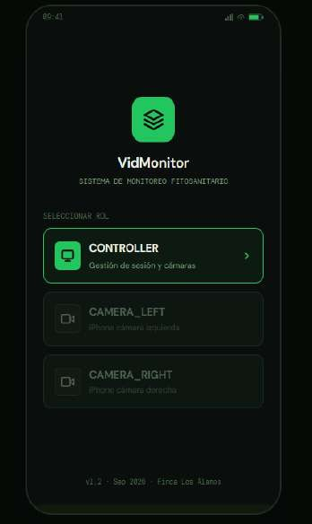

# Fig. 9.3 – Wireframe «Selección de rol» (app, prototipo inicial)

| Campo | Valor |
|---|---|
| Archivo de imagen | `01-documentacion-principal/media/image22.jpeg` |
| Tipo | Wireframe de pantalla móvil (tema oscuro) |
| Aparece en | [`capitulo-09-diseno-ux-ui.md`](../../01-documentacion-principal/capitulo-09-diseno-ux-ui.md) — 9.4. Wireframes |
| Fuente | Informe principal (versión revisada, noviembre 2026) |

## Qué muestra

Primera pantalla del prototipo: el celular elige si será el controlador o una de las dos cámaras. En el documento comparte espacio con la Fig. 9.4 «Listado de sesiones de captura» (imagen no extraída por separado).

## Transcripción

- Logo verde y título **VidMonitor** — «SISTEMA DE MONITOREO FITOSANITARIO».
- «SELECCIONAR ROL»:
  - **CONTROLLER** — «Gestión de sesión y cámaras» (opción resaltada, con flecha).
  - **CAMERA_LEFT** — «iPhone cámara izquierda» (atenuada).
  - **CAMERA_RIGHT** — «iPhone cámara derecha» (atenuada).
- Pie: «v1.2 · Sep 2026 · Finca Los Álamos».

## Vigencia frente al sistema actual

> Corresponde al **prototipo de diseño inicial** del capítulo 9 (ver la «Nota de alcance» del capítulo). El sistema implementado difiere: no existen los módulos «Tratamientos», «Reportes en PDF» ni «Simulador» ni el perfil «Aplicador»; los reportes se descargan en CSV; los avisos van por Telegram (SC-02); la función del celular se elige como Controlador, Cámara 1 o Cámara 2; la web tiene tema claro y otra navegación. Las pantallas reales están en `03-manuales/`. En la app real («Riachuelo Monitoreo», Android) las funciones son Controlador, Cámara 1 y Cámara 2 (PANT-08) y se eligen después de cada login. «VidMonitor» y «Finca Los Álamos» son nombres y datos de ejemplo del prototipo.
