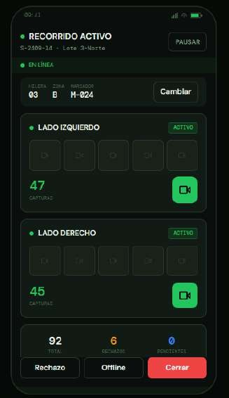

# Fig. 9.5 – Wireframe «Recorrido activo» (app, prototipo inicial)

| Campo | Valor |
|---|---|
| Archivo de imagen | `01-documentacion-principal/media/image24.jpeg` |
| Tipo | Wireframe de pantalla móvil (tema oscuro) |
| Aparece en | [`capitulo-09-diseno-ux-ui.md`](../../01-documentacion-principal/capitulo-09-diseno-ux-ui.md) — 9.4. Wireframes |
| Fuente | Informe principal (versión revisada, noviembre 2026) |

## Qué muestra

Pantalla principal durante la captura: muestra la ubicación actual (hilera, zona, marcador), cuántas fotos lleva cada cámara, los rechazos por calidad y las fotos pendientes de enviar.

## Transcripción

- Encabezado: «● RECORRIDO ACTIVO» · «S-2409-14 · Lote 3-Norte» · botón «PAUSAR». Indicador «● EN LÍNEA».
- Zona actual: HILERA 03 · ZONA B · MARCADOR M-024 · botón «Cambiar».
- Tarjeta «● LADO IZQUIERDO» (ACTIVO): fila de miniaturas, contador **47** CAPTURAS, botón de cámara verde.
- Tarjeta «● LADO DERECHO» (ACTIVO): miniaturas, **45** CAPTURAS, botón de cámara.
- Totales: **92** TOTAL · **6** RECHAZOS · **0** PENDIENTES.
- Botones inferiores: «Rechazo» · «Offline» · «Cerrar» (rojo).

## Vigencia frente al sistema actual

> Corresponde al **prototipo de diseño inicial** del capítulo 9 (ver la «Nota de alcance» del capítulo). El sistema implementado difiere: no existen los módulos «Tratamientos», «Reportes en PDF» ni «Simulador» ni el perfil «Aplicador»; los reportes se descargan en CSV; los avisos van por Telegram (SC-02); la función del celular se elige como Controlador, Cámara 1 o Cámara 2; la web tiene tema claro y otra navegación. Las pantallas reales están en `03-manuales/`. En el sistema real las cámaras no son «lado izquierdo/derecho»: ambas miran el mismo lateral y la hilera se recorre en dos pasadas (SC-04).
