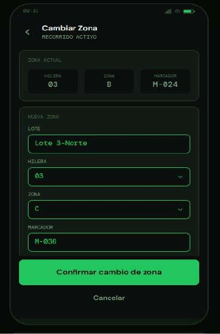

# Fig. 9.6 – Wireframe «Cambiar zona (lote, hilera, marcador)» (app, prototipo inicial)

| Campo | Valor |
|---|---|
| Archivo de imagen | `01-documentacion-principal/media/image25.jpeg` |
| Tipo | Wireframe de pantalla móvil (tema oscuro) |
| Aparece en | [`capitulo-09-diseno-ux-ui.md`](../../01-documentacion-principal/capitulo-09-diseno-ux-ui.md) — 9.4. Wireframes |
| Fuente | Informe principal (versión revisada, noviembre 2026) |

## Qué muestra

Permite al operador avisar que pasó a otra zona o marcador sin cerrar el recorrido, para que las fotos siguientes queden con la ubicación correcta.

## Transcripción

- Título «Cambiar Zona» · «RECORRIDO ACTIVO» · botón atrás.
- «ZONA ACTUAL»: HILERA 03 · ZONA B · MARCADOR M-024.
- «NUEVA ZONA»: LOTE «Lote 3-Norte» · HILERA «03» (desplegable) · ZONA «C» (desplegable) · MARCADOR «M-036».
- Botón verde «Confirmar cambio de zona» · enlace «Cancelar».

## Vigencia frente al sistema actual

> Corresponde al **prototipo de diseño inicial** del capítulo 9 (ver la «Nota de alcance» del capítulo). El sistema implementado difiere: no existen los módulos «Tratamientos», «Reportes en PDF» ni «Simulador» ni el perfil «Aplicador»; los reportes se descargan en CSV; los avisos van por Telegram (SC-02); la función del celular se elige como Controlador, Cámara 1 o Cámara 2; la web tiene tema claro y otra navegación. Las pantallas reales están en `03-manuales/`. En la app real se cambia de marcador con la pasada en pausa; cada hilera tiene 10 segmentos fijos con su marcador.
