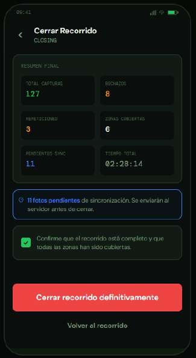

# Fig. 9.7 – Wireframe «Cierre» del recorrido (app, prototipo inicial)

| Campo | Valor |
|---|---|
| Archivo de imagen | `01-documentacion-principal/media/image26.jpeg` |
| Tipo | Wireframe de pantalla móvil (tema oscuro) |
| Aparece en | [`capitulo-09-diseno-ux-ui.md`](../../01-documentacion-principal/capitulo-09-diseno-ux-ui.md) — 9.4. Wireframes |
| Fuente | Informe principal (versión revisada, noviembre 2026) |

## Qué muestra

Resumen y confirmación antes de cerrar un recorrido. En el documento comparte espacio con la Fig. 9.8 «Modo sin conexión» (imagen no extraída por separado).

## Transcripción

- Título «Cerrar Recorrido» · «CLOSING».
- «RESUMEN FINAL»: TOTAL CAPTURAS **127** · RECHAZOS **8** · REPETICIONES **3** · ZONAS CUBIERTAS **6** · PENDIENTES SYNC **11** · TIEMPO TOTAL **02:28:14**.
- Aviso: «11 fotos pendientes de sincronización. Se enviarán al servidor antes de cerrar.»
- Casilla marcada: «Confirmo que el recorrido está completo y que todas las zonas han sido cubiertas.»
- Botón rojo «Cerrar recorrido definitivamente» · enlace «Volver al recorrido».

## Vigencia frente al sistema actual

> Corresponde al **prototipo de diseño inicial** del capítulo 9 (ver la «Nota de alcance» del capítulo). El sistema implementado difiere: no existen los módulos «Tratamientos», «Reportes en PDF» ni «Simulador» ni el perfil «Aplicador»; los reportes se descargan en CSV; los avisos van por Telegram (SC-02); la función del celular se elige como Controlador, Cámara 1 o Cámara 2; la web tiene tema claro y otra navegación. Las pantallas reales están en `03-manuales/`.
