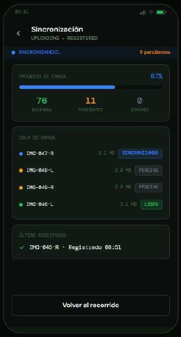

# Fig. 9.9 – Wireframe «Sincronización» (app, prototipo inicial)

| Campo | Valor |
|---|---|
| Archivo de imagen | `01-documentacion-principal/media/image28.jpeg` |
| Tipo | Wireframe de pantalla móvil (tema oscuro) |
| Aparece en | [`capitulo-09-diseno-ux-ui.md`](../../01-documentacion-principal/capitulo-09-diseno-ux-ui.md) — 9.4. Wireframes |
| Fuente | Informe principal (versión revisada, noviembre 2026) |

## Qué muestra

Muestra el avance del envío de fotos al servidor y el estado de cada archivo en la cola.

## Transcripción

- Título «Sincronización» · «UPLOADING → REGISTERED». Barra: «● SINCRONIZANDO…» · «11 pendientes».
- «PROGRESO DE CARGA» 67 %: **76** ENVIADAS · **11** PENDIENTES · **0** ERRORES.
- «COLA DE CARGA»: IMG-047-R 3.2 MB SINCRONIZANDO · IMG-048-L 3.0 MB PENDING · IMG-049-R 2.9 MB PENDING · IMG-046-L 3.1 MB LISTO.
- «ÚLTIMO REGISTRADO»: IMG-045-R · Registrado 08:51.
- Botón «Volver al recorrido».

## Vigencia frente al sistema actual

> Corresponde al **prototipo de diseño inicial** del capítulo 9 (ver la «Nota de alcance» del capítulo). El sistema implementado difiere: no existen los módulos «Tratamientos», «Reportes en PDF» ni «Simulador» ni el perfil «Aplicador»; los reportes se descargan en CSV; los avisos van por Telegram (SC-02); la función del celular se elige como Controlador, Cámara 1 o Cámara 2; la web tiene tema claro y otra navegación. Las pantallas reales están en `03-manuales/`. La sincronización real (PANT-20) envía sesiones, pasadas, secuencias, fotos (directo a Cloudinary con ticket) e incidencias en ese orden.
