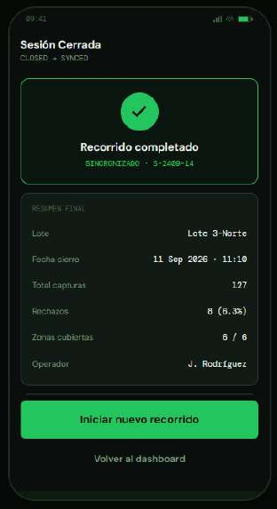

# Fig. 9.10 – Wireframe «Sesión cerrada y sincronizada» (app, prototipo inicial)

| Campo | Valor |
|---|---|
| Archivo de imagen | `01-documentacion-principal/media/image29.jpeg` |
| Tipo | Wireframe de pantalla móvil (tema oscuro) |
| Aparece en | [`capitulo-09-diseno-ux-ui.md`](../../01-documentacion-principal/capitulo-09-diseno-ux-ui.md) — 9.4. Wireframes |
| Fuente | Informe principal (versión revisada, noviembre 2026) |

## Qué muestra

Confirmación final de que el recorrido quedó cerrado y enviado al servidor. Los datos son de ejemplo.

## Transcripción

- Título «Sesión Cerrada» · «CLOSED → SYNCED».
- Tarjeta con check verde: «Recorrido completado» · «SINCRONIZADO · S-2409-14».
- «RESUMEN FINAL»: Lote «Lote 3-Norte» · Fecha cierre «11 Sep 2026 · 11:10» · Total capturas 127 · Rechazos 8 (6.3%) · Zonas cubiertas 6 / 6 · Operador «J. Rodríguez».
- Botón verde «Iniciar nuevo recorrido» · enlace «Volver al dashboard».

## Vigencia frente al sistema actual

> Corresponde al **prototipo de diseño inicial** del capítulo 9 (ver la «Nota de alcance» del capítulo). El sistema implementado difiere: no existen los módulos «Tratamientos», «Reportes en PDF» ni «Simulador» ni el perfil «Aplicador»; los reportes se descargan en CSV; los avisos van por Telegram (SC-02); la función del celular se elige como Controlador, Cámara 1 o Cámara 2; la web tiene tema claro y otra navegación. Las pantallas reales están en `03-manuales/`.
