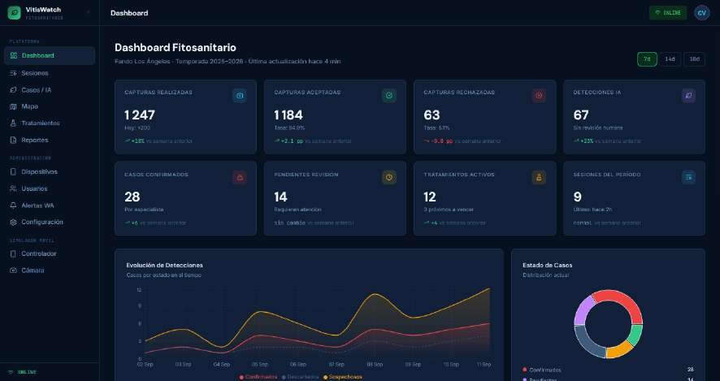

# Fig. 9.11 – Mockup «Dashboard Fitosanitario: indicadores clave del fundo» (web, prototipo inicial)

| Campo | Valor |
|---|---|
| Archivo de imagen | `01-documentacion-principal/media/image30.jpeg` |
| Tipo | Mockup de pantalla web (tema oscuro) |
| Aparece en | [`capitulo-09-diseno-ux-ui.md`](../../01-documentacion-principal/capitulo-09-diseno-ux-ui.md) — 9.5. Mockups |
| Fuente | Informe principal (versión revisada, noviembre 2026) |

## Qué muestra

Panel de indicadores del fundo para el especialista y la jefatura: volumen y calidad de capturas, detecciones de la IA, casos por estado y evolución diaria. Datos ficticios.

## Transcripción

Menú lateral común de los mockups («VitisWatch · Fitosanitario»): PLATAFORMA — Dashboard · Sesiones · Casos / IA · Mapa · Tratamientos · Reportes; ADMINISTRACIÓN — Dispositivos · Usuarios · Alertas WA · Configuración; SIMULADOR MÓVIL — Controlador · Cámara. Arriba a la derecha: indicador «ONLINE» y avatar «CV».

Contenido: «Dashboard Fitosanitario» · «Fundo Los Ángeles · Temporada 2025–2026 · Última actualización hace 4 min» · filtros de periodo 7d / 14d / 30d.

| Indicador | Valor | Nota |
|---|---:|---|
| Capturas realizadas | 1 247 | Hoy: +200 · +18 % vs semana anterior |
| Capturas aceptadas | 1 184 | Tasa 94.9 % · +2.1 pp |
| Capturas rechazadas | 63 | Tasa 5.1 % · −0.8 pp |
| Detecciones IA | 67 | Sin revisión humana · +23 % |
| Casos confirmados | 28 | Por especialista · +6 |
| Pendientes revisión | 14 | Requieren atención · sin cambio |
| Tratamientos activos | 12 | 3 próximos a vencer · +4 |
| Sesiones del periodo | 9 | Última: hace 2 h · normal |

Gráficos: «Evolución de Detecciones — casos por estado en el tiempo» (líneas Confirmados / Descartados / Sospechosos, 02 Sep a 11 Sep) y «Estado de Casos — distribución actual» (anillo: Confirmados 28, Pendientes 14…).

## Vigencia frente al sistema actual

> Corresponde al **prototipo de diseño inicial** del capítulo 9 (ver la «Nota de alcance» del capítulo). El sistema implementado difiere: no existen los módulos «Tratamientos», «Reportes en PDF» ni «Simulador» ni el perfil «Aplicador»; los reportes se descargan en CSV; los avisos van por Telegram (SC-02); la función del celular se elige como Controlador, Cámara 1 o Cámara 2; la web tiene tema claro y otra navegación. Las pantallas reales están en `03-manuales/`. «VitisWatch» y «Fundo Los Ángeles» son nombres de ejemplo del prototipo; el sistema real se llama «Monitoreo fitosanitario de la vid · Agrícola Riachuelo».
