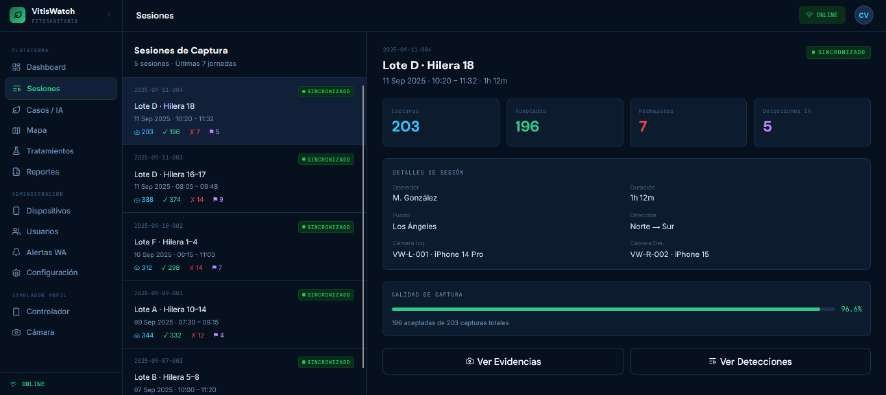

# Fig. 9.12 – Mockup «Sesiones de captura: listado y detalle por lote/hilera» (web, prototipo inicial)

| Campo | Valor |
|---|---|
| Archivo de imagen | `01-documentacion-principal/media/image31.jpeg` |
| Tipo | Mockup de pantalla web (tema oscuro) |
| Aparece en | [`capitulo-09-diseno-ux-ui.md`](../../01-documentacion-principal/capitulo-09-diseno-ux-ui.md) — 9.5. Mockups |
| Fuente | Informe principal (versión revisada, noviembre 2026) |

## Qué muestra

Lista de salidas de campo sincronizadas y el detalle de una: quién la hizo, cuánto duró, cuántas fotos se aceptaron y cuántas detecciones generó. Datos ficticios.

## Transcripción

Menú lateral común de los mockups («VitisWatch · Fitosanitario»): PLATAFORMA — Dashboard · Sesiones · Casos / IA · Mapa · Tratamientos · Reportes; ADMINISTRACIÓN — Dispositivos · Usuarios · Alertas WA · Configuración; SIMULADOR MÓVIL — Controlador · Cámara. Arriba a la derecha: indicador «ONLINE» y avatar «CV».

Columna izquierda «Sesiones de Captura» (5 sesiones · últimas 7 jornadas), cada una con estado «SINCRONIZADO» y contadores (capturas ✓ aceptadas ✗ rechazos ⚑ detecciones):
- Lote D · Hilera 18 — 11 Sep 2025 10:20–11:32 — 203 · 196 · 7 · 5
- Lote D · Hilera 16–17 — 11 Sep 2025 08:05–09:48 — 388 · 374 · 14 · 9
- Lote F · Hilera 1–4 — 10 Sep 2025 — 312 · 298 · 14 · 7
- Lote A · Hilera 10–14 — 09 Sep 2025 07:30–08:15 — 344 · 332 · 12 · 4
- Lote B · Hilera 5–8 — 07 Sep 2025 10:00–11:20

Detalle «Lote D · Hilera 18» (11 Sep 2025 · 10:20–11:32 · 1 h 12 m · SINCRONIZADO): Capturas 203 · Aceptadas 196 · Rechazadas 7 · Detecciones IA 5. «DETALLES DE SESIÓN»: Operador M. González · Duración 1 h 12 m · Fundo Los Ángeles · Dirección Norte → Sur · Cámara Izq. VW-L-001 · iPhone 14 Pro · Cámara Der. VW-R-002 · iPhone 15. «CALIDAD DE CAPTURA» 96.6 % (196 aceptadas de 203). Botones «Ver Evidencias» y «Ver Detecciones».

## Vigencia frente al sistema actual

> Corresponde al **prototipo de diseño inicial** del capítulo 9 (ver la «Nota de alcance» del capítulo). El sistema implementado difiere: no existen los módulos «Tratamientos», «Reportes en PDF» ni «Simulador» ni el perfil «Aplicador»; los reportes se descargan en CSV; los avisos van por Telegram (SC-02); la función del celular se elige como Controlador, Cámara 1 o Cámara 2; la web tiene tema claro y otra navegación. Las pantallas reales están en `03-manuales/`.
