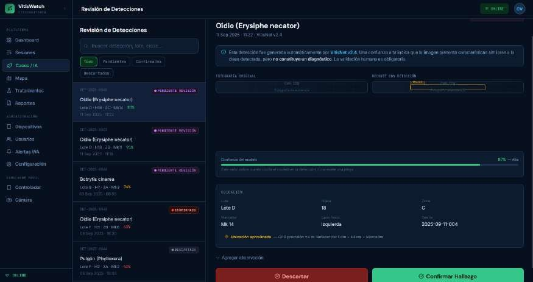

# Fig. 9.13 – Mockup «Revisión de Detecciones: validación de hallazgos de IA» (web, prototipo inicial)

| Campo | Valor |
|---|---|
| Archivo de imagen | `01-documentacion-principal/media/image32.jpeg` |
| Tipo | Mockup de pantalla web (tema oscuro) |
| Aparece en | [`capitulo-09-diseno-ux-ui.md`](../../01-documentacion-principal/capitulo-09-diseno-ux-ui.md) — 9.5. Mockups |
| Fuente | Informe principal (versión revisada, noviembre 2026) |

## Qué muestra

Pantalla clave del especialista: revisa la foto y la caja que marcó la IA con su confianza y ubicación, y decide confirmar o descartar. Refleja la regla de que la IA no diagnostica.

## Transcripción

Menú lateral común de los mockups («VitisWatch · Fitosanitario»): PLATAFORMA — Dashboard · Sesiones · Casos / IA · Mapa · Tratamientos · Reportes; ADMINISTRACIÓN — Dispositivos · Usuarios · Alertas WA · Configuración; SIMULADOR MÓVIL — Controlador · Cámara. Arriba a la derecha: indicador «ONLINE» y avatar «CV».

Columna izquierda «Revisión de Detecciones»: buscador «Buscar detección, lote, clase…», filtros «Todo · Pendientes · Confirmadas · Descartados». Lista:
- Oídio (Erysiphe necator) — Lote D · H18 · ZC · Mk14 — 87 % — PENDIENTE REVISIÓN
- Oídio (Erysiphe necator) — Lote D · H18 · ZB · Mk11 — 93 % — PENDIENTE REVISIÓN
- Botrytis cinerea — Lote B · H7 · ZA · Mk3 — 74 % — PENDIENTE REVISIÓN
- Oídio (Erysiphe necator) — Lote F · H3 · ZB · Mk6 — 67 % — CONFIRMADO
- Pulgón (Phylloxera) — Lote F · H2 · ZA · Mk2 — 52 % — DESCARTADO

Detalle: «Oídio (Erysiphe necator)» · 11 Sep 2025 · 11:22 · VitisNet v2.4. Aviso: «Esta detección fue generada automáticamente por VitisNet v2.4. Una confianza alta indica que la imagen presenta características similares a la clase detectada, pero **no constituye un diagnóstico**. La validación humana es obligatoria.» Paneles «FOTOGRAFÍA ORIGINAL» y «RECORTE CON DETECCIÓN» (caja marcada). «Confianza del modelo» 87 % — Alta. «UBICACIÓN»: Lote D · Hilera 18 · Zona C · Marcador Mk 14 · Lado foto Izquierda · Sesión 2025-09-11-004 · «Ubicación aproximada — GPS precisión ±12 m. Referencia: Lote › Hilera › Marcador». Enlace «Agregar observación». Botones «Descartar» (rojo) y «Confirmar Hallazgo» (verde).

## Vigencia frente al sistema actual

> Corresponde al **prototipo de diseño inicial** del capítulo 9 (ver la «Nota de alcance» del capítulo). El sistema implementado difiere: no existen los módulos «Tratamientos», «Reportes en PDF» ni «Simulador» ni el perfil «Aplicador»; los reportes se descargan en CSV; los avisos van por Telegram (SC-02); la función del celular se elige como Controlador, Cámara 1 o Cámara 2; la web tiene tema claro y otra navegación. Las pantallas reales están en `03-manuales/`. Las clases del prototipo (oídio, botrytis, pulgón) son de ejemplo: el modelo real detecta **chanchito blanco** y **melaza/fumagina**. Las decisiones reales son Confirmado · Posible plaga · Descartado · Evidencia insuficiente.
