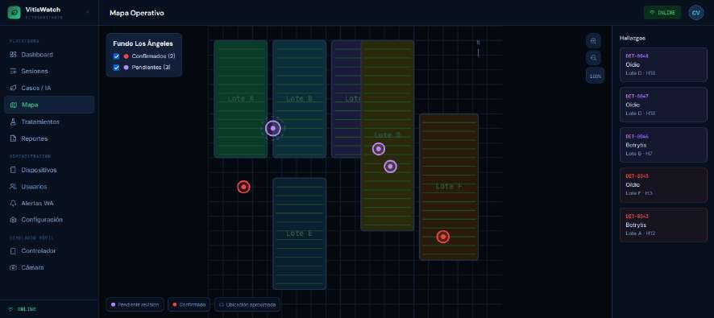

# Fig. 9.14 – Mockup «Mapa Operativo: distribución geoespacial de hallazgos por lote» (web, prototipo inicial)

| Campo | Valor |
|---|---|
| Archivo de imagen | `01-documentacion-principal/media/image33.jpeg` |
| Tipo | Mockup de pantalla web (tema oscuro) |
| Aparece en | [`capitulo-09-diseno-ux-ui.md`](../../01-documentacion-principal/capitulo-09-diseno-ux-ui.md) — 9.5. Mockups |
| Fuente | Informe principal (versión revisada, noviembre 2026) |

## Qué muestra

Ubica los hallazgos sobre un esquema de los lotes, con colores por estado, para ver dónde se concentran.

## Transcripción

Menú lateral común de los mockups («VitisWatch · Fitosanitario»): PLATAFORMA — Dashboard · Sesiones · Casos / IA · Mapa · Tratamientos · Reportes; ADMINISTRACIÓN — Dispositivos · Usuarios · Alertas WA · Configuración; SIMULADOR MÓVIL — Controlador · Cámara. Arriba a la derecha: indicador «ONLINE» y avatar «CV».

- Cuadro de capas «Fundo Los Ángeles»: ☑ Confirmados (2) · ☑ Pendientes (3).
- Lienzo cuadriculado con rectángulos de colores por lote (Lote A, Lote B, Lote C, Lote D, Lote E, Lote F), cada uno con sus hileras en líneas horizontales.
- Marcadores circulares: rojos = confirmado; morados = pendiente de revisión.
- Controles de zoom (+ / − / 100 %).
- Panel derecho «Hallazgos»: DET-0048 Oídio · Lote D · H18 · DET-0047 Oídio · Lote D · H18 · DET-0046 Botrytis · Lote B · H7 · DET-0045 Oídio · Lote F · H3 · DET-0043 Botrytis · Lote A · H12.
- Leyenda inferior: «Pendiente revisión» · «Confirmado» · «Ubicación aproximada».

## Vigencia frente al sistema actual

> Corresponde al **prototipo de diseño inicial** del capítulo 9 (ver la «Nota de alcance» del capítulo). El sistema implementado difiere: no existen los módulos «Tratamientos», «Reportes en PDF» ni «Simulador» ni el perfil «Aplicador»; los reportes se descargan en CSV; los avisos van por Telegram (SC-02); la función del celular se elige como Controlador, Cámara 1 o Cámara 2; la web tiene tema claro y otra navegación. Las pantallas reales están en `03-manuales/`. El mapa real usa Leaflet con teselas satelitales Esri y OpenStreetMap y contornos reales de los lotes, además de un «plano de hileras» por segmento.
