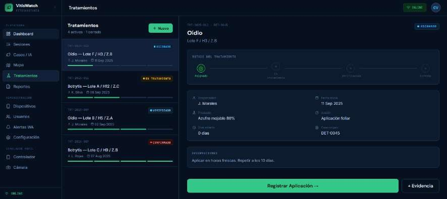

# Fig. 9.15 – Mockup «Tratamientos: seguimiento del estado de aplicación» (web, prototipo inicial)

| Campo | Valor |
|---|---|
| Archivo de imagen | `01-documentacion-principal/media/image34.jpeg` |
| Tipo | Mockup de pantalla web (tema oscuro) |
| Aparece en | [`capitulo-09-diseno-ux-ui.md`](../../01-documentacion-principal/capitulo-09-diseno-ux-ui.md) — 9.5. Mockups |
| Fuente | Informe principal (versión revisada, noviembre 2026) |

## Qué muestra

Seguimiento de la aplicación de tratamientos después de confirmar un hallazgo.

## Transcripción

Menú lateral común de los mockups («VitisWatch · Fitosanitario»): PLATAFORMA — Dashboard · Sesiones · Casos / IA · Mapa · Tratamientos · Reportes; ADMINISTRACIÓN — Dispositivos · Usuarios · Alertas WA · Configuración; SIMULADOR MÓVIL — Controlador · Cámara. Arriba a la derecha: indicador «ONLINE» y avatar «CV».

- Lista «Tratamientos» (4 activos · 1 cerrado) con botón «+ Nuevo»:
  - Oídio — Lote F / H3 / Z.B — J. Morales — 11 Sep 2025 — ASIGNADO
  - Botrytis — Lote A / H12 / Z.C — K. Silva — 08 Sep 2025 — EN TRATAMIENTO
  - Oídio — Lote B / H5 / Z.A — J. Morales — 02 Sep 2025 — VERIFICADO
  - Botrytis — Lote C / H9 / Z.B — L. Rojas — 27 Aug 2025 — CONFIRMADO
- Detalle «Oídio · Lote F / H3 / Z.B» (ASIGNADO). «ESTADO DEL TRATAMIENTO»: Asignado → En tratamiento → Verificación → Cerrado. Responsable J. Morales · Fecha inicio 11 Sep 2025 · Producto «Azufre mojable 80 %» · Método «Aplicación foliar» · Días abierto 0 días · Detección DET-0045. «OBSERVACIONES»: «Aplicar en horas frescas. Repetir a los 10 días.» Botones «Registrar Aplicación →» y «+ Evidencia».

## Vigencia frente al sistema actual

> Corresponde al **prototipo de diseño inicial** del capítulo 9 (ver la «Nota de alcance» del capítulo). El sistema implementado difiere: no existen los módulos «Tratamientos», «Reportes en PDF» ni «Simulador» ni el perfil «Aplicador»; los reportes se descargan en CSV; los avisos van por Telegram (SC-02); la función del celular se elige como Controlador, Cámara 1 o Cámara 2; la web tiene tema claro y otra navegación. Las pantallas reales están en `03-manuales/`. **Este módulo no existe en el sistema implementado**: la decisión y ejecución del tratamiento quedaron fuera del alcance (14.1.3).
