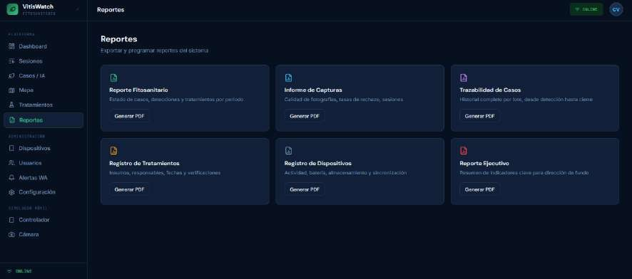

# Fig. 9.16 – Mockup «Reportes: generación de documentos PDF del sistema» (web, prototipo inicial)

| Campo | Valor |
|---|---|
| Archivo de imagen | `01-documentacion-principal/media/image35.jpeg` |
| Tipo | Mockup de pantalla web (tema oscuro) |
| Aparece en | [`capitulo-09-diseno-ux-ui.md`](../../01-documentacion-principal/capitulo-09-diseno-ux-ui.md) — 9.5. Mockups |
| Fuente | Informe principal (versión revisada, noviembre 2026) |

## Qué muestra

Catálogo de reportes descargables que se planteó en el diseño inicial.

## Transcripción

Menú lateral común de los mockups («VitisWatch · Fitosanitario»): PLATAFORMA — Dashboard · Sesiones · Casos / IA · Mapa · Tratamientos · Reportes; ADMINISTRACIÓN — Dispositivos · Usuarios · Alertas WA · Configuración; SIMULADOR MÓVIL — Controlador · Cámara. Arriba a la derecha: indicador «ONLINE» y avatar «CV».

«Reportes — Exportar y programar reportes del sistema». Seis tarjetas, cada una con botón «Generar PDF»:
- **Reporte Fitosanitario** — Estado de casos, detecciones y tratamientos por periodo.
- **Informe de Capturas** — Calidad de fotografías, tasas de rechazo, sesiones.
- **Trazabilidad de Casos** — Historial completo por lote, desde detección hasta cierre.
- **Registro de Tratamientos** — Insumos, responsables, fechas y verificaciones.
- **Registro de Dispositivos** — Actividad, batería, almacenamiento y sincronización.
- **Reporte Ejecutivo** — Resumen de indicadores clave para dirección de fundo.

## Vigencia frente al sistema actual

> Corresponde al **prototipo de diseño inicial** del capítulo 9 (ver la «Nota de alcance» del capítulo). El sistema implementado difiere: no existen los módulos «Tratamientos», «Reportes en PDF» ni «Simulador» ni el perfil «Aplicador»; los reportes se descargan en CSV; los avisos van por Telegram (SC-02); la función del celular se elige como Controlador, Cámara 1 o Cámara 2; la web tiene tema claro y otra navegación. Las pantallas reales están en `03-manuales/`. En el sistema real los reportes se descargan en **CSV** (no PDF) y no hay reporte de tratamientos.
