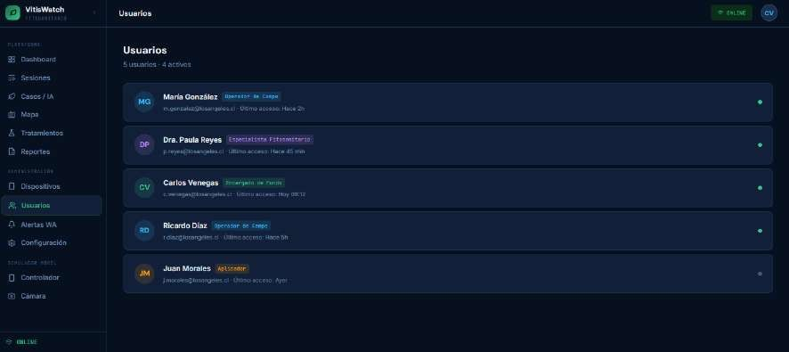

# Fig. 9.17 – Mockup «Usuarios: gestión de roles y accesos» (web, prototipo inicial)

| Campo | Valor |
|---|---|
| Archivo de imagen | `01-documentacion-principal/media/image36.jpeg` |
| Tipo | Mockup de pantalla web (tema oscuro) |
| Aparece en | [`capitulo-09-diseno-ux-ui.md`](../../01-documentacion-principal/capitulo-09-diseno-ux-ui.md) — 9.5. Mockups |
| Fuente | Informe principal (versión revisada, noviembre 2026) |

## Qué muestra

Lista de cuentas con su rol y actividad. Personas y datos ficticios.

## Transcripción

Menú lateral común de los mockups («VitisWatch · Fitosanitario»): PLATAFORMA — Dashboard · Sesiones · Casos / IA · Mapa · Tratamientos · Reportes; ADMINISTRACIÓN — Dispositivos · Usuarios · Alertas WA · Configuración; SIMULADOR MÓVIL — Controlador · Cámara. Arriba a la derecha: indicador «ONLINE» y avatar «CV».

«Usuarios — 5 usuarios · 4 activos». Lista con avatar de iniciales, rol y último acceso (correos de ejemplo omitidos):
- María González — Operador de Campo — último acceso hace 2 h — activa.
- Dra. Paula Reyes — Especialista Fitosanitario — hace 45 min — activa.
- Carlos Venegas — Encargado de Fundo — hoy 08:12 — activo.
- Ricardo Díaz — Operador de Campo — hace 5 h — activo.
- Juan Morales — Aplicador — ayer — inactivo.

## Vigencia frente al sistema actual

> Corresponde al **prototipo de diseño inicial** del capítulo 9 (ver la «Nota de alcance» del capítulo). El sistema implementado difiere: no existen los módulos «Tratamientos», «Reportes en PDF» ni «Simulador» ni el perfil «Aplicador»; los reportes se descargan en CSV; los avisos van por Telegram (SC-02); la función del celular se elige como Controlador, Cámara 1 o Cámara 2; la web tiene tema claro y otra navegación. Las pantallas reales están en `03-manuales/`. Los roles reales son Administrador, Especialista fitosanitario, Supervisor y Operador de campo; no existen «Encargado de Fundo» ni «Aplicador» como roles.
