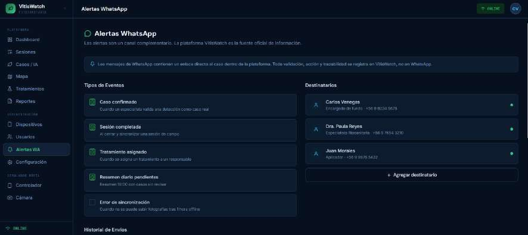

# Fig. 9.18 – Mockup «Alertas: configuración de eventos y destinatarios» (web, prototipo inicial)

| Campo | Valor |
|---|---|
| Archivo de imagen | `01-documentacion-principal/media/image37.jpeg` |
| Tipo | Mockup de pantalla web (tema oscuro) |
| Aparece en | [`capitulo-09-diseno-ux-ui.md`](../../01-documentacion-principal/capitulo-09-diseno-ux-ui.md) — 9.5. Mockups |
| Fuente | Informe principal (versión revisada, noviembre 2026) |

## Qué muestra

Configuración de qué eventos generan avisos y a quién le llegan. El pie del documento la titula «Alertas Telegram», pero la imagen conserva el texto original de WhatsApp.

## Transcripción

Menú lateral común de los mockups («VitisWatch · Fitosanitario»): PLATAFORMA — Dashboard · Sesiones · Casos / IA · Mapa · Tratamientos · Reportes; ADMINISTRACIÓN — Dispositivos · Usuarios · Alertas WA · Configuración; SIMULADOR MÓVIL — Controlador · Cámara. Arriba a la derecha: indicador «ONLINE» y avatar «CV».

Título en la imagen: «Alertas WhatsApp — Las alertas son un canal complementario. La plataforma VitisWatch es la fuente oficial de información.» Aviso: «Los mensajes de WhatsApp contienen un enlace directo al caso dentro de la plataforma. Toda validación, acción y trazabilidad se registra en VitisWatch, no en WhatsApp.»

«Tipos de Eventos» (casillas):
- ☑ **Caso confirmado** — Cuando un especialista valida una detección como caso real.
- ☑ **Sesión completada** — Al cerrar y sincronizar una sesión de campo.
- ☑ **Tratamiento asignado** — Cuando se asigna un tratamiento a un responsable.
- ☑ **Resumen diario pendientes** — Resumen 18:00 con casos sin revisar.
- ☐ **Error de sincronización** — Cuando no se puede subir fotografías tras 1 hora offline.

«Destinatarios» (teléfonos de ejemplo omitidos): Carlos Venegas — Encargado de fundo · Dra. Paula Reyes — Especialista fitosanitario · Juan Morales — Aplicador · botón «+ Agregar destinatario». Abajo: «Historial de Envíos».

## Vigencia frente al sistema actual

> Corresponde al **prototipo de diseño inicial** del capítulo 9 (ver la «Nota de alcance» del capítulo). El sistema implementado difiere: no existen los módulos «Tratamientos», «Reportes en PDF» ni «Simulador» ni el perfil «Aplicador»; los reportes se descargan en CSV; los avisos van por Telegram (SC-02); la función del celular se elige como Controlador, Cámara 1 o Cámara 2; la web tiene tema claro y otra navegación. Las pantallas reales están en `03-manuales/`. En el sistema real los avisos van por **Telegram** y solo por caso confirmado (por el especialista o como alerta temprana de la IA); los destinatarios se asignan por lote en «Destinatarios de avisos».
