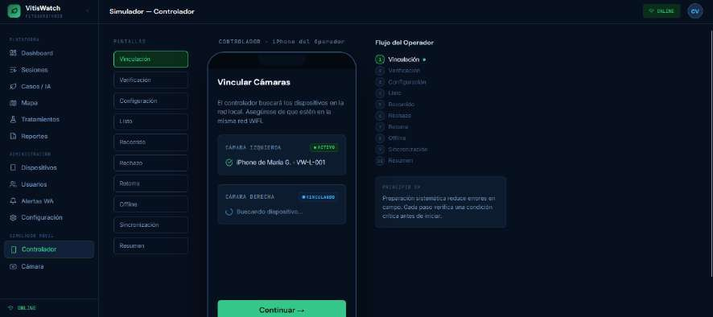

# Fig. 9.19 – Prototipo «Simulador – Controlador: flujo de vinculación de cámaras del operador» (web, prototipo inicial)

| Campo | Valor |
|---|---|
| Archivo de imagen | `01-documentacion-principal/media/image38.jpeg` |
| Tipo | Mockup de prototipo interactivo (tema oscuro) |
| Aparece en | [`capitulo-09-diseno-ux-ui.md`](../../01-documentacion-principal/capitulo-09-diseno-ux-ui.md) — 9.6. Prototipo interactivo |
| Fuente | Informe principal (versión revisada, noviembre 2026) |

## Qué muestra

Prototipo navegable que simula las pantallas del celular controlador, empezando por vincular las dos cámaras en la red Wi-Fi local.

## Transcripción

Menú lateral común de los mockups («VitisWatch · Fitosanitario»): PLATAFORMA — Dashboard · Sesiones · Casos / IA · Mapa · Tratamientos · Reportes; ADMINISTRACIÓN — Dispositivos · Usuarios · Alertas WA · Configuración; SIMULADOR MÓVIL — Controlador · Cámara. Arriba a la derecha: indicador «ONLINE» y avatar «CV».

«Simulador — Controlador». Columna «PANTALLAS»: Vinculación (activa) · Verificación · Configuración · Listo · Recorrido · Rechazo · Retoma · Offline · Sincronización · Resumen.
Teléfono simulado «CONTROLADOR · iPhone del Operador» — pantalla «Vincular Cámaras»: «El controlador buscará los dispositivos en la red local. Asegúrese de que estén en la misma red WiFi.» Tarjetas: «CÁMARA IZQUIERDA — ACTIVO — iPhone de María G. · VW-L-001» y «CÁMARA DERECHA — VINCULANDO — Buscando dispositivo…». Botón «Continuar →».
Panel «Flujo del Operador»: 1 Vinculación · 2 Verificación · 3 Configuración · 4 Listo · 5 Recorrido · 6 Rechazo · 7 Retoma · 8 Offline · 9 Sincronización · 10 Resumen. Recuadro «PRINCIPIO UX»: «Preparación sistemática reduce errores en campo. Cada paso verifica una condición crítica antes de iniciar.»

## Vigencia frente al sistema actual

> Corresponde al **prototipo de diseño inicial** del capítulo 9 (ver la «Nota de alcance» del capítulo). El sistema implementado difiere: no existen los módulos «Tratamientos», «Reportes en PDF» ni «Simulador» ni el perfil «Aplicador»; los reportes se descargan en CSV; los avisos van por Telegram (SC-02); la función del celular se elige como Controlador, Cámara 1 o Cámara 2; la web tiene tema claro y otra navegación. Las pantallas reales están en `03-manuales/`. En la app real la vinculación es por **código QR** que muestra el controlador y escanean las cámaras, seguida de la **prueba corta**.
