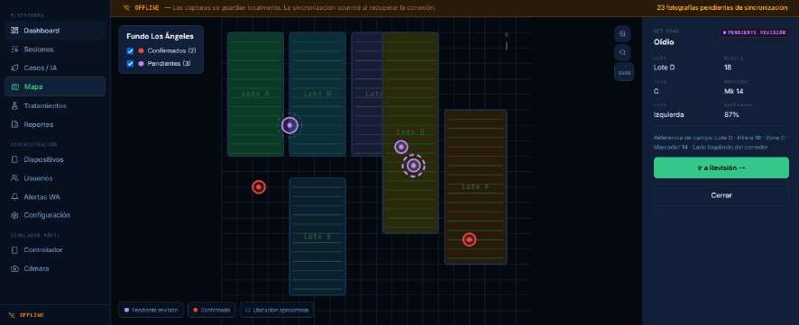

# Fig. 9.21 – Prototipo «Simulador – Mapa operativo en modo offline, con hallazgos pendientes de sincronización» (web, prototipo inicial)

| Campo | Valor |
|---|---|
| Archivo de imagen | `01-documentacion-principal/media/image40.jpeg` |
| Tipo | Mockup de prototipo interactivo (tema oscuro) |
| Aparece en | [`capitulo-09-diseno-ux-ui.md`](../../01-documentacion-principal/capitulo-09-diseno-ux-ui.md) — 9.6. Prototipo interactivo |
| Fuente | Informe principal (versión revisada, noviembre 2026) |

## Qué muestra

Muestra cómo se vería la plataforma sin conexión: los hallazgos siguen visibles y se avisa cuántas fotos faltan sincronizar.

## Transcripción

Menú lateral común de los mockups («VitisWatch · Fitosanitario»): PLATAFORMA — Dashboard · Sesiones · Casos / IA · Mapa · Tratamientos · Reportes; ADMINISTRACIÓN — Dispositivos · Usuarios · Alertas WA · Configuración; SIMULADOR MÓVIL — Controlador · Cámara. Arriba a la derecha: indicador «ONLINE» y avatar «CV».

- Barra superior naranja: «OFFLINE — Las capturas se guardan localmente. La sincronización ocurrirá al recuperar la conexión.» · «23 fotografías pendientes de sincronización».
- Mapa esquemático igual al de la Fig. 9.14 (Fundo Los Ángeles; capas Confirmados (2) y Pendientes (3); lotes A a F; leyenda Pendiente revisión · Confirmado · Ubicación aproximada).
- Panel derecho del hallazgo seleccionado: «DET-0048 · Oídio · PENDIENTE REVISIÓN» · Lote D · Hilera 18 · Zona C · Marcador Mk 14 · Lado Izquierda · Confianza 87 % · «Referencia de campo: Lote D · Hilera 18 · Zona C · Marcador 14 · Lado izquierdo del corredor» · botones «Ir a Revisión →» y «Cerrar». Pie del menú: indicador «OFFLINE».

## Vigencia frente al sistema actual

> Corresponde al **prototipo de diseño inicial** del capítulo 9 (ver la «Nota de alcance» del capítulo). El sistema implementado difiere: no existen los módulos «Tratamientos», «Reportes en PDF» ni «Simulador» ni el perfil «Aplicador»; los reportes se descargan en CSV; los avisos van por Telegram (SC-02); la función del celular se elige como Controlador, Cámara 1 o Cámara 2; la web tiene tema claro y otra navegación. Las pantallas reales están en `03-manuales/`. La web real no tiene modo sin conexión: el trabajo sin internet ocurre solo en la app; la web siempre consulta el servidor.
