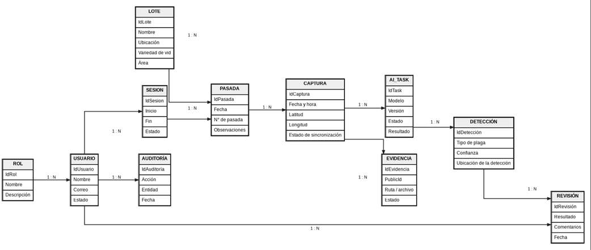

# Modelo conceptual de datos (10.1)

| Campo | Valor |
|---|---|
| Archivo de imagen | `01-documentacion-principal/media/image41.png` |
| Tipo | Diagrama entidad-relación conceptual |
| Aparece en | [`capitulo-10-base-de-datos.md`](../../01-documentacion-principal/capitulo-10-base-de-datos.md) — 10.1. Modelo conceptual |
| Fuente | Informe principal (versión revisada, noviembre 2026) |

## Qué muestra

Entidades principales y cómo se relacionan: un usuario hace sesiones; cada pasada pertenece a un lote y una sesión; cada captura genera evidencias y tareas de IA; cada tarea produce detecciones que el especialista revisa.

## Transcripción

| Entidad | Atributos |
|---|---|
| ROL | IdRol · Nombre · Descripción |
| USUARIO | IdUsuario · Nombre · Correo · Estado |
| AUDITORÍA | IdAuditoría · Acción · Entidad · Fecha |
| LOTE | IdLote · Nombre · Ubicación · Variedad de vid · Área |
| SESIÓN | IdSesion · Inicio · Fin · Estado |
| PASADA | IdPasada · Fecha · N° de pasada · Observaciones |
| CAPTURA | idCaptura · Fecha y hora · Latitud · Longitud · Estado de sincronización |
| EVIDENCIA | IdEvidencia · PublicId · Ruta / archivo · Estado |
| AI_TASK | IdTask · Modelo · Versión · Estado · Resultado |
| DETECCIÓN | IdDetección · Tipo de plaga · Confianza · Ubicación de la detección |
| REVISIÓN | IdRevisión · Resultado · Comentarios · Fecha |

Relaciones (todas 1 : N): ROL → USUARIO · USUARIO → SESIÓN · USUARIO → AUDITORÍA · USUARIO → REVISIÓN · LOTE → PASADA · SESIÓN → PASADA · PASADA → CAPTURA · CAPTURA → EVIDENCIA · CAPTURA → AI_TASK · AI_TASK → DETECCIÓN · DETECCIÓN → REVISIÓN.

## Vigencia frente al sistema actual

> Modelo de datos **del diseño inicial** (ver la «Nota de alcance» del capítulo 10). La base real la crean las migraciones de Django y tiene otras tablas y nombres (users, devices, field_lots, field_rows, field_segments, markers, monitoring_sessions, monitoring_passes, capture_sequences, captures, quality_results, model_configs, ai_tasks, detections, review_cases, human_reviews, notifications, audit_events…). Ver `05-repositorios-de-codigo/plataforma-web/docs/ARQUITECTURA_DATOS.md` y `00-contexto/03-arquitectura-y-tecnologias.md`.
